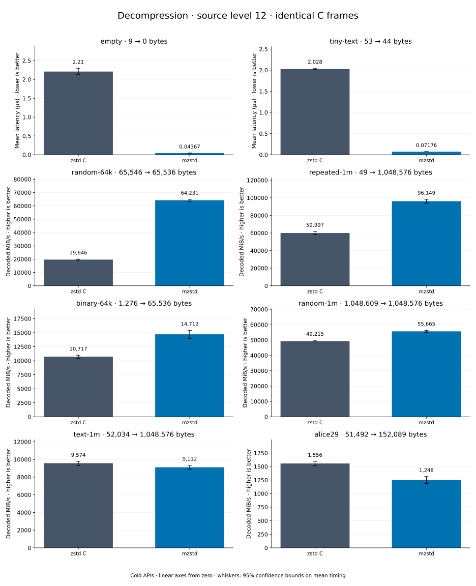

# Decompression of level 12 frames

[Decoder overview](README.md) · [Benchmark index](../README.md)

Recorded run: **long-20261109** (2026-11-09).
[CSV](../decoder-comparison.csv) · [Environment](../decoder-comparison-environment.json) · [Methodology and limits](../decoder-comparison.md).

Level belongs to the C encoder that prepared the frame; decoders have no level setting.
Both decoders restore the same bytes.

## Median speed across 8 datasets

Median of per-dataset C mean time / decoder mean time ratios, with equal weight.
Higher is faster; 1× matches C. No confidence interval
is inferred for this across-dataset median.

| Decoder | Median speed / C |
| --- | ---: |
| zstd C | 1.000× |
| mzstd | 1.591× |

Datasets are ranked by mzstd speed relative to C, highest first.
Throughput counts restored bytes; empty input has latency only. Whiskers and intervals
describe sampling uncertainty, not all host variation. Cold APIs include allocation
and disposal. C reads the frame's content size and decodes into a buffer of exactly
that size; mzstd returns its own vector.

## empty

Empty input; measures API overhead.

**9 compressed → 0 restored bytes; compressed / original: undefined.**

| Decoder | Mean µs | 95% mean interval µs | Decoded MiB/s | Speed / C |
| --- | ---: | ---: | ---: | ---: |
| zstd C | 2.225 | 2.168–2.285 | — | 1.000× |
| mzstd | 0.04463 | 0.04284–0.04646 | — | 49.850× |

## tiny-text

44-byte quick-brown-fox sentence.

**53 compressed → 44 restored bytes; compressed / original: 120.455%.**

| Decoder | Mean µs | 95% mean interval µs | Decoded MiB/s | Speed / C |
| --- | ---: | ---: | ---: | ---: |
| zstd C | 2.031 | 1.978–2.091 | 20.66 | 1.000× |
| mzstd | 0.05169 | 0.04981–0.05385 | 811.73 | 39.293× |

## random-64k

64 KiB prefix of the deterministic pseudorandom corpus.

**65,546 compressed → 65,536 restored bytes; compressed / original: 100.015%.**

| Decoder | Mean µs | 95% mean interval µs | Decoded MiB/s | Speed / C |
| --- | ---: | ---: | ---: | ---: |
| zstd C | 2.984 | 2.909–3.067 | 20,948.48 | 1.000× |
| mzstd | 0.9015 | 0.8957–0.9084 | 69,327.13 | 3.309× |

## repeated-1m

1 MiB of repeated a bytes.

**49 compressed → 1,048,576 restored bytes; compressed / original: 0.005%.**

| Decoder | Mean µs | 95% mean interval µs | Decoded MiB/s | Speed / C |
| --- | ---: | ---: | ---: | ---: |
| zstd C | 17.54 | 17.09–17.97 | 57,016.25 | 1.000× |
| mzstd | 10.56 | 10.33–10.81 | 94,653.90 | 1.660× |

## binary-64k

64 KiB of structured binary bytes: ((i / 16) XOR i) modulo 256.

**1,276 compressed → 65,536 restored bytes; compressed / original: 1.947%.**

| Decoder | Mean µs | 95% mean interval µs | Decoded MiB/s | Speed / C |
| --- | ---: | ---: | ---: | ---: |
| zstd C | 6.587 | 6.267–6.928 | 9,488.05 | 1.000× |
| mzstd | 4.33 | 4.168–4.508 | 14,435.58 | 1.521× |

## random-1m

1 MiB of deterministic xorshift64 pseudorandom bytes.

**1,048,609 compressed → 1,048,576 restored bytes; compressed / original: 100.003%.**

| Decoder | Mean µs | 95% mean interval µs | Decoded MiB/s | Speed / C |
| --- | ---: | ---: | ---: | ---: |
| zstd C | 19.92 | 19.66–20.2 | 50,200.53 | 1.000× |
| mzstd | 17.16 | 17.03–17.3 | 58,286.72 | 1.161× |

## text-1m

Alice text repeated cyclically to 1 MiB.

**52,034 compressed → 1,048,576 restored bytes; compressed / original: 4.962%.**

| Decoder | Mean µs | 95% mean interval µs | Decoded MiB/s | Speed / C |
| --- | ---: | ---: | ---: | ---: |
| zstd C | 100.6 | 99.23–102.4 | 9,937.21 | 1.000× |
| mzstd | 104.1 | 102.9–105.6 | 9,609.88 | 0.967× |

## alice29

Alice in Wonderland text from the Canterbury corpus (`testdata/alice29.txt`).

**51,492 compressed → 152,089 restored bytes; compressed / original: 33.856%.**

| Decoder | Mean µs | 95% mean interval µs | Decoded MiB/s | Speed / C |
| --- | ---: | ---: | ---: | ---: |
| zstd C | 95.56 | 91.75–99.98 | 1,517.85 | 1.000× |
| mzstd | 100.5 | 97.48–104 | 1,442.87 | 0.951× |
