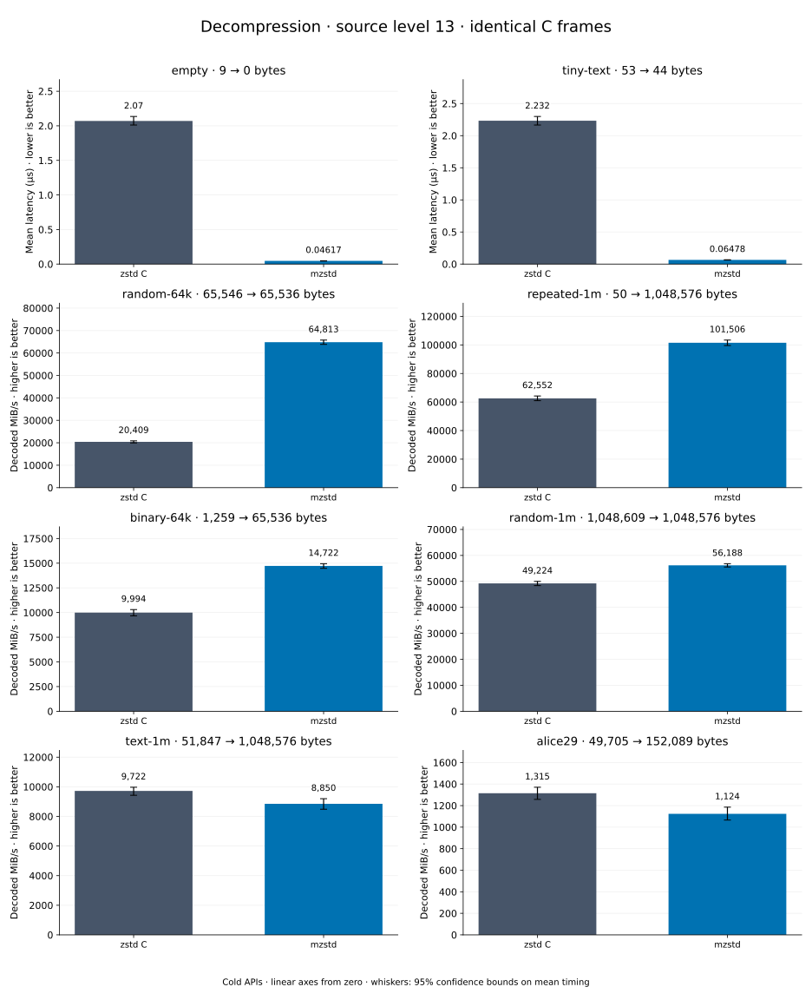

# Decompression of level 13 frames

[Decoder overview](README.md) · [Benchmark index](../README.md)

Recorded run: **long-20261109** (2026-11-09).
[CSV](../decoder-comparison.csv) · [Environment](../decoder-comparison-environment.json) · [Methodology and limits](../decoder-comparison.md).

Level belongs to the C encoder that prepared the frame; decoders have no level setting.
Both decoders restore the same bytes.

## Median speed across 8 datasets

Median of per-dataset C mean time / decoder mean time ratios, with equal weight.
Higher is faster; 1× matches C. No confidence interval
is inferred for this across-dataset median.

| Decoder | Median speed / C |
| --- | ---: |
| zstd C | 1.000× |
| mzstd | 1.492× |

Datasets are ranked by mzstd speed relative to C, highest first.
Throughput counts restored bytes; empty input has latency only. Whiskers and intervals
describe sampling uncertainty, not all host variation. Cold APIs include allocation
and disposal. C reads the frame's content size and decodes into a buffer of exactly
that size; mzstd returns its own vector.

## empty

Empty input; measures API overhead.

**9 compressed → 0 restored bytes; compressed / original: undefined.**

| Decoder | Mean µs | 95% mean interval µs | Decoded MiB/s | Speed / C |
| --- | ---: | ---: | ---: | ---: |
| zstd C | 2.259 | 2.196–2.323 | — | 1.000× |
| mzstd | 0.04026 | 0.03867–0.04205 | — | 56.115× |

## tiny-text

44-byte quick-brown-fox sentence.

**53 compressed → 44 restored bytes; compressed / original: 120.455%.**

| Decoder | Mean µs | 95% mean interval µs | Decoded MiB/s | Speed / C |
| --- | ---: | ---: | ---: | ---: |
| zstd C | 1.965 | 1.938–1.996 | 21.36 | 1.000× |
| mzstd | 0.0536 | 0.05139–0.056 | 782.84 | 36.654× |

## random-64k

64 KiB prefix of the deterministic pseudorandom corpus.

**65,546 compressed → 65,536 restored bytes; compressed / original: 100.015%.**

| Decoder | Mean µs | 95% mean interval µs | Decoded MiB/s | Speed / C |
| --- | ---: | ---: | ---: | ---: |
| zstd C | 2.92 | 2.864–2.983 | 21,405.60 | 1.000× |
| mzstd | 0.91 | 0.8992–0.9217 | 68,684.17 | 3.209× |

## repeated-1m

1 MiB of repeated a bytes.

**50 compressed → 1,048,576 restored bytes; compressed / original: 0.005%.**

| Decoder | Mean µs | 95% mean interval µs | Decoded MiB/s | Speed / C |
| --- | ---: | ---: | ---: | ---: |
| zstd C | 15.5 | 15.08–15.95 | 64,516.25 | 1.000× |
| mzstd | 9.935 | 9.664–10.23 | 100,654.74 | 1.560× |

## binary-64k

64 KiB of structured binary bytes: ((i / 16) XOR i) modulo 256.

**1,259 compressed → 65,536 restored bytes; compressed / original: 1.921%.**

| Decoder | Mean µs | 95% mean interval µs | Decoded MiB/s | Speed / C |
| --- | ---: | ---: | ---: | ---: |
| zstd C | 6.723 | 6.445–7.023 | 9,296.29 | 1.000× |
| mzstd | 4.723 | 4.488–4.982 | 13,232.54 | 1.423× |

## random-1m

1 MiB of deterministic xorshift64 pseudorandom bytes.

**1,048,609 compressed → 1,048,576 restored bytes; compressed / original: 100.003%.**

| Decoder | Mean µs | 95% mean interval µs | Decoded MiB/s | Speed / C |
| --- | ---: | ---: | ---: | ---: |
| zstd C | 19.63 | 19.34–19.93 | 50,950.51 | 1.000× |
| mzstd | 16.93 | 16.69–17.2 | 59,062.32 | 1.159× |

## text-1m

Alice text repeated cyclically to 1 MiB.

**51,847 compressed → 1,048,576 restored bytes; compressed / original: 4.945%.**

| Decoder | Mean µs | 95% mean interval µs | Decoded MiB/s | Speed / C |
| --- | ---: | ---: | ---: | ---: |
| zstd C | 105 | 101.6–109.1 | 9,522.54 | 1.000× |
| mzstd | 104.8 | 103–107.4 | 9,541.63 | 1.002× |

## alice29

Alice in Wonderland text from the Canterbury corpus (`testdata/alice29.txt`).

**49,705 compressed → 152,089 restored bytes; compressed / original: 32.682%.**

| Decoder | Mean µs | 95% mean interval µs | Decoded MiB/s | Speed / C |
| --- | ---: | ---: | ---: | ---: |
| zstd C | 104.1 | 100.4–108.5 | 1,392.90 | 1.000× |
| mzstd | 105.7 | 104.1–107.7 | 1,372.45 | 0.985× |
