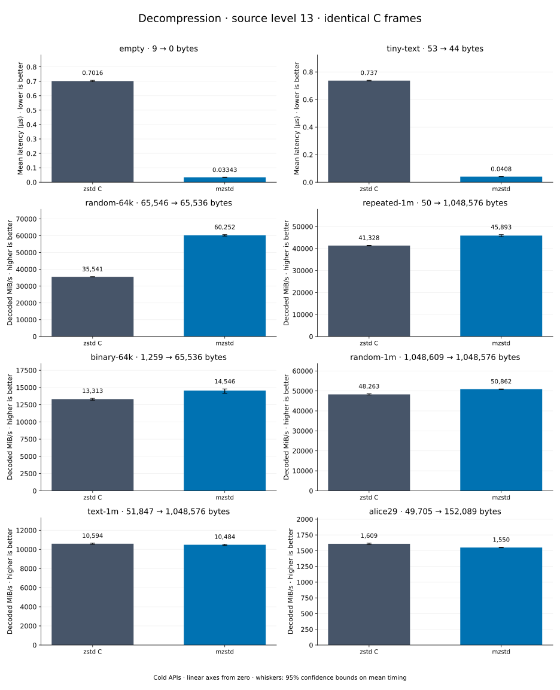

# Decompression of level 13 frames

[Decoder overview](README.md) · [Benchmark index](../README.md)

Recorded run: **dec-20261018** (2026-10-18).
[CSV](../decoder-comparison.csv) · [Environment](../decoder-comparison-environment.json) · [Methodology and limits](../decoder-comparison.md).

Level belongs to the C encoder that prepared the frame; decoders have no level setting.
Both decoders restore the same bytes.

## Median speed across 8 datasets

Median of per-dataset C mean time / decoder mean time ratios, with equal weight.
Higher is faster; 1× matches C. No confidence interval
is inferred for this across-dataset median.

| Decoder | Median speed / C |
| --- | ---: |
| zstd C | 1.000× |
| mzstd | 1.102× |

Datasets are ranked by mzstd speed relative to C, highest first.
Throughput counts restored bytes; empty input has latency only. Whiskers and intervals
describe sampling uncertainty, not all host variation. Cold APIs include allocation
and disposal. C reads the frame's content size and decodes into a buffer of exactly
that size; mzstd returns its own vector.

## empty

Empty input; measures API overhead.

**9 compressed → 0 restored bytes; compressed / original: undefined.**

| Decoder | Mean µs | 95% mean interval µs | Decoded MiB/s | Speed / C |
| --- | ---: | ---: | ---: | ---: |
| zstd C | 0.7016 | 0.698–0.7063 | — | 1.000× |
| mzstd | 0.03343 | 0.03313–0.03372 | — | 20.988× |

## tiny-text

44-byte quick-brown-fox sentence.

**53 compressed → 44 restored bytes; compressed / original: 120.455%.**

| Decoder | Mean µs | 95% mean interval µs | Decoded MiB/s | Speed / C |
| --- | ---: | ---: | ---: | ---: |
| zstd C | 0.737 | 0.7356–0.739 | 56.93 | 1.000× |
| mzstd | 0.0408 | 0.04056–0.04103 | 1,028.47 | 18.064× |

## random-64k

64 KiB prefix of the deterministic pseudorandom corpus.

**65,546 compressed → 65,536 restored bytes; compressed / original: 100.015%.**

| Decoder | Mean µs | 95% mean interval µs | Decoded MiB/s | Speed / C |
| --- | ---: | ---: | ---: | ---: |
| zstd C | 1.759 | 1.755–1.762 | 35,540.77 | 1.000× |
| mzstd | 1.037 | 1.031–1.045 | 60,251.64 | 1.695× |

## repeated-1m

1 MiB of repeated a bytes.

**50 compressed → 1,048,576 restored bytes; compressed / original: 0.005%.**

| Decoder | Mean µs | 95% mean interval µs | Decoded MiB/s | Speed / C |
| --- | ---: | ---: | ---: | ---: |
| zstd C | 24.2 | 24.12–24.28 | 41,327.79 | 1.000× |
| mzstd | 21.79 | 21.59–22.04 | 45,892.81 | 1.110× |

## binary-64k

64 KiB of structured binary bytes: ((i / 16) XOR i) modulo 256.

**1,259 compressed → 65,536 restored bytes; compressed / original: 1.921%.**

| Decoder | Mean µs | 95% mean interval µs | Decoded MiB/s | Speed / C |
| --- | ---: | ---: | ---: | ---: |
| zstd C | 4.695 | 4.657–4.75 | 13,312.50 | 1.000× |
| mzstd | 4.297 | 4.226–4.417 | 14,546.12 | 1.093× |

## random-1m

1 MiB of deterministic xorshift64 pseudorandom bytes.

**1,048,609 compressed → 1,048,576 restored bytes; compressed / original: 100.003%.**

| Decoder | Mean µs | 95% mean interval µs | Decoded MiB/s | Speed / C |
| --- | ---: | ---: | ---: | ---: |
| zstd C | 20.72 | 20.6–20.85 | 48,263.12 | 1.000× |
| mzstd | 19.66 | 19.61–19.71 | 50,862.09 | 1.054× |

## text-1m

Alice text repeated cyclically to 1 MiB.

**51,847 compressed → 1,048,576 restored bytes; compressed / original: 4.945%.**

| Decoder | Mean µs | 95% mean interval µs | Decoded MiB/s | Speed / C |
| --- | ---: | ---: | ---: | ---: |
| zstd C | 94.39 | 93.91–94.91 | 10,594.05 | 1.000× |
| mzstd | 95.39 | 94.93–96.08 | 10,483.73 | 0.990× |

## alice29

Alice in Wonderland text from the Canterbury corpus (`testdata/alice29.txt`).

**49,705 compressed → 152,089 restored bytes; compressed / original: 32.682%.**

| Decoder | Mean µs | 95% mean interval µs | Decoded MiB/s | Speed / C |
| --- | ---: | ---: | ---: | ---: |
| zstd C | 90.13 | 89.61–90.72 | 1,609.29 | 1.000× |
| mzstd | 93.56 | 93.32–93.82 | 1,550.32 | 0.963× |
