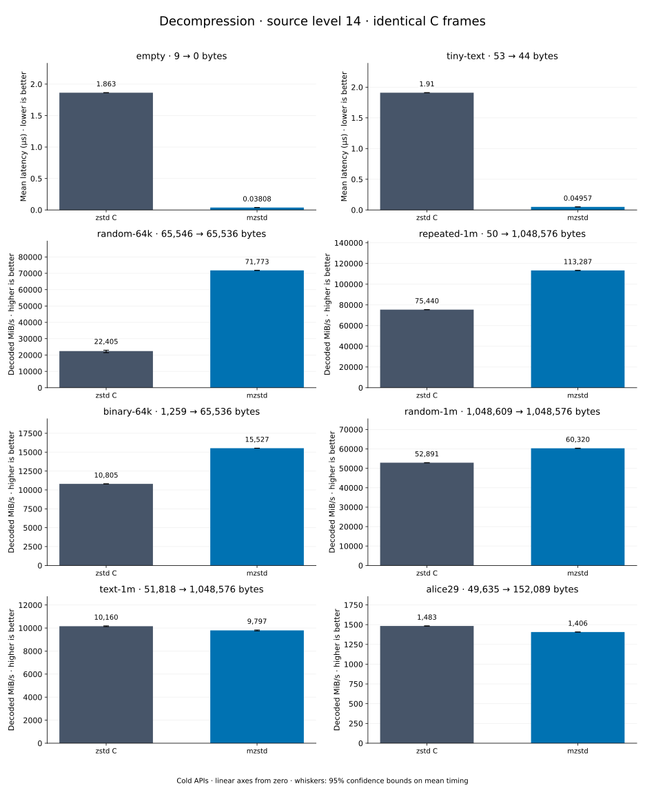

# Decompression of level 14 frames

[Decoder overview](README.md) · [Benchmark index](../README.md)

Recorded run: **dec-20261018** (2026-10-18).
[CSV](../decoder-comparison.csv) · [Environment](../decoder-comparison-environment.json) · [Methodology and limits](../decoder-comparison.md).

Level belongs to the C encoder that prepared the frame; decoders have no level setting.
Both decoders restore the same bytes.

## Median speed across 8 datasets

Median of per-dataset C mean time / decoder mean time ratios, with equal weight.
Higher is faster; 1× matches C. No confidence interval
is inferred for this across-dataset median.

| Decoder | Median speed / C |
| --- | ---: |
| zstd C | 1.000× |
| mzstd | 1.099× |

Datasets are ranked by mzstd speed relative to C, highest first.
Throughput counts restored bytes; empty input has latency only. Whiskers and intervals
describe sampling uncertainty, not all host variation. Cold APIs include allocation
and disposal. C reads the frame's content size and decodes into a buffer of exactly
that size; mzstd returns its own vector.

## empty

Empty input; measures API overhead.

**9 compressed → 0 restored bytes; compressed / original: undefined.**

| Decoder | Mean µs | 95% mean interval µs | Decoded MiB/s | Speed / C |
| --- | ---: | ---: | ---: | ---: |
| zstd C | 0.7009 | 0.6982–0.7043 | — | 1.000× |
| mzstd | 0.03354 | 0.0332–0.03399 | — | 20.897× |

## tiny-text

44-byte quick-brown-fox sentence.

**53 compressed → 44 restored bytes; compressed / original: 120.455%.**

| Decoder | Mean µs | 95% mean interval µs | Decoded MiB/s | Speed / C |
| --- | ---: | ---: | ---: | ---: |
| zstd C | 0.7357 | 0.7349–0.7365 | 57.04 | 1.000× |
| mzstd | 0.04087 | 0.04068–0.04102 | 1,026.84 | 18.003× |

## random-64k

64 KiB prefix of the deterministic pseudorandom corpus.

**65,546 compressed → 65,536 restored bytes; compressed / original: 100.015%.**

| Decoder | Mean µs | 95% mean interval µs | Decoded MiB/s | Speed / C |
| --- | ---: | ---: | ---: | ---: |
| zstd C | 1.766 | 1.76–1.776 | 35,381.31 | 1.000× |
| mzstd | 1.04 | 1.03–1.053 | 60,084.82 | 1.698× |

## repeated-1m

1 MiB of repeated a bytes.

**50 compressed → 1,048,576 restored bytes; compressed / original: 0.005%.**

| Decoder | Mean µs | 95% mean interval µs | Decoded MiB/s | Speed / C |
| --- | ---: | ---: | ---: | ---: |
| zstd C | 24.16 | 24.07–24.27 | 41,386.78 | 1.000× |
| mzstd | 21.97 | 21.8–22.14 | 45,526.09 | 1.100× |

## binary-64k

64 KiB of structured binary bytes: ((i / 16) XOR i) modulo 256.

**1,259 compressed → 65,536 restored bytes; compressed / original: 1.921%.**

| Decoder | Mean µs | 95% mean interval µs | Decoded MiB/s | Speed / C |
| --- | ---: | ---: | ---: | ---: |
| zstd C | 4.674 | 4.653–4.705 | 13,370.54 | 1.000× |
| mzstd | 4.258 | 4.241–4.281 | 14,677.51 | 1.098× |

## random-1m

1 MiB of deterministic xorshift64 pseudorandom bytes.

**1,048,609 compressed → 1,048,576 restored bytes; compressed / original: 100.003%.**

| Decoder | Mean µs | 95% mean interval µs | Decoded MiB/s | Speed / C |
| --- | ---: | ---: | ---: | ---: |
| zstd C | 22.18 | 22.11–22.26 | 45,093.57 | 1.000× |
| mzstd | 21.33 | 21.24–21.43 | 46,879.59 | 1.040× |

## text-1m

Alice text repeated cyclically to 1 MiB.

**51,818 compressed → 1,048,576 restored bytes; compressed / original: 4.942%.**

| Decoder | Mean µs | 95% mean interval µs | Decoded MiB/s | Speed / C |
| --- | ---: | ---: | ---: | ---: |
| zstd C | 93.66 | 93.26–94.19 | 10,676.88 | 1.000× |
| mzstd | 95.19 | 94.64–95.85 | 10,505.51 | 0.984× |

## alice29

Alice in Wonderland text from the Canterbury corpus (`testdata/alice29.txt`).

**49,635 compressed → 152,089 restored bytes; compressed / original: 32.635%.**

| Decoder | Mean µs | 95% mean interval µs | Decoded MiB/s | Speed / C |
| --- | ---: | ---: | ---: | ---: |
| zstd C | 90.27 | 89.49–91.19 | 1,606.69 | 1.000× |
| mzstd | 94.33 | 93.97–94.73 | 1,537.57 | 0.957× |
