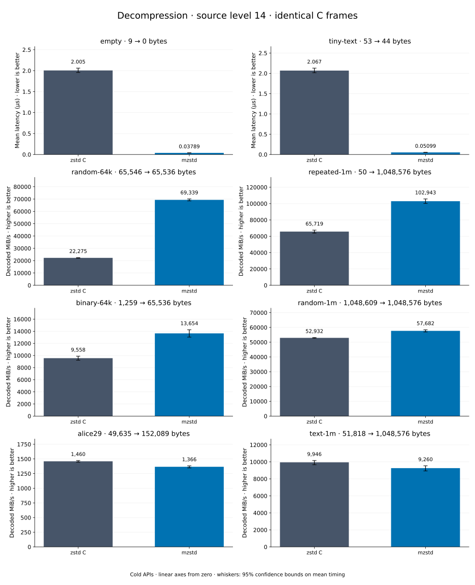

# Decompression of level 14 frames

[Decoder overview](README.md) · [Benchmark index](../README.md)

Recorded run: **long-20261112** (2026-11-12).
[CSV](../decoder-comparison.csv) · [Environment](../decoder-comparison-environment.json) · [Methodology and limits](../decoder-comparison.md).

Level belongs to the C encoder that prepared the frame; decoders have no level setting.
Both decoders restore the same bytes.

## Median speed across 8 datasets

Median of per-dataset C mean time / decoder mean time ratios, with equal weight.
Higher is faster; 1× matches C. No confidence interval
is inferred for this across-dataset median.

| Decoder | Median speed / C |
| --- | ---: |
| zstd C | 1.000× |
| mzstd | 1.521× |

Datasets are ranked by mzstd speed relative to C, highest first.
Throughput counts restored bytes; empty input has latency only. Whiskers and intervals
describe sampling uncertainty, not all host variation. Cold APIs include allocation
and disposal. C reads the frame's content size and decodes into a buffer of exactly
that size; mzstd returns its own vector.

## empty

Empty input; measures API overhead.

**9 compressed → 0 restored bytes; compressed / original: undefined.**

| Decoder | Mean µs | 95% mean interval µs | Decoded MiB/s | Speed / C |
| --- | ---: | ---: | ---: | ---: |
| zstd C | 1.98 | 1.949–2.017 | — | 1.000× |
| mzstd | 0.04334 | 0.04183–0.04497 | — | 45.682× |

## tiny-text

44-byte quick-brown-fox sentence.

**53 compressed → 44 restored bytes; compressed / original: 120.455%.**

| Decoder | Mean µs | 95% mean interval µs | Decoded MiB/s | Speed / C |
| --- | ---: | ---: | ---: | ---: |
| zstd C | 2.214 | 2.155–2.275 | 18.95 | 1.000× |
| mzstd | 0.06145 | 0.06051–0.06248 | 682.83 | 36.030× |

## random-64k

64 KiB prefix of the deterministic pseudorandom corpus.

**65,546 compressed → 65,536 restored bytes; compressed / original: 100.015%.**

| Decoder | Mean µs | 95% mean interval µs | Decoded MiB/s | Speed / C |
| --- | ---: | ---: | ---: | ---: |
| zstd C | 3.134 | 3.049–3.224 | 19,941.26 | 1.000× |
| mzstd | 0.9939 | 0.98–1.008 | 62,883.35 | 3.153× |

## repeated-1m

1 MiB of repeated a bytes.

**50 compressed → 1,048,576 restored bytes; compressed / original: 0.005%.**

| Decoder | Mean µs | 95% mean interval µs | Decoded MiB/s | Speed / C |
| --- | ---: | ---: | ---: | ---: |
| zstd C | 15.97 | 15.5–16.45 | 62,621.22 | 1.000× |
| mzstd | 9.93 | 9.753–10.12 | 100,702.24 | 1.608× |

## binary-64k

64 KiB of structured binary bytes: ((i / 16) XOR i) modulo 256.

**1,259 compressed → 65,536 restored bytes; compressed / original: 1.921%.**

| Decoder | Mean µs | 95% mean interval µs | Decoded MiB/s | Speed / C |
| --- | ---: | ---: | ---: | ---: |
| zstd C | 6.659 | 6.339–7.001 | 9,386.34 | 1.000× |
| mzstd | 4.644 | 4.424–4.888 | 13,456.95 | 1.434× |

## random-1m

1 MiB of deterministic xorshift64 pseudorandom bytes.

**1,048,609 compressed → 1,048,576 restored bytes; compressed / original: 100.003%.**

| Decoder | Mean µs | 95% mean interval µs | Decoded MiB/s | Speed / C |
| --- | ---: | ---: | ---: | ---: |
| zstd C | 20.18 | 19.96–20.41 | 49,565.90 | 1.000× |
| mzstd | 17.86 | 17.68–18.05 | 55,983.61 | 1.129× |

## alice29

Alice in Wonderland text from the Canterbury corpus (`testdata/alice29.txt`).

**49,635 compressed → 152,089 restored bytes; compressed / original: 32.635%.**

| Decoder | Mean µs | 95% mean interval µs | Decoded MiB/s | Speed / C |
| --- | ---: | ---: | ---: | ---: |
| zstd C | 106.6 | 103.3–110.5 | 1,360.14 | 1.000× |
| mzstd | 117.6 | 112.3–123.7 | 1,233.37 | 0.907× |

## text-1m

Alice text repeated cyclically to 1 MiB.

**51,818 compressed → 1,048,576 restored bytes; compressed / original: 4.942%.**

| Decoder | Mean µs | 95% mean interval µs | Decoded MiB/s | Speed / C |
| --- | ---: | ---: | ---: | ---: |
| zstd C | 110.3 | 105.1–116.1 | 9,067.09 | 1.000× |
| mzstd | 123.1 | 116.1–130.5 | 8,121.90 | 0.896× |
