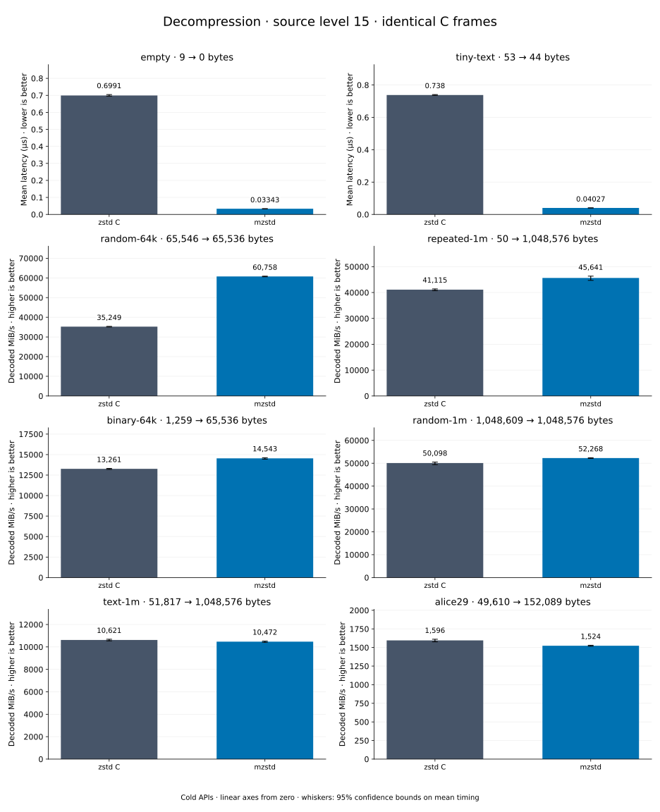

# Decompression of level 15 frames

[Decoder overview](README.md) · [Benchmark index](../README.md)

Recorded run: **dec-20261014-speed** (2026-10-14).
[CSV](../decoder-comparison.csv) · [Environment](../decoder-comparison-environment.json) · [Methodology and limits](../decoder-comparison.md).

Level belongs to the C encoder that prepared the frame; decoders have no level setting.
Both decoders restore the same bytes.

## Median speed across 8 datasets

Median of per-dataset C mean time / decoder mean time ratios, with equal weight.
Higher is faster; 1× matches C. No confidence interval
is inferred for this across-dataset median.

| Decoder | Median speed / C |
| --- | ---: |
| zstd C | 1.000× |
| mzstd | 1.001× |

Datasets are ranked by mzstd speed relative to C, highest first.
Throughput counts restored bytes; empty input has latency only. Whiskers and intervals
describe sampling uncertainty, not all host variation. Cold APIs include allocation
and disposal. C reads the frame's content size and decodes into a buffer of exactly
that size; mzstd returns its own vector.

## empty

Empty input; measures API overhead.

**9 compressed → 0 restored bytes; compressed / original: undefined.**

| Decoder | Mean µs | 95% mean interval µs | Decoded MiB/s | Speed / C |
| --- | ---: | ---: | ---: | ---: |
| zstd C | 0.7055 | 0.7033–0.7091 | — | 1.000× |
| mzstd | 0.02976 | 0.02966–0.02987 | — | 23.711× |

## tiny-text

44-byte quick-brown-fox sentence.

**53 compressed → 44 restored bytes; compressed / original: 120.455%.**

| Decoder | Mean µs | 95% mean interval µs | Decoded MiB/s | Speed / C |
| --- | ---: | ---: | ---: | ---: |
| zstd C | 0.7613 | 0.7553–0.7692 | 55.12 | 1.000× |
| mzstd | 0.03711 | 0.03653–0.03794 | 1,130.74 | 20.516× |

## random-64k

64 KiB prefix of the deterministic pseudorandom corpus.

**65,546 compressed → 65,536 restored bytes; compressed / original: 100.015%.**

| Decoder | Mean µs | 95% mean interval µs | Decoded MiB/s | Speed / C |
| --- | ---: | ---: | ---: | ---: |
| zstd C | 1.774 | 1.77–1.78 | 35,221.91 | 1.000× |
| mzstd | 1.018 | 1.015–1.022 | 61,393.68 | 1.743× |

## random-1m

1 MiB of deterministic xorshift64 pseudorandom bytes.

**1,048,609 compressed → 1,048,576 restored bytes; compressed / original: 100.003%.**

| Decoder | Mean µs | 95% mean interval µs | Decoded MiB/s | Speed / C |
| --- | ---: | ---: | ---: | ---: |
| zstd C | 21.24 | 21.12–21.37 | 47,083.65 | 1.000× |
| mzstd | 20.59 | 20.41–20.79 | 48,557.75 | 1.031× |

## binary-64k

64 KiB of structured binary bytes: ((i / 16) XOR i) modulo 256.

**1,259 compressed → 65,536 restored bytes; compressed / original: 1.921%.**

| Decoder | Mean µs | 95% mean interval µs | Decoded MiB/s | Speed / C |
| --- | ---: | ---: | ---: | ---: |
| zstd C | 4.825 | 4.779–4.87 | 12,953.67 | 1.000× |
| mzstd | 4.97 | 4.926–5.026 | 12,574.80 | 0.971× |

## alice29

Alice in Wonderland text from the Canterbury corpus (`testdata/alice29.txt`).

**49,610 compressed → 152,089 restored bytes; compressed / original: 32.619%.**

| Decoder | Mean µs | 95% mean interval µs | Decoded MiB/s | Speed / C |
| --- | ---: | ---: | ---: | ---: |
| zstd C | 90.59 | 90.37–90.81 | 1,601.03 | 1.000× |
| mzstd | 98.45 | 98.22–98.71 | 1,473.34 | 0.920× |

## repeated-1m

1 MiB of repeated a bytes.

**50 compressed → 1,048,576 restored bytes; compressed / original: 0.005%.**

| Decoder | Mean µs | 95% mean interval µs | Decoded MiB/s | Speed / C |
| --- | ---: | ---: | ---: | ---: |
| zstd C | 24.69 | 24.55–24.84 | 40,505.99 | 1.000× |
| mzstd | 27.05 | 26.97–27.13 | 36,972.75 | 0.913× |

## text-1m

Alice text repeated cyclically to 1 MiB.

**51,817 compressed → 1,048,576 restored bytes; compressed / original: 4.942%.**

| Decoder | Mean µs | 95% mean interval µs | Decoded MiB/s | Speed / C |
| --- | ---: | ---: | ---: | ---: |
| zstd C | 95.51 | 94.71–96.29 | 10,470.60 | 1.000× |
| mzstd | 111.2 | 110.1–112.5 | 8,996.55 | 0.859× |
