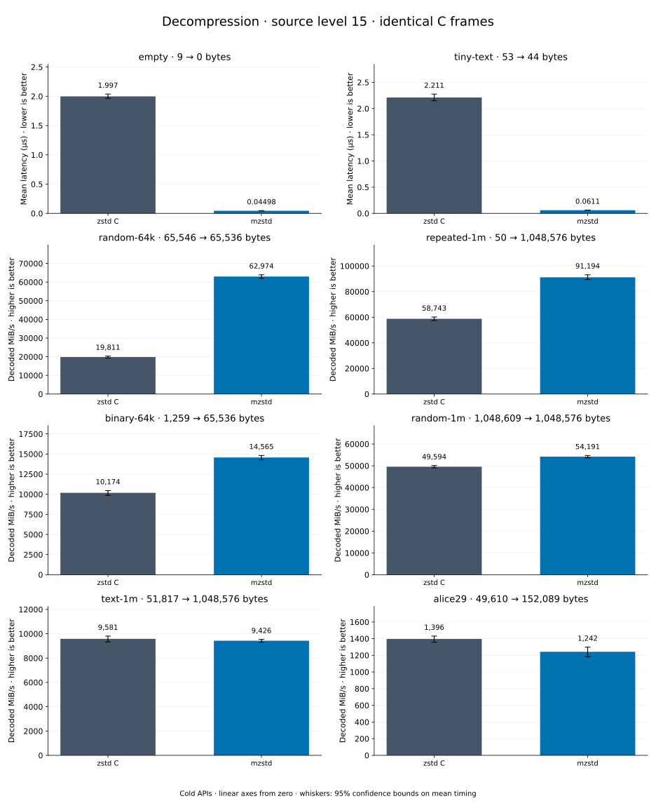

# Decompression of level 15 frames

[Decoder overview](README.md) · [Benchmark index](../README.md)

Recorded run: **long-20261112** (2026-11-12).
[CSV](../decoder-comparison.csv) · [Environment](../decoder-comparison-environment.json) · [Methodology and limits](../decoder-comparison.md).

Level belongs to the C encoder that prepared the frame; decoders have no level setting.
Both decoders restore the same bytes.

## Median speed across 8 datasets

Median of per-dataset C mean time / decoder mean time ratios, with equal weight.
Higher is faster; 1× matches C. No confidence interval
is inferred for this across-dataset median.

| Decoder | Median speed / C |
| --- | ---: |
| zstd C | 1.000× |
| mzstd | 1.492× |

Datasets are ranked by mzstd speed relative to C, highest first.
Throughput counts restored bytes; empty input has latency only. Whiskers and intervals
describe sampling uncertainty, not all host variation. Cold APIs include allocation
and disposal. C reads the frame's content size and decodes into a buffer of exactly
that size; mzstd returns its own vector.

## empty

Empty input; measures API overhead.

**9 compressed → 0 restored bytes; compressed / original: undefined.**

| Decoder | Mean µs | 95% mean interval µs | Decoded MiB/s | Speed / C |
| --- | ---: | ---: | ---: | ---: |
| zstd C | 1.997 | 1.963–2.037 | — | 1.000× |
| mzstd | 0.04498 | 0.04297–0.04721 | — | 44.406× |

## tiny-text

44-byte quick-brown-fox sentence.

**53 compressed → 44 restored bytes; compressed / original: 120.455%.**

| Decoder | Mean µs | 95% mean interval µs | Decoded MiB/s | Speed / C |
| --- | ---: | ---: | ---: | ---: |
| zstd C | 2.211 | 2.148–2.275 | 18.98 | 1.000× |
| mzstd | 0.0611 | 0.06038–0.06188 | 686.80 | 36.183× |

## random-64k

64 KiB prefix of the deterministic pseudorandom corpus.

**65,546 compressed → 65,536 restored bytes; compressed / original: 100.015%.**

| Decoder | Mean µs | 95% mean interval µs | Decoded MiB/s | Speed / C |
| --- | ---: | ---: | ---: | ---: |
| zstd C | 3.155 | 3.075–3.236 | 19,811.19 | 1.000× |
| mzstd | 0.9925 | 0.978–1.007 | 62,973.87 | 3.179× |

## repeated-1m

1 MiB of repeated a bytes.

**50 compressed → 1,048,576 restored bytes; compressed / original: 0.005%.**

| Decoder | Mean µs | 95% mean interval µs | Decoded MiB/s | Speed / C |
| --- | ---: | ---: | ---: | ---: |
| zstd C | 17.02 | 16.62–17.41 | 58,742.83 | 1.000× |
| mzstd | 10.97 | 10.74–11.19 | 91,194.25 | 1.552× |

## binary-64k

64 KiB of structured binary bytes: ((i / 16) XOR i) modulo 256.

**1,259 compressed → 65,536 restored bytes; compressed / original: 1.921%.**

| Decoder | Mean µs | 95% mean interval µs | Decoded MiB/s | Speed / C |
| --- | ---: | ---: | ---: | ---: |
| zstd C | 6.143 | 5.981–6.338 | 10,174.45 | 1.000× |
| mzstd | 4.291 | 4.217–4.377 | 14,565.14 | 1.432× |

## random-1m

1 MiB of deterministic xorshift64 pseudorandom bytes.

**1,048,609 compressed → 1,048,576 restored bytes; compressed / original: 100.003%.**

| Decoder | Mean µs | 95% mean interval µs | Decoded MiB/s | Speed / C |
| --- | ---: | ---: | ---: | ---: |
| zstd C | 20.16 | 19.95–20.38 | 49,593.96 | 1.000× |
| mzstd | 18.45 | 18.26–18.64 | 54,191.25 | 1.093× |

## text-1m

Alice text repeated cyclically to 1 MiB.

**51,817 compressed → 1,048,576 restored bytes; compressed / original: 4.942%.**

| Decoder | Mean µs | 95% mean interval µs | Decoded MiB/s | Speed / C |
| --- | ---: | ---: | ---: | ---: |
| zstd C | 104.4 | 102–107.2 | 9,580.85 | 1.000× |
| mzstd | 106.1 | 104.9–107.6 | 9,426.27 | 0.984× |

## alice29

Alice in Wonderland text from the Canterbury corpus (`testdata/alice29.txt`).

**49,610 compressed → 152,089 restored bytes; compressed / original: 32.619%.**

| Decoder | Mean µs | 95% mean interval µs | Decoded MiB/s | Speed / C |
| --- | ---: | ---: | ---: | ---: |
| zstd C | 103.9 | 101.4–106.9 | 1,396.29 | 1.000× |
| mzstd | 116.7 | 111.7–122.5 | 1,242.36 | 0.890× |
