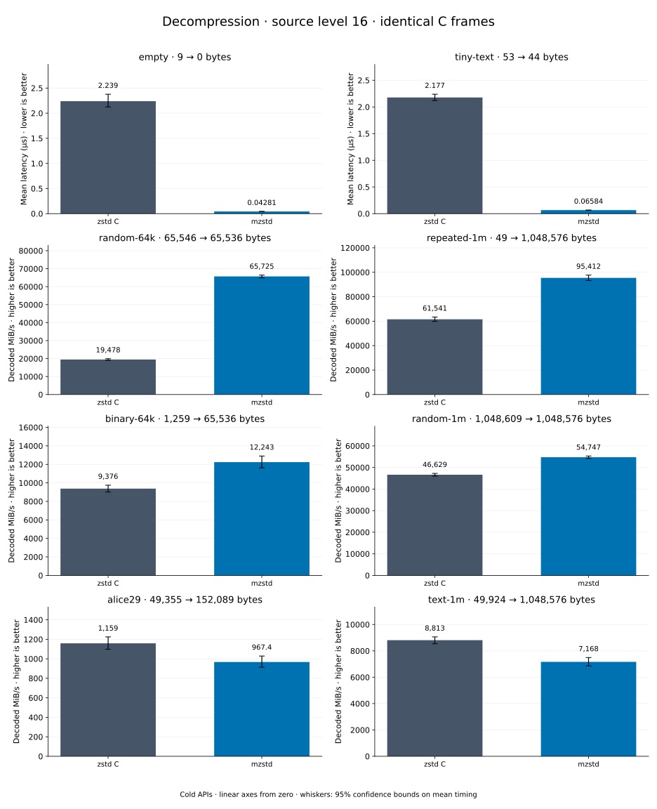

# Decompression of level 16 frames

[Decoder overview](README.md) · [Benchmark index](../README.md)

Recorded run: **long-20261112** (2026-11-12).
[CSV](../decoder-comparison.csv) · [Environment](../decoder-comparison-environment.json) · [Methodology and limits](../decoder-comparison.md).

Level belongs to the C encoder that prepared the frame; decoders have no level setting.
Both decoders restore the same bytes.

## Median speed across 8 datasets

Median of per-dataset C mean time / decoder mean time ratios, with equal weight.
Higher is faster; 1× matches C. No confidence interval
is inferred for this across-dataset median.

| Decoder | Median speed / C |
| --- | ---: |
| zstd C | 1.000× |
| mzstd | 1.428× |

Datasets are ranked by mzstd speed relative to C, highest first.
Throughput counts restored bytes; empty input has latency only. Whiskers and intervals
describe sampling uncertainty, not all host variation. Cold APIs include allocation
and disposal. C reads the frame's content size and decodes into a buffer of exactly
that size; mzstd returns its own vector.

## empty

Empty input; measures API overhead.

**9 compressed → 0 restored bytes; compressed / original: undefined.**

| Decoder | Mean µs | 95% mean interval µs | Decoded MiB/s | Speed / C |
| --- | ---: | ---: | ---: | ---: |
| zstd C | 2.239 | 2.124–2.377 | — | 1.000× |
| mzstd | 0.04281 | 0.04101–0.04484 | — | 52.309× |

## tiny-text

44-byte quick-brown-fox sentence.

**53 compressed → 44 restored bytes; compressed / original: 120.455%.**

| Decoder | Mean µs | 95% mean interval µs | Decoded MiB/s | Speed / C |
| --- | ---: | ---: | ---: | ---: |
| zstd C | 2.177 | 2.119–2.238 | 19.27 | 1.000× |
| mzstd | 0.06584 | 0.06401–0.06774 | 637.38 | 33.074× |

## random-64k

64 KiB prefix of the deterministic pseudorandom corpus.

**65,546 compressed → 65,536 restored bytes; compressed / original: 100.015%.**

| Decoder | Mean µs | 95% mean interval µs | Decoded MiB/s | Speed / C |
| --- | ---: | ---: | ---: | ---: |
| zstd C | 3.209 | 3.134–3.284 | 19,477.85 | 1.000× |
| mzstd | 0.9509 | 0.9408–0.9623 | 65,725.45 | 3.374× |

## repeated-1m

1 MiB of repeated a bytes.

**49 compressed → 1,048,576 restored bytes; compressed / original: 0.005%.**

| Decoder | Mean µs | 95% mean interval µs | Decoded MiB/s | Speed / C |
| --- | ---: | ---: | ---: | ---: |
| zstd C | 16.25 | 15.78–16.73 | 61,541.24 | 1.000× |
| mzstd | 10.48 | 10.24–10.72 | 95,412.36 | 1.550× |

## binary-64k

64 KiB of structured binary bytes: ((i / 16) XOR i) modulo 256.

**1,259 compressed → 65,536 restored bytes; compressed / original: 1.921%.**

| Decoder | Mean µs | 95% mean interval µs | Decoded MiB/s | Speed / C |
| --- | ---: | ---: | ---: | ---: |
| zstd C | 6.666 | 6.41–6.939 | 9,375.75 | 1.000× |
| mzstd | 5.105 | 4.844–5.374 | 12,243.46 | 1.306× |

## random-1m

1 MiB of deterministic xorshift64 pseudorandom bytes.

**1,048,609 compressed → 1,048,576 restored bytes; compressed / original: 100.003%.**

| Decoder | Mean µs | 95% mean interval µs | Decoded MiB/s | Speed / C |
| --- | ---: | ---: | ---: | ---: |
| zstd C | 21.45 | 21.16–21.73 | 46,629.25 | 1.000× |
| mzstd | 18.27 | 18.08–18.45 | 54,747.31 | 1.174× |

## alice29

Alice in Wonderland text from the Canterbury corpus (`testdata/alice29.txt`).

**49,355 compressed → 152,089 restored bytes; compressed / original: 32.451%.**

| Decoder | Mean µs | 95% mean interval µs | Decoded MiB/s | Speed / C |
| --- | ---: | ---: | ---: | ---: |
| zstd C | 125.1 | 118.4–132.1 | 1,159.04 | 1.000× |
| mzstd | 149.9 | 141–158.8 | 967.40 | 0.835× |

## text-1m

Alice text repeated cyclically to 1 MiB.

**49,924 compressed → 1,048,576 restored bytes; compressed / original: 4.761%.**

| Decoder | Mean µs | 95% mean interval µs | Decoded MiB/s | Speed / C |
| --- | ---: | ---: | ---: | ---: |
| zstd C | 113.5 | 110.4–117.1 | 8,812.50 | 1.000× |
| mzstd | 139.5 | 133.4–145.8 | 7,167.98 | 0.813× |
