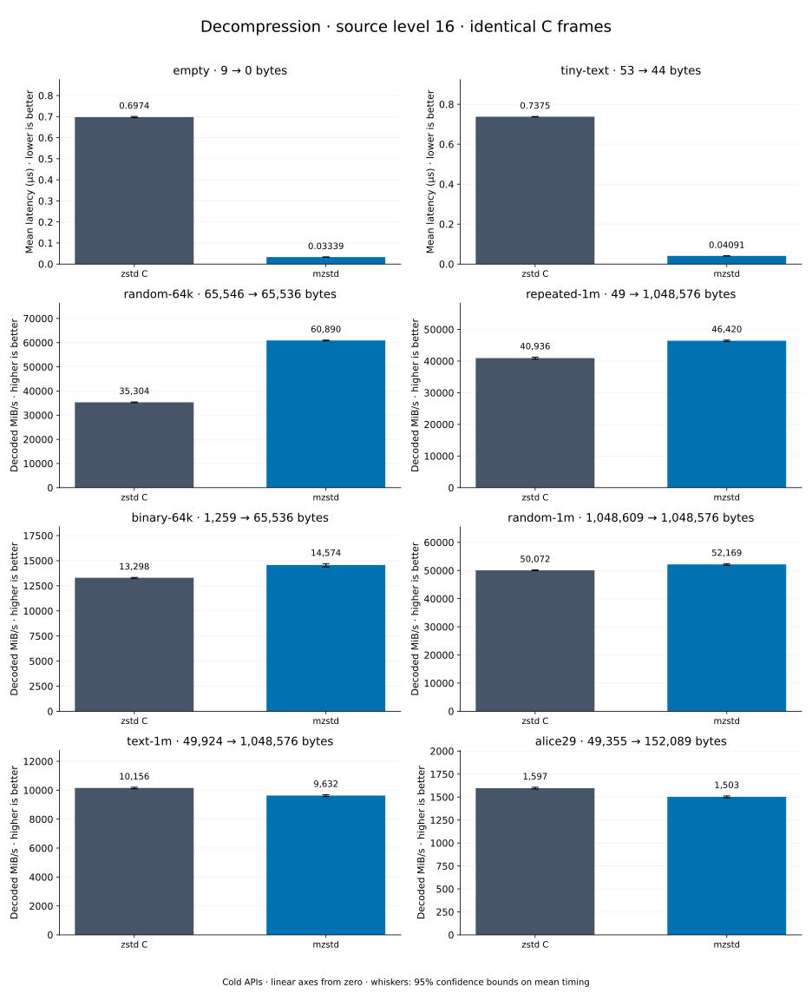

# Decompression of level 16 frames

[Decoder overview](README.md) · [Benchmark index](../README.md)

Recorded run: **dec-20261014-speed** (2026-10-14).
[CSV](../decoder-comparison.csv) · [Environment](../decoder-comparison-environment.json) · [Methodology and limits](../decoder-comparison.md).

Level belongs to the C encoder that prepared the frame; decoders have no level setting.
Both decoders restore the same bytes.

## Median speed across 8 datasets

Median of per-dataset C mean time / decoder mean time ratios, with equal weight.
Higher is faster; 1× matches C. No confidence interval
is inferred for this across-dataset median.

| Decoder | Median speed / C |
| --- | ---: |
| zstd C | 1.000× |
| mzstd | 0.992× |

Datasets are ranked by mzstd speed relative to C, highest first.
Throughput counts restored bytes; empty input has latency only. Whiskers and intervals
describe sampling uncertainty, not all host variation. Cold APIs include allocation
and disposal. C reads the frame's content size and decodes into a buffer of exactly
that size; mzstd returns its own vector.

## empty

Empty input; measures API overhead.

**9 compressed → 0 restored bytes; compressed / original: undefined.**

| Decoder | Mean µs | 95% mean interval µs | Decoded MiB/s | Speed / C |
| --- | ---: | ---: | ---: | ---: |
| zstd C | 0.71 | 0.7079–0.713 | — | 1.000× |
| mzstd | 0.02993 | 0.02969–0.03029 | — | 23.720× |

## tiny-text

44-byte quick-brown-fox sentence.

**53 compressed → 44 restored bytes; compressed / original: 120.455%.**

| Decoder | Mean µs | 95% mean interval µs | Decoded MiB/s | Speed / C |
| --- | ---: | ---: | ---: | ---: |
| zstd C | 0.7571 | 0.7505–0.7644 | 55.43 | 1.000× |
| mzstd | 0.03652 | 0.03625–0.03682 | 1,148.87 | 20.727× |

## random-64k

64 KiB prefix of the deterministic pseudorandom corpus.

**65,546 compressed → 65,536 restored bytes; compressed / original: 100.015%.**

| Decoder | Mean µs | 95% mean interval µs | Decoded MiB/s | Speed / C |
| --- | ---: | ---: | ---: | ---: |
| zstd C | 1.785 | 1.777–1.794 | 35,014.02 | 1.000× |
| mzstd | 1.021 | 1.017–1.024 | 61,239.71 | 1.749× |

## random-1m

1 MiB of deterministic xorshift64 pseudorandom bytes.

**1,048,609 compressed → 1,048,576 restored bytes; compressed / original: 100.003%.**

| Decoder | Mean µs | 95% mean interval µs | Decoded MiB/s | Speed / C |
| --- | ---: | ---: | ---: | ---: |
| zstd C | 21.04 | 20.85–21.23 | 47,533.72 | 1.000× |
| mzstd | 20.32 | 20.14–20.5 | 49,217.47 | 1.035× |

## binary-64k

64 KiB of structured binary bytes: ((i / 16) XOR i) modulo 256.

**1,259 compressed → 65,536 restored bytes; compressed / original: 1.921%.**

| Decoder | Mean µs | 95% mean interval µs | Decoded MiB/s | Speed / C |
| --- | ---: | ---: | ---: | ---: |
| zstd C | 4.688 | 4.674–4.702 | 13,330.77 | 1.000× |
| mzstd | 4.941 | 4.914–4.968 | 12,649.80 | 0.949× |

## alice29

Alice in Wonderland text from the Canterbury corpus (`testdata/alice29.txt`).

**49,355 compressed → 152,089 restored bytes; compressed / original: 32.451%.**

| Decoder | Mean µs | 95% mean interval µs | Decoded MiB/s | Speed / C |
| --- | ---: | ---: | ---: | ---: |
| zstd C | 90.93 | 90.58–91.31 | 1,595.06 | 1.000× |
| mzstd | 99.92 | 99.07–101.4 | 1,451.58 | 0.910× |

## repeated-1m

1 MiB of repeated a bytes.

**49 compressed → 1,048,576 restored bytes; compressed / original: 0.005%.**

| Decoder | Mean µs | 95% mean interval µs | Decoded MiB/s | Speed / C |
| --- | ---: | ---: | ---: | ---: |
| zstd C | 24.46 | 24.39–24.54 | 40,887.79 | 1.000× |
| mzstd | 27.15 | 27.04–27.29 | 36,828.15 | 0.901× |

## text-1m

Alice text repeated cyclically to 1 MiB.

**49,924 compressed → 1,048,576 restored bytes; compressed / original: 4.761%.**

| Decoder | Mean µs | 95% mean interval µs | Decoded MiB/s | Speed / C |
| --- | ---: | ---: | ---: | ---: |
| zstd C | 101.3 | 100.9–101.7 | 9,873.33 | 1.000× |
| mzstd | 120.8 | 119.9–121.6 | 8,280.39 | 0.839× |
