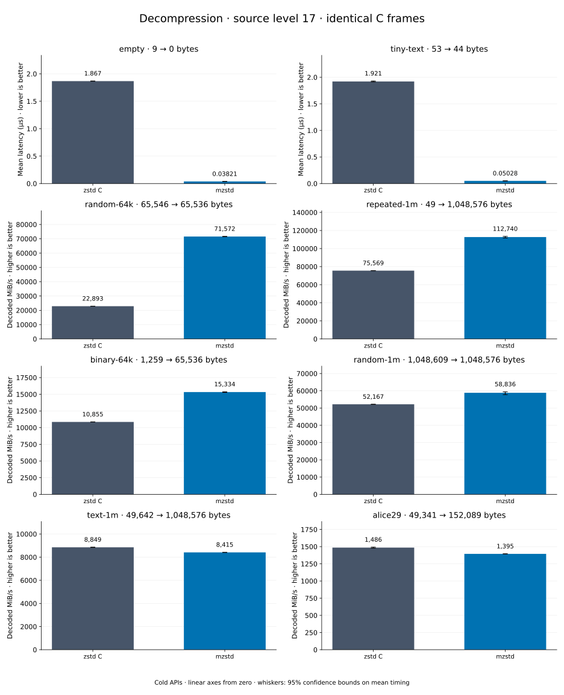

# Decompression of level 17 frames

[Decoder overview](README.md) · [Benchmark index](../README.md)

Recorded run: **dec-20261014-speed** (2026-10-14).
[CSV](../decoder-comparison.csv) · [Environment](../decoder-comparison-environment.json) · [Methodology and limits](../decoder-comparison.md).

Level belongs to the C encoder that prepared the frame; decoders have no level setting.
Both decoders restore the same bytes.

## Median speed across 8 datasets

Median of per-dataset C mean time / decoder mean time ratios, with equal weight.
Higher is faster; 1× matches C. No confidence interval
is inferred for this across-dataset median.

| Decoder | Median speed / C |
| --- | ---: |
| zstd C | 1.000× |
| mzstd | 0.998× |

Datasets are ranked by mzstd speed relative to C, highest first.
Throughput counts restored bytes; empty input has latency only. Whiskers and intervals
describe sampling uncertainty, not all host variation. Cold APIs include allocation
and disposal. C reads the frame's content size and decodes into a buffer of exactly
that size; mzstd returns its own vector.

## empty

Empty input; measures API overhead.

**9 compressed → 0 restored bytes; compressed / original: undefined.**

| Decoder | Mean µs | 95% mean interval µs | Decoded MiB/s | Speed / C |
| --- | ---: | ---: | ---: | ---: |
| zstd C | 0.7116 | 0.708–0.7161 | — | 1.000× |
| mzstd | 0.02973 | 0.02959–0.02992 | — | 23.936× |

## tiny-text

44-byte quick-brown-fox sentence.

**53 compressed → 44 restored bytes; compressed / original: 120.455%.**

| Decoder | Mean µs | 95% mean interval µs | Decoded MiB/s | Speed / C |
| --- | ---: | ---: | ---: | ---: |
| zstd C | 0.7717 | 0.7604–0.7855 | 54.38 | 1.000× |
| mzstd | 0.03651 | 0.03622–0.03682 | 1,149.18 | 21.133× |

## random-64k

64 KiB prefix of the deterministic pseudorandom corpus.

**65,546 compressed → 65,536 restored bytes; compressed / original: 100.015%.**

| Decoder | Mean µs | 95% mean interval µs | Decoded MiB/s | Speed / C |
| --- | ---: | ---: | ---: | ---: |
| zstd C | 1.803 | 1.787–1.819 | 34,665.97 | 1.000× |
| mzstd | 1.032 | 1.024–1.041 | 60,534.62 | 1.746× |

## random-1m

1 MiB of deterministic xorshift64 pseudorandom bytes.

**1,048,609 compressed → 1,048,576 restored bytes; compressed / original: 100.003%.**

| Decoder | Mean µs | 95% mean interval µs | Decoded MiB/s | Speed / C |
| --- | ---: | ---: | ---: | ---: |
| zstd C | 21.47 | 21.28–21.66 | 46,572.15 | 1.000× |
| mzstd | 20.51 | 20.37–20.66 | 48,755.91 | 1.047× |

## binary-64k

64 KiB of structured binary bytes: ((i / 16) XOR i) modulo 256.

**1,259 compressed → 65,536 restored bytes; compressed / original: 1.921%.**

| Decoder | Mean µs | 95% mean interval µs | Decoded MiB/s | Speed / C |
| --- | ---: | ---: | ---: | ---: |
| zstd C | 4.683 | 4.659–4.71 | 13,344.95 | 1.000× |
| mzstd | 4.937 | 4.905–4.972 | 12,659.48 | 0.949× |

## alice29

Alice in Wonderland text from the Canterbury corpus (`testdata/alice29.txt`).

**49,341 compressed → 152,089 restored bytes; compressed / original: 32.442%.**

| Decoder | Mean µs | 95% mean interval µs | Decoded MiB/s | Speed / C |
| --- | ---: | ---: | ---: | ---: |
| zstd C | 91.96 | 89.97–95.58 | 1,577.32 | 1.000× |
| mzstd | 99.93 | 99.27–100.7 | 1,451.43 | 0.920× |

## repeated-1m

1 MiB of repeated a bytes.

**49 compressed → 1,048,576 restored bytes; compressed / original: 0.005%.**

| Decoder | Mean µs | 95% mean interval µs | Decoded MiB/s | Speed / C |
| --- | ---: | ---: | ---: | ---: |
| zstd C | 24.44 | 24.35–24.53 | 40,918.43 | 1.000× |
| mzstd | 27.36 | 27.29–27.43 | 36,549.75 | 0.893× |

## text-1m

Alice text repeated cyclically to 1 MiB.

**49,642 compressed → 1,048,576 restored bytes; compressed / original: 4.734%.**

| Decoder | Mean µs | 95% mean interval µs | Decoded MiB/s | Speed / C |
| --- | ---: | ---: | ---: | ---: |
| zstd C | 102.9 | 102.1–103.7 | 9,722.82 | 1.000× |
| mzstd | 123.8 | 123.1–124.6 | 8,079.72 | 0.831× |
