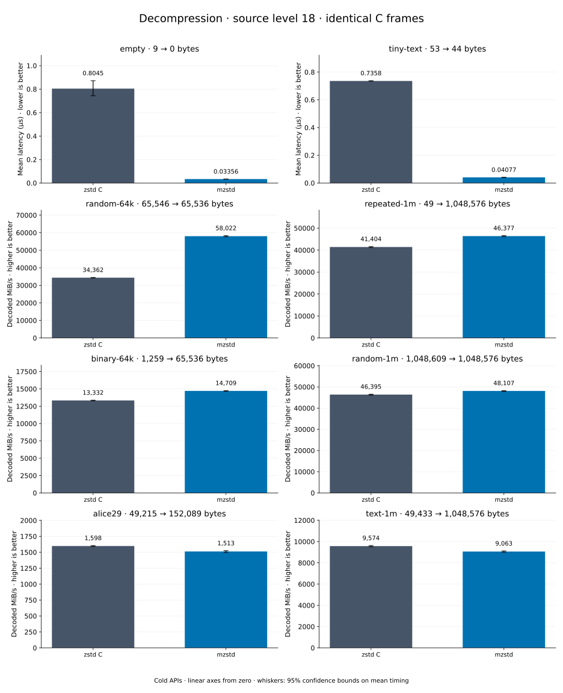

# Decompression of level 18 frames

[Decoder overview](README.md) · [Benchmark index](../README.md)

Recorded run: **dec-20261015c** (2026-10-15).
[CSV](../decoder-comparison.csv) · [Environment](../decoder-comparison-environment.json) · [Methodology and limits](../decoder-comparison.md).

Level belongs to the C encoder that prepared the frame; decoders have no level setting.
Both decoders restore the same bytes.

## Median speed across 8 datasets

Median of per-dataset C mean time / decoder mean time ratios, with equal weight.
Higher is faster; 1× matches C. No confidence interval
is inferred for this across-dataset median.

| Decoder | Median speed / C |
| --- | ---: |
| zstd C | 1.000× |
| mzstd | 0.991× |

Datasets are ranked by mzstd speed relative to C, highest first.
Throughput counts restored bytes; empty input has latency only. Whiskers and intervals
describe sampling uncertainty, not all host variation. Cold APIs include allocation
and disposal. C reads the frame's content size and decodes into a buffer of exactly
that size; mzstd returns its own vector.

## empty

Empty input; measures API overhead.

**9 compressed → 0 restored bytes; compressed / original: undefined.**

| Decoder | Mean µs | 95% mean interval µs | Decoded MiB/s | Speed / C |
| --- | ---: | ---: | ---: | ---: |
| zstd C | 0.7136 | 0.7106–0.7165 | — | 1.000× |
| mzstd | 0.03263 | 0.03247–0.03281 | — | 21.869× |

## tiny-text

44-byte quick-brown-fox sentence.

**53 compressed → 44 restored bytes; compressed / original: 120.455%.**

| Decoder | Mean µs | 95% mean interval µs | Decoded MiB/s | Speed / C |
| --- | ---: | ---: | ---: | ---: |
| zstd C | 0.7796 | 0.7724–0.7866 | 53.83 | 1.000× |
| mzstd | 0.04109 | 0.04096–0.04127 | 1,021.10 | 18.970× |

## random-64k

64 KiB prefix of the deterministic pseudorandom corpus.

**65,546 compressed → 65,536 restored bytes; compressed / original: 100.015%.**

| Decoder | Mean µs | 95% mean interval µs | Decoded MiB/s | Speed / C |
| --- | ---: | ---: | ---: | ---: |
| zstd C | 1.757 | 1.75–1.765 | 35,574.18 | 1.000× |
| mzstd | 1.007 | 0.9995–1.017 | 62,065.78 | 1.745× |

## random-1m

1 MiB of deterministic xorshift64 pseudorandom bytes.

**1,048,609 compressed → 1,048,576 restored bytes; compressed / original: 100.003%.**

| Decoder | Mean µs | 95% mean interval µs | Decoded MiB/s | Speed / C |
| --- | ---: | ---: | ---: | ---: |
| zstd C | 21.05 | 20.87–21.22 | 47,510.04 | 1.000× |
| mzstd | 20.29 | 20.12–20.47 | 49,278.44 | 1.037× |

## binary-64k

64 KiB of structured binary bytes: ((i / 16) XOR i) modulo 256.

**1,259 compressed → 65,536 restored bytes; compressed / original: 1.921%.**

| Decoder | Mean µs | 95% mean interval µs | Decoded MiB/s | Speed / C |
| --- | ---: | ---: | ---: | ---: |
| zstd C | 4.675 | 4.658–4.692 | 13,369.96 | 1.000× |
| mzstd | 4.951 | 4.931–4.971 | 12,624.34 | 0.944× |

## alice29

Alice in Wonderland text from the Canterbury corpus (`testdata/alice29.txt`).

**49,215 compressed → 152,089 restored bytes; compressed / original: 32.359%.**

| Decoder | Mean µs | 95% mean interval µs | Decoded MiB/s | Speed / C |
| --- | ---: | ---: | ---: | ---: |
| zstd C | 91.17 | 90.97–91.38 | 1,590.98 | 1.000× |
| mzstd | 98.3 | 97.92–98.8 | 1,475.56 | 0.927× |

## repeated-1m

1 MiB of repeated a bytes.

**49 compressed → 1,048,576 restored bytes; compressed / original: 0.005%.**

| Decoder | Mean µs | 95% mean interval µs | Decoded MiB/s | Speed / C |
| --- | ---: | ---: | ---: | ---: |
| zstd C | 24.17 | 24.12–24.25 | 41,365.45 | 1.000× |
| mzstd | 26.73 | 26.64–26.81 | 37,415.79 | 0.905× |

## text-1m

Alice text repeated cyclically to 1 MiB.

**49,433 compressed → 1,048,576 restored bytes; compressed / original: 4.714%.**

| Decoder | Mean µs | 95% mean interval µs | Decoded MiB/s | Speed / C |
| --- | ---: | ---: | ---: | ---: |
| zstd C | 105 | 104–106.1 | 9,520.40 | 1.000× |
| mzstd | 127.8 | 126.4–129.2 | 7,826.65 | 0.822× |
