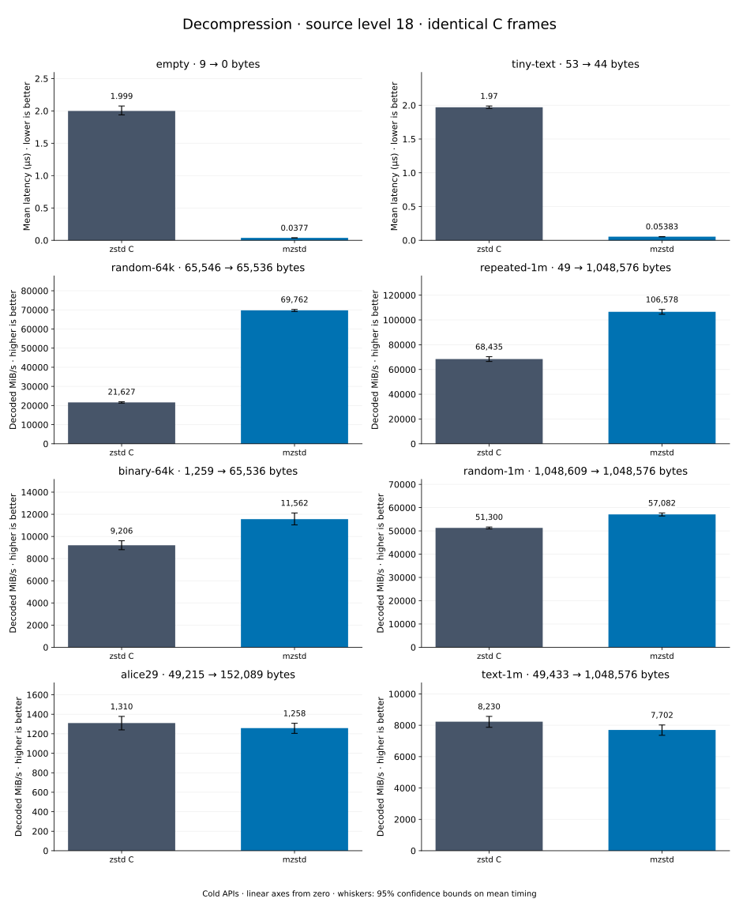

# Decompression of level 18 frames

[Decoder overview](README.md) · [Benchmark index](../README.md)

Recorded run: **long-20261109** (2026-11-09).
[CSV](../decoder-comparison.csv) · [Environment](../decoder-comparison-environment.json) · [Methodology and limits](../decoder-comparison.md).

Level belongs to the C encoder that prepared the frame; decoders have no level setting.
Both decoders restore the same bytes.

## Median speed across 8 datasets

Median of per-dataset C mean time / decoder mean time ratios, with equal weight.
Higher is faster; 1× matches C. No confidence interval
is inferred for this across-dataset median.

| Decoder | Median speed / C |
| --- | ---: |
| zstd C | 1.000× |
| mzstd | 1.407× |

Datasets are ranked by mzstd speed relative to C, highest first.
Throughput counts restored bytes; empty input has latency only. Whiskers and intervals
describe sampling uncertainty, not all host variation. Cold APIs include allocation
and disposal. C reads the frame's content size and decodes into a buffer of exactly
that size; mzstd returns its own vector.

## empty

Empty input; measures API overhead.

**9 compressed → 0 restored bytes; compressed / original: undefined.**

| Decoder | Mean µs | 95% mean interval µs | Decoded MiB/s | Speed / C |
| --- | ---: | ---: | ---: | ---: |
| zstd C | 1.999 | 1.938–2.076 | — | 1.000× |
| mzstd | 0.0377 | 0.03713–0.03837 | — | 53.021× |

## tiny-text

44-byte quick-brown-fox sentence.

**53 compressed → 44 restored bytes; compressed / original: 120.455%.**

| Decoder | Mean µs | 95% mean interval µs | Decoded MiB/s | Speed / C |
| --- | ---: | ---: | ---: | ---: |
| zstd C | 1.97 | 1.954–1.989 | 21.30 | 1.000× |
| mzstd | 0.05383 | 0.05149–0.05635 | 779.55 | 36.605× |

## random-64k

64 KiB prefix of the deterministic pseudorandom corpus.

**65,546 compressed → 65,536 restored bytes; compressed / original: 100.015%.**

| Decoder | Mean µs | 95% mean interval µs | Decoded MiB/s | Speed / C |
| --- | ---: | ---: | ---: | ---: |
| zstd C | 2.89 | 2.847–2.94 | 21,627.46 | 1.000× |
| mzstd | 0.8959 | 0.8902–0.9037 | 69,762.49 | 3.226× |

## repeated-1m

1 MiB of repeated a bytes.

**49 compressed → 1,048,576 restored bytes; compressed / original: 0.005%.**

| Decoder | Mean µs | 95% mean interval µs | Decoded MiB/s | Speed / C |
| --- | ---: | ---: | ---: | ---: |
| zstd C | 14.61 | 14.23–15.05 | 68,434.72 | 1.000× |
| mzstd | 9.383 | 9.221–9.561 | 106,577.92 | 1.557× |

## binary-64k

64 KiB of structured binary bytes: ((i / 16) XOR i) modulo 256.

**1,259 compressed → 65,536 restored bytes; compressed / original: 1.921%.**

| Decoder | Mean µs | 95% mean interval µs | Decoded MiB/s | Speed / C |
| --- | ---: | ---: | ---: | ---: |
| zstd C | 6.789 | 6.502–7.094 | 9,206.00 | 1.000× |
| mzstd | 5.406 | 5.156–5.657 | 11,561.58 | 1.256× |

## random-1m

1 MiB of deterministic xorshift64 pseudorandom bytes.

**1,048,609 compressed → 1,048,576 restored bytes; compressed / original: 100.003%.**

| Decoder | Mean µs | 95% mean interval µs | Decoded MiB/s | Speed / C |
| --- | ---: | ---: | ---: | ---: |
| zstd C | 19.49 | 19.35–19.66 | 51,300.31 | 1.000× |
| mzstd | 17.52 | 17.33–17.72 | 57,082.29 | 1.113× |

## alice29

Alice in Wonderland text from the Canterbury corpus (`testdata/alice29.txt`).

**49,215 compressed → 152,089 restored bytes; compressed / original: 32.359%.**

| Decoder | Mean µs | 95% mean interval µs | Decoded MiB/s | Speed / C |
| --- | ---: | ---: | ---: | ---: |
| zstd C | 110.7 | 105.3–117 | 1,309.84 | 1.000× |
| mzstd | 115.3 | 110.9–120.4 | 1,257.68 | 0.960× |

## text-1m

Alice text repeated cyclically to 1 MiB.

**49,433 compressed → 1,048,576 restored bytes; compressed / original: 4.714%.**

| Decoder | Mean µs | 95% mean interval µs | Decoded MiB/s | Speed / C |
| --- | ---: | ---: | ---: | ---: |
| zstd C | 121.5 | 116.8–127.1 | 8,229.54 | 1.000× |
| mzstd | 129.8 | 124.7–135.8 | 7,702.41 | 0.936× |
