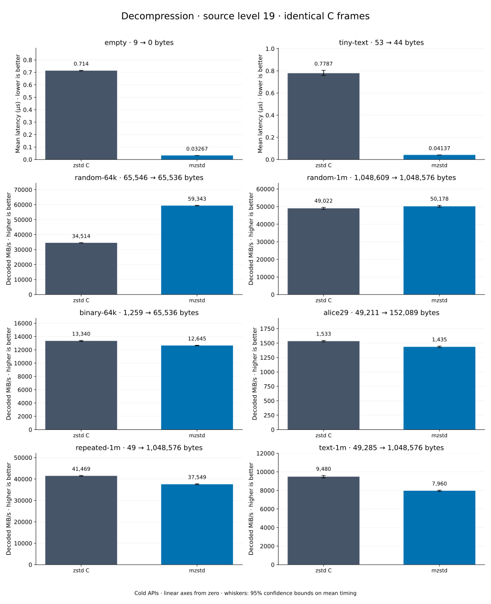

# Decompression of level 19 frames

[Decoder overview](README.md) · [Benchmark index](../README.md)

Recorded run: **dec-20261018** (2026-10-18).
[CSV](../decoder-comparison.csv) · [Environment](../decoder-comparison-environment.json) · [Methodology and limits](../decoder-comparison.md).

Level belongs to the C encoder that prepared the frame; decoders have no level setting.
Both decoders restore the same bytes.

## Median speed across 8 datasets

Median of per-dataset C mean time / decoder mean time ratios, with equal weight.
Higher is faster; 1× matches C. No confidence interval
is inferred for this across-dataset median.

| Decoder | Median speed / C |
| --- | ---: |
| zstd C | 1.000× |
| mzstd | 1.087× |

Datasets are ranked by mzstd speed relative to C, highest first.
Throughput counts restored bytes; empty input has latency only. Whiskers and intervals
describe sampling uncertainty, not all host variation. Cold APIs include allocation
and disposal. C reads the frame's content size and decodes into a buffer of exactly
that size; mzstd returns its own vector.

## empty

Empty input; measures API overhead.

**9 compressed → 0 restored bytes; compressed / original: undefined.**

| Decoder | Mean µs | 95% mean interval µs | Decoded MiB/s | Speed / C |
| --- | ---: | ---: | ---: | ---: |
| zstd C | 0.6953 | 0.6929–0.6977 | — | 1.000× |
| mzstd | 0.03343 | 0.03319–0.03365 | — | 20.799× |

## tiny-text

44-byte quick-brown-fox sentence.

**53 compressed → 44 restored bytes; compressed / original: 120.455%.**

| Decoder | Mean µs | 95% mean interval µs | Decoded MiB/s | Speed / C |
| --- | ---: | ---: | ---: | ---: |
| zstd C | 0.7387 | 0.7366–0.7421 | 56.80 | 1.000× |
| mzstd | 0.0402 | 0.03997–0.04039 | 1,043.94 | 18.378× |

## random-64k

64 KiB prefix of the deterministic pseudorandom corpus.

**65,546 compressed → 65,536 restored bytes; compressed / original: 100.015%.**

| Decoder | Mean µs | 95% mean interval µs | Decoded MiB/s | Speed / C |
| --- | ---: | ---: | ---: | ---: |
| zstd C | 1.807 | 1.78–1.844 | 34,595.02 | 1.000× |
| mzstd | 1.057 | 1.049–1.068 | 59,107.68 | 1.709× |

## repeated-1m

1 MiB of repeated a bytes.

**49 compressed → 1,048,576 restored bytes; compressed / original: 0.005%.**

| Decoder | Mean µs | 95% mean interval µs | Decoded MiB/s | Speed / C |
| --- | ---: | ---: | ---: | ---: |
| zstd C | 24.1 | 24–24.22 | 41,486.38 | 1.000× |
| mzstd | 21.91 | 21.77–22.08 | 45,643.97 | 1.100× |

## binary-64k

64 KiB of structured binary bytes: ((i / 16) XOR i) modulo 256.

**1,259 compressed → 65,536 restored bytes; compressed / original: 1.921%.**

| Decoder | Mean µs | 95% mean interval µs | Decoded MiB/s | Speed / C |
| --- | ---: | ---: | ---: | ---: |
| zstd C | 4.673 | 4.646–4.703 | 13,374.93 | 1.000× |
| mzstd | 4.352 | 4.233–4.574 | 14,361.76 | 1.074× |

## random-1m

1 MiB of deterministic xorshift64 pseudorandom bytes.

**1,048,609 compressed → 1,048,576 restored bytes; compressed / original: 100.003%.**

| Decoder | Mean µs | 95% mean interval µs | Decoded MiB/s | Speed / C |
| --- | ---: | ---: | ---: | ---: |
| zstd C | 18.87 | 18.81–18.94 | 52,988.93 | 1.000× |
| mzstd | 18.33 | 18.28–18.39 | 54,546.44 | 1.029× |

## alice29

Alice in Wonderland text from the Canterbury corpus (`testdata/alice29.txt`).

**49,211 compressed → 152,089 restored bytes; compressed / original: 32.357%.**

| Decoder | Mean µs | 95% mean interval µs | Decoded MiB/s | Speed / C |
| --- | ---: | ---: | ---: | ---: |
| zstd C | 92.46 | 91.75–93.28 | 1,568.70 | 1.000× |
| mzstd | 95.77 | 95.22–96.39 | 1,514.49 | 0.965× |

## text-1m

Alice text repeated cyclically to 1 MiB.

**49,285 compressed → 1,048,576 restored bytes; compressed / original: 4.700%.**

| Decoder | Mean µs | 95% mean interval µs | Decoded MiB/s | Speed / C |
| --- | ---: | ---: | ---: | ---: |
| zstd C | 104.8 | 104.4–105.3 | 9,540.70 | 1.000× |
| mzstd | 110.5 | 109.8–111.7 | 9,046.72 | 0.948× |
