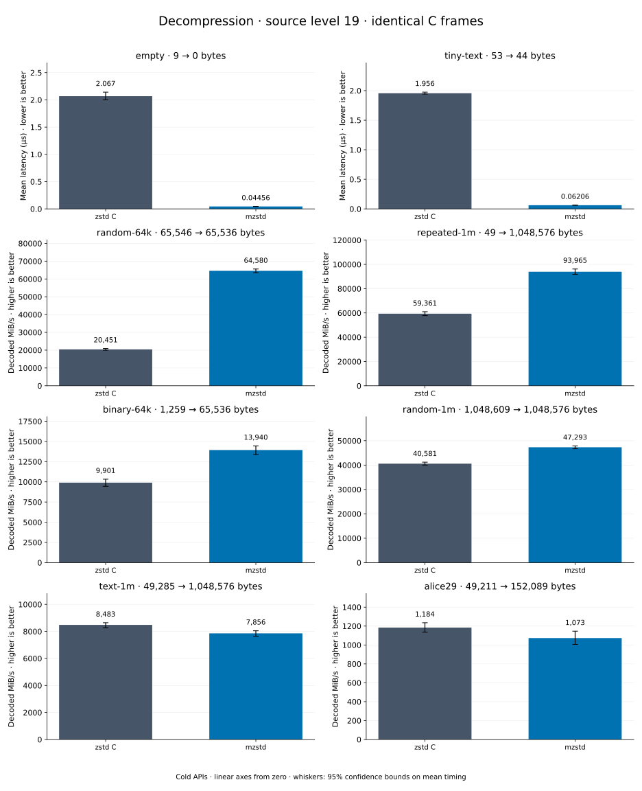

# Decompression of level 19 frames

[Decoder overview](README.md) · [Benchmark index](../README.md)

Recorded run: **long-20261109** (2026-11-09).
[CSV](../decoder-comparison.csv) · [Environment](../decoder-comparison-environment.json) · [Methodology and limits](../decoder-comparison.md).

Level belongs to the C encoder that prepared the frame; decoders have no level setting.
Both decoders restore the same bytes.

## Median speed across 8 datasets

Median of per-dataset C mean time / decoder mean time ratios, with equal weight.
Higher is faster; 1× matches C. No confidence interval
is inferred for this across-dataset median.

| Decoder | Median speed / C |
| --- | ---: |
| zstd C | 1.000× |
| mzstd | 1.457× |

Datasets are ranked by mzstd speed relative to C, highest first.
Throughput counts restored bytes; empty input has latency only. Whiskers and intervals
describe sampling uncertainty, not all host variation. Cold APIs include allocation
and disposal. C reads the frame's content size and decodes into a buffer of exactly
that size; mzstd returns its own vector.

## empty

Empty input; measures API overhead.

**9 compressed → 0 restored bytes; compressed / original: undefined.**

| Decoder | Mean µs | 95% mean interval µs | Decoded MiB/s | Speed / C |
| --- | ---: | ---: | ---: | ---: |
| zstd C | 1.955 | 1.94–1.971 | — | 1.000× |
| mzstd | 0.03756 | 0.03678–0.0386 | — | 52.045× |

## tiny-text

44-byte quick-brown-fox sentence.

**53 compressed → 44 restored bytes; compressed / original: 120.455%.**

| Decoder | Mean µs | 95% mean interval µs | Decoded MiB/s | Speed / C |
| --- | ---: | ---: | ---: | ---: |
| zstd C | 2.05 | 1.995–2.114 | 20.47 | 1.000× |
| mzstd | 0.04909 | 0.04843–0.04984 | 854.77 | 41.754× |

## random-64k

64 KiB prefix of the deterministic pseudorandom corpus.

**65,546 compressed → 65,536 restored bytes; compressed / original: 100.015%.**

| Decoder | Mean µs | 95% mean interval µs | Decoded MiB/s | Speed / C |
| --- | ---: | ---: | ---: | ---: |
| zstd C | 2.82 | 2.792–2.853 | 22,163.93 | 1.000× |
| mzstd | 0.9429 | 0.9265–0.96 | 66,283.21 | 2.991× |

## binary-64k

64 KiB of structured binary bytes: ((i / 16) XOR i) modulo 256.

**1,259 compressed → 65,536 restored bytes; compressed / original: 1.921%.**

| Decoder | Mean µs | 95% mean interval µs | Decoded MiB/s | Speed / C |
| --- | ---: | ---: | ---: | ---: |
| zstd C | 7.462 | 7.176–7.748 | 8,375.54 | 1.000× |
| mzstd | 5.121 | 4.899–5.347 | 12,205.56 | 1.457× |

## repeated-1m

1 MiB of repeated a bytes.

**49 compressed → 1,048,576 restored bytes; compressed / original: 0.005%.**

| Decoder | Mean µs | 95% mean interval µs | Decoded MiB/s | Speed / C |
| --- | ---: | ---: | ---: | ---: |
| zstd C | 14.14 | 13.92–14.39 | 70,738.81 | 1.000× |
| mzstd | 9.71 | 9.432–10.01 | 102,982.42 | 1.456× |

## random-1m

1 MiB of deterministic xorshift64 pseudorandom bytes.

**1,048,609 compressed → 1,048,576 restored bytes; compressed / original: 100.003%.**

| Decoder | Mean µs | 95% mean interval µs | Decoded MiB/s | Speed / C |
| --- | ---: | ---: | ---: | ---: |
| zstd C | 19.8 | 19.58–20.06 | 50,492.79 | 1.000× |
| mzstd | 17.32 | 17.18–17.47 | 57,741.15 | 1.144× |

## alice29

Alice in Wonderland text from the Canterbury corpus (`testdata/alice29.txt`).

**49,211 compressed → 152,089 restored bytes; compressed / original: 32.357%.**

| Decoder | Mean µs | 95% mean interval µs | Decoded MiB/s | Speed / C |
| --- | ---: | ---: | ---: | ---: |
| zstd C | 116.4 | 110.5–122.9 | 1,245.67 | 1.000× |
| mzstd | 121.1 | 114.6–128.5 | 1,197.33 | 0.961× |

## text-1m

Alice text repeated cyclically to 1 MiB.

**49,285 compressed → 1,048,576 restored bytes; compressed / original: 4.700%.**

| Decoder | Mean µs | 95% mean interval µs | Decoded MiB/s | Speed / C |
| --- | ---: | ---: | ---: | ---: |
| zstd C | 117.2 | 114.9–119.9 | 8,533.02 | 1.000× |
| mzstd | 134.8 | 127.3–143.1 | 7,419.53 | 0.870× |
