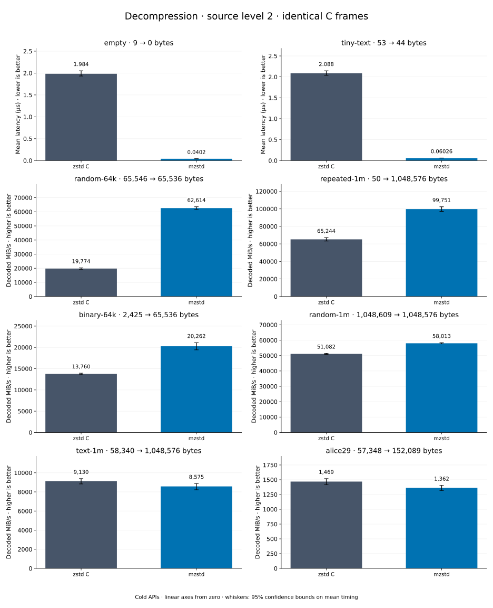

# Decompression of level 2 frames

[Decoder overview](README.md) · [Benchmark index](../README.md)

Recorded run: **long-20261112** (2026-11-12).
[CSV](../decoder-comparison.csv) · [Environment](../decoder-comparison-environment.json) · [Methodology and limits](../decoder-comparison.md).

Level belongs to the C encoder that prepared the frame; decoders have no level setting.
Both decoders restore the same bytes.

## Median speed across 8 datasets

Median of per-dataset C mean time / decoder mean time ratios, with equal weight.
Higher is faster; 1× matches C. No confidence interval
is inferred for this across-dataset median.

| Decoder | Median speed / C |
| --- | ---: |
| zstd C | 1.000× |
| mzstd | 1.501× |

Datasets are ranked by mzstd speed relative to C, highest first.
Throughput counts restored bytes; empty input has latency only. Whiskers and intervals
describe sampling uncertainty, not all host variation. Cold APIs include allocation
and disposal. C reads the frame's content size and decodes into a buffer of exactly
that size; mzstd returns its own vector.

## empty

Empty input; measures API overhead.

**9 compressed → 0 restored bytes; compressed / original: undefined.**

| Decoder | Mean µs | 95% mean interval µs | Decoded MiB/s | Speed / C |
| --- | ---: | ---: | ---: | ---: |
| zstd C | 1.984 | 1.932–2.051 | — | 1.000× |
| mzstd | 0.0402 | 0.03967–0.04082 | — | 49.341× |

## tiny-text

44-byte quick-brown-fox sentence.

**53 compressed → 44 restored bytes; compressed / original: 120.455%.**

| Decoder | Mean µs | 95% mean interval µs | Decoded MiB/s | Speed / C |
| --- | ---: | ---: | ---: | ---: |
| zstd C | 2.088 | 2.035–2.144 | 20.10 | 1.000× |
| mzstd | 0.06026 | 0.05939–0.06124 | 696.34 | 34.644× |

## random-64k

64 KiB prefix of the deterministic pseudorandom corpus.

**65,546 compressed → 65,536 restored bytes; compressed / original: 100.015%.**

| Decoder | Mean µs | 95% mean interval µs | Decoded MiB/s | Speed / C |
| --- | ---: | ---: | ---: | ---: |
| zstd C | 3.161 | 3.083–3.241 | 19,774.10 | 1.000× |
| mzstd | 0.9982 | 0.9834–1.014 | 62,613.83 | 3.166× |

## repeated-1m

1 MiB of repeated a bytes.

**50 compressed → 1,048,576 restored bytes; compressed / original: 0.005%.**

| Decoder | Mean µs | 95% mean interval µs | Decoded MiB/s | Speed / C |
| --- | ---: | ---: | ---: | ---: |
| zstd C | 15.33 | 14.89–15.8 | 65,244.18 | 1.000× |
| mzstd | 10.03 | 9.768–10.3 | 99,750.51 | 1.529× |

## binary-64k

64 KiB of structured binary bytes: ((i / 16) XOR i) modulo 256.

**2,425 compressed → 65,536 restored bytes; compressed / original: 3.700%.**

| Decoder | Mean µs | 95% mean interval µs | Decoded MiB/s | Speed / C |
| --- | ---: | ---: | ---: | ---: |
| zstd C | 4.542 | 4.488–4.605 | 13,760.13 | 1.000× |
| mzstd | 3.085 | 2.963–3.219 | 20,261.56 | 1.472× |

## random-1m

1 MiB of deterministic xorshift64 pseudorandom bytes.

**1,048,609 compressed → 1,048,576 restored bytes; compressed / original: 100.003%.**

| Decoder | Mean µs | 95% mean interval µs | Decoded MiB/s | Speed / C |
| --- | ---: | ---: | ---: | ---: |
| zstd C | 19.58 | 19.45–19.72 | 51,082.35 | 1.000× |
| mzstd | 17.24 | 17.13–17.35 | 58,013.25 | 1.136× |

## text-1m

Alice text repeated cyclically to 1 MiB.

**58,340 compressed → 1,048,576 restored bytes; compressed / original: 5.564%.**

| Decoder | Mean µs | 95% mean interval µs | Decoded MiB/s | Speed / C |
| --- | ---: | ---: | ---: | ---: |
| zstd C | 109.5 | 106.6–113.2 | 9,130.24 | 1.000× |
| mzstd | 116.6 | 112.7–121.6 | 8,575.14 | 0.939× |

## alice29

Alice in Wonderland text from the Canterbury corpus (`testdata/alice29.txt`).

**57,348 compressed → 152,089 restored bytes; compressed / original: 37.707%.**

| Decoder | Mean µs | 95% mean interval µs | Decoded MiB/s | Speed / C |
| --- | ---: | ---: | ---: | ---: |
| zstd C | 98.73 | 95.53–102.4 | 1,469.04 | 1.000× |
| mzstd | 106.5 | 103.3–110 | 1,362.45 | 0.927× |
