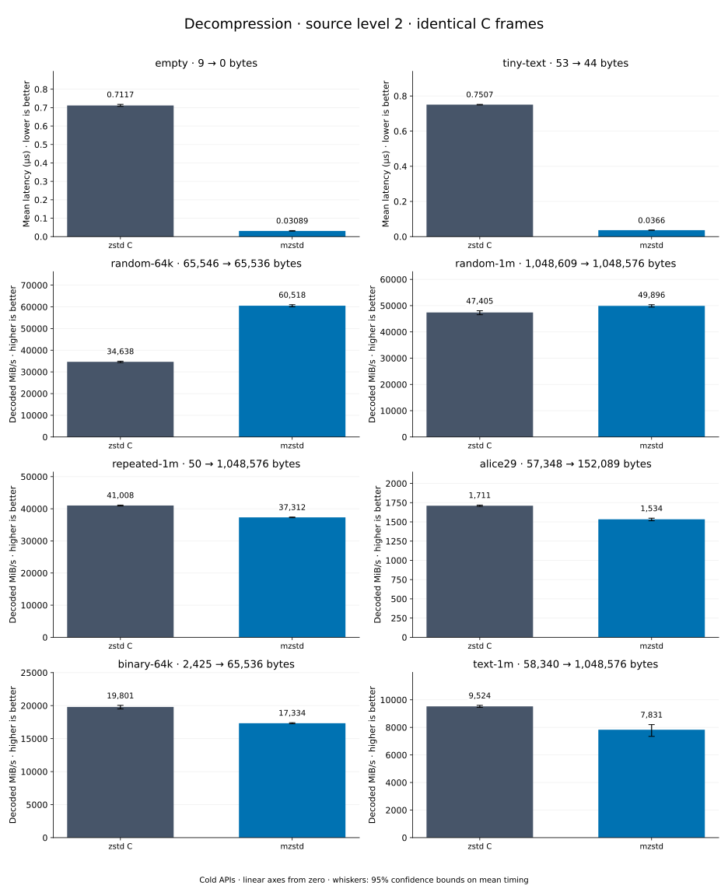

# Decompression of level 2 frames

[Decoder overview](README.md) · [Benchmark index](../README.md)

Recorded run: **dec-20261018** (2026-10-18).
[CSV](../decoder-comparison.csv) · [Environment](../decoder-comparison-environment.json) · [Methodology and limits](../decoder-comparison.md).

Level belongs to the C encoder that prepared the frame; decoders have no level setting.
Both decoders restore the same bytes.

## Median speed across 8 datasets

Median of per-dataset C mean time / decoder mean time ratios, with equal weight.
Higher is faster; 1× matches C. No confidence interval
is inferred for this across-dataset median.

| Decoder | Median speed / C |
| --- | ---: |
| zstd C | 1.000× |
| mzstd | 1.096× |

Datasets are ranked by mzstd speed relative to C, highest first.
Throughput counts restored bytes; empty input has latency only. Whiskers and intervals
describe sampling uncertainty, not all host variation. Cold APIs include allocation
and disposal. C reads the frame's content size and decodes into a buffer of exactly
that size; mzstd returns its own vector.

## empty

Empty input; measures API overhead.

**9 compressed → 0 restored bytes; compressed / original: undefined.**

| Decoder | Mean µs | 95% mean interval µs | Decoded MiB/s | Speed / C |
| --- | ---: | ---: | ---: | ---: |
| zstd C | 0.7019 | 0.6988–0.7055 | — | 1.000× |
| mzstd | 0.03375 | 0.03346–0.034 | — | 20.798× |

## tiny-text

44-byte quick-brown-fox sentence.

**53 compressed → 44 restored bytes; compressed / original: 120.455%.**

| Decoder | Mean µs | 95% mean interval µs | Decoded MiB/s | Speed / C |
| --- | ---: | ---: | ---: | ---: |
| zstd C | 0.7357 | 0.735–0.7365 | 57.04 | 1.000× |
| mzstd | 0.0413 | 0.04101–0.04162 | 1,015.97 | 17.813× |

## random-64k

64 KiB prefix of the deterministic pseudorandom corpus.

**65,546 compressed → 65,536 restored bytes; compressed / original: 100.015%.**

| Decoder | Mean µs | 95% mean interval µs | Decoded MiB/s | Speed / C |
| --- | ---: | ---: | ---: | ---: |
| zstd C | 1.789 | 1.772–1.81 | 34,934.40 | 1.000× |
| mzstd | 1.038 | 1.031–1.045 | 60,227.54 | 1.724× |

## repeated-1m

1 MiB of repeated a bytes.

**50 compressed → 1,048,576 restored bytes; compressed / original: 0.005%.**

| Decoder | Mean µs | 95% mean interval µs | Decoded MiB/s | Speed / C |
| --- | ---: | ---: | ---: | ---: |
| zstd C | 24.28 | 24.23–24.31 | 41,190.97 | 1.000× |
| mzstd | 21.61 | 21.55–21.69 | 46,277.97 | 1.123× |

## binary-64k

64 KiB of structured binary bytes: ((i / 16) XOR i) modulo 256.

**2,425 compressed → 65,536 restored bytes; compressed / original: 3.700%.**

| Decoder | Mean µs | 95% mean interval µs | Decoded MiB/s | Speed / C |
| --- | ---: | ---: | ---: | ---: |
| zstd C | 3.119 | 3.106–3.134 | 20,037.07 | 1.000× |
| mzstd | 2.92 | 2.914–2.928 | 21,401.10 | 1.068× |

## random-1m

1 MiB of deterministic xorshift64 pseudorandom bytes.

**1,048,609 compressed → 1,048,576 restored bytes; compressed / original: 100.003%.**

| Decoder | Mean µs | 95% mean interval µs | Decoded MiB/s | Speed / C |
| --- | ---: | ---: | ---: | ---: |
| zstd C | 20.98 | 20.92–21.04 | 47,666.23 | 1.000× |
| mzstd | 20.18 | 20.15–20.22 | 49,551.12 | 1.040× |

## text-1m

Alice text repeated cyclically to 1 MiB.

**58,340 compressed → 1,048,576 restored bytes; compressed / original: 5.564%.**

| Decoder | Mean µs | 95% mean interval µs | Decoded MiB/s | Speed / C |
| --- | ---: | ---: | ---: | ---: |
| zstd C | 101.3 | 100.7–101.9 | 9,870.86 | 1.000× |
| mzstd | 100.6 | 100.2–101.1 | 9,938.41 | 1.007× |

## alice29

Alice in Wonderland text from the Canterbury corpus (`testdata/alice29.txt`).

**57,348 compressed → 152,089 restored bytes; compressed / original: 37.707%.**

| Decoder | Mean µs | 95% mean interval µs | Decoded MiB/s | Speed / C |
| --- | ---: | ---: | ---: | ---: |
| zstd C | 84.99 | 84.71–85.27 | 1,706.63 | 1.000× |
| mzstd | 91.1 | 90.95–91.27 | 1,592.11 | 0.933× |
