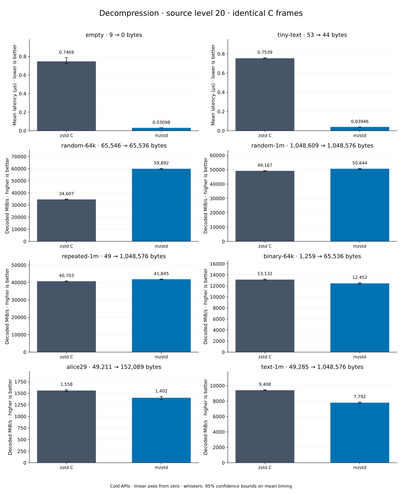

# Decompression of level 20 frames

[Decoder overview](README.md) · [Benchmark index](../README.md)

Recorded run: **full-20261030** (2026-10-30).
[CSV](../decoder-comparison.csv) · [Environment](../decoder-comparison-environment.json) · [Methodology and limits](../decoder-comparison.md).

Level belongs to the C encoder that prepared the frame; decoders have no level setting.
Both decoders restore the same bytes.

## Median speed across 8 datasets

Median of per-dataset C mean time / decoder mean time ratios, with equal weight.
Higher is faster; 1× matches C. No confidence interval
is inferred for this across-dataset median.

| Decoder | Median speed / C |
| --- | ---: |
| zstd C | 1.000× |
| mzstd main | 1.377× |
| mzstd | 1.453× |

mzstd main is the same matrix measured on `0a4fd87` in a process beside this run's; its ratios use that run's C timings.

Datasets are ranked by mzstd speed relative to C, highest first.
Throughput counts restored bytes; empty input has latency only. Whiskers and intervals
describe sampling uncertainty, not all host variation. Cold APIs include allocation
and disposal. C reads the frame's content size and decodes into a buffer of exactly
that size; mzstd returns its own vector.

## empty

Empty input; measures API overhead.

**9 compressed → 0 restored bytes; compressed / original: undefined.**

| Decoder | Mean µs | 95% mean interval µs | Decoded MiB/s | Speed / C |
| --- | ---: | ---: | ---: | ---: |
| zstd C | 1.886 | 1.878–1.893 | — | 1.000× |
| mzstd | 0.03859 | 0.03843–0.03873 | — | 48.864× |
| mzstd main (separate run) | 0.03862 | 0.03783–0.03958 | — | 49.595× |

## tiny-text

44-byte quick-brown-fox sentence.

**53 compressed → 44 restored bytes; compressed / original: 120.455%.**

| Decoder | Mean µs | 95% mean interval µs | Decoded MiB/s | Speed / C |
| --- | ---: | ---: | ---: | ---: |
| zstd C | 1.912 | 1.911–1.913 | 21.95 | 1.000× |
| mzstd | 0.04978 | 0.04959–0.05 | 842.90 | 38.408× |
| mzstd main (separate run) | 0.05239 | 0.05128–0.05372 | 800.98 | 36.597× |

## random-64k

64 KiB prefix of the deterministic pseudorandom corpus.

**65,546 compressed → 65,536 restored bytes; compressed / original: 100.015%.**

| Decoder | Mean µs | 95% mean interval µs | Decoded MiB/s | Speed / C |
| --- | ---: | ---: | ---: | ---: |
| zstd C | 2.748 | 2.744–2.753 | 22,740.39 | 1.000× |
| mzstd | 0.8766 | 0.876–0.8772 | 71,295.63 | 3.135× |
| mzstd main (separate run) | 0.865 | 0.864–0.8662 | 72,252.81 | 3.164× |

## repeated-1m

1 MiB of repeated a bytes.

**49 compressed → 1,048,576 restored bytes; compressed / original: 0.005%.**

| Decoder | Mean µs | 95% mean interval µs | Decoded MiB/s | Speed / C |
| --- | ---: | ---: | ---: | ---: |
| zstd C | 13.23 | 13.22–13.24 | 75,589.61 | 1.000× |
| mzstd | 8.785 | 8.771–8.799 | 113,829.03 | 1.506× |
| mzstd main (separate run) | 9.746 | 9.738–9.755 | 102,605.54 | 1.431× |

## binary-64k

64 KiB of structured binary bytes: ((i / 16) XOR i) modulo 256.

**1,259 compressed → 65,536 restored bytes; compressed / original: 1.921%.**

| Decoder | Mean µs | 95% mean interval µs | Decoded MiB/s | Speed / C |
| --- | ---: | ---: | ---: | ---: |
| zstd C | 5.784 | 5.776–5.792 | 10,805.71 | 1.000× |
| mzstd | 4.132 | 4.13–4.134 | 15,127.02 | 1.400× |
| mzstd main (separate run) | 4.364 | 4.352–4.38 | 14,322.24 | 1.324× |

## random-1m

1 MiB of deterministic xorshift64 pseudorandom bytes.

**1,048,609 compressed → 1,048,576 restored bytes; compressed / original: 100.003%.**

| Decoder | Mean µs | 95% mean interval µs | Decoded MiB/s | Speed / C |
| --- | ---: | ---: | ---: | ---: |
| zstd C | 19.44 | 19.42–19.46 | 51,446.12 | 1.000× |
| mzstd | 17.09 | 17.07–17.12 | 58,506.09 | 1.137× |
| mzstd main (separate run) | 16.84 | 16.83–16.85 | 59,382.12 | 1.143× |

## text-1m

Alice text repeated cyclically to 1 MiB.

**49,285 compressed → 1,048,576 restored bytes; compressed / original: 4.700%.**

| Decoder | Mean µs | 95% mean interval µs | Decoded MiB/s | Speed / C |
| --- | ---: | ---: | ---: | ---: |
| zstd C | 116.9 | 115.9–118.6 | 8,557.06 | 1.000× |
| mzstd | 120.1 | 120–120.2 | 8,325.13 | 0.973× |
| mzstd main (separate run) | 122.6 | 122.5–122.7 | 8,156.89 | 0.923× |

## alice29

Alice in Wonderland text from the Canterbury corpus (`testdata/alice29.txt`).

**49,211 compressed → 152,089 restored bytes; compressed / original: 32.357%.**

| Decoder | Mean µs | 95% mean interval µs | Decoded MiB/s | Speed / C |
| --- | ---: | ---: | ---: | ---: |
| zstd C | 99.22 | 99.15–99.29 | 1,461.89 | 1.000× |
| mzstd | 104.2 | 104–104.4 | 1,392.59 | 0.953× |
| mzstd main (separate run) | 108.7 | 107.6–110.5 | 1,334.76 | 0.900× |
