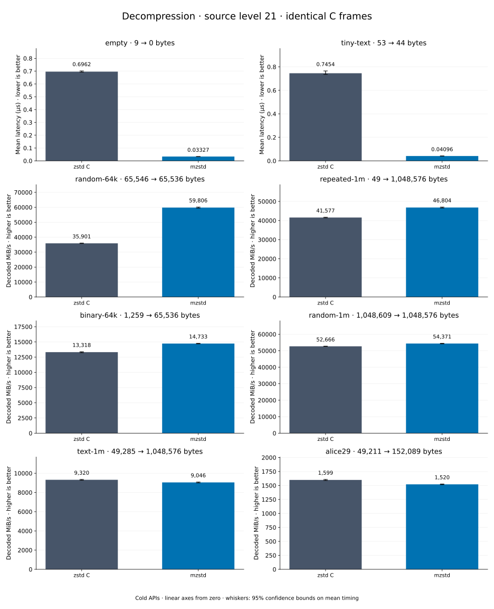

# Decompression of level 21 frames

[Decoder overview](README.md) · [Benchmark index](../README.md)

Recorded run: **dec-20261018** (2026-10-18).
[CSV](../decoder-comparison.csv) · [Environment](../decoder-comparison-environment.json) · [Methodology and limits](../decoder-comparison.md).

Level belongs to the C encoder that prepared the frame; decoders have no level setting.
Both decoders restore the same bytes.

## Median speed across 8 datasets

Median of per-dataset C mean time / decoder mean time ratios, with equal weight.
Higher is faster; 1× matches C. No confidence interval
is inferred for this across-dataset median.

| Decoder | Median speed / C |
| --- | ---: |
| zstd C | 1.000× |
| mzstd | 1.116× |

Datasets are ranked by mzstd speed relative to C, highest first.
Throughput counts restored bytes; empty input has latency only. Whiskers and intervals
describe sampling uncertainty, not all host variation. Cold APIs include allocation
and disposal. C reads the frame's content size and decodes into a buffer of exactly
that size; mzstd returns its own vector.

## empty

Empty input; measures API overhead.

**9 compressed → 0 restored bytes; compressed / original: undefined.**

| Decoder | Mean µs | 95% mean interval µs | Decoded MiB/s | Speed / C |
| --- | ---: | ---: | ---: | ---: |
| zstd C | 0.6962 | 0.6921–0.7017 | — | 1.000× |
| mzstd | 0.03327 | 0.03301–0.03351 | — | 20.925× |

## tiny-text

44-byte quick-brown-fox sentence.

**53 compressed → 44 restored bytes; compressed / original: 120.455%.**

| Decoder | Mean µs | 95% mean interval µs | Decoded MiB/s | Speed / C |
| --- | ---: | ---: | ---: | ---: |
| zstd C | 0.7454 | 0.7353–0.7649 | 56.29 | 1.000× |
| mzstd | 0.04096 | 0.04069–0.04128 | 1,024.48 | 18.200× |

## random-64k

64 KiB prefix of the deterministic pseudorandom corpus.

**65,546 compressed → 65,536 restored bytes; compressed / original: 100.015%.**

| Decoder | Mean µs | 95% mean interval µs | Decoded MiB/s | Speed / C |
| --- | ---: | ---: | ---: | ---: |
| zstd C | 1.741 | 1.734–1.749 | 35,901.00 | 1.000× |
| mzstd | 1.045 | 1.04–1.052 | 59,806.01 | 1.666× |

## repeated-1m

1 MiB of repeated a bytes.

**49 compressed → 1,048,576 restored bytes; compressed / original: 0.005%.**

| Decoder | Mean µs | 95% mean interval µs | Decoded MiB/s | Speed / C |
| --- | ---: | ---: | ---: | ---: |
| zstd C | 24.05 | 23.97–24.13 | 41,577.21 | 1.000× |
| mzstd | 21.37 | 21.27–21.48 | 46,804.01 | 1.126× |

## binary-64k

64 KiB of structured binary bytes: ((i / 16) XOR i) modulo 256.

**1,259 compressed → 65,536 restored bytes; compressed / original: 1.921%.**

| Decoder | Mean µs | 95% mean interval µs | Decoded MiB/s | Speed / C |
| --- | ---: | ---: | ---: | ---: |
| zstd C | 4.693 | 4.669–4.723 | 13,318.15 | 1.000× |
| mzstd | 4.242 | 4.229–4.257 | 14,732.70 | 1.106× |

## random-1m

1 MiB of deterministic xorshift64 pseudorandom bytes.

**1,048,609 compressed → 1,048,576 restored bytes; compressed / original: 100.003%.**

| Decoder | Mean µs | 95% mean interval µs | Decoded MiB/s | Speed / C |
| --- | ---: | ---: | ---: | ---: |
| zstd C | 18.99 | 18.95–19.02 | 52,666.41 | 1.000× |
| mzstd | 18.39 | 18.34–18.46 | 54,371.19 | 1.032× |

## text-1m

Alice text repeated cyclically to 1 MiB.

**49,285 compressed → 1,048,576 restored bytes; compressed / original: 4.700%.**

| Decoder | Mean µs | 95% mean interval µs | Decoded MiB/s | Speed / C |
| --- | ---: | ---: | ---: | ---: |
| zstd C | 107.3 | 106.9–107.8 | 9,319.89 | 1.000× |
| mzstd | 110.5 | 110.1–111.1 | 9,045.82 | 0.971× |

## alice29

Alice in Wonderland text from the Canterbury corpus (`testdata/alice29.txt`).

**49,211 compressed → 152,089 restored bytes; compressed / original: 32.357%.**

| Decoder | Mean µs | 95% mean interval µs | Decoded MiB/s | Speed / C |
| --- | ---: | ---: | ---: | ---: |
| zstd C | 90.71 | 90.2–91.26 | 1,598.98 | 1.000× |
| mzstd | 95.4 | 95.04–95.77 | 1,520.35 | 0.951× |
