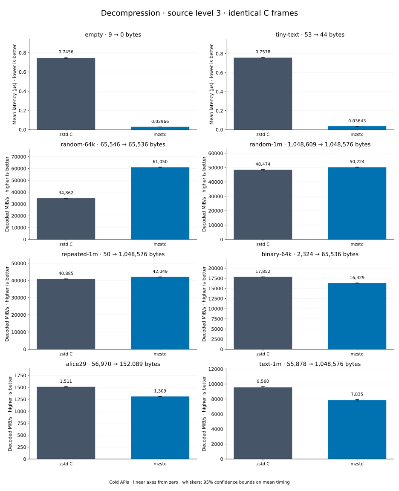

# Decompression of level 3 frames

[Decoder overview](README.md) · [Benchmark index](../README.md)

Recorded run: **full-20261030** (2026-10-30).
[CSV](../decoder-comparison.csv) · [Environment](../decoder-comparison-environment.json) · [Methodology and limits](../decoder-comparison.md).

Level belongs to the C encoder that prepared the frame; decoders have no level setting.
Both decoders restore the same bytes.

## Median speed across 8 datasets

Median of per-dataset C mean time / decoder mean time ratios, with equal weight.
Higher is faster; 1× matches C. No confidence interval
is inferred for this across-dataset median.

| Decoder | Median speed / C |
| --- | ---: |
| zstd C | 1.000× |
| mzstd main | 1.433× |
| mzstd | 1.497× |

mzstd main is the same matrix measured on `0a4fd87` in a process beside this run's; its ratios use that run's C timings.

Datasets are ranked by mzstd speed relative to C, highest first.
Throughput counts restored bytes; empty input has latency only. Whiskers and intervals
describe sampling uncertainty, not all host variation. Cold APIs include allocation
and disposal. C reads the frame's content size and decodes into a buffer of exactly
that size; mzstd returns its own vector.

## empty

Empty input; measures API overhead.

**9 compressed → 0 restored bytes; compressed / original: undefined.**

| Decoder | Mean µs | 95% mean interval µs | Decoded MiB/s | Speed / C |
| --- | ---: | ---: | ---: | ---: |
| zstd C | 1.859 | 1.858–1.86 | — | 1.000× |
| mzstd | 0.03841 | 0.03816–0.03885 | — | 48.392× |
| mzstd main (separate run) | 0.03932 | 0.0385–0.04035 | — | 47.671× |

## tiny-text

44-byte quick-brown-fox sentence.

**53 compressed → 44 restored bytes; compressed / original: 120.455%.**

| Decoder | Mean µs | 95% mean interval µs | Decoded MiB/s | Speed / C |
| --- | ---: | ---: | ---: | ---: |
| zstd C | 1.911 | 1.908–1.913 | 21.96 | 1.000× |
| mzstd | 0.05023 | 0.04992–0.05055 | 835.38 | 38.039× |
| mzstd main (separate run) | 0.05151 | 0.05072–0.05245 | 814.67 | 37.247× |

## random-64k

64 KiB prefix of the deterministic pseudorandom corpus.

**65,546 compressed → 65,536 restored bytes; compressed / original: 100.015%.**

| Decoder | Mean µs | 95% mean interval µs | Decoded MiB/s | Speed / C |
| --- | ---: | ---: | ---: | ---: |
| zstd C | 2.74 | 2.733–2.751 | 22,809.62 | 1.000× |
| mzstd | 0.8872 | 0.8862–0.8883 | 70,448.62 | 3.089× |
| mzstd main (separate run) | 0.8584 | 0.8576–0.8593 | 72,809.43 | 3.199× |

## repeated-1m

1 MiB of repeated a bytes.

**50 compressed → 1,048,576 restored bytes; compressed / original: 0.005%.**

| Decoder | Mean µs | 95% mean interval µs | Decoded MiB/s | Speed / C |
| --- | ---: | ---: | ---: | ---: |
| zstd C | 13.31 | 13.3–13.32 | 75,149.18 | 1.000× |
| mzstd | 8.808 | 8.799–8.816 | 113,535.17 | 1.511× |
| mzstd main (separate run) | 9.761 | 9.747–9.775 | 102,446.35 | 1.409× |

## binary-64k

64 KiB of structured binary bytes: ((i / 16) XOR i) modulo 256.

**2,324 compressed → 65,536 restored bytes; compressed / original: 3.546%.**

| Decoder | Mean µs | 95% mean interval µs | Decoded MiB/s | Speed / C |
| --- | ---: | ---: | ---: | ---: |
| zstd C | 4.533 | 4.529–4.536 | 13,788.84 | 1.000× |
| mzstd | 3.055 | 2.899–3.328 | 20,459.67 | 1.484× |
| mzstd main (separate run) | 3.091 | 3.087–3.097 | 20,217.27 | 1.456× |

## random-1m

1 MiB of deterministic xorshift64 pseudorandom bytes.

**1,048,609 compressed → 1,048,576 restored bytes; compressed / original: 100.003%.**

| Decoder | Mean µs | 95% mean interval µs | Decoded MiB/s | Speed / C |
| --- | ---: | ---: | ---: | ---: |
| zstd C | 18.66 | 18.65–18.67 | 53,596.12 | 1.000× |
| mzstd | 16.4 | 16.39–16.41 | 60,979.05 | 1.138× |
| mzstd main (separate run) | 16.63 | 16.62–16.64 | 60,127.22 | 1.147× |

## text-1m

Alice text repeated cyclically to 1 MiB.

**55,878 compressed → 1,048,576 restored bytes; compressed / original: 5.329%.**

| Decoder | Mean µs | 95% mean interval µs | Decoded MiB/s | Speed / C |
| --- | ---: | ---: | ---: | ---: |
| zstd C | 106.5 | 106.4–106.6 | 9,393.18 | 1.000× |
| mzstd | 112.3 | 112.1–112.5 | 8,901.73 | 0.948× |
| mzstd main (separate run) | 116.8 | 116.6–116.9 | 8,563.60 | 0.904× |

## alice29

Alice in Wonderland text from the Canterbury corpus (`testdata/alice29.txt`).

**56,970 compressed → 152,089 restored bytes; compressed / original: 37.458%.**

| Decoder | Mean µs | 95% mean interval µs | Decoded MiB/s | Speed / C |
| --- | ---: | ---: | ---: | ---: |
| zstd C | 104.5 | 104.3–104.6 | 1,388.32 | 1.000× |
| mzstd | 111.2 | 111.1–111.4 | 1,303.89 | 0.939× |
| mzstd main (separate run) | 114.7 | 114.6–114.9 | 1,264.10 | 0.894× |
