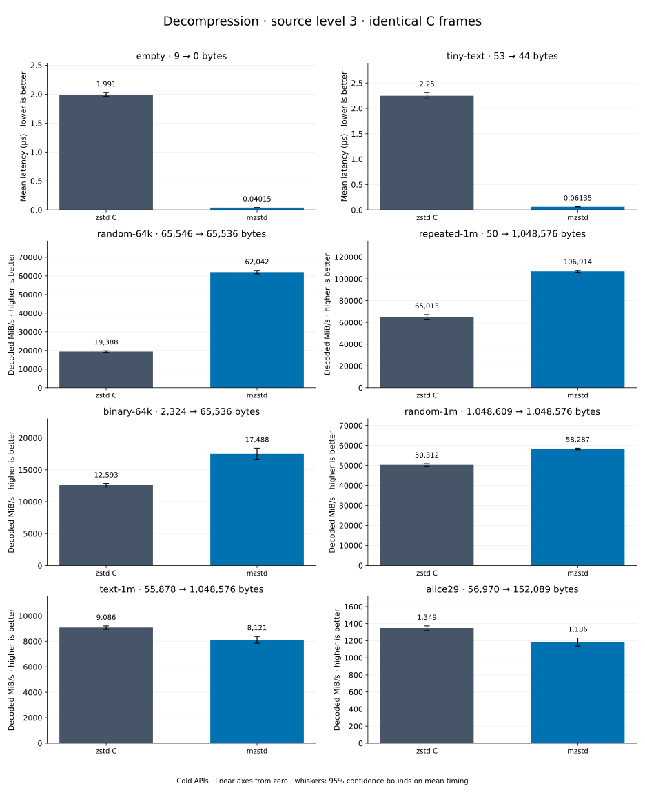

# Decompression of level 3 frames

[Decoder overview](README.md) · [Benchmark index](../README.md)

Recorded run: **long-20261112** (2026-11-12).
[CSV](../decoder-comparison.csv) · [Environment](../decoder-comparison-environment.json) · [Methodology and limits](../decoder-comparison.md).

Level belongs to the C encoder that prepared the frame; decoders have no level setting.
Both decoders restore the same bytes.

## Median speed across 8 datasets

Median of per-dataset C mean time / decoder mean time ratios, with equal weight.
Higher is faster; 1× matches C. No confidence interval
is inferred for this across-dataset median.

| Decoder | Median speed / C |
| --- | ---: |
| zstd C | 1.000× |
| mzstd | 1.517× |

Datasets are ranked by mzstd speed relative to C, highest first.
Throughput counts restored bytes; empty input has latency only. Whiskers and intervals
describe sampling uncertainty, not all host variation. Cold APIs include allocation
and disposal. C reads the frame's content size and decodes into a buffer of exactly
that size; mzstd returns its own vector.

## empty

Empty input; measures API overhead.

**9 compressed → 0 restored bytes; compressed / original: undefined.**

| Decoder | Mean µs | 95% mean interval µs | Decoded MiB/s | Speed / C |
| --- | ---: | ---: | ---: | ---: |
| zstd C | 1.991 | 1.959–2.026 | — | 1.000× |
| mzstd | 0.04015 | 0.03965–0.04074 | — | 49.588× |

## tiny-text

44-byte quick-brown-fox sentence.

**53 compressed → 44 restored bytes; compressed / original: 120.455%.**

| Decoder | Mean µs | 95% mean interval µs | Decoded MiB/s | Speed / C |
| --- | ---: | ---: | ---: | ---: |
| zstd C | 2.25 | 2.189–2.31 | 18.65 | 1.000× |
| mzstd | 0.06135 | 0.06046–0.0624 | 683.99 | 36.668× |

## random-64k

64 KiB prefix of the deterministic pseudorandom corpus.

**65,546 compressed → 65,536 restored bytes; compressed / original: 100.015%.**

| Decoder | Mean µs | 95% mean interval µs | Decoded MiB/s | Speed / C |
| --- | ---: | ---: | ---: | ---: |
| zstd C | 3.224 | 3.149–3.301 | 19,388.14 | 1.000× |
| mzstd | 1.007 | 0.9922–1.023 | 62,041.63 | 3.200× |

## repeated-1m

1 MiB of repeated a bytes.

**50 compressed → 1,048,576 restored bytes; compressed / original: 0.005%.**

| Decoder | Mean µs | 95% mean interval µs | Decoded MiB/s | Speed / C |
| --- | ---: | ---: | ---: | ---: |
| zstd C | 15.38 | 14.9–15.88 | 65,012.80 | 1.000× |
| mzstd | 9.353 | 9.276–9.44 | 106,914.45 | 1.645× |

## binary-64k

64 KiB of structured binary bytes: ((i / 16) XOR i) modulo 256.

**2,324 compressed → 65,536 restored bytes; compressed / original: 3.546%.**

| Decoder | Mean µs | 95% mean interval µs | Decoded MiB/s | Speed / C |
| --- | ---: | ---: | ---: | ---: |
| zstd C | 4.963 | 4.864–5.08 | 12,593.35 | 1.000× |
| mzstd | 3.574 | 3.396–3.759 | 17,487.79 | 1.389× |

## random-1m

1 MiB of deterministic xorshift64 pseudorandom bytes.

**1,048,609 compressed → 1,048,576 restored bytes; compressed / original: 100.003%.**

| Decoder | Mean µs | 95% mean interval µs | Decoded MiB/s | Speed / C |
| --- | ---: | ---: | ---: | ---: |
| zstd C | 19.88 | 19.66–20.11 | 50,311.66 | 1.000× |
| mzstd | 17.16 | 17.04–17.29 | 58,286.74 | 1.159× |

## text-1m

Alice text repeated cyclically to 1 MiB.

**55,878 compressed → 1,048,576 restored bytes; compressed / original: 5.329%.**

| Decoder | Mean µs | 95% mean interval µs | Decoded MiB/s | Speed / C |
| --- | ---: | ---: | ---: | ---: |
| zstd C | 110.1 | 108.6–112 | 9,086.25 | 1.000× |
| mzstd | 123.1 | 119.3–127.5 | 8,121.10 | 0.894× |

## alice29

Alice in Wonderland text from the Canterbury corpus (`testdata/alice29.txt`).

**56,970 compressed → 152,089 restored bytes; compressed / original: 37.458%.**

| Decoder | Mean µs | 95% mean interval µs | Decoded MiB/s | Speed / C |
| --- | ---: | ---: | ---: | ---: |
| zstd C | 107.5 | 105.6–110 | 1,348.96 | 1.000× |
| mzstd | 122.3 | 117.8–127.5 | 1,186.27 | 0.879× |
