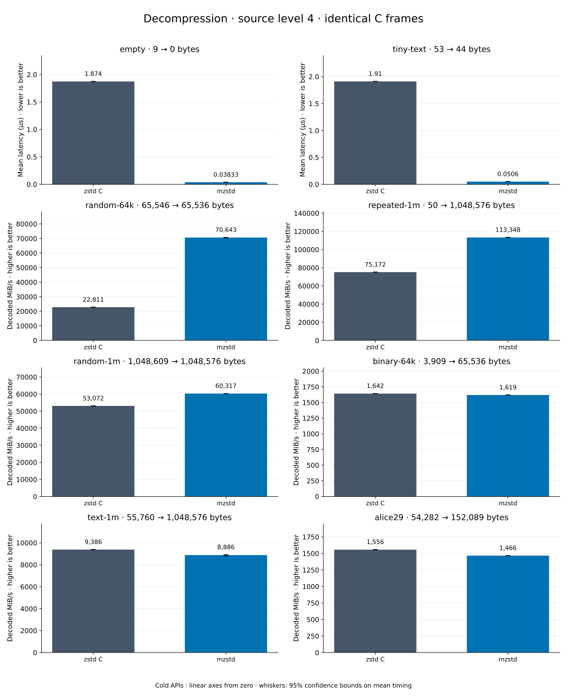

# Decompression of level 4 frames

[Decoder overview](README.md) · [Benchmark index](../README.md)

Recorded run: **dec-2026-10-13** (2026-10-13).
[CSV](../decoder-comparison.csv) · [Environment](../decoder-comparison-environment.json) · [Methodology and limits](../decoder-comparison.md).

Level belongs to the C encoder that prepared the frame; decoders have no level setting.
Both decoders restore the same bytes.

## Median speed across 8 datasets

Median of per-dataset C mean time / decoder mean time ratios, with equal weight.
Higher is faster; 1× matches C. No confidence interval
is inferred for this across-dataset median.

| Decoder | Median speed / C |
| --- | ---: |
| zstd C | 1.000× |
| mzstd | 1.034× |

Datasets are ranked by mzstd speed relative to C, highest first.
Throughput counts restored bytes; empty input has latency only. Whiskers and intervals
describe sampling uncertainty, not all host variation. Cold APIs include allocation
and disposal. C reads the frame's content size and decodes into a buffer of exactly
that size; mzstd returns its own vector.

## empty

Empty input; measures API overhead.

**9 compressed → 0 restored bytes; compressed / original: undefined.**

| Decoder | Mean µs | 95% mean interval µs | Decoded MiB/s | Speed / C |
| --- | ---: | ---: | ---: | ---: |
| zstd C | 0.7536 | 0.7469–0.7602 | — | 1.000× |
| mzstd | 0.0301 | 0.02983–0.03034 | — | 25.035× |

## tiny-text

44-byte quick-brown-fox sentence.

**53 compressed → 44 restored bytes; compressed / original: 120.455%.**

| Decoder | Mean µs | 95% mean interval µs | Decoded MiB/s | Speed / C |
| --- | ---: | ---: | ---: | ---: |
| zstd C | 0.7577 | 0.7553–0.7604 | 55.38 | 1.000× |
| mzstd | 0.03664 | 0.03647–0.03683 | 1,145.36 | 20.681× |

## random-64k

64 KiB prefix of the deterministic pseudorandom corpus.

**65,546 compressed → 65,536 restored bytes; compressed / original: 100.015%.**

| Decoder | Mean µs | 95% mean interval µs | Decoded MiB/s | Speed / C |
| --- | ---: | ---: | ---: | ---: |
| zstd C | 1.782 | 1.779–1.786 | 35,065.70 | 1.000× |
| mzstd | 1.023 | 1.019–1.027 | 61,120.35 | 1.743× |

## random-1m

1 MiB of deterministic xorshift64 pseudorandom bytes.

**1,048,609 compressed → 1,048,576 restored bytes; compressed / original: 100.003%.**

| Decoder | Mean µs | 95% mean interval µs | Decoded MiB/s | Speed / C |
| --- | ---: | ---: | ---: | ---: |
| zstd C | 20.05 | 19.97–20.14 | 49,875.97 | 1.000× |
| mzstd | 19.23 | 19.17–19.29 | 52,010.10 | 1.043× |

## repeated-1m

1 MiB of repeated a bytes.

**50 compressed → 1,048,576 restored bytes; compressed / original: 0.005%.**

| Decoder | Mean µs | 95% mean interval µs | Decoded MiB/s | Speed / C |
| --- | ---: | ---: | ---: | ---: |
| zstd C | 24.44 | 24.37–24.5 | 40,923.80 | 1.000× |
| mzstd | 23.83 | 23.74–23.94 | 41,970.16 | 1.026× |

## binary-64k

64 KiB of structured binary bytes: ((i / 16) XOR i) modulo 256.

**3,909 compressed → 65,536 restored bytes; compressed / original: 5.965%.**

| Decoder | Mean µs | 95% mean interval µs | Decoded MiB/s | Speed / C |
| --- | ---: | ---: | ---: | ---: |
| zstd C | 38.25 | 38.17–38.34 | 1,634.01 | 1.000× |
| mzstd | 42.83 | 42.73–42.97 | 1,459.11 | 0.893× |

## alice29

Alice in Wonderland text from the Canterbury corpus (`testdata/alice29.txt`).

**54,282 compressed → 152,089 restored bytes; compressed / original: 35.691%.**

| Decoder | Mean µs | 95% mean interval µs | Decoded MiB/s | Speed / C |
| --- | ---: | ---: | ---: | ---: |
| zstd C | 87.23 | 86.81–87.68 | 1,662.72 | 1.000× |
| mzstd | 99.49 | 99.1–99.96 | 1,457.82 | 0.877× |

## text-1m

Alice text repeated cyclically to 1 MiB.

**55,760 compressed → 1,048,576 restored bytes; compressed / original: 5.318%.**

| Decoder | Mean µs | 95% mean interval µs | Decoded MiB/s | Speed / C |
| --- | ---: | ---: | ---: | ---: |
| zstd C | 104.7 | 103.6–105.8 | 9,553.08 | 1.000× |
| mzstd | 128.8 | 127.9–129.6 | 7,766.88 | 0.813× |
