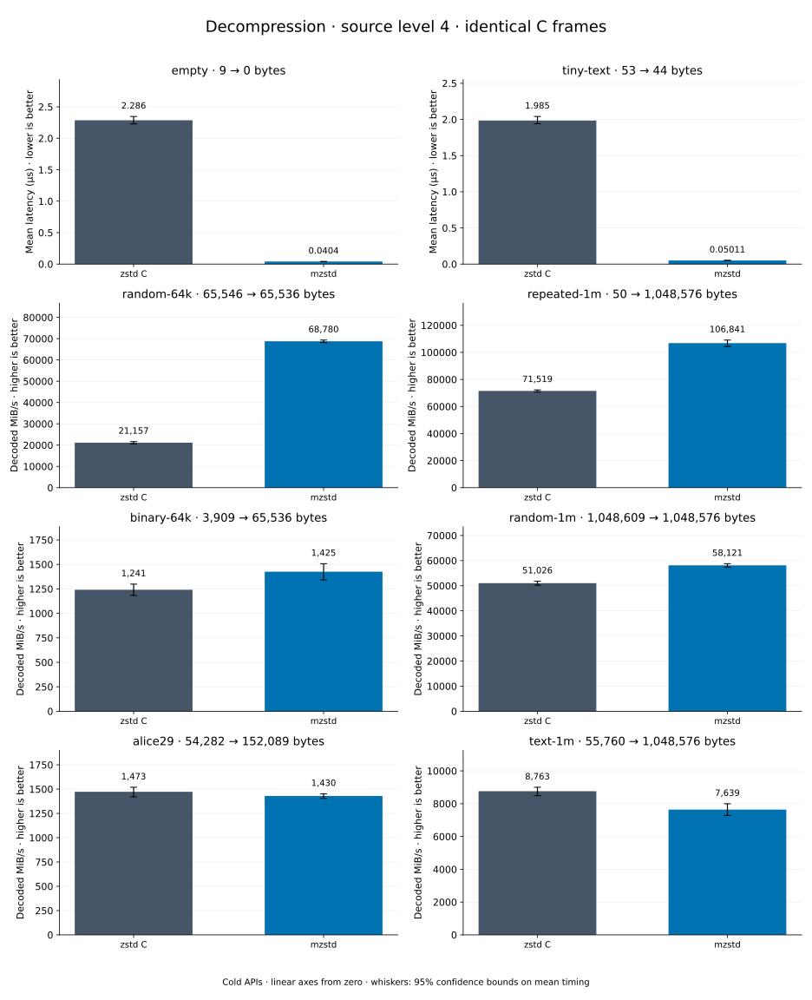

# Decompression of level 4 frames

[Decoder overview](README.md) · [Benchmark index](../README.md)

Recorded run: **long-20261112** (2026-11-12).
[CSV](../decoder-comparison.csv) · [Environment](../decoder-comparison-environment.json) · [Methodology and limits](../decoder-comparison.md).

Level belongs to the C encoder that prepared the frame; decoders have no level setting.
Both decoders restore the same bytes.

## Median speed across 8 datasets

Median of per-dataset C mean time / decoder mean time ratios, with equal weight.
Higher is faster; 1× matches C. No confidence interval
is inferred for this across-dataset median.

| Decoder | Median speed / C |
| --- | ---: |
| zstd C | 1.000× |
| mzstd | 1.291× |

Datasets are ranked by mzstd speed relative to C, highest first.
Throughput counts restored bytes; empty input has latency only. Whiskers and intervals
describe sampling uncertainty, not all host variation. Cold APIs include allocation
and disposal. C reads the frame's content size and decodes into a buffer of exactly
that size; mzstd returns its own vector.

## empty

Empty input; measures API overhead.

**9 compressed → 0 restored bytes; compressed / original: undefined.**

| Decoder | Mean µs | 95% mean interval µs | Decoded MiB/s | Speed / C |
| --- | ---: | ---: | ---: | ---: |
| zstd C | 2.076 | 2.015–2.142 | — | 1.000× |
| mzstd | 0.03956 | 0.0392–0.04002 | — | 52.479× |

## tiny-text

44-byte quick-brown-fox sentence.

**53 compressed → 44 restored bytes; compressed / original: 120.455%.**

| Decoder | Mean µs | 95% mean interval µs | Decoded MiB/s | Speed / C |
| --- | ---: | ---: | ---: | ---: |
| zstd C | 2.221 | 2.14–2.307 | 18.89 | 1.000× |
| mzstd | 0.06095 | 0.05995–0.06203 | 688.50 | 36.443× |

## random-64k

64 KiB prefix of the deterministic pseudorandom corpus.

**65,546 compressed → 65,536 restored bytes; compressed / original: 100.015%.**

| Decoder | Mean µs | 95% mean interval µs | Decoded MiB/s | Speed / C |
| --- | ---: | ---: | ---: | ---: |
| zstd C | 3.139 | 3.078–3.202 | 19,912.66 | 1.000× |
| mzstd | 1.005 | 0.9887–1.022 | 62,176.16 | 3.122× |

## repeated-1m

1 MiB of repeated a bytes.

**50 compressed → 1,048,576 restored bytes; compressed / original: 0.005%.**

| Decoder | Mean µs | 95% mean interval µs | Decoded MiB/s | Speed / C |
| --- | ---: | ---: | ---: | ---: |
| zstd C | 14.5 | 14.23–14.82 | 68,967.21 | 1.000× |
| mzstd | 9.988 | 9.715–10.28 | 100,117.00 | 1.452× |

## random-1m

1 MiB of deterministic xorshift64 pseudorandom bytes.

**1,048,609 compressed → 1,048,576 restored bytes; compressed / original: 100.003%.**

| Decoder | Mean µs | 95% mean interval µs | Decoded MiB/s | Speed / C |
| --- | ---: | ---: | ---: | ---: |
| zstd C | 19.45 | 19.3–19.61 | 51,421.70 | 1.000× |
| mzstd | 17.19 | 17.05–17.35 | 58,172.43 | 1.131× |

## binary-64k

64 KiB of structured binary bytes: ((i / 16) XOR i) modulo 256.

**3,909 compressed → 65,536 restored bytes; compressed / original: 5.965%.**

| Decoder | Mean µs | 95% mean interval µs | Decoded MiB/s | Speed / C |
| --- | ---: | ---: | ---: | ---: |
| zstd C | 44.99 | 43.47–46.61 | 1,389.26 | 1.000× |
| mzstd | 45.37 | 43.18–47.78 | 1,377.66 | 0.992× |

## alice29

Alice in Wonderland text from the Canterbury corpus (`testdata/alice29.txt`).

**54,282 compressed → 152,089 restored bytes; compressed / original: 35.691%.**

| Decoder | Mean µs | 95% mean interval µs | Decoded MiB/s | Speed / C |
| --- | ---: | ---: | ---: | ---: |
| zstd C | 100.9 | 97.98–104.3 | 1,437.15 | 1.000× |
| mzstd | 106.1 | 104.3–108.2 | 1,366.80 | 0.951× |

## text-1m

Alice text repeated cyclically to 1 MiB.

**55,760 compressed → 1,048,576 restored bytes; compressed / original: 5.318%.**

| Decoder | Mean µs | 95% mean interval µs | Decoded MiB/s | Speed / C |
| --- | ---: | ---: | ---: | ---: |
| zstd C | 118.2 | 114.5–122.3 | 8,461.39 | 1.000× |
| mzstd | 140.3 | 134–147.1 | 7,125.06 | 0.842× |
