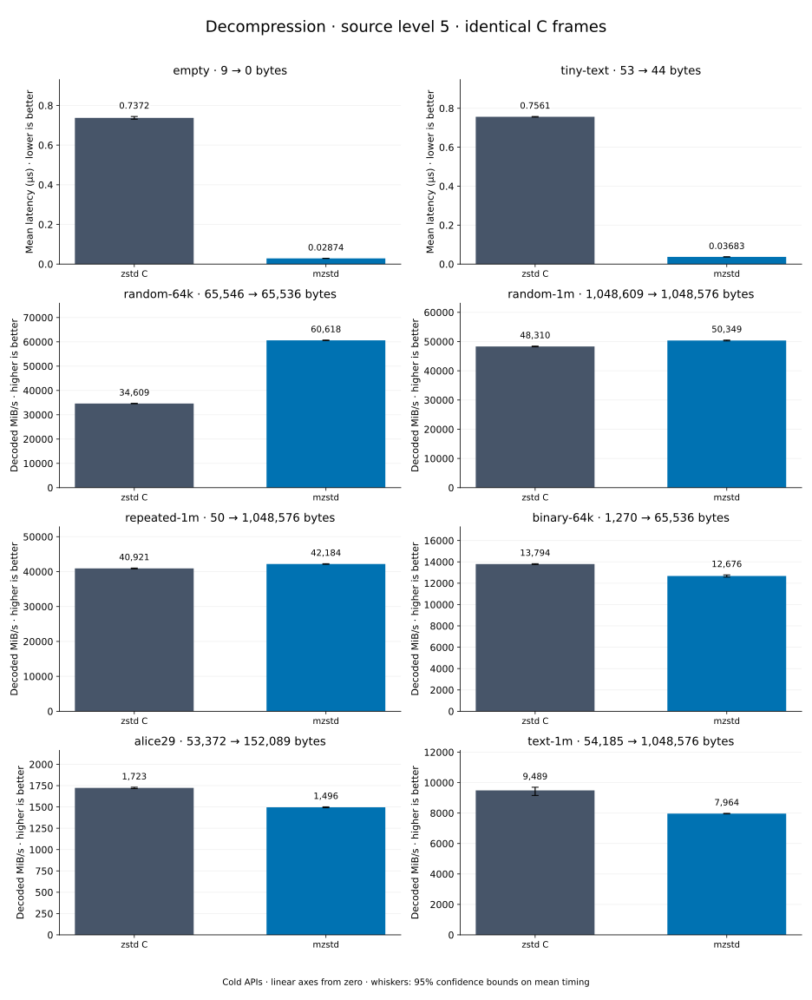

# Decompression of level 5 frames

[Decoder overview](README.md) · [Benchmark index](../README.md)

Recorded run: **dec-20261015c** (2026-10-15).
[CSV](../decoder-comparison.csv) · [Environment](../decoder-comparison-environment.json) · [Methodology and limits](../decoder-comparison.md).

Level belongs to the C encoder that prepared the frame; decoders have no level setting.
Both decoders restore the same bytes.

## Median speed across 8 datasets

Median of per-dataset C mean time / decoder mean time ratios, with equal weight.
Higher is faster; 1× matches C. No confidence interval
is inferred for this across-dataset median.

| Decoder | Median speed / C |
| --- | ---: |
| zstd C | 1.000× |
| mzstd | 0.987× |

Datasets are ranked by mzstd speed relative to C, highest first.
Throughput counts restored bytes; empty input has latency only. Whiskers and intervals
describe sampling uncertainty, not all host variation. Cold APIs include allocation
and disposal. C reads the frame's content size and decodes into a buffer of exactly
that size; mzstd returns its own vector.

## empty

Empty input; measures API overhead.

**9 compressed → 0 restored bytes; compressed / original: undefined.**

| Decoder | Mean µs | 95% mean interval µs | Decoded MiB/s | Speed / C |
| --- | ---: | ---: | ---: | ---: |
| zstd C | 0.7117 | 0.7088–0.7149 | — | 1.000× |
| mzstd | 0.03359 | 0.03265–0.03475 | — | 21.188× |

## tiny-text

44-byte quick-brown-fox sentence.

**53 compressed → 44 restored bytes; compressed / original: 120.455%.**

| Decoder | Mean µs | 95% mean interval µs | Decoded MiB/s | Speed / C |
| --- | ---: | ---: | ---: | ---: |
| zstd C | 0.7562 | 0.7544–0.7582 | 55.49 | 1.000× |
| mzstd | 0.04391 | 0.04269–0.04589 | 955.63 | 17.222× |

## random-64k

64 KiB prefix of the deterministic pseudorandom corpus.

**65,546 compressed → 65,536 restored bytes; compressed / original: 100.015%.**

| Decoder | Mean µs | 95% mean interval µs | Decoded MiB/s | Speed / C |
| --- | ---: | ---: | ---: | ---: |
| zstd C | 1.792 | 1.786–1.798 | 34,883.24 | 1.000× |
| mzstd | 1.038 | 1.028–1.048 | 60,203.02 | 1.726× |

## random-1m

1 MiB of deterministic xorshift64 pseudorandom bytes.

**1,048,609 compressed → 1,048,576 restored bytes; compressed / original: 100.003%.**

| Decoder | Mean µs | 95% mean interval µs | Decoded MiB/s | Speed / C |
| --- | ---: | ---: | ---: | ---: |
| zstd C | 19.96 | 19.89–20.03 | 50,095.88 | 1.000× |
| mzstd | 19.34 | 19.23–19.46 | 51,702.97 | 1.032× |

## binary-64k

64 KiB of structured binary bytes: ((i / 16) XOR i) modulo 256.

**1,270 compressed → 65,536 restored bytes; compressed / original: 1.938%.**

| Decoder | Mean µs | 95% mean interval µs | Decoded MiB/s | Speed / C |
| --- | ---: | ---: | ---: | ---: |
| zstd C | 4.444 | 4.426–4.465 | 14,063.94 | 1.000× |
| mzstd | 4.715 | 4.684–4.749 | 13,256.81 | 0.943× |

## alice29

Alice in Wonderland text from the Canterbury corpus (`testdata/alice29.txt`).

**53,372 compressed → 152,089 restored bytes; compressed / original: 35.093%.**

| Decoder | Mean µs | 95% mean interval µs | Decoded MiB/s | Speed / C |
| --- | ---: | ---: | ---: | ---: |
| zstd C | 84.77 | 83.82–86.14 | 1,711.11 | 1.000× |
| mzstd | 92.23 | 90.92–93.93 | 1,572.70 | 0.919× |

## repeated-1m

1 MiB of repeated a bytes.

**50 compressed → 1,048,576 restored bytes; compressed / original: 0.005%.**

| Decoder | Mean µs | 95% mean interval µs | Decoded MiB/s | Speed / C |
| --- | ---: | ---: | ---: | ---: |
| zstd C | 24.46 | 24.3–24.63 | 40,887.54 | 1.000× |
| mzstd | 26.9 | 26.71–27.12 | 37,170.09 | 0.909× |

## text-1m

Alice text repeated cyclically to 1 MiB.

**54,185 compressed → 1,048,576 restored bytes; compressed / original: 5.167%.**

| Decoder | Mean µs | 95% mean interval µs | Decoded MiB/s | Speed / C |
| --- | ---: | ---: | ---: | ---: |
| zstd C | 102.3 | 102–102.5 | 9,778.86 | 1.000× |
| mzstd | 120.5 | 119.8–121.5 | 8,300.22 | 0.849× |
