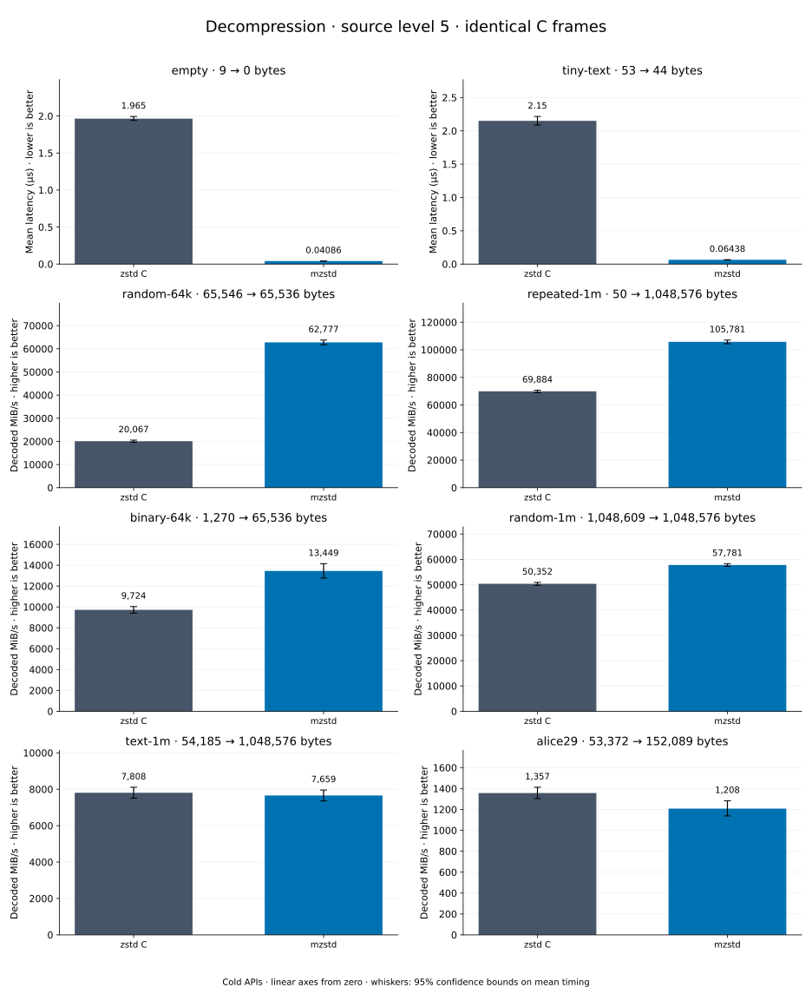

# Decompression of level 5 frames

[Decoder overview](README.md) · [Benchmark index](../README.md)

Recorded run: **long-20261112** (2026-11-12).
[CSV](../decoder-comparison.csv) · [Environment](../decoder-comparison-environment.json) · [Methodology and limits](../decoder-comparison.md).

Level belongs to the C encoder that prepared the frame; decoders have no level setting.
Both decoders restore the same bytes.

## Median speed across 8 datasets

Median of per-dataset C mean time / decoder mean time ratios, with equal weight.
Higher is faster; 1× matches C. No confidence interval
is inferred for this across-dataset median.

| Decoder | Median speed / C |
| --- | ---: |
| zstd C | 1.000× |
| mzstd | 1.448× |

Datasets are ranked by mzstd speed relative to C, highest first.
Throughput counts restored bytes; empty input has latency only. Whiskers and intervals
describe sampling uncertainty, not all host variation. Cold APIs include allocation
and disposal. C reads the frame's content size and decodes into a buffer of exactly
that size; mzstd returns its own vector.

## empty

Empty input; measures API overhead.

**9 compressed → 0 restored bytes; compressed / original: undefined.**

| Decoder | Mean µs | 95% mean interval µs | Decoded MiB/s | Speed / C |
| --- | ---: | ---: | ---: | ---: |
| zstd C | 1.965 | 1.941–1.994 | — | 1.000× |
| mzstd | 0.04086 | 0.04016–0.04171 | — | 48.088× |

## tiny-text

44-byte quick-brown-fox sentence.

**53 compressed → 44 restored bytes; compressed / original: 120.455%.**

| Decoder | Mean µs | 95% mean interval µs | Decoded MiB/s | Speed / C |
| --- | ---: | ---: | ---: | ---: |
| zstd C | 2.15 | 2.087–2.215 | 19.52 | 1.000× |
| mzstd | 0.06438 | 0.06272–0.06618 | 651.78 | 33.397× |

## random-64k

64 KiB prefix of the deterministic pseudorandom corpus.

**65,546 compressed → 65,536 restored bytes; compressed / original: 100.015%.**

| Decoder | Mean µs | 95% mean interval µs | Decoded MiB/s | Speed / C |
| --- | ---: | ---: | ---: | ---: |
| zstd C | 3.115 | 3.044–3.189 | 20,066.51 | 1.000× |
| mzstd | 0.9956 | 0.9801–1.012 | 62,776.55 | 3.128× |

## repeated-1m

1 MiB of repeated a bytes.

**50 compressed → 1,048,576 restored bytes; compressed / original: 0.005%.**

| Decoder | Mean µs | 95% mean interval µs | Decoded MiB/s | Speed / C |
| --- | ---: | ---: | ---: | ---: |
| zstd C | 14.31 | 14.15–14.51 | 69,883.71 | 1.000× |
| mzstd | 9.453 | 9.341–9.581 | 105,781.30 | 1.514× |

## binary-64k

64 KiB of structured binary bytes: ((i / 16) XOR i) modulo 256.

**1,270 compressed → 65,536 restored bytes; compressed / original: 1.938%.**

| Decoder | Mean µs | 95% mean interval µs | Decoded MiB/s | Speed / C |
| --- | ---: | ---: | ---: | ---: |
| zstd C | 6.427 | 6.229–6.642 | 9,723.99 | 1.000× |
| mzstd | 4.647 | 4.418–4.895 | 13,449.34 | 1.383× |

## random-1m

1 MiB of deterministic xorshift64 pseudorandom bytes.

**1,048,609 compressed → 1,048,576 restored bytes; compressed / original: 100.003%.**

| Decoder | Mean µs | 95% mean interval µs | Decoded MiB/s | Speed / C |
| --- | ---: | ---: | ---: | ---: |
| zstd C | 19.86 | 19.64–20.1 | 50,351.81 | 1.000× |
| mzstd | 17.31 | 17.15–17.47 | 57,780.86 | 1.148× |

## text-1m

Alice text repeated cyclically to 1 MiB.

**54,185 compressed → 1,048,576 restored bytes; compressed / original: 5.167%.**

| Decoder | Mean µs | 95% mean interval µs | Decoded MiB/s | Speed / C |
| --- | ---: | ---: | ---: | ---: |
| zstd C | 128.1 | 123.3–133.2 | 7,807.54 | 1.000× |
| mzstd | 130.6 | 125.7–136 | 7,658.68 | 0.981× |

## alice29

Alice in Wonderland text from the Canterbury corpus (`testdata/alice29.txt`).

**53,372 compressed → 152,089 restored bytes; compressed / original: 35.093%.**

| Decoder | Mean µs | 95% mean interval µs | Decoded MiB/s | Speed / C |
| --- | ---: | ---: | ---: | ---: |
| zstd C | 106.9 | 102.7–111.3 | 1,356.63 | 1.000× |
| mzstd | 120.1 | 113.1–127.5 | 1,207.89 | 0.890× |
