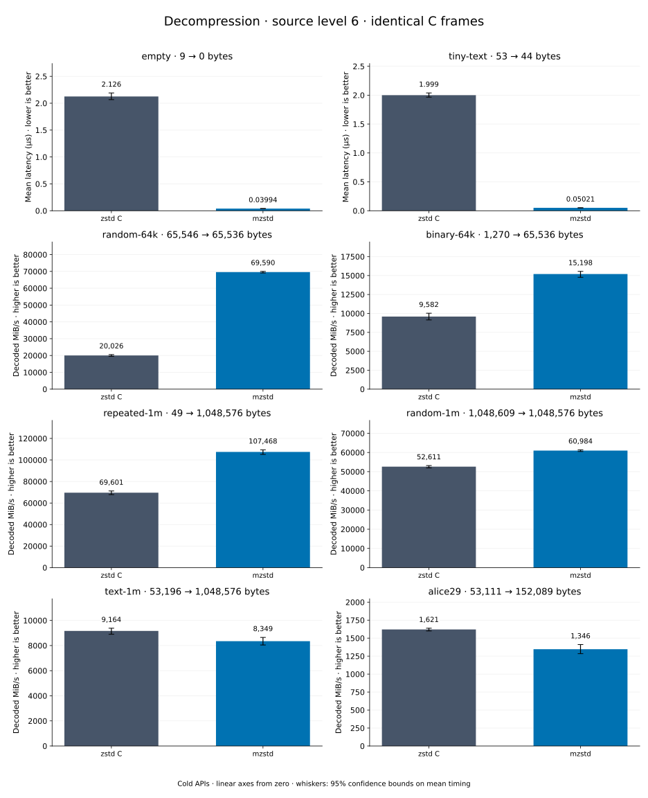

# Decompression of level 6 frames

[Decoder overview](README.md) · [Benchmark index](../README.md)

Recorded run: **long-20261112** (2026-11-12).
[CSV](../decoder-comparison.csv) · [Environment](../decoder-comparison-environment.json) · [Methodology and limits](../decoder-comparison.md).

Level belongs to the C encoder that prepared the frame; decoders have no level setting.
Both decoders restore the same bytes.

## Median speed across 8 datasets

Median of per-dataset C mean time / decoder mean time ratios, with equal weight.
Higher is faster; 1× matches C. No confidence interval
is inferred for this across-dataset median.

| Decoder | Median speed / C |
| --- | ---: |
| zstd C | 1.000× |
| mzstd | 1.584× |

Datasets are ranked by mzstd speed relative to C, highest first.
Throughput counts restored bytes; empty input has latency only. Whiskers and intervals
describe sampling uncertainty, not all host variation. Cold APIs include allocation
and disposal. C reads the frame's content size and decodes into a buffer of exactly
that size; mzstd returns its own vector.

## empty

Empty input; measures API overhead.

**9 compressed → 0 restored bytes; compressed / original: undefined.**

| Decoder | Mean µs | 95% mean interval µs | Decoded MiB/s | Speed / C |
| --- | ---: | ---: | ---: | ---: |
| zstd C | 2.001 | 1.972–2.035 | — | 1.000× |
| mzstd | 0.04552 | 0.04352–0.04766 | — | 43.966× |

## tiny-text

44-byte quick-brown-fox sentence.

**53 compressed → 44 restored bytes; compressed / original: 120.455%.**

| Decoder | Mean µs | 95% mean interval µs | Decoded MiB/s | Speed / C |
| --- | ---: | ---: | ---: | ---: |
| zstd C | 2.016 | 1.973–2.065 | 20.82 | 1.000× |
| mzstd | 0.05908 | 0.05849–0.05974 | 710.27 | 34.117× |

## random-64k

64 KiB prefix of the deterministic pseudorandom corpus.

**65,546 compressed → 65,536 restored bytes; compressed / original: 100.015%.**

| Decoder | Mean µs | 95% mean interval µs | Decoded MiB/s | Speed / C |
| --- | ---: | ---: | ---: | ---: |
| zstd C | 3.354 | 3.281–3.428 | 18,632.40 | 1.000× |
| mzstd | 0.9808 | 0.9677–0.9942 | 63,725.85 | 3.420× |

## binary-64k

64 KiB of structured binary bytes: ((i / 16) XOR i) modulo 256.

**1,270 compressed → 65,536 restored bytes; compressed / original: 1.938%.**

| Decoder | Mean µs | 95% mean interval µs | Decoded MiB/s | Speed / C |
| --- | ---: | ---: | ---: | ---: |
| zstd C | 7.015 | 6.659–7.378 | 8,909.55 | 1.000× |
| mzstd | 4.386 | 4.204–4.589 | 14,251.25 | 1.600× |

## repeated-1m

1 MiB of repeated a bytes.

**49 compressed → 1,048,576 restored bytes; compressed / original: 0.005%.**

| Decoder | Mean µs | 95% mean interval µs | Decoded MiB/s | Speed / C |
| --- | ---: | ---: | ---: | ---: |
| zstd C | 14.51 | 14.25–14.81 | 68,925.93 | 1.000× |
| mzstd | 9.245 | 9.128–9.389 | 108,163.92 | 1.569× |

## random-1m

1 MiB of deterministic xorshift64 pseudorandom bytes.

**1,048,609 compressed → 1,048,576 restored bytes; compressed / original: 100.003%.**

| Decoder | Mean µs | 95% mean interval µs | Decoded MiB/s | Speed / C |
| --- | ---: | ---: | ---: | ---: |
| zstd C | 20.36 | 20.07–20.66 | 49,112.22 | 1.000× |
| mzstd | 18.25 | 18.04–18.45 | 54,800.84 | 1.116× |

## text-1m

Alice text repeated cyclically to 1 MiB.

**53,196 compressed → 1,048,576 restored bytes; compressed / original: 5.073%.**

| Decoder | Mean µs | 95% mean interval µs | Decoded MiB/s | Speed / C |
| --- | ---: | ---: | ---: | ---: |
| zstd C | 120.7 | 116.8–125 | 8,284.30 | 1.000× |
| mzstd | 123.1 | 120–126.4 | 8,122.54 | 0.980× |

## alice29

Alice in Wonderland text from the Canterbury corpus (`testdata/alice29.txt`).

**53,111 compressed → 152,089 restored bytes; compressed / original: 34.921%.**

| Decoder | Mean µs | 95% mean interval µs | Decoded MiB/s | Speed / C |
| --- | ---: | ---: | ---: | ---: |
| zstd C | 95.45 | 92.75–98.63 | 1,519.58 | 1.000× |
| mzstd | 97.42 | 96.32–98.67 | 1,488.87 | 0.980× |
