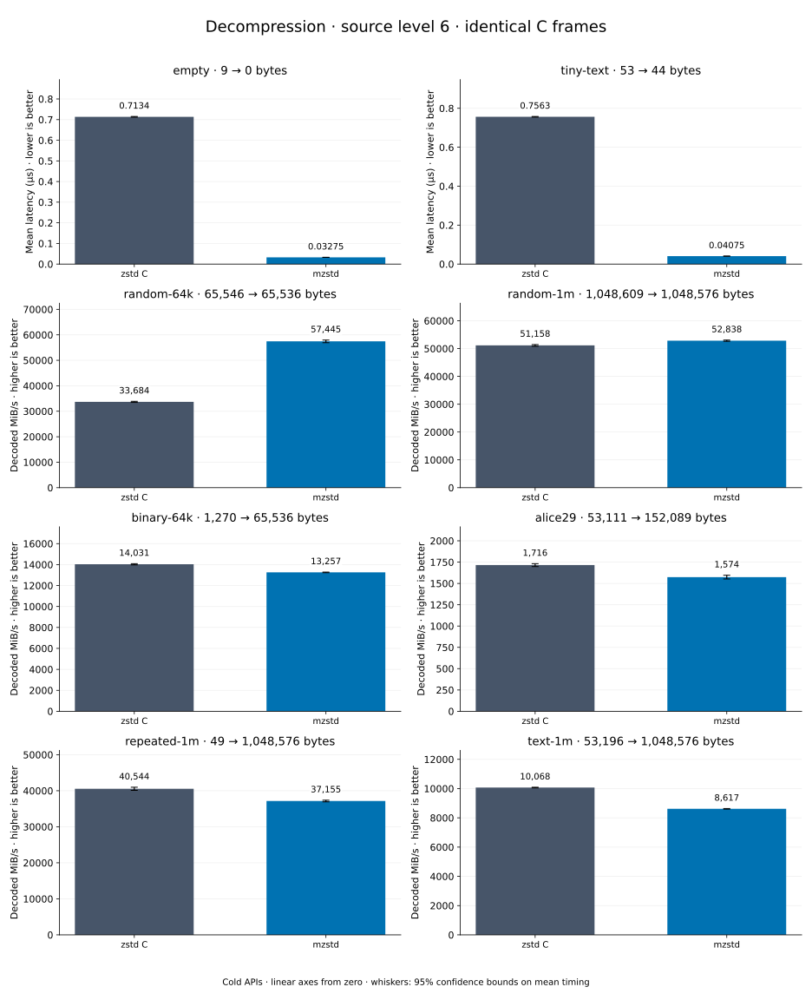

# Decompression of level 6 frames

[Decoder overview](README.md) · [Benchmark index](../README.md)

Recorded run: **dec-2026-10-13** (2026-10-13).
[CSV](../decoder-comparison.csv) · [Environment](../decoder-comparison-environment.json) · [Methodology and limits](../decoder-comparison.md).

Level belongs to the C encoder that prepared the frame; decoders have no level setting.
Both decoders restore the same bytes.

## Median speed across 8 datasets

Median of per-dataset C mean time / decoder mean time ratios, with equal weight.
Higher is faster; 1× matches C. No confidence interval
is inferred for this across-dataset median.

| Decoder | Median speed / C |
| --- | ---: |
| zstd C | 1.000× |
| mzstd | 1.032× |

Datasets are ranked by mzstd speed relative to C, highest first.
Throughput counts restored bytes; empty input has latency only. Whiskers and intervals
describe sampling uncertainty, not all host variation. Cold APIs include allocation
and disposal. C reads the frame's content size and decodes into a buffer of exactly
that size; mzstd returns its own vector.

## empty

Empty input; measures API overhead.

**9 compressed → 0 restored bytes; compressed / original: undefined.**

| Decoder | Mean µs | 95% mean interval µs | Decoded MiB/s | Speed / C |
| --- | ---: | ---: | ---: | ---: |
| zstd C | 0.7297 | 0.7277–0.7318 | — | 1.000× |
| mzstd | 0.02872 | 0.02863–0.02883 | — | 25.408× |

## tiny-text

44-byte quick-brown-fox sentence.

**53 compressed → 44 restored bytes; compressed / original: 120.455%.**

| Decoder | Mean µs | 95% mean interval µs | Decoded MiB/s | Speed / C |
| --- | ---: | ---: | ---: | ---: |
| zstd C | 0.7553 | 0.7534–0.7573 | 55.56 | 1.000× |
| mzstd | 0.03576 | 0.0356–0.03595 | 1,173.46 | 21.121× |

## random-64k

64 KiB prefix of the deterministic pseudorandom corpus.

**65,546 compressed → 65,536 restored bytes; compressed / original: 100.015%.**

| Decoder | Mean µs | 95% mean interval µs | Decoded MiB/s | Speed / C |
| --- | ---: | ---: | ---: | ---: |
| zstd C | 1.849 | 1.845–1.853 | 33,803.45 | 1.000× |
| mzstd | 1.071 | 1.068–1.074 | 58,376.94 | 1.727× |

## random-1m

1 MiB of deterministic xorshift64 pseudorandom bytes.

**1,048,609 compressed → 1,048,576 restored bytes; compressed / original: 100.003%.**

| Decoder | Mean µs | 95% mean interval µs | Decoded MiB/s | Speed / C |
| --- | ---: | ---: | ---: | ---: |
| zstd C | 20.3 | 20.22–20.39 | 49,249.84 | 1.000× |
| mzstd | 19.52 | 19.45–19.6 | 51,224.81 | 1.040× |

## repeated-1m

1 MiB of repeated a bytes.

**49 compressed → 1,048,576 restored bytes; compressed / original: 0.005%.**

| Decoder | Mean µs | 95% mean interval µs | Decoded MiB/s | Speed / C |
| --- | ---: | ---: | ---: | ---: |
| zstd C | 24.38 | 24.28–24.48 | 41,019.66 | 1.000× |
| mzstd | 23.8 | 23.71–23.88 | 42,024.73 | 1.025× |

## binary-64k

64 KiB of structured binary bytes: ((i / 16) XOR i) modulo 256.

**1,270 compressed → 65,536 restored bytes; compressed / original: 1.938%.**

| Decoder | Mean µs | 95% mean interval µs | Decoded MiB/s | Speed / C |
| --- | ---: | ---: | ---: | ---: |
| zstd C | 4.669 | 4.617–4.719 | 13,386.77 | 1.000× |
| mzstd | 4.908 | 4.861–4.956 | 12,733.61 | 0.951× |

## alice29

Alice in Wonderland text from the Canterbury corpus (`testdata/alice29.txt`).

**53,111 compressed → 152,089 restored bytes; compressed / original: 34.921%.**

| Decoder | Mean µs | 95% mean interval µs | Decoded MiB/s | Speed / C |
| --- | ---: | ---: | ---: | ---: |
| zstd C | 83.23 | 82.8–83.68 | 1,742.76 | 1.000× |
| mzstd | 95.57 | 95.22–95.96 | 1,517.61 | 0.871× |

## text-1m

Alice text repeated cyclically to 1 MiB.

**53,196 compressed → 1,048,576 restored bytes; compressed / original: 5.073%.**

| Decoder | Mean µs | 95% mean interval µs | Decoded MiB/s | Speed / C |
| --- | ---: | ---: | ---: | ---: |
| zstd C | 100.1 | 99.79–100.6 | 9,988.76 | 1.000× |
| mzstd | 122.6 | 122.1–123.2 | 8,154.08 | 0.816× |
