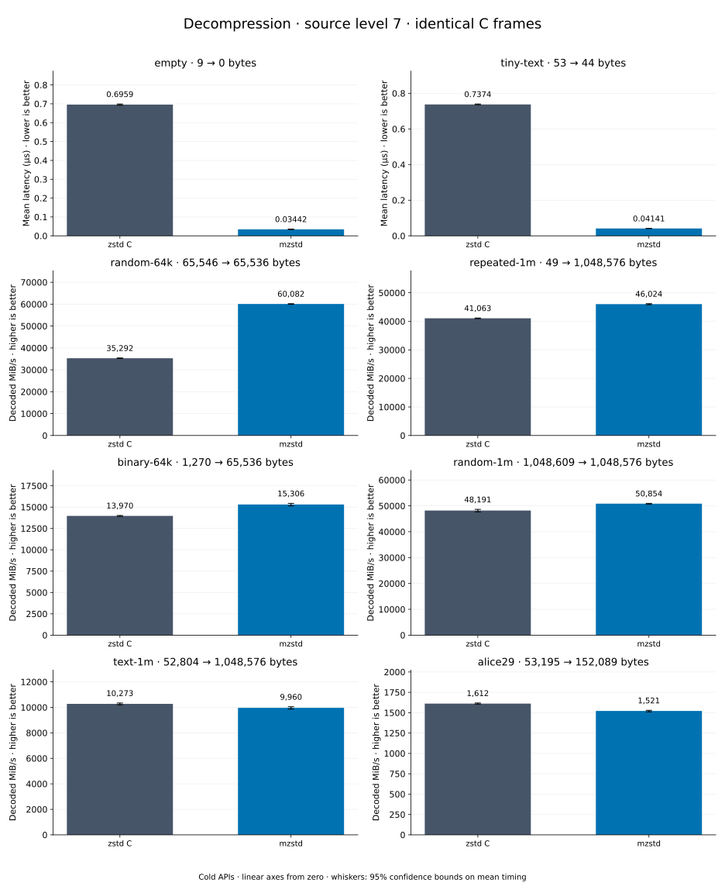

# Decompression of level 7 frames

[Decoder overview](README.md) · [Benchmark index](../README.md)

Recorded run: **dec-20261015c** (2026-10-15).
[CSV](../decoder-comparison.csv) · [Environment](../decoder-comparison-environment.json) · [Methodology and limits](../decoder-comparison.md).

Level belongs to the C encoder that prepared the frame; decoders have no level setting.
Both decoders restore the same bytes.

## Median speed across 8 datasets

Median of per-dataset C mean time / decoder mean time ratios, with equal weight.
Higher is faster; 1× matches C. No confidence interval
is inferred for this across-dataset median.

| Decoder | Median speed / C |
| --- | ---: |
| zstd C | 1.000× |
| mzstd | 0.993× |

Datasets are ranked by mzstd speed relative to C, highest first.
Throughput counts restored bytes; empty input has latency only. Whiskers and intervals
describe sampling uncertainty, not all host variation. Cold APIs include allocation
and disposal. C reads the frame's content size and decodes into a buffer of exactly
that size; mzstd returns its own vector.

## empty

Empty input; measures API overhead.

**9 compressed → 0 restored bytes; compressed / original: undefined.**

| Decoder | Mean µs | 95% mean interval µs | Decoded MiB/s | Speed / C |
| --- | ---: | ---: | ---: | ---: |
| zstd C | 0.7135 | 0.7123–0.7148 | — | 1.000× |
| mzstd | 0.03278 | 0.03264–0.03295 | — | 21.769× |

## tiny-text

44-byte quick-brown-fox sentence.

**53 compressed → 44 restored bytes; compressed / original: 120.455%.**

| Decoder | Mean µs | 95% mean interval µs | Decoded MiB/s | Speed / C |
| --- | ---: | ---: | ---: | ---: |
| zstd C | 0.7744 | 0.7597–0.7962 | 54.19 | 1.000× |
| mzstd | 0.04114 | 0.04091–0.0414 | 1,020.02 | 18.824× |

## random-64k

64 KiB prefix of the deterministic pseudorandom corpus.

**65,546 compressed → 65,536 restored bytes; compressed / original: 100.015%.**

| Decoder | Mean µs | 95% mean interval µs | Decoded MiB/s | Speed / C |
| --- | ---: | ---: | ---: | ---: |
| zstd C | 1.843 | 1.822–1.863 | 33,920.46 | 1.000× |
| mzstd | 1.046 | 1.04–1.052 | 59,748.82 | 1.761× |

## random-1m

1 MiB of deterministic xorshift64 pseudorandom bytes.

**1,048,609 compressed → 1,048,576 restored bytes; compressed / original: 100.003%.**

| Decoder | Mean µs | 95% mean interval µs | Decoded MiB/s | Speed / C |
| --- | ---: | ---: | ---: | ---: |
| zstd C | 19.33 | 19.26–19.41 | 51,720.52 | 1.000× |
| mzstd | 18.53 | 18.49–18.58 | 53,952.51 | 1.043× |

## alice29

Alice in Wonderland text from the Canterbury corpus (`testdata/alice29.txt`).

**53,195 compressed → 152,089 restored bytes; compressed / original: 34.976%.**

| Decoder | Mean µs | 95% mean interval µs | Decoded MiB/s | Speed / C |
| --- | ---: | ---: | ---: | ---: |
| zstd C | 91.78 | 90.69–92.94 | 1,580.37 | 1.000× |
| mzstd | 97.4 | 96.5–98.39 | 1,489.14 | 0.942× |

## binary-64k

64 KiB of structured binary bytes: ((i / 16) XOR i) modulo 256.

**1,270 compressed → 65,536 restored bytes; compressed / original: 1.938%.**

| Decoder | Mean µs | 95% mean interval µs | Decoded MiB/s | Speed / C |
| --- | ---: | ---: | ---: | ---: |
| zstd C | 4.462 | 4.444–4.482 | 14,006.28 | 1.000× |
| mzstd | 4.752 | 4.738–4.766 | 13,152.75 | 0.939× |

## repeated-1m

1 MiB of repeated a bytes.

**49 compressed → 1,048,576 restored bytes; compressed / original: 0.005%.**

| Decoder | Mean µs | 95% mean interval µs | Decoded MiB/s | Speed / C |
| --- | ---: | ---: | ---: | ---: |
| zstd C | 24.82 | 24.63–25.01 | 40,284.50 | 1.000× |
| mzstd | 27.26 | 26.98–27.57 | 36,689.55 | 0.911× |

## text-1m

Alice text repeated cyclically to 1 MiB.

**52,804 compressed → 1,048,576 restored bytes; compressed / original: 5.036%.**

| Decoder | Mean µs | 95% mean interval µs | Decoded MiB/s | Speed / C |
| --- | ---: | ---: | ---: | ---: |
| zstd C | 101.4 | 98.8–106.1 | 9,866.16 | 1.000× |
| mzstd | 115.1 | 114.7–115.5 | 8,690.41 | 0.881× |
