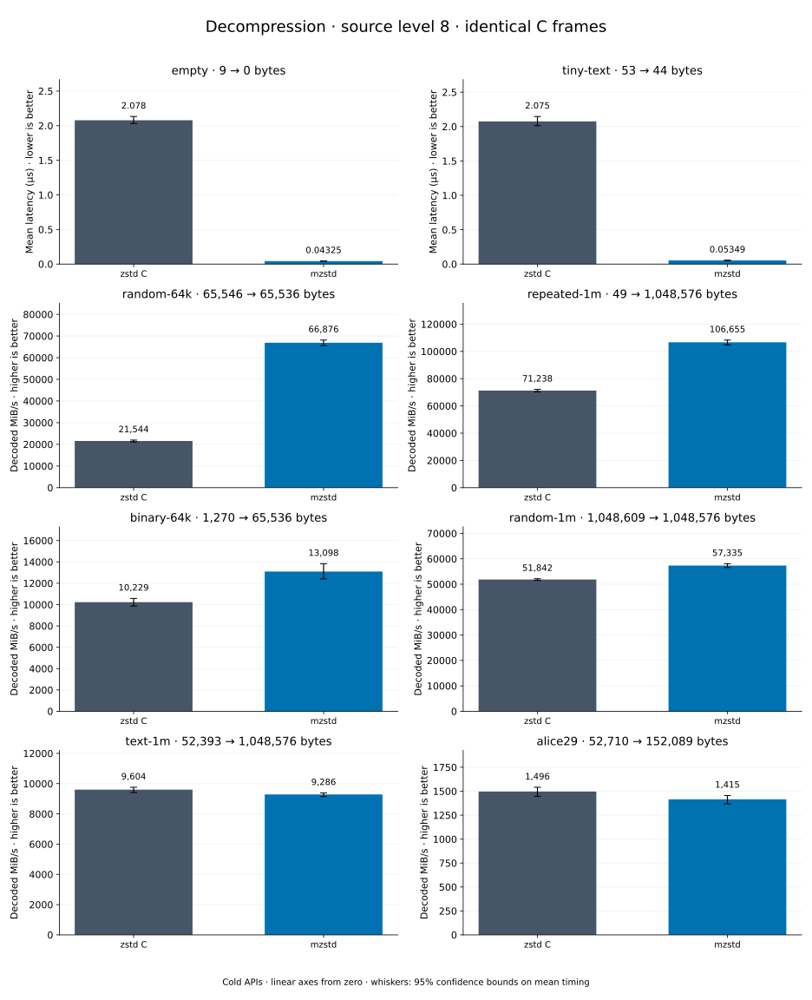

# Decompression of level 8 frames

[Decoder overview](README.md) · [Benchmark index](../README.md)

Recorded run: **long-20261112** (2026-11-12).
[CSV](../decoder-comparison.csv) · [Environment](../decoder-comparison-environment.json) · [Methodology and limits](../decoder-comparison.md).

Level belongs to the C encoder that prepared the frame; decoders have no level setting.
Both decoders restore the same bytes.

## Median speed across 8 datasets

Median of per-dataset C mean time / decoder mean time ratios, with equal weight.
Higher is faster; 1× matches C. No confidence interval
is inferred for this across-dataset median.

| Decoder | Median speed / C |
| --- | ---: |
| zstd C | 1.000× |
| mzstd | 1.536× |

Datasets are ranked by mzstd speed relative to C, highest first.
Throughput counts restored bytes; empty input has latency only. Whiskers and intervals
describe sampling uncertainty, not all host variation. Cold APIs include allocation
and disposal. C reads the frame's content size and decodes into a buffer of exactly
that size; mzstd returns its own vector.

## empty

Empty input; measures API overhead.

**9 compressed → 0 restored bytes; compressed / original: undefined.**

| Decoder | Mean µs | 95% mean interval µs | Decoded MiB/s | Speed / C |
| --- | ---: | ---: | ---: | ---: |
| zstd C | 2.093 | 2.04–2.15 | — | 1.000× |
| mzstd | 0.04226 | 0.04106–0.04364 | — | 49.516× |

## tiny-text

44-byte quick-brown-fox sentence.

**53 compressed → 44 restored bytes; compressed / original: 120.455%.**

| Decoder | Mean µs | 95% mean interval µs | Decoded MiB/s | Speed / C |
| --- | ---: | ---: | ---: | ---: |
| zstd C | 2.02 | 1.992–2.052 | 20.78 | 1.000× |
| mzstd | 0.06513 | 0.06325–0.0671 | 644.31 | 31.009× |

## random-64k

64 KiB prefix of the deterministic pseudorandom corpus.

**65,546 compressed → 65,536 restored bytes; compressed / original: 100.015%.**

| Decoder | Mean µs | 95% mean interval µs | Decoded MiB/s | Speed / C |
| --- | ---: | ---: | ---: | ---: |
| zstd C | 3.188 | 3.114–3.264 | 19,605.15 | 1.000× |
| mzstd | 1.003 | 0.9854–1.022 | 62,315.08 | 3.179× |

## repeated-1m

1 MiB of repeated a bytes.

**49 compressed → 1,048,576 restored bytes; compressed / original: 0.005%.**

| Decoder | Mean µs | 95% mean interval µs | Decoded MiB/s | Speed / C |
| --- | ---: | ---: | ---: | ---: |
| zstd C | 15.87 | 15.46–16.3 | 63,014.13 | 1.000× |
| mzstd | 9.735 | 9.541–9.946 | 102,724.53 | 1.630× |

## binary-64k

64 KiB of structured binary bytes: ((i / 16) XOR i) modulo 256.

**1,270 compressed → 65,536 restored bytes; compressed / original: 1.938%.**

| Decoder | Mean µs | 95% mean interval µs | Decoded MiB/s | Speed / C |
| --- | ---: | ---: | ---: | ---: |
| zstd C | 5.77 | 5.701–5.851 | 10,832.01 | 1.000× |
| mzstd | 4 | 3.95–4.057 | 15,623.74 | 1.442× |

## random-1m

1 MiB of deterministic xorshift64 pseudorandom bytes.

**1,048,609 compressed → 1,048,576 restored bytes; compressed / original: 100.003%.**

| Decoder | Mean µs | 95% mean interval µs | Decoded MiB/s | Speed / C |
| --- | ---: | ---: | ---: | ---: |
| zstd C | 20.59 | 20.37–20.8 | 48,575.15 | 1.000× |
| mzstd | 18.19 | 18–18.37 | 54,986.79 | 1.132× |

## alice29

Alice in Wonderland text from the Canterbury corpus (`testdata/alice29.txt`).

**52,710 compressed → 152,089 restored bytes; compressed / original: 34.657%.**

| Decoder | Mean µs | 95% mean interval µs | Decoded MiB/s | Speed / C |
| --- | ---: | ---: | ---: | ---: |
| zstd C | 108.6 | 103.7–113.7 | 1,335.74 | 1.000× |
| mzstd | 103 | 100.1–106.3 | 1,408.50 | 1.054× |

## text-1m

Alice text repeated cyclically to 1 MiB.

**52,393 compressed → 1,048,576 restored bytes; compressed / original: 4.997%.**

| Decoder | Mean µs | 95% mean interval µs | Decoded MiB/s | Speed / C |
| --- | ---: | ---: | ---: | ---: |
| zstd C | 130.1 | 124.6–135.6 | 7,684.93 | 1.000× |
| mzstd | 130.8 | 125.7–136.1 | 7,646.94 | 0.995× |
