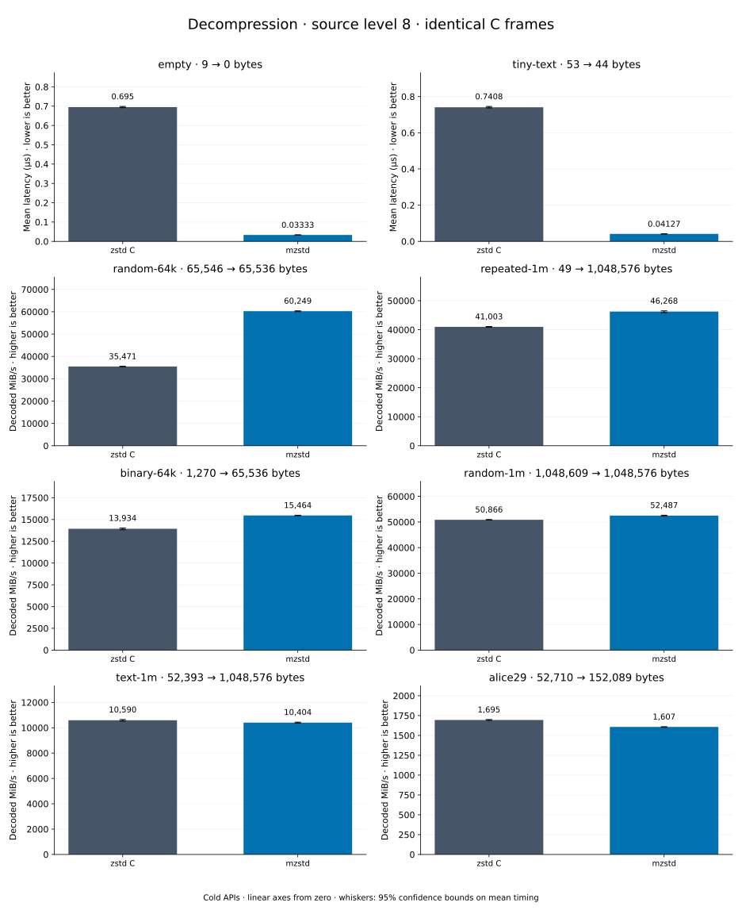

# Decompression of level 8 frames

[Decoder overview](README.md) · [Benchmark index](../README.md)

Recorded run: **dec-20261014-speed** (2026-10-14).
[CSV](../decoder-comparison.csv) · [Environment](../decoder-comparison-environment.json) · [Methodology and limits](../decoder-comparison.md).

Level belongs to the C encoder that prepared the frame; decoders have no level setting.
Both decoders restore the same bytes.

## Median speed across 8 datasets

Median of per-dataset C mean time / decoder mean time ratios, with equal weight.
Higher is faster; 1× matches C. No confidence interval
is inferred for this across-dataset median.

| Decoder | Median speed / C |
| --- | ---: |
| zstd C | 1.000× |
| mzstd | 1.007× |

Datasets are ranked by mzstd speed relative to C, highest first.
Throughput counts restored bytes; empty input has latency only. Whiskers and intervals
describe sampling uncertainty, not all host variation. Cold APIs include allocation
and disposal. C reads the frame's content size and decodes into a buffer of exactly
that size; mzstd returns its own vector.

## empty

Empty input; measures API overhead.

**9 compressed → 0 restored bytes; compressed / original: undefined.**

| Decoder | Mean µs | 95% mean interval µs | Decoded MiB/s | Speed / C |
| --- | ---: | ---: | ---: | ---: |
| zstd C | 0.7167 | 0.7112–0.7232 | — | 1.000× |
| mzstd | 0.02996 | 0.02971–0.03035 | — | 23.919× |

## tiny-text

44-byte quick-brown-fox sentence.

**53 compressed → 44 restored bytes; compressed / original: 120.455%.**

| Decoder | Mean µs | 95% mean interval µs | Decoded MiB/s | Speed / C |
| --- | ---: | ---: | ---: | ---: |
| zstd C | 0.7488 | 0.7475–0.7501 | 56.04 | 1.000× |
| mzstd | 0.03689 | 0.0367–0.03713 | 1,137.33 | 20.295× |

## random-64k

64 KiB prefix of the deterministic pseudorandom corpus.

**65,546 compressed → 65,536 restored bytes; compressed / original: 100.015%.**

| Decoder | Mean µs | 95% mean interval µs | Decoded MiB/s | Speed / C |
| --- | ---: | ---: | ---: | ---: |
| zstd C | 1.802 | 1.795–1.81 | 34,683.08 | 1.000× |
| mzstd | 1.049 | 1.041–1.058 | 59,576.26 | 1.718× |

## random-1m

1 MiB of deterministic xorshift64 pseudorandom bytes.

**1,048,609 compressed → 1,048,576 restored bytes; compressed / original: 100.003%.**

| Decoder | Mean µs | 95% mean interval µs | Decoded MiB/s | Speed / C |
| --- | ---: | ---: | ---: | ---: |
| zstd C | 20.36 | 20.23–20.49 | 49,105.19 | 1.000× |
| mzstd | 19.41 | 19.34–19.48 | 51,508.24 | 1.049× |

## binary-64k

64 KiB of structured binary bytes: ((i / 16) XOR i) modulo 256.

**1,270 compressed → 65,536 restored bytes; compressed / original: 1.938%.**

| Decoder | Mean µs | 95% mean interval µs | Decoded MiB/s | Speed / C |
| --- | ---: | ---: | ---: | ---: |
| zstd C | 4.559 | 4.532–4.587 | 13,708.22 | 1.000× |
| mzstd | 4.722 | 4.697–4.749 | 13,235.26 | 0.965× |

## alice29

Alice in Wonderland text from the Canterbury corpus (`testdata/alice29.txt`).

**52,710 compressed → 152,089 restored bytes; compressed / original: 34.657%.**

| Decoder | Mean µs | 95% mean interval µs | Decoded MiB/s | Speed / C |
| --- | ---: | ---: | ---: | ---: |
| zstd C | 85.63 | 85.39–85.9 | 1,693.79 | 1.000× |
| mzstd | 93.29 | 92.77–93.81 | 1,554.82 | 0.918× |

## repeated-1m

1 MiB of repeated a bytes.

**49 compressed → 1,048,576 restored bytes; compressed / original: 0.005%.**

| Decoder | Mean µs | 95% mean interval µs | Decoded MiB/s | Speed / C |
| --- | ---: | ---: | ---: | ---: |
| zstd C | 24.48 | 24.37–24.6 | 40,841.96 | 1.000× |
| mzstd | 26.95 | 26.85–27.06 | 37,107.28 | 0.909× |

## text-1m

Alice text repeated cyclically to 1 MiB.

**52,393 compressed → 1,048,576 restored bytes; compressed / original: 4.997%.**

| Decoder | Mean µs | 95% mean interval µs | Decoded MiB/s | Speed / C |
| --- | ---: | ---: | ---: | ---: |
| zstd C | 96.37 | 95.52–97.73 | 10,376.39 | 1.000× |
| mzstd | 112.9 | 112.6–113.4 | 8,854.29 | 0.853× |
