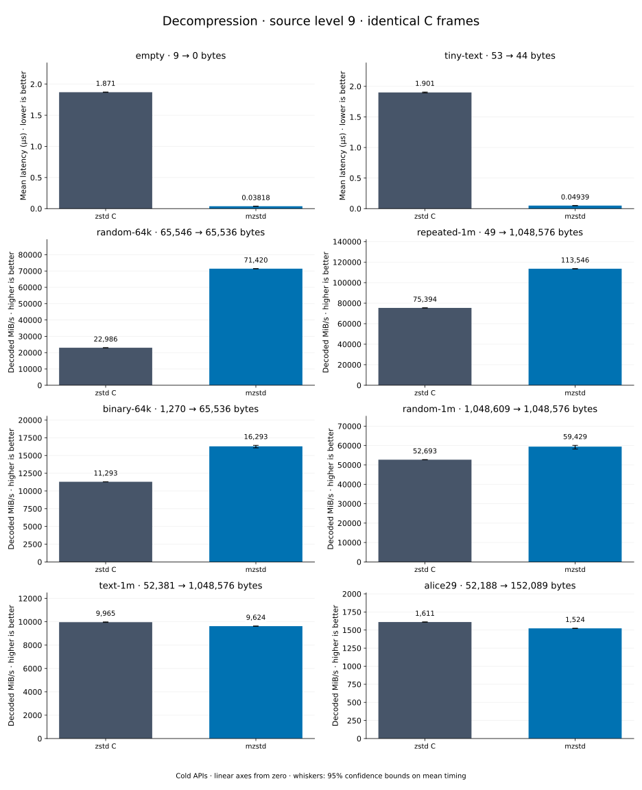

# Decompression of level 9 frames

[Decoder overview](README.md) · [Benchmark index](../README.md)

Recorded run: **full-20261030** (2026-10-30).
[CSV](../decoder-comparison.csv) · [Environment](../decoder-comparison-environment.json) · [Methodology and limits](../decoder-comparison.md).

Level belongs to the C encoder that prepared the frame; decoders have no level setting.
Both decoders restore the same bytes.

## Median speed across 8 datasets

Median of per-dataset C mean time / decoder mean time ratios, with equal weight.
Higher is faster; 1× matches C. No confidence interval
is inferred for this across-dataset median.

| Decoder | Median speed / C |
| --- | ---: |
| zstd C | 1.000× |
| mzstd main | 1.363× |
| mzstd | 1.474× |

mzstd main is the same matrix measured on `0a4fd87` in a process beside this run's; its ratios use that run's C timings.

Datasets are ranked by mzstd speed relative to C, highest first.
Throughput counts restored bytes; empty input has latency only. Whiskers and intervals
describe sampling uncertainty, not all host variation. Cold APIs include allocation
and disposal. C reads the frame's content size and decodes into a buffer of exactly
that size; mzstd returns its own vector.

## empty

Empty input; measures API overhead.

**9 compressed → 0 restored bytes; compressed / original: undefined.**

| Decoder | Mean µs | 95% mean interval µs | Decoded MiB/s | Speed / C |
| --- | ---: | ---: | ---: | ---: |
| zstd C | 1.871 | 1.868–1.873 | — | 1.000× |
| mzstd | 0.03818 | 0.03812–0.03824 | — | 48.988× |
| mzstd main (separate run) | 0.0392 | 0.03849–0.03998 | — | 48.044× |

## tiny-text

44-byte quick-brown-fox sentence.

**53 compressed → 44 restored bytes; compressed / original: 120.455%.**

| Decoder | Mean µs | 95% mean interval µs | Decoded MiB/s | Speed / C |
| --- | ---: | ---: | ---: | ---: |
| zstd C | 1.901 | 1.893–1.908 | 22.08 | 1.000× |
| mzstd | 0.04939 | 0.04922–0.04958 | 849.57 | 38.482× |
| mzstd main (separate run) | 0.05584 | 0.05215–0.0609 | 751.51 | 34.205× |

## random-64k

64 KiB prefix of the deterministic pseudorandom corpus.

**65,546 compressed → 65,536 restored bytes; compressed / original: 100.015%.**

| Decoder | Mean µs | 95% mean interval µs | Decoded MiB/s | Speed / C |
| --- | ---: | ---: | ---: | ---: |
| zstd C | 2.719 | 2.715–2.723 | 22,985.91 | 1.000× |
| mzstd | 0.8751 | 0.8749–0.8753 | 71,419.61 | 3.107× |
| mzstd main (separate run) | 0.8743 | 0.8735–0.8754 | 71,483.28 | 3.136× |

## repeated-1m

1 MiB of repeated a bytes.

**49 compressed → 1,048,576 restored bytes; compressed / original: 0.005%.**

| Decoder | Mean µs | 95% mean interval µs | Decoded MiB/s | Speed / C |
| --- | ---: | ---: | ---: | ---: |
| zstd C | 13.26 | 13.26–13.27 | 75,393.93 | 1.000× |
| mzstd | 8.807 | 8.801–8.814 | 113,546.15 | 1.506× |
| mzstd main (separate run) | 9.874 | 9.776–10.04 | 101,281.08 | 1.390× |

## binary-64k

64 KiB of structured binary bytes: ((i / 16) XOR i) modulo 256.

**1,270 compressed → 65,536 restored bytes; compressed / original: 1.938%.**

| Decoder | Mean µs | 95% mean interval µs | Decoded MiB/s | Speed / C |
| --- | ---: | ---: | ---: | ---: |
| zstd C | 5.534 | 5.532–5.537 | 11,293.30 | 1.000× |
| mzstd | 3.836 | 3.802–3.887 | 16,292.68 | 1.443× |
| mzstd main (separate run) | 4.124 | 4.119–4.129 | 15,156.77 | 1.336× |

## random-1m

1 MiB of deterministic xorshift64 pseudorandom bytes.

**1,048,609 compressed → 1,048,576 restored bytes; compressed / original: 100.003%.**

| Decoder | Mean µs | 95% mean interval µs | Decoded MiB/s | Speed / C |
| --- | ---: | ---: | ---: | ---: |
| zstd C | 18.98 | 18.96–19 | 52,692.89 | 1.000× |
| mzstd | 16.83 | 16.64–17.19 | 59,428.59 | 1.128× |
| mzstd main (separate run) | 16.77 | 16.76–16.79 | 59,612.84 | 1.142× |

## text-1m

Alice text repeated cyclically to 1 MiB.

**52,381 compressed → 1,048,576 restored bytes; compressed / original: 4.995%.**

| Decoder | Mean µs | 95% mean interval µs | Decoded MiB/s | Speed / C |
| --- | ---: | ---: | ---: | ---: |
| zstd C | 100.4 | 100.2–100.6 | 9,965.09 | 1.000× |
| mzstd | 103.9 | 103.8–104 | 9,623.63 | 0.966× |
| mzstd main (separate run) | 109 | 108.8–109.1 | 9,177.68 | 0.913× |

## alice29

Alice in Wonderland text from the Canterbury corpus (`testdata/alice29.txt`).

**52,188 compressed → 152,089 restored bytes; compressed / original: 34.314%.**

| Decoder | Mean µs | 95% mean interval µs | Decoded MiB/s | Speed / C |
| --- | ---: | ---: | ---: | ---: |
| zstd C | 90.05 | 89.97–90.14 | 1,610.63 | 1.000× |
| mzstd | 95.2 | 95.06–95.35 | 1,523.56 | 0.946× |
| mzstd main (separate run) | 99.07 | 98.58–99.96 | 1,464.05 | 0.886× |
