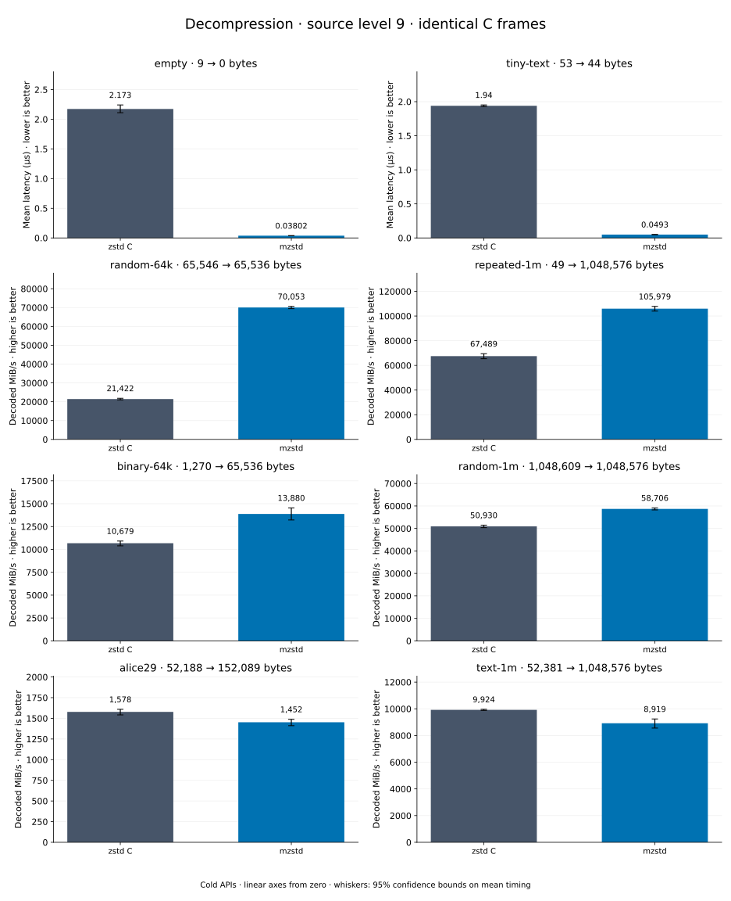

# Decompression of level 9 frames

[Decoder overview](README.md) · [Benchmark index](../README.md)

Recorded run: **long-20261112** (2026-11-12).
[CSV](../decoder-comparison.csv) · [Environment](../decoder-comparison-environment.json) · [Methodology and limits](../decoder-comparison.md).

Level belongs to the C encoder that prepared the frame; decoders have no level setting.
Both decoders restore the same bytes.

## Median speed across 8 datasets

Median of per-dataset C mean time / decoder mean time ratios, with equal weight.
Higher is faster; 1× matches C. No confidence interval
is inferred for this across-dataset median.

| Decoder | Median speed / C |
| --- | ---: |
| zstd C | 1.000× |
| mzstd | 1.502× |

Datasets are ranked by mzstd speed relative to C, highest first.
Throughput counts restored bytes; empty input has latency only. Whiskers and intervals
describe sampling uncertainty, not all host variation. Cold APIs include allocation
and disposal. C reads the frame's content size and decodes into a buffer of exactly
that size; mzstd returns its own vector.

## empty

Empty input; measures API overhead.

**9 compressed → 0 restored bytes; compressed / original: undefined.**

| Decoder | Mean µs | 95% mean interval µs | Decoded MiB/s | Speed / C |
| --- | ---: | ---: | ---: | ---: |
| zstd C | 2.168 | 2.096–2.241 | — | 1.000× |
| mzstd | 0.04645 | 0.04411–0.04892 | — | 46.659× |

## tiny-text

44-byte quick-brown-fox sentence.

**53 compressed → 44 restored bytes; compressed / original: 120.455%.**

| Decoder | Mean µs | 95% mean interval µs | Decoded MiB/s | Speed / C |
| --- | ---: | ---: | ---: | ---: |
| zstd C | 2.047 | 1.996–2.106 | 20.50 | 1.000× |
| mzstd | 0.06167 | 0.06032–0.06317 | 680.41 | 33.196× |

## random-64k

64 KiB prefix of the deterministic pseudorandom corpus.

**65,546 compressed → 65,536 restored bytes; compressed / original: 100.015%.**

| Decoder | Mean µs | 95% mean interval µs | Decoded MiB/s | Speed / C |
| --- | ---: | ---: | ---: | ---: |
| zstd C | 3.028 | 2.97–3.092 | 20,638.37 | 1.000× |
| mzstd | 0.9815 | 0.9636–1.001 | 63,678.55 | 3.085× |

## repeated-1m

1 MiB of repeated a bytes.

**49 compressed → 1,048,576 restored bytes; compressed / original: 0.005%.**

| Decoder | Mean µs | 95% mean interval µs | Decoded MiB/s | Speed / C |
| --- | ---: | ---: | ---: | ---: |
| zstd C | 15.99 | 15.48–16.51 | 62,534.46 | 1.000× |
| mzstd | 10.2 | 9.989–10.41 | 98,058.25 | 1.568× |

## binary-64k

64 KiB of structured binary bytes: ((i / 16) XOR i) modulo 256.

**1,270 compressed → 65,536 restored bytes; compressed / original: 1.938%.**

| Decoder | Mean µs | 95% mean interval µs | Decoded MiB/s | Speed / C |
| --- | ---: | ---: | ---: | ---: |
| zstd C | 5.907 | 5.774–6.06 | 10,580.52 | 1.000× |
| mzstd | 4.111 | 3.98–4.277 | 15,201.40 | 1.437× |

## random-1m

1 MiB of deterministic xorshift64 pseudorandom bytes.

**1,048,609 compressed → 1,048,576 restored bytes; compressed / original: 100.003%.**

| Decoder | Mean µs | 95% mean interval µs | Decoded MiB/s | Speed / C |
| --- | ---: | ---: | ---: | ---: |
| zstd C | 20.61 | 20.37–20.85 | 48,523.47 | 1.000× |
| mzstd | 17.88 | 17.73–18.03 | 55,937.51 | 1.153× |

## text-1m

Alice text repeated cyclically to 1 MiB.

**52,381 compressed → 1,048,576 restored bytes; compressed / original: 4.995%.**

| Decoder | Mean µs | 95% mean interval µs | Decoded MiB/s | Speed / C |
| --- | ---: | ---: | ---: | ---: |
| zstd C | 120.8 | 116.3–125.4 | 8,280.55 | 1.000× |
| mzstd | 111.1 | 108.6–114.4 | 9,002.62 | 1.087× |

## alice29

Alice in Wonderland text from the Canterbury corpus (`testdata/alice29.txt`).

**52,188 compressed → 152,089 restored bytes; compressed / original: 34.314%.**

| Decoder | Mean µs | 95% mean interval µs | Decoded MiB/s | Speed / C |
| --- | ---: | ---: | ---: | ---: |
| zstd C | 99.48 | 95.54–103.9 | 1,458.00 | 1.000× |
| mzstd | 99.75 | 97.54–102.5 | 1,454.09 | 0.997× |
