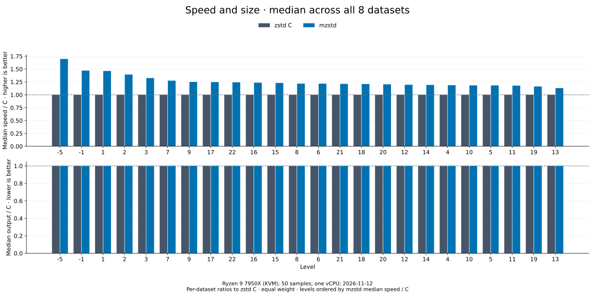

# Compression comparison — 2026-11-12

[Benchmark index](README.md) · [Results by level](encoders/README.md)

The [384-row CSV](encoder-comparison.csv) records mzstd 0.2.14 (the working
tree on `2c15c38` with the v0.2.14 changes in the
[changelog](../../CHANGELOG.md)) against zstd 1.5.7, under the Criterion baseline
`long-20261112`. The median speed relative to C is **1.216×** over all 192
dataset/level pairs, and mzstd has the lower mean latency in **174** of
them; in 159 of those its 95% interval for mean latency lies wholly below
C's. Every frame is byte-identical to zstd's.

Other tenants load this host (see
[interpretation limits](#interpretation-limits)). Sampling is therefore 50
samples of 6 s after a 3 s warmup, which keeps the medians stable but
leaves a median 95% interval of about 6% per case. Read single cells as
±10%.

The [environment record](encoder-comparison-environment.json) identifies the
measured sources and binaries by SHA-256. The
[size manifest](encoder-comparison-2026-11-12/sizes.csv) and the raw
[Criterion samples and estimates](encoder-comparison-2026-11-12/criterion-samples.json.gz)
are archived with this run.

## Results



Speed / C is C mean latency divided by mzstd mean latency for the same input,
in the same process. Each level takes the median of these ratios over eight
equally weighted datasets, including empty and tiny input; higher is better.
The [level overview](encoders/README.md) lists every level's medians.

The medians over all 24 levels for each dataset, with the 2026-11-09 run
(mzstd 0.2.12) for reference:

| Dataset | mzstd speed / C ↑ | 2026-11-09 | Range across levels |
| --- | ---: | ---: | ---: |
| empty | 8.029× | 8.410× | 5.03–11.36× |
| tiny-text | 3.443× | 3.531× | 1.32–8.41× |
| alice29 | 1.022× | 1.008× | 0.82–1.19× |
| text-1m | 1.091× | 1.088× | 0.95–1.27× |
| binary-64k | 1.230× | 1.241× | 0.92–1.66× |
| random-64k | 1.150× | 1.151× | 0.96–1.74× |
| random-1m | 1.135× | 1.111× | 0.93–1.48× |
| repeated-1m | 2.459× | 2.437× | 1.24–3.46× |

The per-dataset medians agree with the previous run to within 5%, which
is inside this host's noise: the changes since then target inputs of many
megabytes ([lzbench](lzbench-2026-11-12.md)) and leave this corpus, whose
largest input is 1 MiB, where it was. Eighteen pairs are slower than C,
nine of them Alice (levels 1-4, 6, 7, 9, 11 and 12; 0.82–0.97×). The rest
are cyclic Alice at levels 2, 7, 9 and 11 (0.95–0.999×), structured
binary at levels 4 and 19 (0.92–0.98×), random 64 KiB at level 11 (0.96×)
and random 1 MiB at levels 4 and 10 (0.93–0.98×). Only two cells are below
0.9×, Alice at levels 7 (0.82×) and 2 (0.89×). Alice at level 2 was at
0.84× in the previous run as well; the other three cells below 0.9× in
that run are between 0.97× and 1.13× in this one. Text results at selected
levels:

| Dataset | Level | mzstd, MiB/s ↑ | C, MiB/s ↑ | Speed / C ↑ | Frame bytes, both |
| --- | ---: | ---: | ---: | ---: | ---: |
| alice29 | -5 | 477.7 | 463.4 | 1.031× | 85,658 |
| alice29 | 1 | 375.7 | 394.0 | 0.954× | 59,657 |
| alice29 | 3 | 262.5 | 270.6 | 0.970× | 56,970 |
| alice29 | 9 | 47.4 | 50.5 | 0.939× | 52,188 |
| alice29 | 19 | 5.7 | 4.8 | 1.187× | 49,211 |
| text-1m | -5 | 4,236 | 3,340 | 1.268× | 96,657 |
| text-1m | 1 | 2,711 | 2,303 | 1.177× | 61,206 |
| text-1m | 3 | 1,838 | 1,570 | 1.171× | 55,878 |
| text-1m | 9 | 415.5 | 419.7 | 0.990× | 52,381 |
| text-1m | 19 | 36.8 | 33.9 | 1.088× | 49,285 |

Absolute throughput moves with the tenants' load, which slows C and mzstd
alike; compare ratios, not MiB/s.
Every mzstd frame passed byte-for-byte comparison with zstd and decoded back
to the original input through zstd before timing. The
[level pages](encoders/README.md) expose all datasets, timings, throughput and
95% mean confidence bounds.

## Measurement contract

| Setting | Recorded value |
| --- | --- |
| Host | AMD Ryzen 9 7950X, Linux KVM guest with two vCPUs, host shared with other tenants |
| Affinity | The encoder suite's Criterion process on vCPU 1, then the decoder suite's; nothing CPU-heavy ran beside them in the guest |
| Rust | rustc 1.99.1 (LLVM 23.1.1); Cargo release defaults; runtime SIMD dispatch (AVX-512 here) |
| C compiler | GCC 15.2.0; `cc` crate defaults (`-O3`) |
| zstd | 1.5.7; submodule `f8745da6ff1ad1e7bab384bd1f9d742439278e99`; single-threaded, no legacy formats, no Huffman assembly |
| Compression | Level only, complete known input, no dictionary or explicit flush |
| API | Cold one-shot: `ZSTD_createCCtx` + `ZSTD_compress2` into a `ZSTD_compressBound` buffer against `Compressor::new(level).compress`; construction, allocation, compression and disposal timed |
| Sampling | 50 samples; 3 s warmup; 6 s requested measurement per case; Criterion's default 100,000 bootstrap resamples; 95% confidence intervals |
| Validation | All 192 mzstd frames byte-identical to zstd and decoded to the original input through zstd before timing |

Inputs are empty, 44-byte text, `testdata/alice29.txt` (152,089 bytes), cyclic
Alice text at 1 MiB, structured binary at 64 KiB, deterministic pseudorandom
bytes at 64 KiB and 1 MiB, and 1 MiB of repeated `a` bytes: mbrotli's corpus,
with the same generators and seeds. Construction and validation occur outside
timing. Empty input has latency and output size but no meaningful throughput
or compressed/input fraction.

## Reproduction

Run from the repository root and choose a fresh baseline name for new timings.
These options reproduce the recorded sampling settings:

```sh
cargo bench --manifest-path benchmarks/comparison/Cargo.toml --bench encoders --locked --no-run
cd benchmarks/comparison
taskset -c 1 target/release/deps/encoders-<hash> --bench --save-baseline my-encoders --sample-size 50 --warm-up-time 3 --measurement-time 6 --noplot
cd ../..
python3 benchmarks/comparison/report.py --baseline my-encoders --csv /tmp/my-encoders.csv
cp benchmarks/comparison/target/criterion/sizes.csv /tmp/my-encoders-sizes.csv
```

On a quiet host the shorter settings of the
[benchmark guide](../benchmarking.md#encoder-comparison) (20 samples, 0.5 s
warmup, 1 s measurement) reach intervals below 1%. Criterion extends slow
cases to collect the requested samples. The exporter rejects incomplete
matrices and mismatched input lengths. Export immediately after timing and
archive `sizes.csv` with the named baseline: a later preflight replaces that
shared manifest. The archived gzip file holds each case's `benchmark`,
`estimates` and `sample` JSON records from Criterion.

Use the [benchmark guide](../benchmarking.md#encoder-comparison) to regenerate
the checked-in pages and charts from the published CSV and environment
record. Plotting uses Matplotlib 3.10.8 and does not rerun timings.

## Interpretation limits

This is one complete sweep on one KVM guest whose host other tenants load:
identical instruction counts take a varying number of cycles from one
minute to the next. No load probe ran beside this sweep. Its noise shows in
the intervals (median 95% interval 5.7%, 90th percentile 9.8%) and in C's
own timings, which moved by a median 5.3% against the 2026-11-09 run of
the same C library, while the per-dataset medians agree with that run to
within 5%. C and mzstd run consecutively for each case in a fixed order.
Affinity restricts CPU migration but does not control frequency, thermal
state or host scheduling.

Every dataset/level pair has equal weight, regardless of input size or execution
time. The median describes this corpus, not a production workload distribution.
Cold APIs include allocation and allocator state; timings include the effects
of glibc's changing mmap and trim thresholds within a process.

Streaming, retained contexts and parallel compression have separate root
benchmarks (`cargo bench --bench compress`, `--bench parallel`) and are outside
this comparison; [lzbench](lzbench-2026-11-12.md) measures whole-archive
throughput on `silesia.tar`. See the
[harness specification](../../architecture/benchmarking.md).
