# Encoder comparison

[Benchmark index](../README.md)

Recorded run: **enc-2026-10-13** (2026-10-13).
[Raw results](../encoder-comparison.csv) · [Environment](../encoder-comparison-environment.json) · [Run analysis](../encoder-comparison.md).

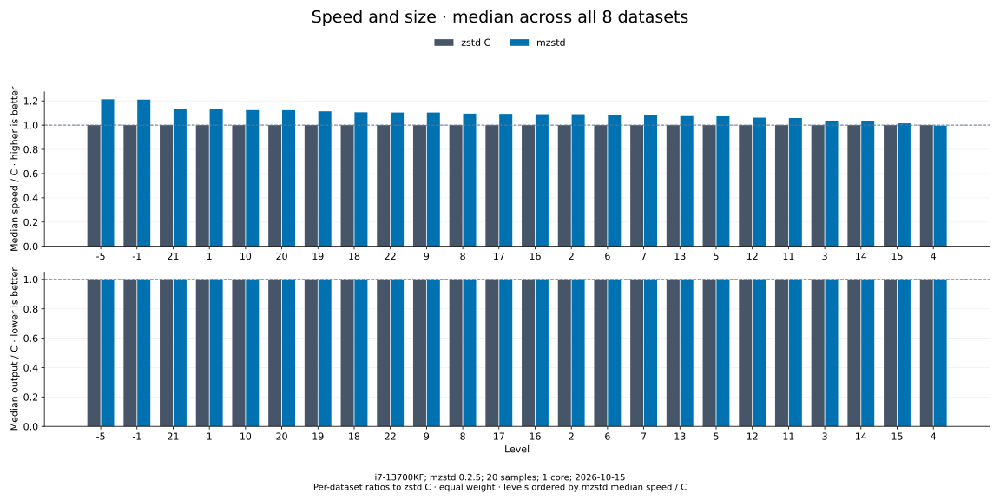

All 8 datasets contribute equally to each median, including empty and tiny input.
For each dataset, speed / C = C mean latency / mzstd mean latency;
output / C = mzstd bytes / C bytes. Medians are taken over those ratios.
Levels are ordered by mzstd median speed / C, highest first. Frames are byte-identical,
so output / C is 1× at every level.

| Level | mzstd speed / C ↑ | mzstd output / C ↓ | Datasets |
| --- | ---: | ---: | ---: |
| [Level 20](l20.md) | 1.006× | 1.000× | 8 |
| [Level 12](l12.md) | 1.000× | 1.000× | 8 |
| [Level 21](l21.md) | 0.995× | 1.000× | 8 |
| [Level 19](l19.md) | 0.995× | 1.000× | 8 |
| [Level 22](l22.md) | 0.994× | 1.000× | 8 |
| [Level 18](l18.md) | 0.992× | 1.000× | 8 |
| [Level 11](l11.md) | 0.989× | 1.000× | 8 |
| [Level 16](l16.md) | 0.982× | 1.000× | 8 |
| [Level 17](l17.md) | 0.971× | 1.000× | 8 |
| [Level 15](l15.md) | 0.966× | 1.000× | 8 |
| [Level 8](l8.md) | 0.958× | 1.000× | 8 |
| [Level 7](l7.md) | 0.958× | 1.000× | 8 |
| [Level 14](l14.md) | 0.956× | 1.000× | 8 |
| [Level 6](l6.md) | 0.952× | 1.000× | 8 |
| [Level 1](l1.md) | 0.950× | 1.000× | 8 |
| [Level 3](l3.md) | 0.946× | 1.000× | 8 |
| [Level 4](l4.md) | 0.932× | 1.000× | 8 |
| [Level 2](l2.md) | 0.931× | 1.000× | 8 |
| [Level 13](l13.md) | 0.931× | 1.000× | 8 |
| [Level -1](l-1.md) | 0.930× | 1.000× | 8 |
| [Level -5](l-5.md) | 0.928× | 1.000× | 8 |
| [Level 5](l5.md) | 0.926× | 1.000× | 8 |
| [Level 10](l10.md) | 0.922× | 1.000× | 8 |
| [Level 9](l9.md) | 0.921× | 1.000× | 8 |

## [Level 20](l20.md)

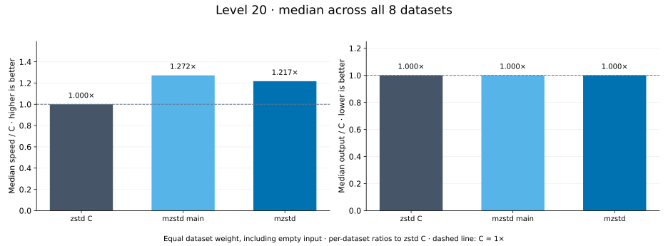

## [Level 12](l12.md)

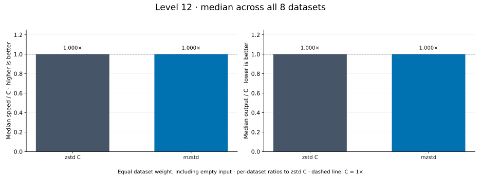

## [Level 21](l21.md)

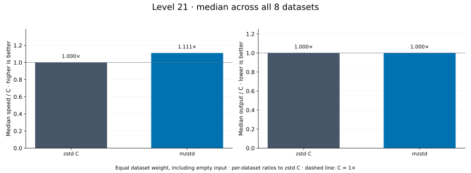

## [Level 19](l19.md)

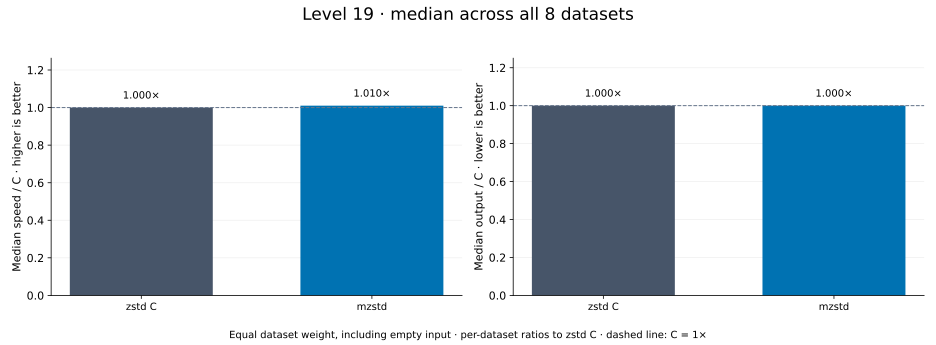

## [Level 22](l22.md)

## [Level 18](l18.md)

## [Level 11](l11.md)

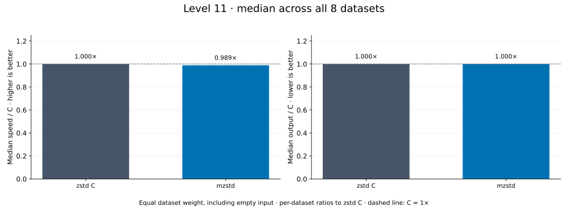

## [Level 16](l16.md)

## [Level 17](l17.md)

## [Level 15](l15.md)

## [Level 8](l8.md)

## [Level 7](l7.md)

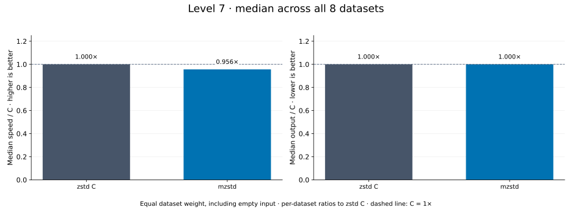

## [Level 14](l14.md)

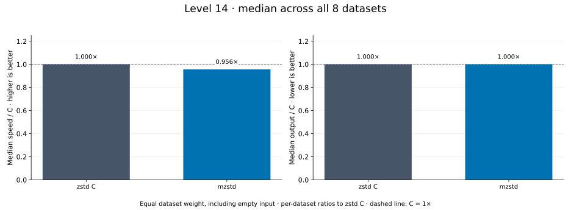

## [Level 6](l6.md)

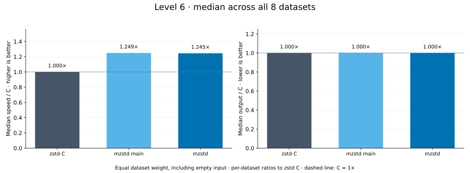

## [Level 1](l1.md)

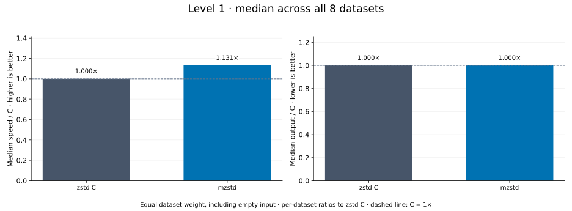

## [Level 3](l3.md)

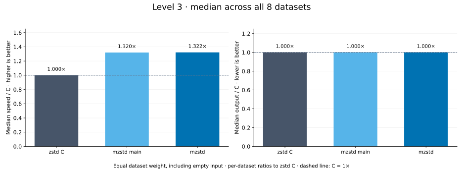

## [Level 4](l4.md)

## [Level 2](l2.md)

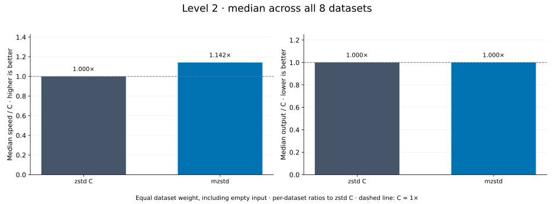

## [Level 13](l13.md)

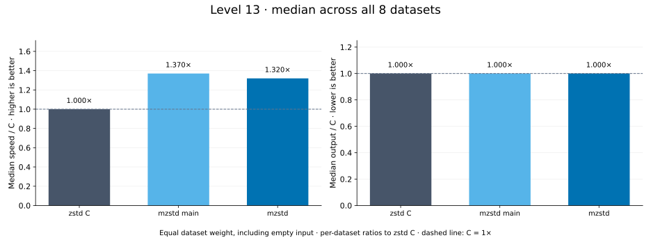

## [Level -1](l-1.md)

## [Level -5](l-5.md)

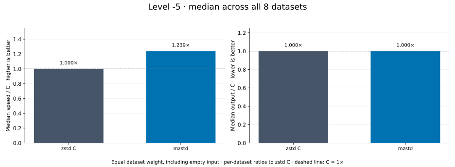

## [Level 5](l5.md)

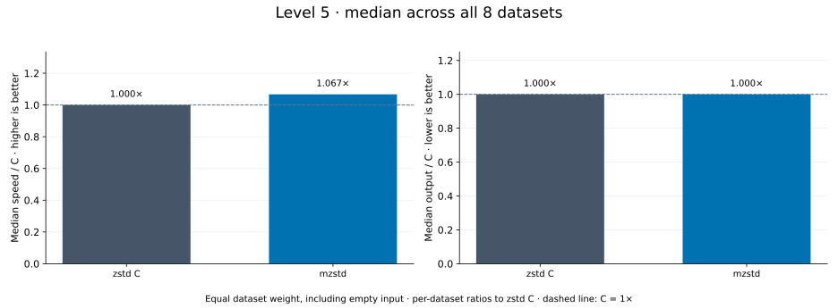

## [Level 10](l10.md)

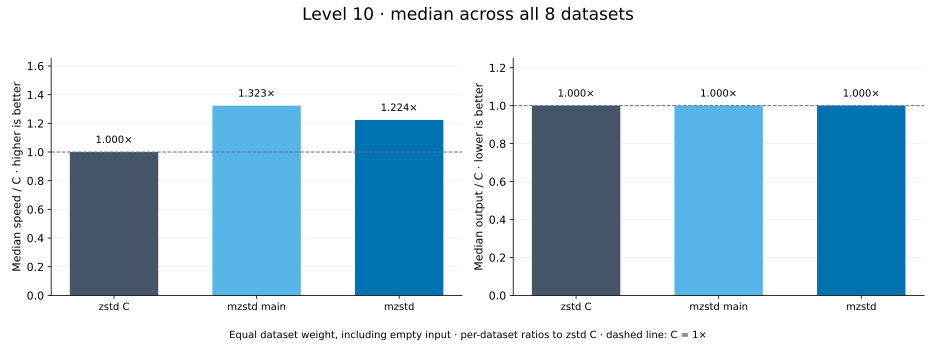

## [Level 9](l9.md)

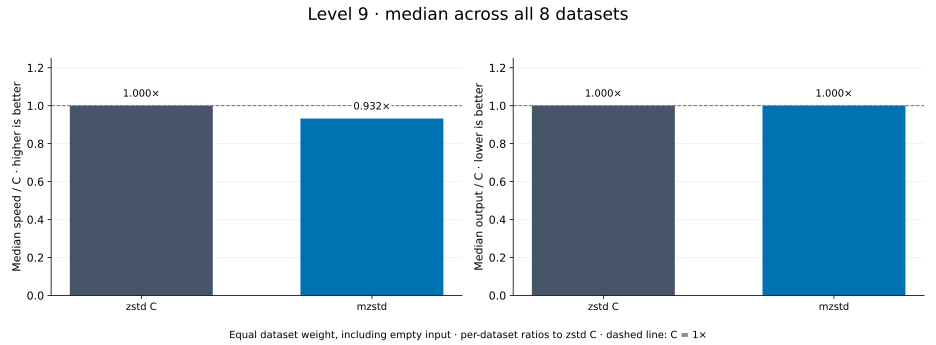
