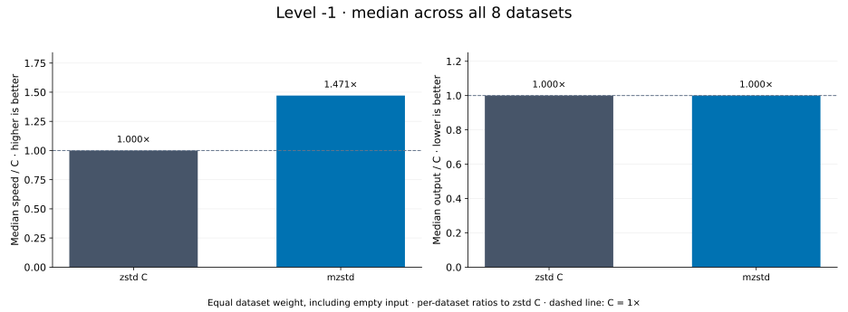
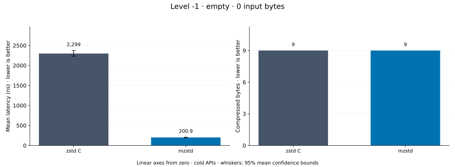
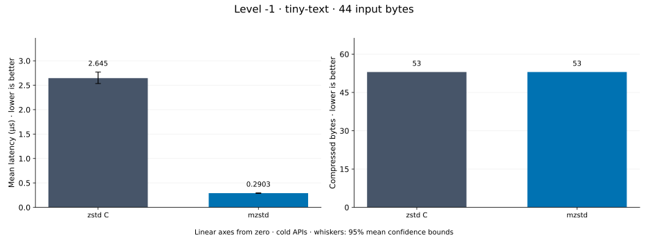
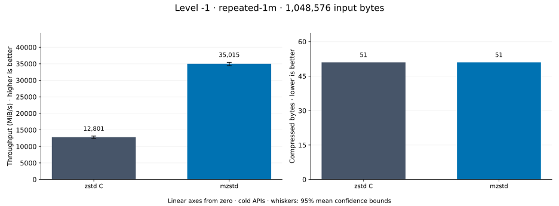
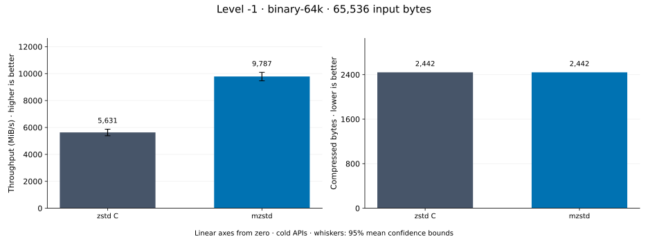
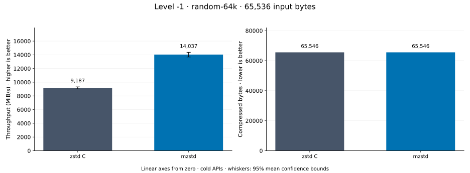
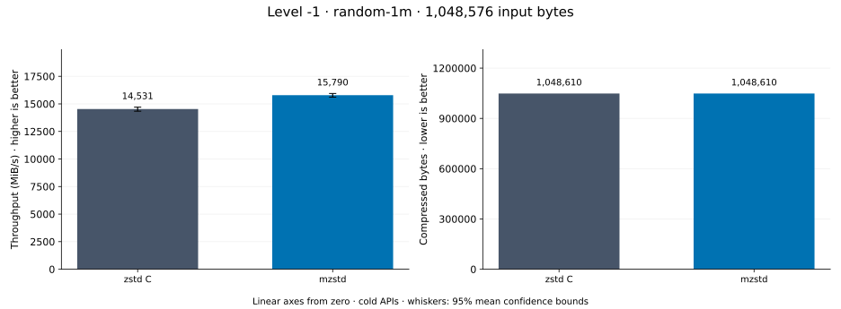
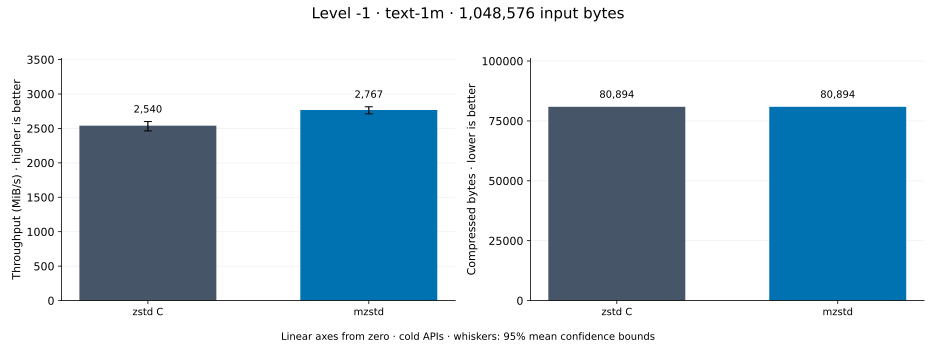
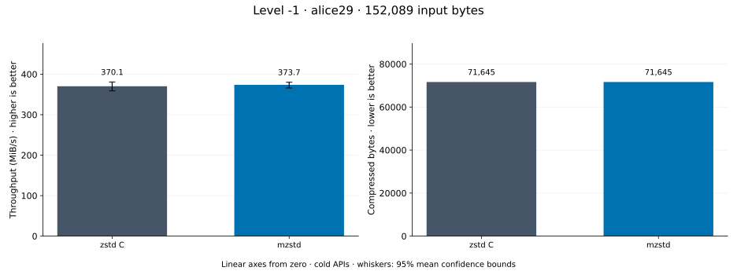

# Compression level -1

[Benchmark index](../README.md) · [Median overview](README.md) · [← Level -5](l-5.md) · [Level 1 →](l1.md)

Recorded run: **long-20261109** (2026-11-09).
[Raw results](../encoder-comparison.csv) · [Environment](../encoder-comparison-environment.json) · [Run analysis](../encoder-comparison.md).

## Median across all datasets

Each of the 8 datasets has equal weight, including empty and tiny input.
Speed / C = C mean latency / implementation mean latency; output / C = implementation bytes / C bytes.
We take the median of these 8 per-dataset ratios separately for speed and size.
1× matches C; higher speed and lower output are better. These are medians across datasets,
not median sample latencies, and do not imply statistical significance.

| Implementation | Median speed / C ↑ | Median output / C ↓ | Datasets |
| --- | ---: | ---: | ---: |
| zstd C | 1.000× | 1.000× | 8 |
| mzstd | 1.633× | 1.000× | 8 |

Measurement setup and interpretation

zstd 1.5.7 (the C library built by `zstd-ffi`) and mzstd at the recorded
working tree compress identical bytes at this level. Every frame was checked byte-identical
to zstd's and decoded back to its input before any timing.

These are cold native API measurements: construction, allocation, compression, and disposal.
Complete known input; 50 samples, 3 s warmup, at least 6 s measurement.
Host: AMD Ryzen 9 7950X, Linux KVM guest with two vCPUs: the encoder suite, then the decoder suite, each in one Criterion process pinned to vCPU 1; nothing else ran in the guest. Other tenants loaded the host: a fixed C decode varied by 8-43% (p10-p90 wall time) through the day, so sampling was lengthened to average over the noise. unset; Cargo release defaults (bench profile), runtime SIMD dispatch (AVX-512 level on this host; the decoder runs its block loops at the AVX2 level).

Chart whiskers and table intervals describe 95% confidence bounds on mean timing.
They do not capture all host or allocator variation. Throughput bounds are transformed latency bounds.
Output / input is compressed bytes divided by input bytes; smaller is better, and values above 100% mean expansion.
For empty input, throughput and output / input are undefined (—).
See the [run analysis](../encoder-comparison.md#interpretation-limits) for measurement limitations.

## Dataset details

Ordered by mzstd speed / C, highest first; all 8 datasets are shown.
This order uses recorded mean latency, not statistical significance. Bars start at zero.

[empty](#empty) · [tiny-text](#tiny-text) · [repeated-1m](#repeated-1m) · [binary-64k](#binary-64k) · [random-64k](#random-64k) · [random-1m](#random-1m) · [text-1m](#text-1m) · [alice29](#alice29)

### empty

Empty input; measures API overhead. **Input: 0 bytes.**

mzstd speed / C: **11.441×**; output: 9 / 9 bytes.

Exact measurements and confidence bounds

| Implementation | Mean, ns | 95% mean interval, ns | MiB/s | Output bytes | Output / input | Speed / C |
| --- | ---: | ---: | ---: | ---: | ---: | ---: |
| zstd C | 2,299 | 2,231–2,374 | — | 9 | — | 1.000× |
| mzstd | 200.9 | 193.6–209.1 | — | 9 | — | 11.441× |

### tiny-text

44-byte quick-brown-fox sentence. **Input: 44 bytes.**

mzstd speed / C: **9.111×**; output: 53 / 53 bytes.

Exact measurements and confidence bounds

| Implementation | Mean, µs | 95% mean interval, µs | MiB/s | Output bytes | Output / input | Speed / C |
| --- | ---: | ---: | ---: | ---: | ---: | ---: |
| zstd C | 2.645 | 2.535–2.771 | 15.86 | 53 | 120.455% | 1.000× |
| mzstd | 0.2903 | 0.2849–0.2965 | 144.53 | 53 | 120.455% | 9.111× |

### repeated-1m

1 MiB of repeated a bytes. **Input: 1,048,576 bytes.**

mzstd speed / C: **2.735×**; output: 51 / 51 bytes.

Exact measurements and confidence bounds

| Implementation | Mean, µs | 95% mean interval, µs | MiB/s | Output bytes | Output / input | Speed / C |
| --- | ---: | ---: | ---: | ---: | ---: | ---: |
| zstd C | 78.12 | 76.16–80.59 | 12,800.99 | 51 | 0.005% | 1.000× |
| mzstd | 28.56 | 28.21–29.04 | 35,014.71 | 51 | 0.005% | 2.735× |

### binary-64k

64 KiB of structured binary bytes: ((i / 16) XOR i) modulo 256. **Input: 65,536 bytes.**

mzstd speed / C: **1.738×**; output: 2,442 / 2,442 bytes.

Exact measurements and confidence bounds

| Implementation | Mean, µs | 95% mean interval, µs | MiB/s | Output bytes | Output / input | Speed / C |
| --- | ---: | ---: | ---: | ---: | ---: | ---: |
| zstd C | 11.1 | 10.64–11.6 | 5,630.72 | 2,442 | 3.726% | 1.000× |
| mzstd | 6.386 | 6.19–6.601 | 9,787.28 | 2,442 | 3.726% | 1.738× |

### random-64k

64 KiB prefix of the deterministic pseudorandom corpus. **Input: 65,536 bytes.**

mzstd speed / C: **1.528×**; output: 65,546 / 65,546 bytes.

Exact measurements and confidence bounds

| Implementation | Mean, µs | 95% mean interval, µs | MiB/s | Output bytes | Output / input | Speed / C |
| --- | ---: | ---: | ---: | ---: | ---: | ---: |
| zstd C | 6.803 | 6.705–6.93 | 9,187.22 | 65,546 | 100.015% | 1.000× |
| mzstd | 4.453 | 4.352–4.57 | 14,036.88 | 65,546 | 100.015% | 1.528× |

### random-1m

1 MiB of deterministic xorshift64 pseudorandom bytes. **Input: 1,048,576 bytes.**

mzstd speed / C: **1.122×**; output: 1,048,610 / 1,048,610 bytes.

Exact measurements and confidence bounds

| Implementation | Mean, µs | 95% mean interval, µs | MiB/s | Output bytes | Output / input | Speed / C |
| --- | ---: | ---: | ---: | ---: | ---: | ---: |
| zstd C | 70.51 | 69.28–71.86 | 14,181.86 | 1,048,610 | 100.003% | 1.000× |
| mzstd | 62.84 | 61.8–63.93 | 15,913.72 | 1,048,610 | 100.003% | 1.122× |

### text-1m

Alice text repeated cyclically to 1 MiB. **Input: 1,048,576 bytes.**

mzstd speed / C: **1.085×**; output: 80,894 / 80,894 bytes.

Exact measurements and confidence bounds

| Implementation | Mean, µs | 95% mean interval, µs | MiB/s | Output bytes | Output / input | Speed / C |
| --- | ---: | ---: | ---: | ---: | ---: | ---: |
| zstd C | 438.2 | 425.7–451.1 | 2,282.31 | 80,894 | 7.715% | 1.000× |
| mzstd | 403.7 | 391–417.2 | 2,477.15 | 80,894 | 7.715% | 1.085× |

### alice29

Alice in Wonderland text from the Canterbury corpus (`testdata/alice29.txt`). **Input: 152,089 bytes.**

mzstd speed / C: **0.953×**; output: 71,645 / 71,645 bytes.

Exact measurements and confidence bounds

| Implementation | Mean, µs | 95% mean interval, µs | MiB/s | Output bytes | Output / input | Speed / C |
| --- | ---: | ---: | ---: | ---: | ---: | ---: |
| zstd C | 390.8 | 378–405.8 | 371.14 | 71,645 | 47.107% | 1.000× |
| mzstd | 410 | 395.3–426.5 | 353.73 | 71,645 | 47.107% | 0.953× |

