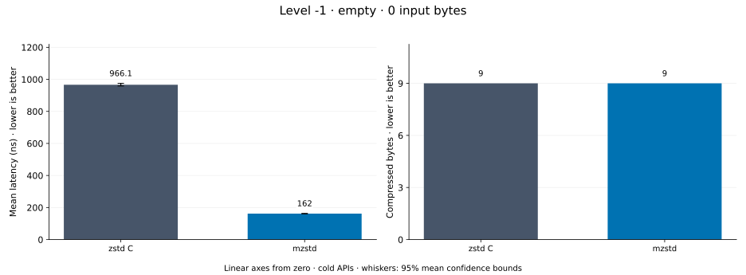
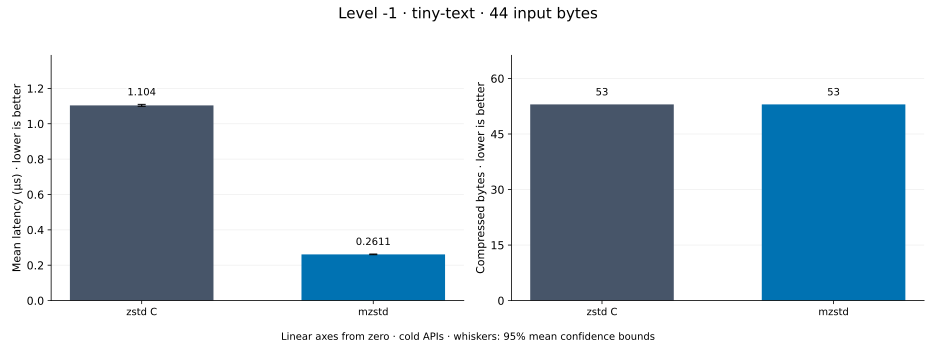
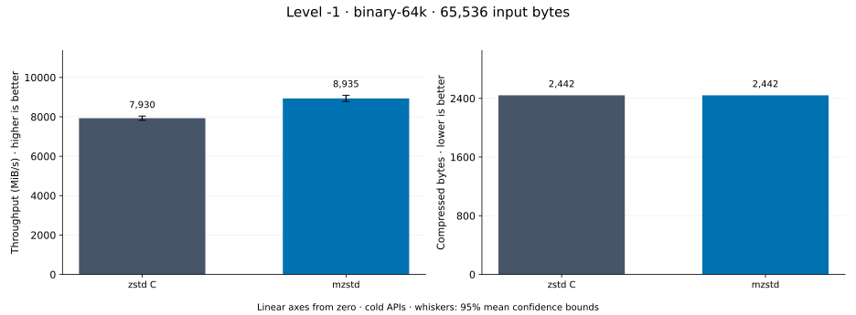
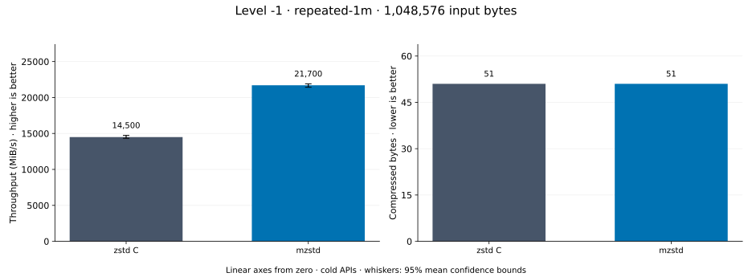
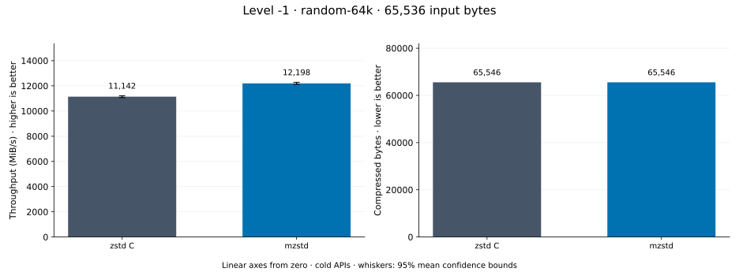
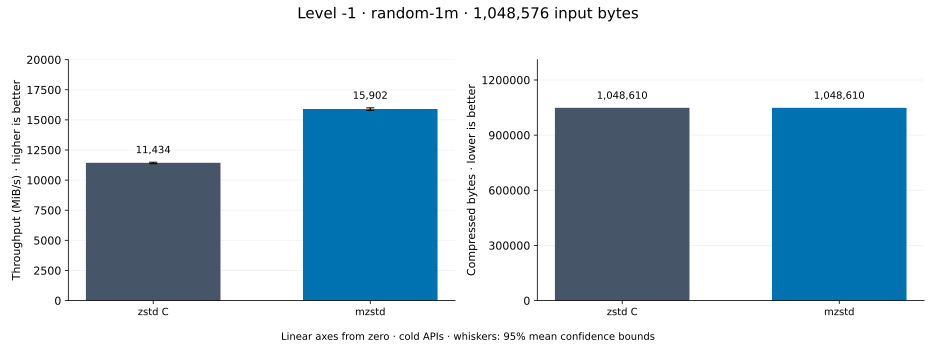
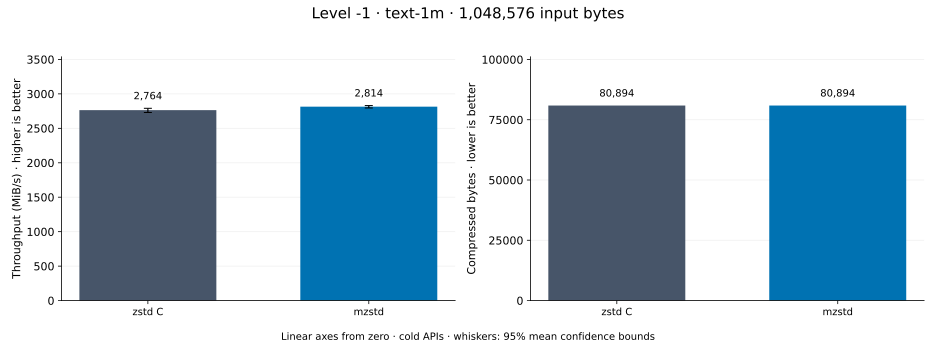
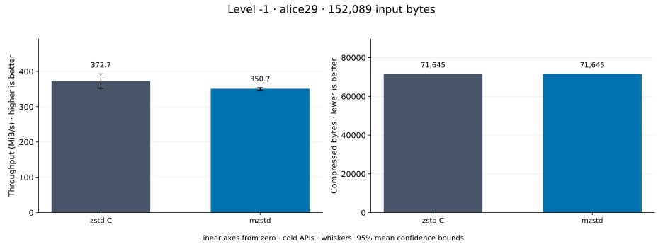

# Compression level -1

[Benchmark index](../README.md) · [Median overview](README.md) · [← Level -5](l-5.md) · [Level 1 →](l1.md)

Recorded run: **enc-20261018** (2026-10-18).
[Raw results](../encoder-comparison.csv) · [Environment](../encoder-comparison-environment.json) · [Run analysis](../encoder-comparison.md).

## Median across all datasets

Each of the 8 datasets has equal weight, including empty and tiny input.
Speed / C = C mean latency / implementation mean latency; output / C = implementation bytes / C bytes.
We take the median of these 8 per-dataset ratios separately for speed and size.
1× matches C; higher speed and lower output are better. These are medians across datasets,
not median sample latencies, and do not imply statistical significance.

| Implementation | Median speed / C ↑ | Median output / C ↓ | Datasets |
| --- | ---: | ---: | ---: |
| zstd C | 1.000× | 1.000× | 8 |
| mzstd | 1.245× | 1.000× | 8 |

Measurement setup and interpretation

zstd 1.5.7 (the C library built by `zstd-ffi`) and mzstd at the recorded
working tree compress identical bytes at this level. Every frame was checked byte-identical
to zstd's and decoded back to its input before any timing.

These are cold native API measurements: construction, allocation, compression, and disposal.
Complete known input; 20 samples, 0.2 s warmup, at least 0.5 s measurement.
Host: 13th Gen Intel(R) Core(TM) i7-13700KF, One single-threaded Criterion process pinned to logical CPU 2; the decoder sweep ran at the same time on logical CPU 6 (separate physical core) and nothing else ran. unset; Cargo release defaults (bench profile), runtime SIMD dispatch (AVX2 level on this host).

Chart whiskers and table intervals describe 95% confidence bounds on mean timing.
They do not capture all host or allocator variation. Throughput bounds are transformed latency bounds.
Output / input is compressed bytes divided by input bytes; smaller is better, and values above 100% mean expansion.
For empty input, throughput and output / input are undefined (—).
See the [run analysis](../encoder-comparison.md#interpretation-limits) for measurement limitations.

## Dataset details

Ordered by mzstd speed / C, highest first; all 8 datasets are shown.
This order uses recorded mean latency, not statistical significance. Bars start at zero.

[empty](#empty) · [tiny-text](#tiny-text) · [binary-64k](#binary-64k) · [repeated-1m](#repeated-1m) · [random-64k](#random-64k) · [random-1m](#random-1m) · [text-1m](#text-1m) · [alice29](#alice29)

### empty

Empty input; measures API overhead. **Input: 0 bytes.**

mzstd speed / C: **5.965×**; output: 9 / 9 bytes.

Exact measurements and confidence bounds

| Implementation | Mean, ns | 95% mean interval, ns | MiB/s | Output bytes | Output / input | Speed / C |
| --- | ---: | ---: | ---: | ---: | ---: | ---: |
| zstd C | 966.1 | 958.9–975 | — | 9 | — | 1.000× |
| mzstd | 162 | 160.7–163.3 | — | 9 | — | 5.965× |

### tiny-text

44-byte quick-brown-fox sentence. **Input: 44 bytes.**

mzstd speed / C: **4.227×**; output: 53 / 53 bytes.

Exact measurements and confidence bounds

| Implementation | Mean, µs | 95% mean interval, µs | MiB/s | Output bytes | Output / input | Speed / C |
| --- | ---: | ---: | ---: | ---: | ---: | ---: |
| zstd C | 1.104 | 1.099–1.11 | 38.01 | 53 | 120.455% | 1.000× |
| mzstd | 0.2611 | 0.2595–0.2633 | 160.68 | 53 | 120.455% | 4.227× |

### binary-64k

64 KiB of structured binary bytes: ((i / 16) XOR i) modulo 256. **Input: 65,536 bytes.**

mzstd speed / C: **1.271×**; output: 2,442 / 2,442 bytes.

Exact measurements and confidence bounds

| Implementation | Mean, µs | 95% mean interval, µs | MiB/s | Output bytes | Output / input | Speed / C |
| --- | ---: | ---: | ---: | ---: | ---: | ---: |
| zstd C | 7.805 | 7.782–7.835 | 8,008.00 | 2,442 | 3.726% | 1.000× |
| mzstd | 6.143 | 6.132–6.155 | 10,174.80 | 2,442 | 3.726% | 1.271× |

### repeated-1m

1 MiB of repeated a bytes. **Input: 1,048,576 bytes.**

mzstd speed / C: **1.253×**; output: 51 / 51 bytes.

Exact measurements and confidence bounds

| Implementation | Mean, µs | 95% mean interval, µs | MiB/s | Output bytes | Output / input | Speed / C |
| --- | ---: | ---: | ---: | ---: | ---: | ---: |
| zstd C | 58.15 | 57.63–58.99 | 17,196.73 | 51 | 0.005% | 1.000× |
| mzstd | 46.4 | 46.27–46.55 | 21,551.78 | 51 | 0.005% | 1.253× |

### random-64k

64 KiB prefix of the deterministic pseudorandom corpus. **Input: 65,536 bytes.**

mzstd speed / C: **1.237×**; output: 65,546 / 65,546 bytes.

Exact measurements and confidence bounds

| Implementation | Mean, µs | 95% mean interval, µs | MiB/s | Output bytes | Output / input | Speed / C |
| --- | ---: | ---: | ---: | ---: | ---: | ---: |
| zstd C | 5.669 | 5.657–5.684 | 11,024.88 | 65,546 | 100.015% | 1.000× |
| mzstd | 4.583 | 4.572–4.598 | 13,638.07 | 65,546 | 100.015% | 1.237× |

### random-1m

1 MiB of deterministic xorshift64 pseudorandom bytes. **Input: 1,048,576 bytes.**

mzstd speed / C: **1.113×**; output: 1,048,610 / 1,048,610 bytes.

Exact measurements and confidence bounds

| Implementation | Mean, µs | 95% mean interval, µs | MiB/s | Output bytes | Output / input | Speed / C |
| --- | ---: | ---: | ---: | ---: | ---: | ---: |
| zstd C | 88.8 | 88.34–89.39 | 11,261.48 | 1,048,610 | 100.003% | 1.000× |
| mzstd | 79.8 | 79.02–80.84 | 12,531.55 | 1,048,610 | 100.003% | 1.113× |

### text-1m

Alice text repeated cyclically to 1 MiB. **Input: 1,048,576 bytes.**

mzstd speed / C: **1.018×**; output: 80,894 / 80,894 bytes.

Exact measurements and confidence bounds

| Implementation | Mean, µs | 95% mean interval, µs | MiB/s | Output bytes | Output / input | Speed / C |
| --- | ---: | ---: | ---: | ---: | ---: | ---: |
| zstd C | 361.8 | 358.3–366.4 | 2,763.93 | 80,894 | 7.715% | 1.000× |
| mzstd | 355.4 | 353.3–357.7 | 2,814.12 | 80,894 | 7.715% | 1.018× |

### alice29

Alice in Wonderland text from the Canterbury corpus (`testdata/alice29.txt`). **Input: 152,089 bytes.**

mzstd speed / C: **0.935×**; output: 71,645 / 71,645 bytes.

Exact measurements and confidence bounds

| Implementation | Mean, µs | 95% mean interval, µs | MiB/s | Output bytes | Output / input | Speed / C |
| --- | ---: | ---: | ---: | ---: | ---: | ---: |
| zstd C | 367.4 | 366.7–368.1 | 394.79 | 71,645 | 47.107% | 1.000× |
| mzstd | 392.9 | 391.5–394.5 | 369.14 | 71,645 | 47.107% | 0.935× |

