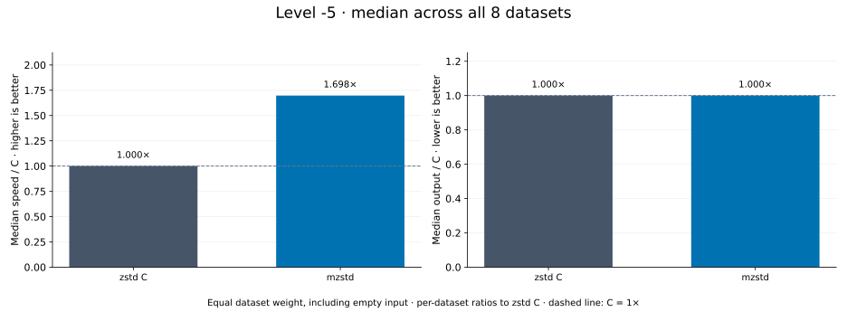
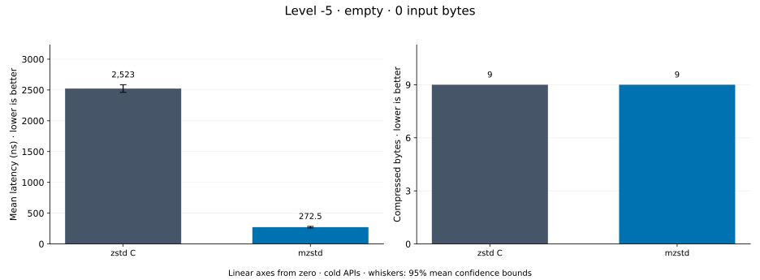
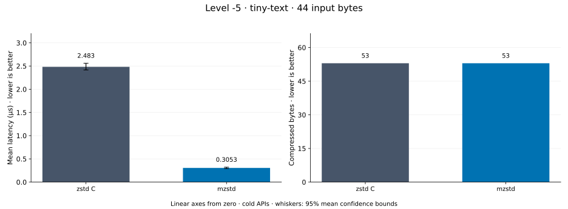
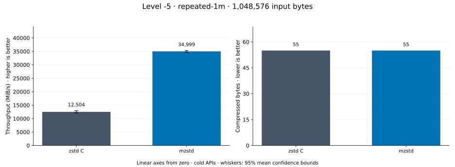
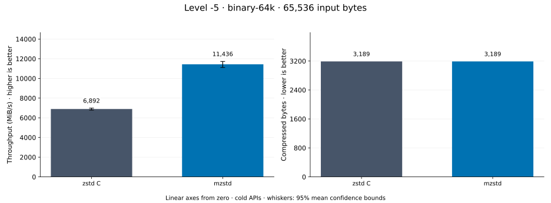
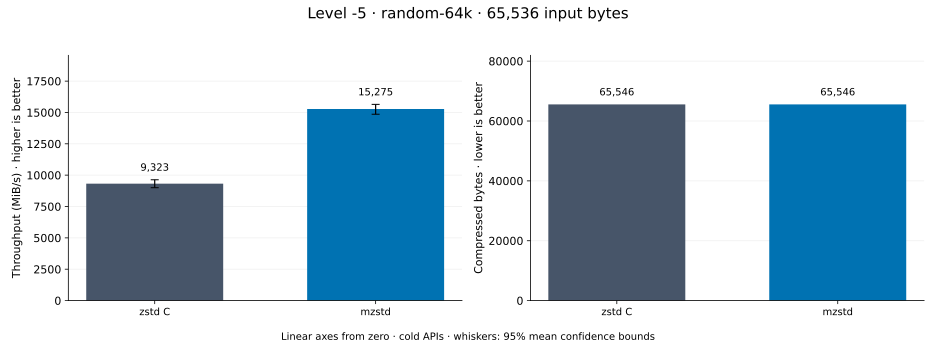
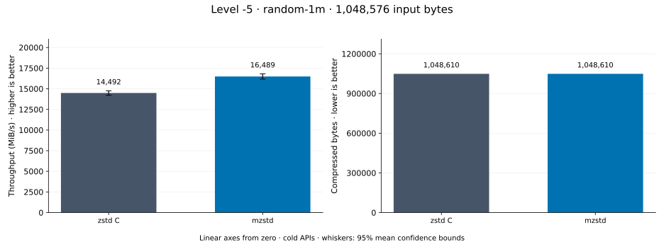
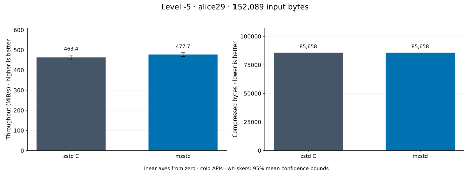
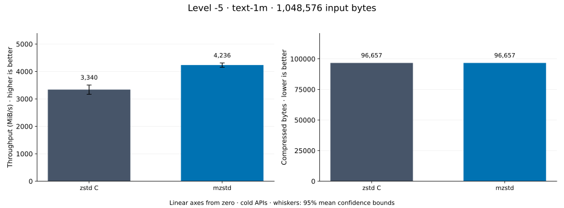

# Compression level -5

[Benchmark index](../README.md) · [Median overview](README.md) · [Level -1 →](l-1.md)

Recorded run: **long-20261109** (2026-11-09).
[Raw results](../encoder-comparison.csv) · [Environment](../encoder-comparison-environment.json) · [Run analysis](../encoder-comparison.md).

## Median across all datasets

Each of the 8 datasets has equal weight, including empty and tiny input.
Speed / C = C mean latency / implementation mean latency; output / C = implementation bytes / C bytes.
We take the median of these 8 per-dataset ratios separately for speed and size.
1× matches C; higher speed and lower output are better. These are medians across datasets,
not median sample latencies, and do not imply statistical significance.

| Implementation | Median speed / C ↑ | Median output / C ↓ | Datasets |
| --- | ---: | ---: | ---: |
| zstd C | 1.000× | 1.000× | 8 |
| mzstd | 1.720× | 1.000× | 8 |

Measurement setup and interpretation

zstd 1.5.7 (the C library built by `zstd-ffi`) and mzstd at the recorded
working tree compress identical bytes at this level. Every frame was checked byte-identical
to zstd's and decoded back to its input before any timing.

These are cold native API measurements: construction, allocation, compression, and disposal.
Complete known input; 50 samples, 3 s warmup, at least 6 s measurement.
Host: AMD Ryzen 9 7950X, Linux KVM guest with two vCPUs: the encoder suite, then the decoder suite, each in one Criterion process pinned to vCPU 1; nothing else ran in the guest. Other tenants loaded the host: a fixed C decode varied by 8-43% (p10-p90 wall time) through the day, so sampling was lengthened to average over the noise. unset; Cargo release defaults (bench profile), runtime SIMD dispatch (AVX-512 level on this host; the decoder runs its block loops at the AVX2 level).

Chart whiskers and table intervals describe 95% confidence bounds on mean timing.
They do not capture all host or allocator variation. Throughput bounds are transformed latency bounds.
Output / input is compressed bytes divided by input bytes; smaller is better, and values above 100% mean expansion.
For empty input, throughput and output / input are undefined (—).
See the [run analysis](../encoder-comparison.md#interpretation-limits) for measurement limitations.

## Dataset details

Ordered by mzstd speed / C, highest first; all 8 datasets are shown.
This order uses recorded mean latency, not statistical significance. Bars start at zero.

[empty](#empty) · [tiny-text](#tiny-text) · [repeated-1m](#repeated-1m) · [binary-64k](#binary-64k) · [random-64k](#random-64k) · [random-1m](#random-1m) · [alice29](#alice29) · [text-1m](#text-1m)

### empty

Empty input; measures API overhead. **Input: 0 bytes.**

mzstd speed / C: **10.763×**; output: 9 / 9 bytes.

Exact measurements and confidence bounds

| Implementation | Mean, ns | 95% mean interval, ns | MiB/s | Output bytes | Output / input | Speed / C |
| --- | ---: | ---: | ---: | ---: | ---: | ---: |
| zstd C | 2,200 | 2,168–2,236 | — | 9 | — | 1.000× |
| mzstd | 204.4 | 197.2–212.7 | — | 9 | — | 10.763× |

### tiny-text

44-byte quick-brown-fox sentence. **Input: 44 bytes.**

mzstd speed / C: **8.134×**; output: 53 / 53 bytes.

Exact measurements and confidence bounds

| Implementation | Mean, µs | 95% mean interval, µs | MiB/s | Output bytes | Output / input | Speed / C |
| --- | ---: | ---: | ---: | ---: | ---: | ---: |
| zstd C | 2.483 | 2.416–2.561 | 16.90 | 53 | 120.455% | 1.000× |
| mzstd | 0.3053 | 0.2914–0.3207 | 137.46 | 53 | 120.455% | 8.134× |

### repeated-1m

1 MiB of repeated a bytes. **Input: 1,048,576 bytes.**

mzstd speed / C: **2.799×**; output: 55 / 55 bytes.

Exact measurements and confidence bounds

| Implementation | Mean, µs | 95% mean interval, µs | MiB/s | Output bytes | Output / input | Speed / C |
| --- | ---: | ---: | ---: | ---: | ---: | ---: |
| zstd C | 79.98 | 77.36–82.99 | 12,503.89 | 55 | 0.005% | 1.000× |
| mzstd | 28.57 | 28.31–28.87 | 34,999.29 | 55 | 0.005% | 2.799× |

### binary-64k

64 KiB of structured binary bytes: ((i / 16) XOR i) modulo 256. **Input: 65,536 bytes.**

mzstd speed / C: **1.801×**; output: 3,189 / 3,189 bytes.

Exact measurements and confidence bounds

| Implementation | Mean, µs | 95% mean interval, µs | MiB/s | Output bytes | Output / input | Speed / C |
| --- | ---: | ---: | ---: | ---: | ---: | ---: |
| zstd C | 9.566 | 9.255–9.912 | 6,533.28 | 3,189 | 4.866% | 1.000× |
| mzstd | 5.313 | 5.232–5.404 | 11,764.11 | 3,189 | 4.866% | 1.801× |

### random-64k

64 KiB prefix of the deterministic pseudorandom corpus. **Input: 65,536 bytes.**

mzstd speed / C: **1.638×**; output: 65,546 / 65,546 bytes.

Exact measurements and confidence bounds

| Implementation | Mean, µs | 95% mean interval, µs | MiB/s | Output bytes | Output / input | Speed / C |
| --- | ---: | ---: | ---: | ---: | ---: | ---: |
| zstd C | 6.704 | 6.486–6.943 | 9,323.24 | 65,546 | 100.015% | 1.000× |
| mzstd | 4.092 | 3.995–4.207 | 15,275.18 | 65,546 | 100.015% | 1.638× |

### random-1m

1 MiB of deterministic xorshift64 pseudorandom bytes. **Input: 1,048,576 bytes.**

mzstd speed / C: **1.138×**; output: 1,048,610 / 1,048,610 bytes.

Exact measurements and confidence bounds

| Implementation | Mean, µs | 95% mean interval, µs | MiB/s | Output bytes | Output / input | Speed / C |
| --- | ---: | ---: | ---: | ---: | ---: | ---: |
| zstd C | 69.01 | 67.74–70.32 | 14,491.55 | 1,048,610 | 100.003% | 1.000× |
| mzstd | 60.65 | 59.48–61.85 | 16,488.59 | 1,048,610 | 100.003% | 1.138× |

### alice29

Alice in Wonderland text from the Canterbury corpus (`testdata/alice29.txt`). **Input: 152,089 bytes.**

mzstd speed / C: **1.109×**; output: 85,658 / 85,658 bytes.

Exact measurements and confidence bounds

| Implementation | Mean, µs | 95% mean interval, µs | MiB/s | Output bytes | Output / input | Speed / C |
| --- | ---: | ---: | ---: | ---: | ---: | ---: |
| zstd C | 330.3 | 315.9–346.2 | 439.15 | 85,658 | 56.321% | 1.000× |
| mzstd | 297.8 | 292.9–304 | 487.07 | 85,658 | 56.321% | 1.109× |

### text-1m

Alice text repeated cyclically to 1 MiB. **Input: 1,048,576 bytes.**

mzstd speed / C: **1.091×**; output: 96,657 / 96,657 bytes.

Exact measurements and confidence bounds

| Implementation | Mean, µs | 95% mean interval, µs | MiB/s | Output bytes | Output / input | Speed / C |
| --- | ---: | ---: | ---: | ---: | ---: | ---: |
| zstd C | 319.5 | 305.3–335.2 | 3,130.25 | 96,657 | 9.218% | 1.000× |
| mzstd | 292.8 | 279.3–306.8 | 3,415.00 | 96,657 | 9.218% | 1.091× |

