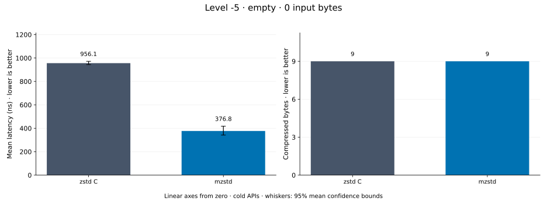
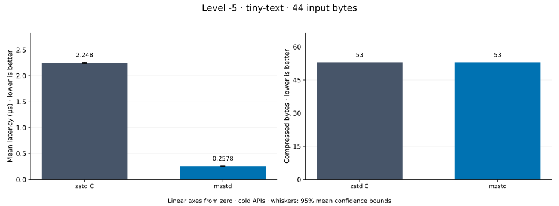
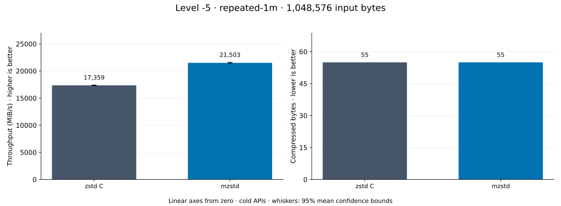
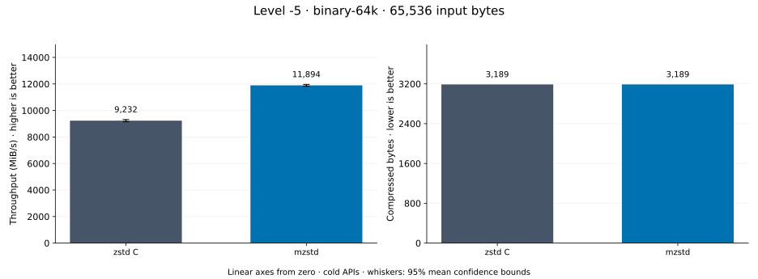
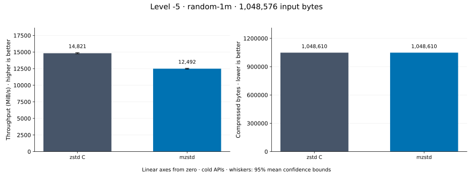
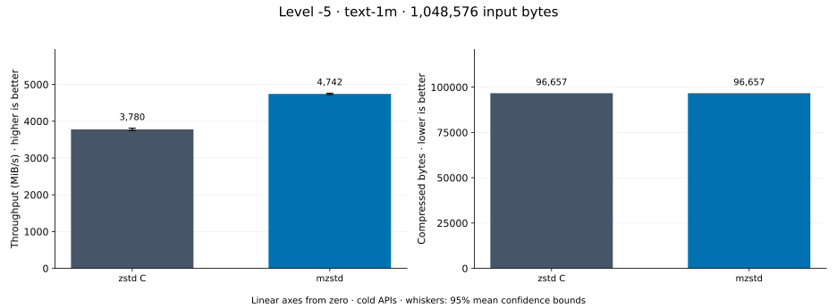
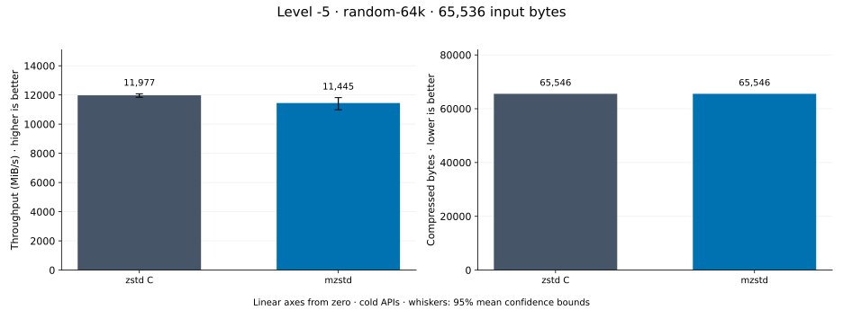
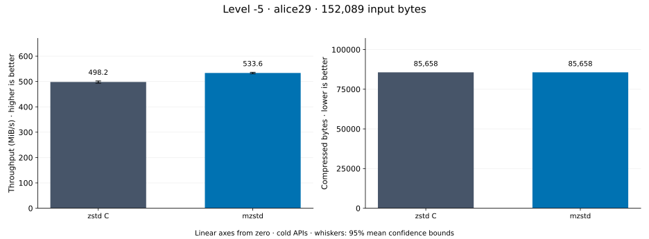

# Compression level -5

[Benchmark index](../README.md) · [Median overview](README.md) · [Level -1 →](l-1.md)

Recorded run: **enc-20261014-fix** (2026-10-14).
[Raw results](../encoder-comparison.csv) · [Environment](../encoder-comparison-environment.json) · [Run analysis](../encoder-comparison.md).

## Median across all datasets

Each of the 8 datasets has equal weight, including empty and tiny input.
Speed / C = C mean latency / implementation mean latency; output / C = implementation bytes / C bytes.
We take the median of these 8 per-dataset ratios separately for speed and size.
1× matches C; higher speed and lower output are better. These are medians across datasets,
not median sample latencies, and do not imply statistical significance.

| Implementation | Median speed / C ↑ | Median output / C ↓ | Datasets |
| --- | ---: | ---: | ---: |
| zstd C | 1.000× | 1.000× | 8 |
| mzstd | 1.078× | 1.000× | 8 |

Measurement setup and interpretation

zstd 1.5.7 (the C library built by `zstd-ffi`) and mzstd at the recorded
working tree compress identical bytes at this level. Every frame was checked byte-identical
to zstd's and decoded back to its input before any timing.

These are cold native API measurements: construction, allocation, compression, and disposal.
Complete known input; 20 samples, 0.2 s warmup, at least 0.5 s measurement.
Host: 13th Gen Intel(R) Core(TM) i7-13700KF, One single-threaded Criterion process pinned to logical CPU 2; no concurrent decoder sweep. unset; Cargo release defaults (bench profile), runtime SIMD dispatch (AVX2 level on this host).

Chart whiskers and table intervals describe 95% confidence bounds on mean timing.
They do not capture all host or allocator variation. Throughput bounds are transformed latency bounds.
Output / input is compressed bytes divided by input bytes; smaller is better, and values above 100% mean expansion.
For empty input, throughput and output / input are undefined (—).
See the [run analysis](../encoder-comparison.md#interpretation-limits) for measurement limitations.

## Dataset details

Ordered by mzstd speed / C, highest first; all 8 datasets are shown.
This order uses recorded mean latency, not statistical significance. Bars start at zero.

[empty](#empty) · [tiny-text](#tiny-text) · [repeated-1m](#repeated-1m) · [binary-64k](#binary-64k) · [random-1m](#random-1m) · [text-1m](#text-1m) · [random-64k](#random-64k) · [alice29](#alice29)

### empty

Empty input; measures API overhead. **Input: 0 bytes.**

mzstd speed / C: **2.759×**; output: 9 / 9 bytes.

Exact measurements and confidence bounds

| Implementation | Mean, ns | 95% mean interval, ns | MiB/s | Output bytes | Output / input | Speed / C |
| --- | ---: | ---: | ---: | ---: | ---: | ---: |
| zstd C | 955.2 | 941.9–968.2 | — | 9 | — | 1.000× |
| mzstd | 346.2 | 339–354 | — | 9 | — | 2.759× |

### tiny-text

44-byte quick-brown-fox sentence. **Input: 44 bytes.**

mzstd speed / C: **2.541×**; output: 53 / 53 bytes.

Exact measurements and confidence bounds

| Implementation | Mean, µs | 95% mean interval, µs | MiB/s | Output bytes | Output / input | Speed / C |
| --- | ---: | ---: | ---: | ---: | ---: | ---: |
| zstd C | 1.04 | 1.033–1.048 | 40.34 | 53 | 120.455% | 1.000× |
| mzstd | 0.4094 | 0.4064–0.4131 | 102.49 | 53 | 120.455% | 2.541× |

### repeated-1m

1 MiB of repeated a bytes. **Input: 1,048,576 bytes.**

mzstd speed / C: **1.363×**; output: 55 / 55 bytes.

Exact measurements and confidence bounds

| Implementation | Mean, µs | 95% mean interval, µs | MiB/s | Output bytes | Output / input | Speed / C |
| --- | ---: | ---: | ---: | ---: | ---: | ---: |
| zstd C | 65.91 | 63.67–68.27 | 15,172.73 | 55 | 0.005% | 1.000× |
| mzstd | 48.34 | 47.49–49.28 | 20,686.00 | 55 | 0.005% | 1.363× |

### binary-64k

64 KiB of structured binary bytes: ((i / 16) XOR i) modulo 256. **Input: 65,536 bytes.**

mzstd speed / C: **1.113×**; output: 3,189 / 3,189 bytes.

Exact measurements and confidence bounds

| Implementation | Mean, µs | 95% mean interval, µs | MiB/s | Output bytes | Output / input | Speed / C |
| --- | ---: | ---: | ---: | ---: | ---: | ---: |
| zstd C | 6.707 | 6.575–6.84 | 9,319.19 | 3,189 | 4.866% | 1.000× |
| mzstd | 6.028 | 5.874–6.192 | 10,367.81 | 3,189 | 4.866% | 1.113× |

### random-1m

1 MiB of deterministic xorshift64 pseudorandom bytes. **Input: 1,048,576 bytes.**

mzstd speed / C: **1.043×**; output: 1,048,610 / 1,048,610 bytes.

Exact measurements and confidence bounds

| Implementation | Mean, µs | 95% mean interval, µs | MiB/s | Output bytes | Output / input | Speed / C |
| --- | ---: | ---: | ---: | ---: | ---: | ---: |
| zstd C | 66.4 | 65.58–67.39 | 15,059.38 | 1,048,610 | 100.003% | 1.000× |
| mzstd | 63.67 | 63.41–63.99 | 15,706.79 | 1,048,610 | 100.003% | 1.043× |

### text-1m

Alice text repeated cyclically to 1 MiB. **Input: 1,048,576 bytes.**

mzstd speed / C: **1.020×**; output: 96,657 / 96,657 bytes.

Exact measurements and confidence bounds

| Implementation | Mean, µs | 95% mean interval, µs | MiB/s | Output bytes | Output / input | Speed / C |
| --- | ---: | ---: | ---: | ---: | ---: | ---: |
| zstd C | 287.1 | 282–293.1 | 3,482.81 | 96,657 | 9.218% | 1.000× |
| mzstd | 281.5 | 278–286.2 | 3,552.38 | 96,657 | 9.218% | 1.020× |

### random-64k

64 KiB prefix of the deterministic pseudorandom corpus. **Input: 65,536 bytes.**

mzstd speed / C: **1.012×**; output: 65,546 / 65,546 bytes.

Exact measurements and confidence bounds

| Implementation | Mean, µs | 95% mean interval, µs | MiB/s | Output bytes | Output / input | Speed / C |
| --- | ---: | ---: | ---: | ---: | ---: | ---: |
| zstd C | 5.264 | 5.152–5.407 | 11,872.32 | 65,546 | 100.015% | 1.000× |
| mzstd | 5.203 | 5.126–5.28 | 12,013.32 | 65,546 | 100.015% | 1.012× |

### alice29

Alice in Wonderland text from the Canterbury corpus (`testdata/alice29.txt`). **Input: 152,089 bytes.**

mzstd speed / C: **0.868×**; output: 85,658 / 85,658 bytes.

Exact measurements and confidence bounds

| Implementation | Mean, µs | 95% mean interval, µs | MiB/s | Output bytes | Output / input | Speed / C |
| --- | ---: | ---: | ---: | ---: | ---: | ---: |
| zstd C | 316.1 | 309.9–322.5 | 458.80 | 85,658 | 56.321% | 1.000× |
| mzstd | 364.3 | 358.9–369.6 | 398.17 | 85,658 | 56.321% | 0.868× |

