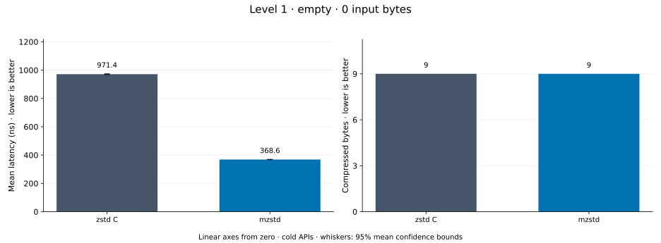
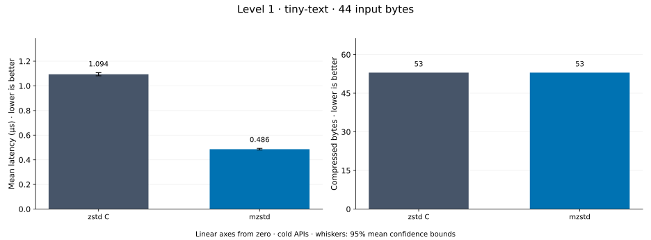
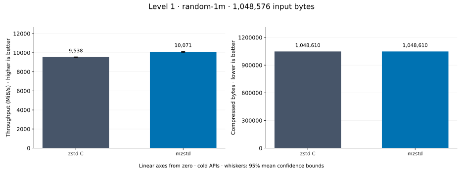
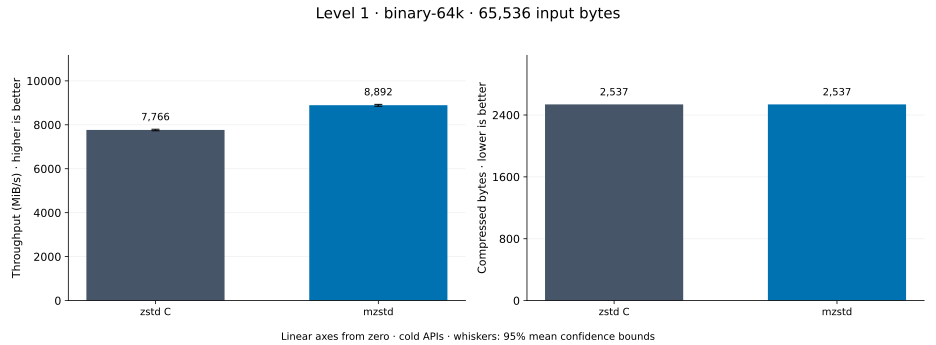
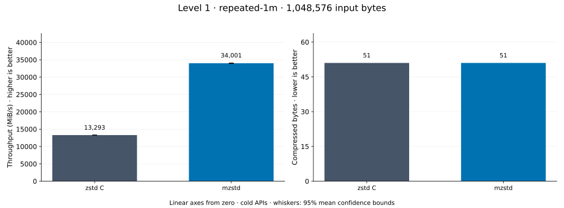
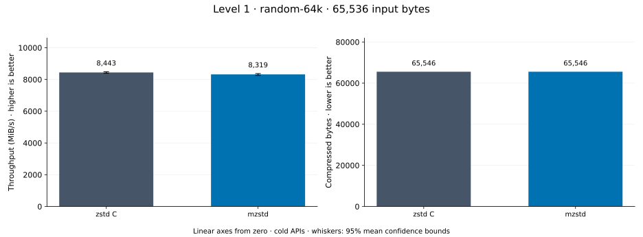
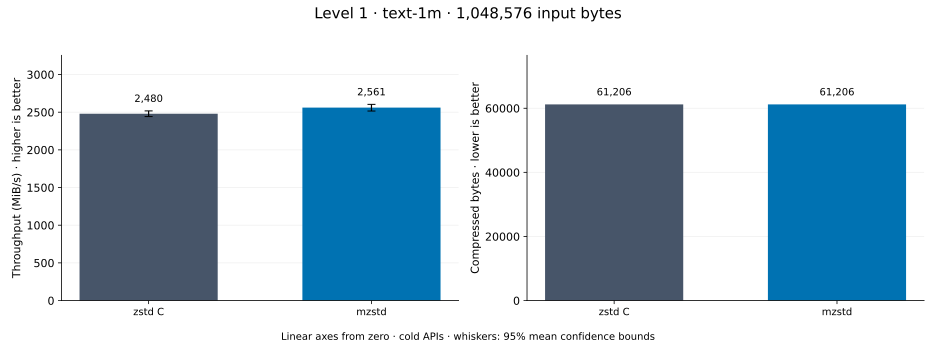
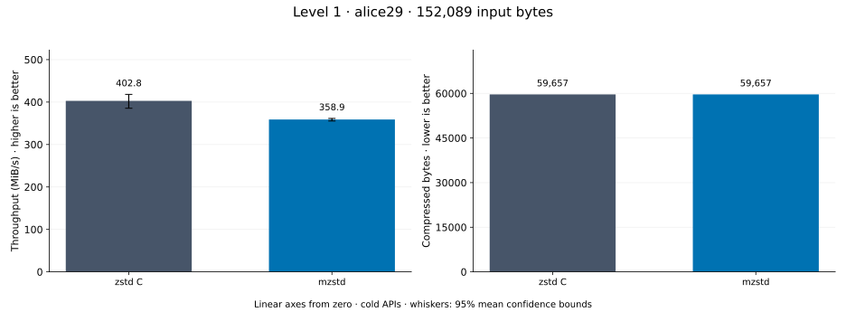

# Compression level 1

[Benchmark index](../README.md) · [Median overview](README.md) · [← Level -1](l-1.md) · [Level 2 →](l2.md)

Recorded run: **enc-2026-10-13** (2026-10-13).
[Raw results](../encoder-comparison.csv) · [Environment](../encoder-comparison-environment.json) · [Run analysis](../encoder-comparison.md).

## Median across all datasets

Each of the 8 datasets has equal weight, including empty and tiny input.
Speed / C = C mean latency / implementation mean latency; output / C = implementation bytes / C bytes.
We take the median of these 8 per-dataset ratios separately for speed and size.
1× matches C; higher speed and lower output are better. These are medians across datasets,
not median sample latencies, and do not imply statistical significance.

| Implementation | Median speed / C ↑ | Median output / C ↓ | Datasets |
| --- | ---: | ---: | ---: |
| zstd C | 1.000× | 1.000× | 8 |
| mzstd | 0.950× | 1.000× | 8 |

Measurement setup and interpretation

zstd 1.5.7 (the C library built by `zstd-ffi`) and mzstd at the recorded
working tree compress identical bytes at this level. Every frame was checked byte-identical
to zstd's and decoded back to its input before any timing.

These are cold native API measurements: construction, allocation, compression, and disposal.
Complete known input; 20 samples, 1 s warmup, at least 3 s measurement.
Host: 13th Gen Intel(R) Core(TM) i7-13700KF, One single-threaded Criterion process pinned to logical CPU 2; the encoder and decoder sweeps ran concurrently on logical CPUs 2 and 6 (separate physical cores) and nothing else ran. unset; Cargo release defaults (bench profile), runtime SIMD dispatch (AVX2 level on this host).

Chart whiskers and table intervals describe 95% confidence bounds on mean timing.
They do not capture all host or allocator variation. Throughput bounds are transformed latency bounds.
Output / input is compressed bytes divided by input bytes; smaller is better, and values above 100% mean expansion.
For empty input, throughput and output / input are undefined (—).
See the [run analysis](../encoder-comparison.md#interpretation-limits) for measurement limitations.

## Dataset details

Ordered by mzstd speed / C, highest first; all 8 datasets are shown.
This order uses recorded mean latency, not statistical significance. Bars start at zero.

[empty](#empty) · [tiny-text](#tiny-text) · [random-1m](#random-1m) · [binary-64k](#binary-64k) · [repeated-1m](#repeated-1m) · [random-64k](#random-64k) · [text-1m](#text-1m) · [alice29](#alice29)

### empty

Empty input; measures API overhead. **Input: 0 bytes.**

mzstd speed / C: **2.635×**; output: 9 / 9 bytes.

Exact measurements and confidence bounds

| Implementation | Mean, ns | 95% mean interval, ns | MiB/s | Output bytes | Output / input | Speed / C |
| --- | ---: | ---: | ---: | ---: | ---: | ---: |
| zstd C | 971.4 | 968.9–973.9 | — | 9 | — | 1.000× |
| mzstd | 368.6 | 367.5–369.8 | — | 9 | — | 2.635× |

### tiny-text

44-byte quick-brown-fox sentence. **Input: 44 bytes.**

mzstd speed / C: **2.230×**; output: 53 / 53 bytes.

Exact measurements and confidence bounds

| Implementation | Mean, µs | 95% mean interval, µs | MiB/s | Output bytes | Output / input | Speed / C |
| --- | ---: | ---: | ---: | ---: | ---: | ---: |
| zstd C | 1.095 | 1.093–1.098 | 38.32 | 53 | 120.455% | 1.000× |
| mzstd | 0.4909 | 0.4884–0.4939 | 85.48 | 53 | 120.455% | 2.230× |

### random-1m

1 MiB of deterministic xorshift64 pseudorandom bytes. **Input: 1,048,576 bytes.**

mzstd speed / C: **1.056×**; output: 1,048,610 / 1,048,610 bytes.

Exact measurements and confidence bounds

| Implementation | Mean, µs | 95% mean interval, µs | MiB/s | Output bytes | Output / input | Speed / C |
| --- | ---: | ---: | ---: | ---: | ---: | ---: |
| zstd C | 104.8 | 104.5–105.2 | 9,538.47 | 1,048,610 | 100.003% | 1.000× |
| mzstd | 99.3 | 98.69–99.93 | 10,070.98 | 1,048,610 | 100.003% | 1.056× |

### binary-64k

64 KiB of structured binary bytes: ((i / 16) XOR i) modulo 256. **Input: 65,536 bytes.**

mzstd speed / C: **0.988×**; output: 2,537 / 2,537 bytes.

Exact measurements and confidence bounds

| Implementation | Mean, µs | 95% mean interval, µs | MiB/s | Output bytes | Output / input | Speed / C |
| --- | ---: | ---: | ---: | ---: | ---: | ---: |
| zstd C | 8.399 | 8.331–8.472 | 7,440.99 | 2,537 | 3.871% | 1.000× |
| mzstd | 8.499 | 8.418–8.582 | 7,353.40 | 2,537 | 3.871% | 0.988× |

### repeated-1m

1 MiB of repeated a bytes. **Input: 1,048,576 bytes.**

mzstd speed / C: **0.912×**; output: 51 / 51 bytes.

Exact measurements and confidence bounds

| Implementation | Mean, µs | 95% mean interval, µs | MiB/s | Output bytes | Output / input | Speed / C |
| --- | ---: | ---: | ---: | ---: | ---: | ---: |
| zstd C | 58.95 | 58.64–59.27 | 16,962.16 | 51 | 0.005% | 1.000× |
| mzstd | 64.66 | 64.35–64.96 | 15,465.07 | 51 | 0.005% | 0.912× |

### random-64k

64 KiB prefix of the deterministic pseudorandom corpus. **Input: 65,536 bytes.**

mzstd speed / C: **0.896×**; output: 65,546 / 65,546 bytes.

Exact measurements and confidence bounds

| Implementation | Mean, µs | 95% mean interval, µs | MiB/s | Output bytes | Output / input | Speed / C |
| --- | ---: | ---: | ---: | ---: | ---: | ---: |
| zstd C | 7.487 | 7.463–7.517 | 8,347.74 | 65,546 | 100.015% | 1.000× |
| mzstd | 8.352 | 8.331–8.375 | 7,483.67 | 65,546 | 100.015% | 0.896× |

### text-1m

Alice text repeated cyclically to 1 MiB. **Input: 1,048,576 bytes.**

mzstd speed / C: **0.840×**; output: 61,206 / 61,206 bytes.

Exact measurements and confidence bounds

| Implementation | Mean, µs | 95% mean interval, µs | MiB/s | Output bytes | Output / input | Speed / C |
| --- | ---: | ---: | ---: | ---: | ---: | ---: |
| zstd C | 409.6 | 405–414.3 | 2,441.40 | 61,206 | 5.837% | 1.000× |
| mzstd | 487.4 | 482.8–491.9 | 2,051.87 | 61,206 | 5.837% | 0.840× |

### alice29

Alice in Wonderland text from the Canterbury corpus (`testdata/alice29.txt`). **Input: 152,089 bytes.**

mzstd speed / C: **0.779×**; output: 59,657 / 59,657 bytes.

Exact measurements and confidence bounds

| Implementation | Mean, µs | 95% mean interval, µs | MiB/s | Output bytes | Output / input | Speed / C |
| --- | ---: | ---: | ---: | ---: | ---: | ---: |
| zstd C | 362.2 | 359–365.3 | 400.48 | 59,657 | 39.225% | 1.000× |
| mzstd | 465.2 | 461.3–469.2 | 311.80 | 59,657 | 39.225% | 0.779× |

