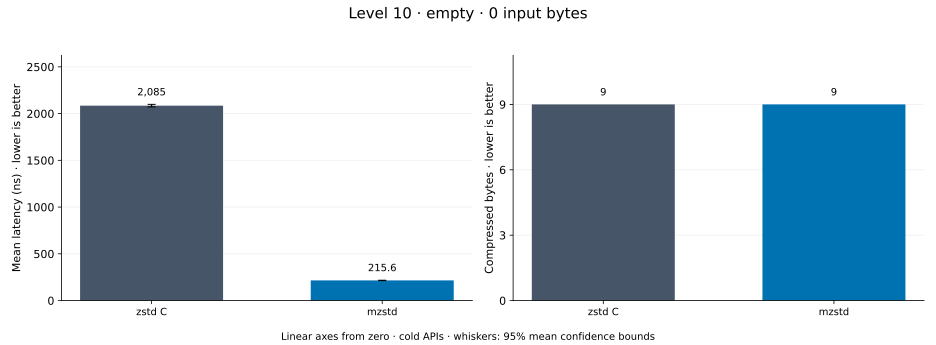
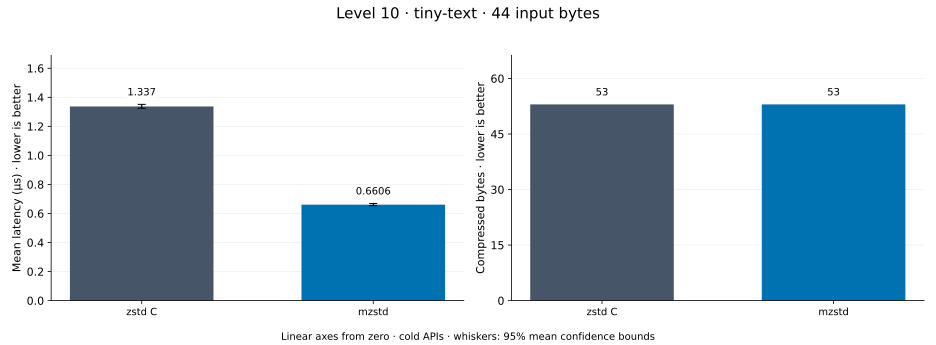
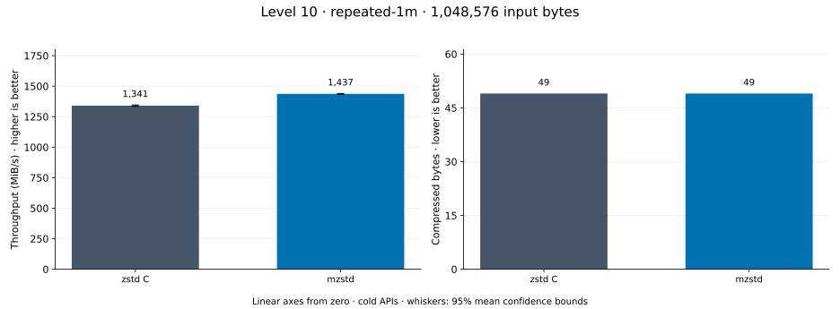
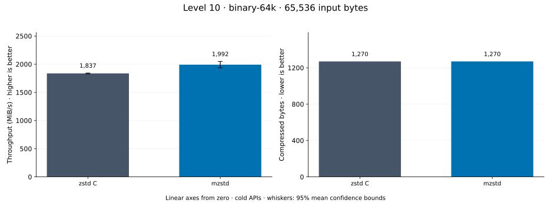
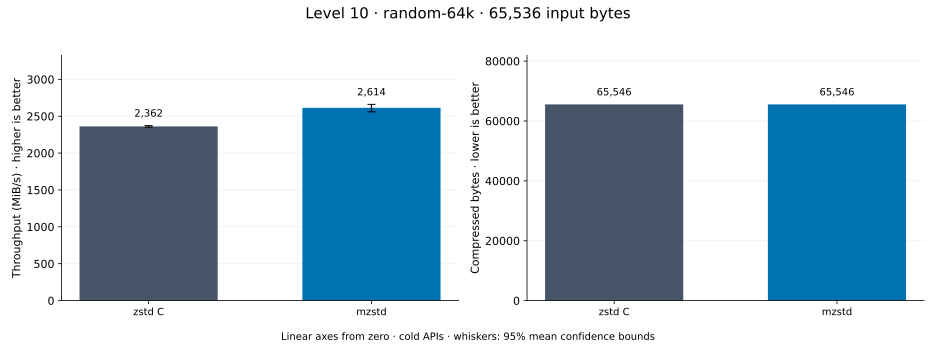
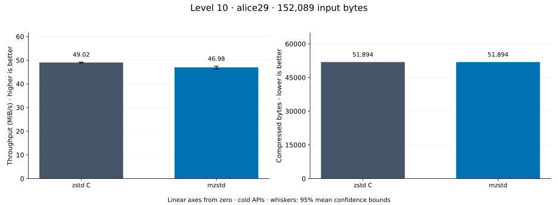
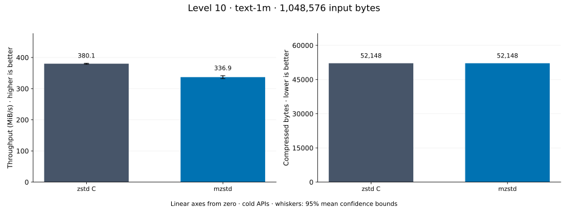
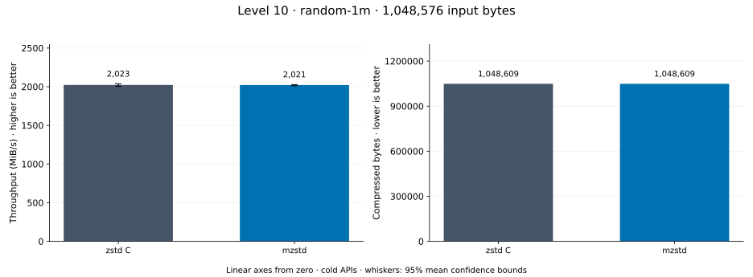

# Compression level 10

[Benchmark index](../README.md) · [Median overview](README.md) · [← Level 9](l9.md) · [Level 11 →](l11.md)

Recorded run: **enc-2026-10-13** (2026-10-13).
[Raw results](../encoder-comparison.csv) · [Environment](../encoder-comparison-environment.json) · [Run analysis](../encoder-comparison.md).

## Median across all datasets

Each of the 8 datasets has equal weight, including empty and tiny input.
Speed / C = C mean latency / implementation mean latency; output / C = implementation bytes / C bytes.
We take the median of these 8 per-dataset ratios separately for speed and size.
1× matches C; higher speed and lower output are better. These are medians across datasets,
not median sample latencies, and do not imply statistical significance.

| Implementation | Median speed / C ↑ | Median output / C ↓ | Datasets |
| --- | ---: | ---: | ---: |
| zstd C | 1.000× | 1.000× | 8 |
| mzstd | 0.922× | 1.000× | 8 |

Measurement setup and interpretation

zstd 1.5.7 (the C library built by `zstd-ffi`) and mzstd at the recorded
working tree compress identical bytes at this level. Every frame was checked byte-identical
to zstd's and decoded back to its input before any timing.

These are cold native API measurements: construction, allocation, compression, and disposal.
Complete known input; 20 samples, 1 s warmup, at least 3 s measurement.
Host: 13th Gen Intel(R) Core(TM) i7-13700KF, One single-threaded Criterion process pinned to logical CPU 2; the encoder and decoder sweeps ran concurrently on logical CPUs 2 and 6 (separate physical cores) and nothing else ran. unset; Cargo release defaults (bench profile), runtime SIMD dispatch (AVX2 level on this host).

Chart whiskers and table intervals describe 95% confidence bounds on mean timing.
They do not capture all host or allocator variation. Throughput bounds are transformed latency bounds.
Output / input is compressed bytes divided by input bytes; smaller is better, and values above 100% mean expansion.
For empty input, throughput and output / input are undefined (—).
See the [run analysis](../encoder-comparison.md#interpretation-limits) for measurement limitations.

## Dataset details

Ordered by mzstd speed / C, highest first; all 8 datasets are shown.
This order uses recorded mean latency, not statistical significance. Bars start at zero.

[empty](#empty) · [tiny-text](#tiny-text) · [repeated-1m](#repeated-1m) · [binary-64k](#binary-64k) · [random-64k](#random-64k) · [alice29](#alice29) · [text-1m](#text-1m) · [random-1m](#random-1m)

### empty

Empty input; measures API overhead. **Input: 0 bytes.**

mzstd speed / C: **2.426×**; output: 9 / 9 bytes.

Exact measurements and confidence bounds

| Implementation | Mean, ns | 95% mean interval, ns | MiB/s | Output bytes | Output / input | Speed / C |
| --- | ---: | ---: | ---: | ---: | ---: | ---: |
| zstd C | 972.1 | 969.3–975.1 | — | 9 | — | 1.000× |
| mzstd | 400.7 | 398.9–403.1 | — | 9 | — | 2.426× |

### tiny-text

44-byte quick-brown-fox sentence. **Input: 44 bytes.**

mzstd speed / C: **1.997×**; output: 53 / 53 bytes.

Exact measurements and confidence bounds

| Implementation | Mean, µs | 95% mean interval, µs | MiB/s | Output bytes | Output / input | Speed / C |
| --- | ---: | ---: | ---: | ---: | ---: | ---: |
| zstd C | 1.362 | 1.359–1.365 | 30.80 | 53 | 120.455% | 1.000× |
| mzstd | 0.682 | 0.6801–0.6841 | 61.53 | 53 | 120.455% | 1.997× |

### repeated-1m

1 MiB of repeated a bytes. **Input: 1,048,576 bytes.**

mzstd speed / C: **1.072×**; output: 49 / 49 bytes.

Exact measurements and confidence bounds

| Implementation | Mean, µs | 95% mean interval, µs | MiB/s | Output bytes | Output / input | Speed / C |
| --- | ---: | ---: | ---: | ---: | ---: | ---: |
| zstd C | 745.8 | 743.1–748.8 | 1,340.84 | 49 | 0.005% | 1.000× |
| mzstd | 695.9 | 694.4–697.6 | 1,436.89 | 49 | 0.005% | 1.072× |

### binary-64k

64 KiB of structured binary bytes: ((i / 16) XOR i) modulo 256. **Input: 65,536 bytes.**

mzstd speed / C: **0.929×**; output: 1,270 / 1,270 bytes.

Exact measurements and confidence bounds

| Implementation | Mean, µs | 95% mean interval, µs | MiB/s | Output bytes | Output / input | Speed / C |
| --- | ---: | ---: | ---: | ---: | ---: | ---: |
| zstd C | 35.3 | 34.76–35.98 | 1,770.30 | 1,270 | 1.938% | 1.000× |
| mzstd | 37.99 | 37.53–38.43 | 1,645.37 | 1,270 | 1.938% | 0.929× |

### random-64k

64 KiB prefix of the deterministic pseudorandom corpus. **Input: 65,536 bytes.**

mzstd speed / C: **0.914×**; output: 65,546 / 65,546 bytes.

Exact measurements and confidence bounds

| Implementation | Mean, µs | 95% mean interval, µs | MiB/s | Output bytes | Output / input | Speed / C |
| --- | ---: | ---: | ---: | ---: | ---: | ---: |
| zstd C | 27.2 | 27.11–27.3 | 2,297.71 | 65,546 | 100.015% | 1.000× |
| mzstd | 29.75 | 29.53–29.95 | 2,100.89 | 65,546 | 100.015% | 0.914× |

### alice29

Alice in Wonderland text from the Canterbury corpus (`testdata/alice29.txt`). **Input: 152,089 bytes.**

mzstd speed / C: **0.866×**; output: 51,894 / 51,894 bytes.

Exact measurements and confidence bounds

| Implementation | Mean, µs | 95% mean interval, µs | MiB/s | Output bytes | Output / input | Speed / C |
| --- | ---: | ---: | ---: | ---: | ---: | ---: |
| zstd C | 3,145 | 3,119–3,172 | 46.12 | 51,894 | 34.121% | 1.000× |
| mzstd | 3,632 | 3,596–3,669 | 39.94 | 51,894 | 34.121% | 0.866× |

### text-1m

Alice text repeated cyclically to 1 MiB. **Input: 1,048,576 bytes.**

mzstd speed / C: **0.854×**; output: 52,148 / 52,148 bytes.

Exact measurements and confidence bounds

| Implementation | Mean, µs | 95% mean interval, µs | MiB/s | Output bytes | Output / input | Speed / C |
| --- | ---: | ---: | ---: | ---: | ---: | ---: |
| zstd C | 2,709 | 2,677–2,741 | 369.21 | 52,148 | 4.973% | 1.000× |
| mzstd | 3,172 | 3,150–3,197 | 315.24 | 52,148 | 4.973% | 0.854× |

### random-1m

1 MiB of deterministic xorshift64 pseudorandom bytes. **Input: 1,048,576 bytes.**

mzstd speed / C: **0.831×**; output: 1,048,609 / 1,048,609 bytes.

Exact measurements and confidence bounds

| Implementation | Mean, µs | 95% mean interval, µs | MiB/s | Output bytes | Output / input | Speed / C |
| --- | ---: | ---: | ---: | ---: | ---: | ---: |
| zstd C | 489 | 487.8–490.2 | 2,045.19 | 1,048,609 | 100.003% | 1.000× |
| mzstd | 588.2 | 586.5–589.7 | 1,700.18 | 1,048,609 | 100.003% | 0.831× |

