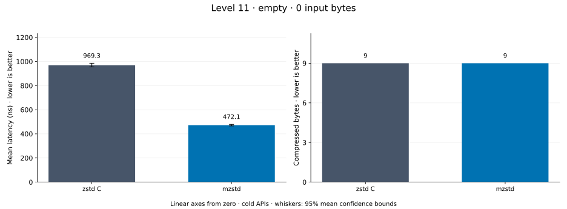
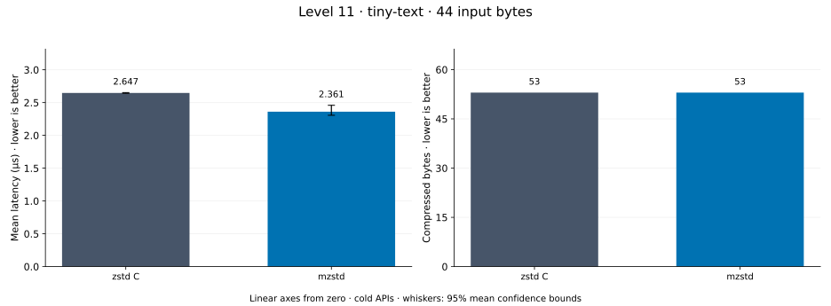
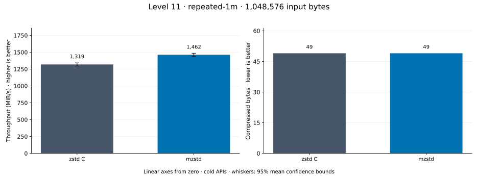
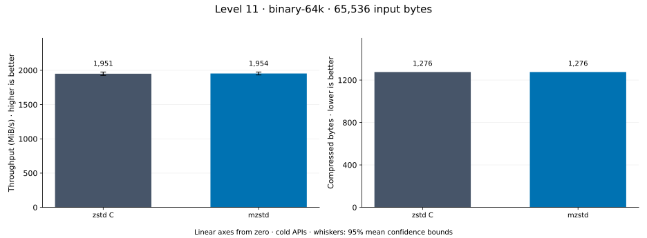
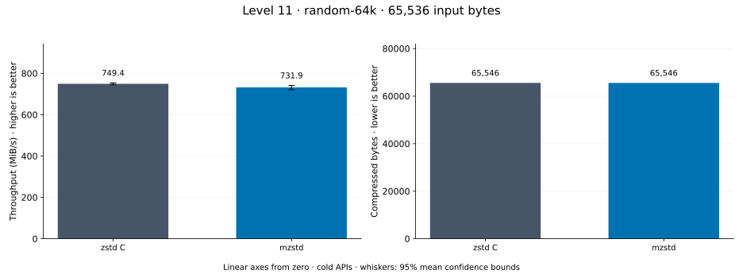
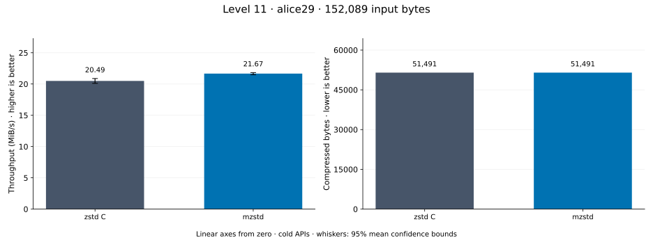
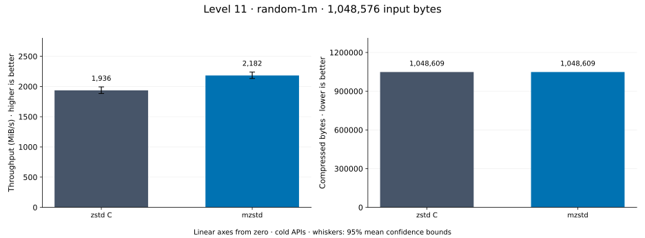

# Compression level 11

[Benchmark index](../README.md) · [Median overview](README.md) · [← Level 10](l10.md) · [Level 12 →](l12.md)

Recorded run: **enc-20261015c** (2026-10-15).
[Raw results](../encoder-comparison.csv) · [Environment](../encoder-comparison-environment.json) · [Run analysis](../encoder-comparison.md).

## Median across all datasets

Each of the 8 datasets has equal weight, including empty and tiny input.
Speed / C = C mean latency / implementation mean latency; output / C = implementation bytes / C bytes.
We take the median of these 8 per-dataset ratios separately for speed and size.
1× matches C; higher speed and lower output are better. These are medians across datasets,
not median sample latencies, and do not imply statistical significance.

| Implementation | Median speed / C ↑ | Median output / C ↓ | Datasets |
| --- | ---: | ---: | ---: |
| zstd C | 1.000× | 1.000× | 8 |
| mzstd | 1.058× | 1.000× | 8 |

Measurement setup and interpretation

zstd 1.5.7 (the C library built by `zstd-ffi`) and mzstd at the recorded
working tree compress identical bytes at this level. Every frame was checked byte-identical
to zstd's and decoded back to its input before any timing.

These are cold native API measurements: construction, allocation, compression, and disposal.
Complete known input; 20 samples, 0.2 s warmup, at least 0.5 s measurement.
Host: 13th Gen Intel(R) Core(TM) i7-13700KF, One single-threaded Criterion process pinned to logical CPU 2; the decoder sweep ran at the same time on logical CPU 6 (separate physical core) and nothing else ran. unset; Cargo release defaults (bench profile), runtime SIMD dispatch (AVX2 level on this host).

Chart whiskers and table intervals describe 95% confidence bounds on mean timing.
They do not capture all host or allocator variation. Throughput bounds are transformed latency bounds.
Output / input is compressed bytes divided by input bytes; smaller is better, and values above 100% mean expansion.
For empty input, throughput and output / input are undefined (—).
See the [run analysis](../encoder-comparison.md#interpretation-limits) for measurement limitations.

## Dataset details

Ordered by mzstd speed / C, highest first; all 8 datasets are shown.
This order uses recorded mean latency, not statistical significance. Bars start at zero.

[empty](#empty) · [tiny-text](#tiny-text) · [repeated-1m](#repeated-1m) · [binary-64k](#binary-64k) · [random-64k](#random-64k) · [alice29](#alice29) · [random-1m](#random-1m) · [text-1m](#text-1m)

### empty

Empty input; measures API overhead. **Input: 0 bytes.**

mzstd speed / C: **2.313×**; output: 9 / 9 bytes.

Exact measurements and confidence bounds

| Implementation | Mean, ns | 95% mean interval, ns | MiB/s | Output bytes | Output / input | Speed / C |
| --- | ---: | ---: | ---: | ---: | ---: | ---: |
| zstd C | 945.8 | 940.5–952.7 | — | 9 | — | 1.000× |
| mzstd | 408.9 | 405.3–413.2 | — | 9 | — | 2.313× |

### tiny-text

44-byte quick-brown-fox sentence. **Input: 44 bytes.**

mzstd speed / C: **1.121×**; output: 53 / 53 bytes.

Exact measurements and confidence bounds

| Implementation | Mean, µs | 95% mean interval, µs | MiB/s | Output bytes | Output / input | Speed / C |
| --- | ---: | ---: | ---: | ---: | ---: | ---: |
| zstd C | 2.647 | 2.642–2.652 | 15.85 | 53 | 120.455% | 1.000× |
| mzstd | 2.361 | 2.306–2.459 | 17.78 | 53 | 120.455% | 1.121× |

### repeated-1m

1 MiB of repeated a bytes. **Input: 1,048,576 bytes.**

mzstd speed / C: **1.118×**; output: 49 / 49 bytes.

Exact measurements and confidence bounds

| Implementation | Mean, µs | 95% mean interval, µs | MiB/s | Output bytes | Output / input | Speed / C |
| --- | ---: | ---: | ---: | ---: | ---: | ---: |
| zstd C | 764.2 | 758.2–769.2 | 1,308.55 | 49 | 0.005% | 1.000× |
| mzstd | 683.3 | 675.4–690.3 | 1,463.46 | 49 | 0.005% | 1.118× |

### binary-64k

64 KiB of structured binary bytes: ((i / 16) XOR i) modulo 256. **Input: 65,536 bytes.**

mzstd speed / C: **1.065×**; output: 1,276 / 1,276 bytes.

Exact measurements and confidence bounds

| Implementation | Mean, µs | 95% mean interval, µs | MiB/s | Output bytes | Output / input | Speed / C |
| --- | ---: | ---: | ---: | ---: | ---: | ---: |
| zstd C | 30.74 | 30.61–30.89 | 2,033.04 | 1,276 | 1.947% | 1.000× |
| mzstd | 28.86 | 28.67–29.05 | 2,165.93 | 1,276 | 1.947% | 1.065× |

### random-64k

64 KiB prefix of the deterministic pseudorandom corpus. **Input: 65,536 bytes.**

mzstd speed / C: **1.051×**; output: 65,546 / 65,546 bytes.

Exact measurements and confidence bounds

| Implementation | Mean, µs | 95% mean interval, µs | MiB/s | Output bytes | Output / input | Speed / C |
| --- | ---: | ---: | ---: | ---: | ---: | ---: |
| zstd C | 83.99 | 82.43–85.8 | 744.11 | 65,546 | 100.015% | 1.000× |
| mzstd | 79.95 | 79.45–80.54 | 781.79 | 65,546 | 100.015% | 1.051× |

### alice29

Alice in Wonderland text from the Canterbury corpus (`testdata/alice29.txt`). **Input: 152,089 bytes.**

mzstd speed / C: **1.006×**; output: 51,491 / 51,491 bytes.

Exact measurements and confidence bounds

| Implementation | Mean, µs | 95% mean interval, µs | MiB/s | Output bytes | Output / input | Speed / C |
| --- | ---: | ---: | ---: | ---: | ---: | ---: |
| zstd C | 6,884 | 6,848–6,922 | 21.07 | 51,491 | 33.856% | 1.000× |
| mzstd | 6,841 | 6,760–6,949 | 21.20 | 51,491 | 33.856% | 1.006× |

### random-1m

1 MiB of deterministic xorshift64 pseudorandom bytes. **Input: 1,048,576 bytes.**

mzstd speed / C: **1.001×**; output: 1,048,609 / 1,048,609 bytes.

Exact measurements and confidence bounds

| Implementation | Mean, µs | 95% mean interval, µs | MiB/s | Output bytes | Output / input | Speed / C |
| --- | ---: | ---: | ---: | ---: | ---: | ---: |
| zstd C | 586.6 | 575.5–599.4 | 1,704.75 | 1,048,609 | 100.003% | 1.000× |
| mzstd | 585.9 | 582.6–589.5 | 1,706.82 | 1,048,609 | 100.003% | 1.001× |

### text-1m

Alice text repeated cyclically to 1 MiB. **Input: 1,048,576 bytes.**

mzstd speed / C: **0.982×**; output: 52,034 / 52,034 bytes.

Exact measurements and confidence bounds

| Implementation | Mean, µs | 95% mean interval, µs | MiB/s | Output bytes | Output / input | Speed / C |
| --- | ---: | ---: | ---: | ---: | ---: | ---: |
| zstd C | 3,141 | 3,084–3,203 | 318.33 | 52,034 | 4.962% | 1.000× |
| mzstd | 3,198 | 3,177–3,220 | 312.67 | 52,034 | 4.962% | 0.982× |

