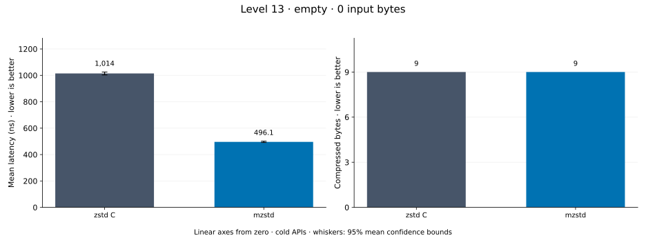
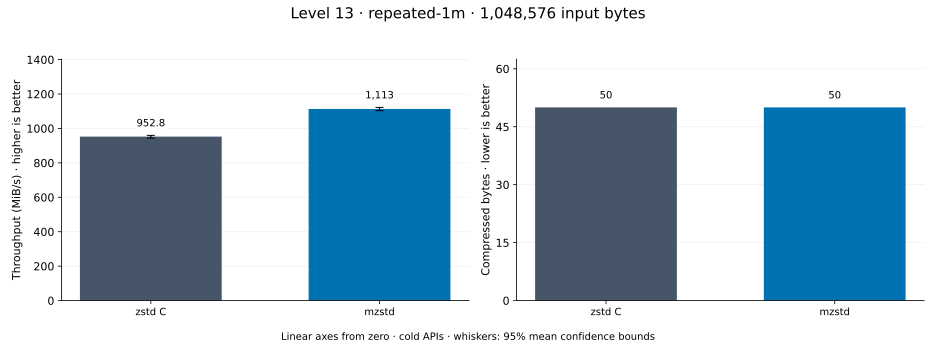
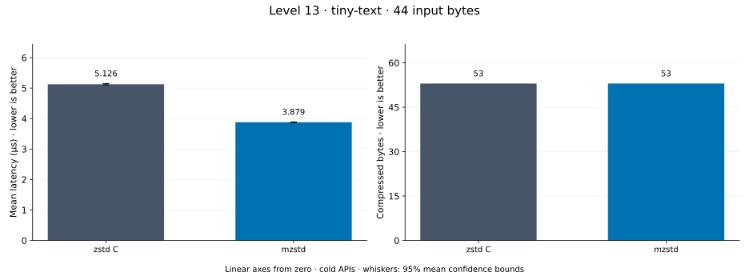
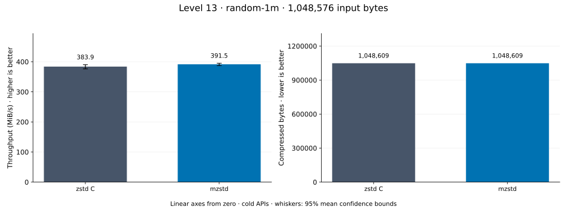
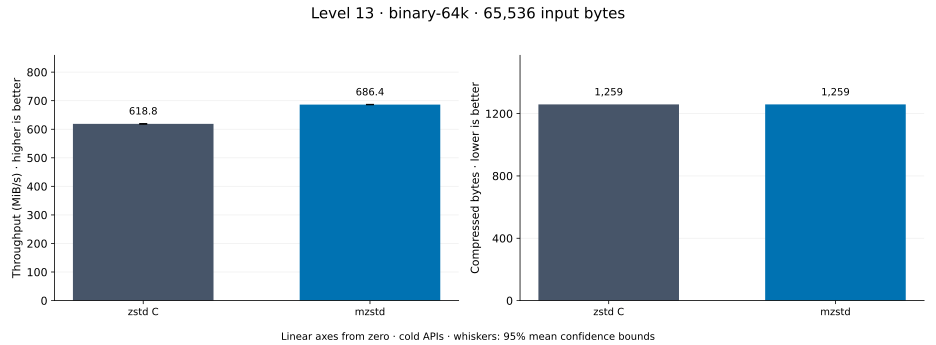
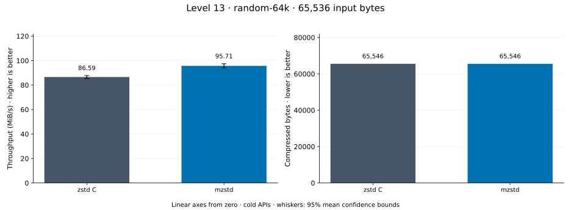
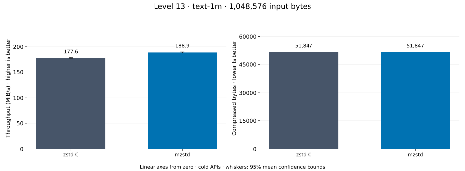
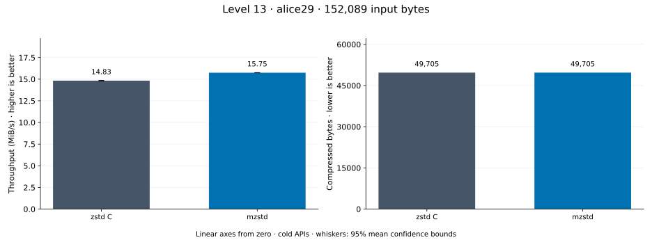

# Compression level 13

[Benchmark index](../README.md) · [Median overview](README.md) · [← Level 12](l12.md) · [Level 14 →](l14.md)

Recorded run: **full-20261030** (2026-10-30).
[Raw results](../encoder-comparison.csv) · [Environment](../encoder-comparison-environment.json) · [Run analysis](../encoder-comparison.md).

## Median across all datasets

Each of the 8 datasets has equal weight, including empty and tiny input.
Speed / C = C mean latency / implementation mean latency; output / C = implementation bytes / C bytes.
We take the median of these 8 per-dataset ratios separately for speed and size.
1× matches C; higher speed and lower output are better. These are medians across datasets,
not median sample latencies, and do not imply statistical significance.

| Implementation | Median speed / C ↑ | Median output / C ↓ | Datasets |
| --- | ---: | ---: | ---: |
| zstd C | 1.000× | 1.000× | 8 |
| mzstd main | 1.370× | 1.000× | 8 |
| mzstd | 1.320× | 1.000× | 8 |

mzstd main is the same matrix measured on `0a4fd87` in a process beside this run's; its ratios use that run's C timings.

Measurement setup and interpretation

zstd 1.5.7 (the C library built by `zstd-ffi`) and mzstd at the recorded
working tree compress identical bytes at this level. Every frame was checked byte-identical
to zstd's and decoded back to its input before any timing.

These are cold native API measurements: construction, allocation, compression, and disposal.
Complete known input; 20 samples, 0.5 s warmup, at least 1 s measurement.
Host: AMD Ryzen 9 7950X, Linux KVM guest with two dedicated vCPUs: the working tree's Criterion process pinned to vCPU 0 and the main branch's to vCPU 1, side by side; nothing else ran. unset; Cargo release defaults (bench profile), runtime SIMD dispatch (AVX-512 level on this host; the decoder runs its block loops at the AVX2 level).

Chart whiskers and table intervals describe 95% confidence bounds on mean timing.
They do not capture all host or allocator variation. Throughput bounds are transformed latency bounds.
Output / input is compressed bytes divided by input bytes; smaller is better, and values above 100% mean expansion.
For empty input, throughput and output / input are undefined (—).
See the [run analysis](../encoder-comparison.md#interpretation-limits) for measurement limitations.

## Dataset details

Ordered by mzstd speed / C, highest first; all 8 datasets are shown.
This order uses recorded mean latency, not statistical significance. Bars start at zero.

[empty](#empty) · [repeated-1m](#repeated-1m) · [tiny-text](#tiny-text) · [random-1m](#random-1m) · [binary-64k](#binary-64k) · [random-64k](#random-64k) · [text-1m](#text-1m) · [alice29](#alice29)

### empty

Empty input; measures API overhead. **Input: 0 bytes.**

mzstd speed / C: **6.485×**; output: 9 / 9 bytes.
mzstd main speed / C: 5.425× (separate run).

Exact measurements and confidence bounds

| Implementation | Mean, ns | 95% mean interval, ns | MiB/s | Output bytes | Output / input | Speed / C |
| --- | ---: | ---: | ---: | ---: | ---: | ---: |
| zstd C | 2,085 | 2,070–2,101 | — | 9 | — | 1.000× |
| mzstd | 321.5 | 318.7–323.8 | — | 9 | — | 6.485× |

### repeated-1m

1 MiB of repeated a bytes. **Input: 1,048,576 bytes.**

mzstd speed / C: **3.089×**; output: 50 / 50 bytes.
mzstd main speed / C: 2.500× (separate run).

Exact measurements and confidence bounds

| Implementation | Mean, µs | 95% mean interval, µs | MiB/s | Output bytes | Output / input | Speed / C |
| --- | ---: | ---: | ---: | ---: | ---: | ---: |
| zstd C | 1,506 | 1,492–1,524 | 664.14 | 50 | 0.005% | 1.000× |
| mzstd | 487.5 | 482.2–492.1 | 2,051.36 | 50 | 0.005% | 3.089× |

### tiny-text

44-byte quick-brown-fox sentence. **Input: 44 bytes.**

mzstd speed / C: **1.579×**; output: 53 / 53 bytes.
mzstd main speed / C: 1.595× (separate run).

Exact measurements and confidence bounds

| Implementation | Mean, µs | 95% mean interval, µs | MiB/s | Output bytes | Output / input | Speed / C |
| --- | ---: | ---: | ---: | ---: | ---: | ---: |
| zstd C | 6.147 | 6.137–6.157 | 6.83 | 53 | 120.455% | 1.000× |
| mzstd | 3.894 | 3.891–3.899 | 10.78 | 53 | 120.455% | 1.579× |

### random-1m

1 MiB of deterministic xorshift64 pseudorandom bytes. **Input: 1,048,576 bytes.**

mzstd speed / C: **1.531×**; output: 1,048,609 / 1,048,609 bytes.
mzstd main speed / C: 1.569× (separate run).

Exact measurements and confidence bounds

| Implementation | Mean, µs | 95% mean interval, µs | MiB/s | Output bytes | Output / input | Speed / C |
| --- | ---: | ---: | ---: | ---: | ---: | ---: |
| zstd C | 4,445 | 4,053–4,757 | 224.96 | 1,048,609 | 100.003% | 1.000× |
| mzstd | 2,904 | 2,837–2,974 | 344.35 | 1,048,609 | 100.003% | 1.531× |

### binary-64k

64 KiB of structured binary bytes: ((i / 16) XOR i) modulo 256. **Input: 65,536 bytes.**

mzstd speed / C: **1.109×**; output: 1,259 / 1,259 bytes.
mzstd main speed / C: 1.141× (separate run).

Exact measurements and confidence bounds

| Implementation | Mean, µs | 95% mean interval, µs | MiB/s | Output bytes | Output / input | Speed / C |
| --- | ---: | ---: | ---: | ---: | ---: | ---: |
| zstd C | 101 | 100.8–101.2 | 618.79 | 1,259 | 1.921% | 1.000× |
| mzstd | 91.06 | 90.97–91.15 | 686.36 | 1,259 | 1.921% | 1.109× |

### random-64k

64 KiB prefix of the deterministic pseudorandom corpus. **Input: 65,536 bytes.**

mzstd speed / C: **1.095×**; output: 65,546 / 65,546 bytes.
mzstd main speed / C: 1.117× (separate run).

Exact measurements and confidence bounds

| Implementation | Mean, µs | 95% mean interval, µs | MiB/s | Output bytes | Output / input | Speed / C |
| --- | ---: | ---: | ---: | ---: | ---: | ---: |
| zstd C | 755.5 | 754.7–756.4 | 82.73 | 65,546 | 100.015% | 1.000× |
| mzstd | 690 | 685.9–697.4 | 90.57 | 65,546 | 100.015% | 1.095× |

### text-1m

Alice text repeated cyclically to 1 MiB. **Input: 1,048,576 bytes.**

mzstd speed / C: **1.063×**; output: 51,847 / 51,847 bytes.
mzstd main speed / C: 1.072× (separate run).

Exact measurements and confidence bounds

| Implementation | Mean, µs | 95% mean interval, µs | MiB/s | Output bytes | Output / input | Speed / C |
| --- | ---: | ---: | ---: | ---: | ---: | ---: |
| zstd C | 5,630 | 5,604–5,657 | 177.63 | 51,847 | 4.945% | 1.000× |
| mzstd | 5,294 | 5,267–5,321 | 188.88 | 51,847 | 4.945% | 1.063× |

### alice29

Alice in Wonderland text from the Canterbury corpus (`testdata/alice29.txt`). **Input: 152,089 bytes.**

mzstd speed / C: **1.062×**; output: 49,705 / 49,705 bytes.
mzstd main speed / C: 1.172× (separate run).

Exact measurements and confidence bounds

| Implementation | Mean, µs | 95% mean interval, µs | MiB/s | Output bytes | Output / input | Speed / C |
| --- | ---: | ---: | ---: | ---: | ---: | ---: |
| zstd C | 9,781 | 9,769–9,794 | 14.83 | 49,705 | 32.682% | 1.000× |
| mzstd | 9,211 | 9,205–9,216 | 15.75 | 49,705 | 32.682% | 1.062× |

