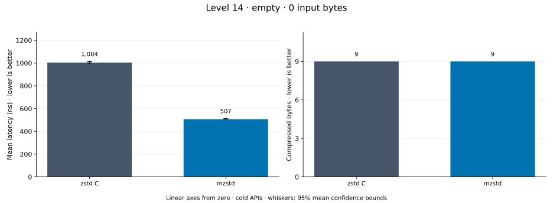
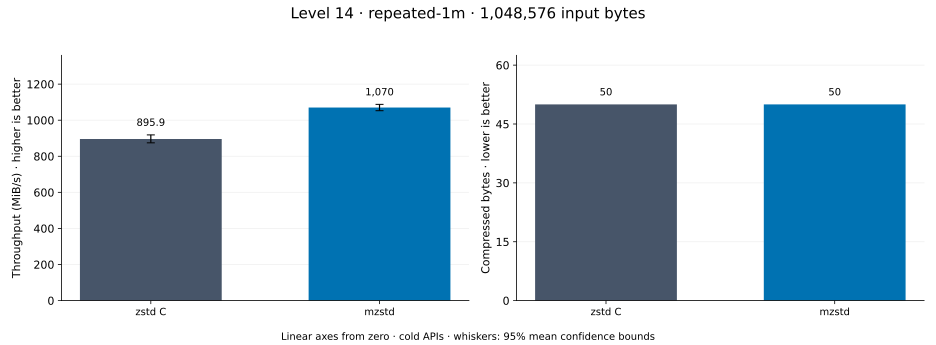
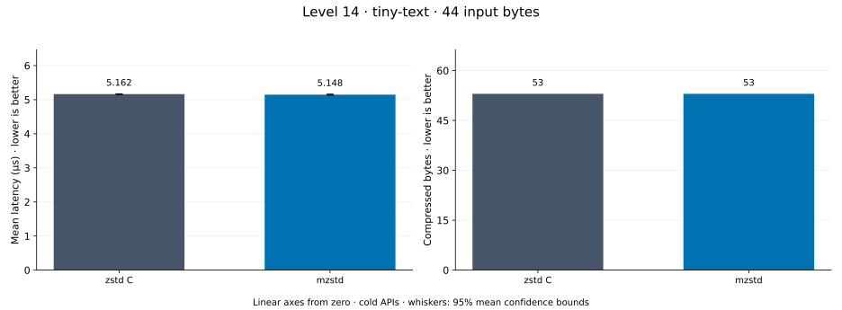
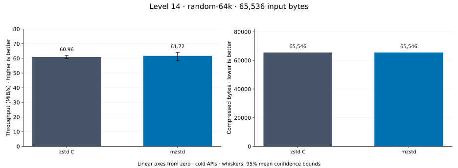
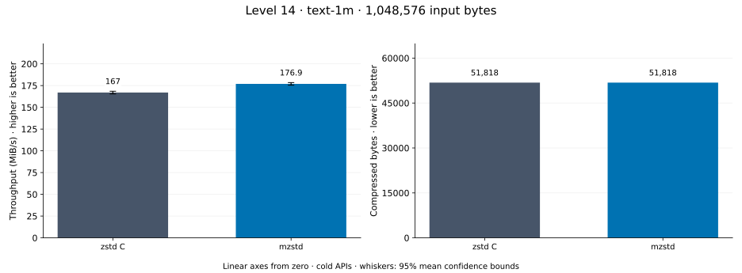
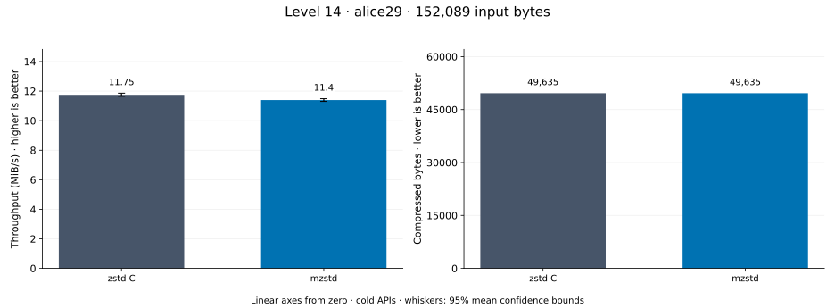
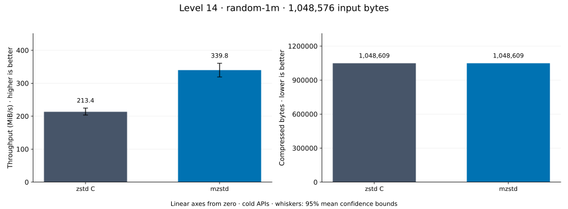
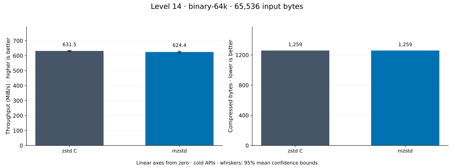

# Compression level 14

[Benchmark index](../README.md) · [Median overview](README.md) · [← Level 13](l13.md) · [Level 15 →](l15.md)

Recorded run: **enc-20261015c** (2026-10-15).
[Raw results](../encoder-comparison.csv) · [Environment](../encoder-comparison-environment.json) · [Run analysis](../encoder-comparison.md).

## Median across all datasets

Each of the 8 datasets has equal weight, including empty and tiny input.
Speed / C = C mean latency / implementation mean latency; output / C = implementation bytes / C bytes.
We take the median of these 8 per-dataset ratios separately for speed and size.
1× matches C; higher speed and lower output are better. These are medians across datasets,
not median sample latencies, and do not imply statistical significance.

| Implementation | Median speed / C ↑ | Median output / C ↓ | Datasets |
| --- | ---: | ---: | ---: |
| zstd C | 1.000× | 1.000× | 8 |
| mzstd | 1.037× | 1.000× | 8 |

Measurement setup and interpretation

zstd 1.5.7 (the C library built by `zstd-ffi`) and mzstd at the recorded
working tree compress identical bytes at this level. Every frame was checked byte-identical
to zstd's and decoded back to its input before any timing.

These are cold native API measurements: construction, allocation, compression, and disposal.
Complete known input; 20 samples, 0.2 s warmup, at least 0.5 s measurement.
Host: 13th Gen Intel(R) Core(TM) i7-13700KF, One single-threaded Criterion process pinned to logical CPU 2; the decoder sweep ran at the same time on logical CPU 6 (separate physical core) and nothing else ran. unset; Cargo release defaults (bench profile), runtime SIMD dispatch (AVX2 level on this host).

Chart whiskers and table intervals describe 95% confidence bounds on mean timing.
They do not capture all host or allocator variation. Throughput bounds are transformed latency bounds.
Output / input is compressed bytes divided by input bytes; smaller is better, and values above 100% mean expansion.
For empty input, throughput and output / input are undefined (—).
See the [run analysis](../encoder-comparison.md#interpretation-limits) for measurement limitations.

## Dataset details

Ordered by mzstd speed / C, highest first; all 8 datasets are shown.
This order uses recorded mean latency, not statistical significance. Bars start at zero.

[empty](#empty) · [repeated-1m](#repeated-1m) · [tiny-text](#tiny-text) · [random-64k](#random-64k) · [text-1m](#text-1m) · [alice29](#alice29) · [random-1m](#random-1m) · [binary-64k](#binary-64k)

### empty

Empty input; measures API overhead. **Input: 0 bytes.**

mzstd speed / C: **2.189×**; output: 9 / 9 bytes.

Exact measurements and confidence bounds

| Implementation | Mean, ns | 95% mean interval, ns | MiB/s | Output bytes | Output / input | Speed / C |
| --- | ---: | ---: | ---: | ---: | ---: | ---: |
| zstd C | 976.6 | 972.8–981.3 | — | 9 | — | 1.000× |
| mzstd | 446.1 | 444–449.1 | — | 9 | — | 2.189× |

### repeated-1m

1 MiB of repeated a bytes. **Input: 1,048,576 bytes.**

mzstd speed / C: **1.159×**; output: 50 / 50 bytes.

Exact measurements and confidence bounds

| Implementation | Mean, µs | 95% mean interval, µs | MiB/s | Output bytes | Output / input | Speed / C |
| --- | ---: | ---: | ---: | ---: | ---: | ---: |
| zstd C | 1,061 | 1,047–1,078 | 942.15 | 50 | 0.005% | 1.000× |
| mzstd | 915.6 | 903.1–927.8 | 1,092.20 | 50 | 0.005% | 1.159× |

### tiny-text

44-byte quick-brown-fox sentence. **Input: 44 bytes.**

mzstd speed / C: **1.140×**; output: 53 / 53 bytes.

Exact measurements and confidence bounds

| Implementation | Mean, µs | 95% mean interval, µs | MiB/s | Output bytes | Output / input | Speed / C |
| --- | ---: | ---: | ---: | ---: | ---: | ---: |
| zstd C | 5.113 | 5.1–5.128 | 8.21 | 53 | 120.455% | 1.000× |
| mzstd | 4.486 | 4.469–4.508 | 9.35 | 53 | 120.455% | 1.140× |

### random-64k

64 KiB prefix of the deterministic pseudorandom corpus. **Input: 65,536 bytes.**

mzstd speed / C: **1.054×**; output: 65,546 / 65,546 bytes.

Exact measurements and confidence bounds

| Implementation | Mean, µs | 95% mean interval, µs | MiB/s | Output bytes | Output / input | Speed / C |
| --- | ---: | ---: | ---: | ---: | ---: | ---: |
| zstd C | 1,027 | 1,010–1,056 | 60.87 | 65,546 | 100.015% | 1.000× |
| mzstd | 974.1 | 970.7–977.7 | 64.16 | 65,546 | 100.015% | 1.054× |

### text-1m

Alice text repeated cyclically to 1 MiB. **Input: 1,048,576 bytes.**

mzstd speed / C: **1.019×**; output: 51,818 / 51,818 bytes.

Exact measurements and confidence bounds

| Implementation | Mean, µs | 95% mean interval, µs | MiB/s | Output bytes | Output / input | Speed / C |
| --- | ---: | ---: | ---: | ---: | ---: | ---: |
| zstd C | 6,063 | 6,036–6,092 | 164.93 | 51,818 | 4.942% | 1.000× |
| mzstd | 5,951 | 5,928–5,977 | 168.04 | 51,818 | 4.942% | 1.019× |

### alice29

Alice in Wonderland text from the Canterbury corpus (`testdata/alice29.txt`). **Input: 152,089 bytes.**

mzstd speed / C: **1.012×**; output: 49,635 / 49,635 bytes.

Exact measurements and confidence bounds

| Implementation | Mean, µs | 95% mean interval, µs | MiB/s | Output bytes | Output / input | Speed / C |
| --- | ---: | ---: | ---: | ---: | ---: | ---: |
| zstd C | 1.199e+04 | 1.171e+04–1.236e+04 | 12.09 | 49,635 | 32.635% | 1.000× |
| mzstd | 1.186e+04 | 1.178e+04–1.194e+04 | 12.23 | 49,635 | 32.635% | 1.012× |

### random-1m

1 MiB of deterministic xorshift64 pseudorandom bytes. **Input: 1,048,576 bytes.**

mzstd speed / C: **0.996×**; output: 1,048,609 / 1,048,609 bytes.

Exact measurements and confidence bounds

| Implementation | Mean, µs | 95% mean interval, µs | MiB/s | Output bytes | Output / input | Speed / C |
| --- | ---: | ---: | ---: | ---: | ---: | ---: |
| zstd C | 2,581 | 2,557–2,609 | 387.42 | 1,048,609 | 100.003% | 1.000× |
| mzstd | 2,592 | 2,555–2,632 | 385.76 | 1,048,609 | 100.003% | 0.996× |

### binary-64k

64 KiB of structured binary bytes: ((i / 16) XOR i) modulo 256. **Input: 65,536 bytes.**

mzstd speed / C: **0.989×**; output: 1,259 / 1,259 bytes.

Exact measurements and confidence bounds

| Implementation | Mean, µs | 95% mean interval, µs | MiB/s | Output bytes | Output / input | Speed / C |
| --- | ---: | ---: | ---: | ---: | ---: | ---: |
| zstd C | 98.98 | 98.56–99.45 | 631.46 | 1,259 | 1.921% | 1.000× |
| mzstd | 100.1 | 99.33–101 | 624.40 | 1,259 | 1.921% | 0.989× |

