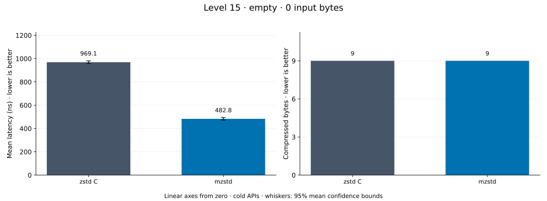
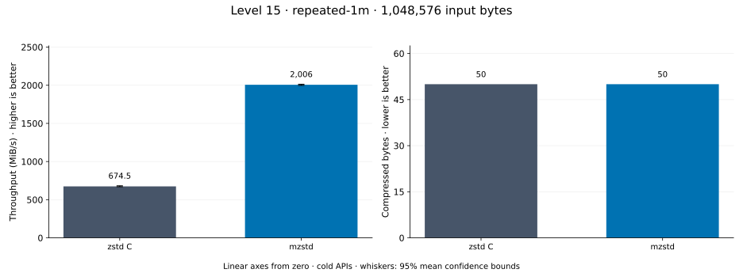
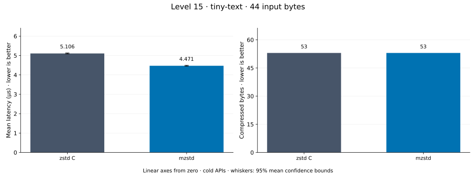
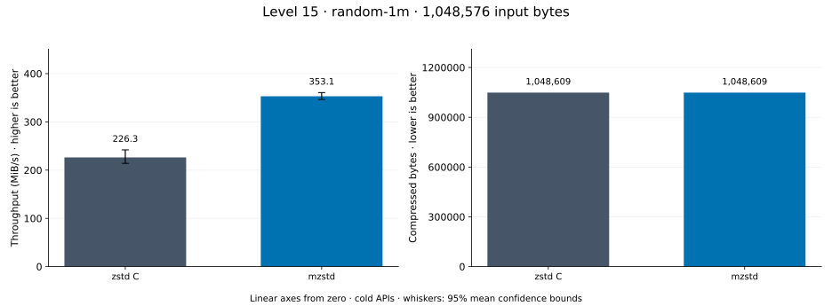
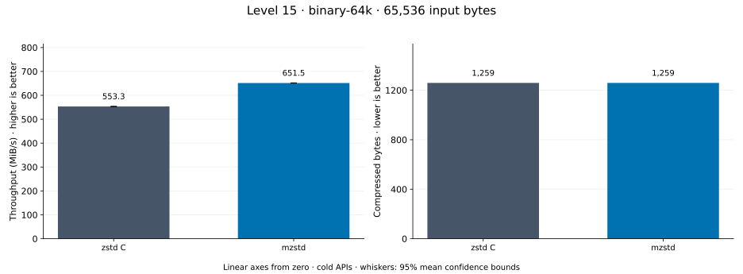
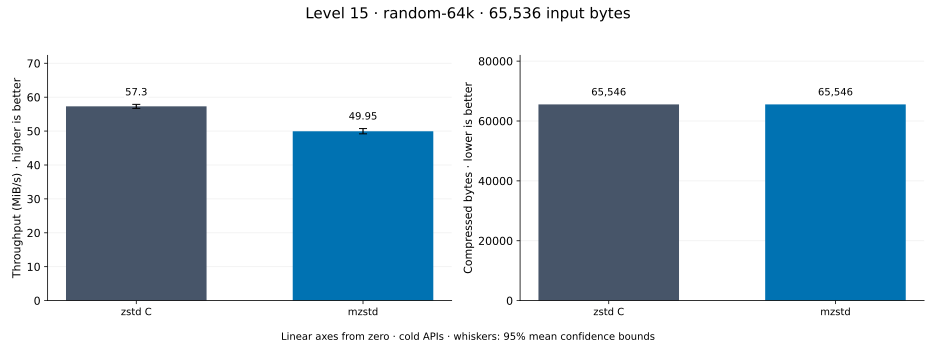
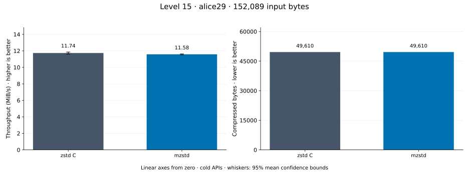
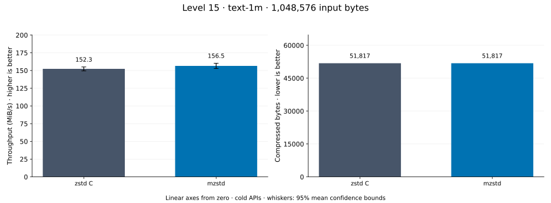

# Compression level 15

[Benchmark index](../README.md) · [Median overview](README.md) · [← Level 14](l14.md) · [Level 16 →](l16.md)

Recorded run: **full-20261030** (2026-10-30).
[Raw results](../encoder-comparison.csv) · [Environment](../encoder-comparison-environment.json) · [Run analysis](../encoder-comparison.md).

## Median across all datasets

Each of the 8 datasets has equal weight, including empty and tiny input.
Speed / C = C mean latency / implementation mean latency; output / C = implementation bytes / C bytes.
We take the median of these 8 per-dataset ratios separately for speed and size.
1× matches C; higher speed and lower output are better. These are medians across datasets,
not median sample latencies, and do not imply statistical significance.

| Implementation | Median speed / C ↑ | Median output / C ↓ | Datasets |
| --- | ---: | ---: | ---: |
| zstd C | 1.000× | 1.000× | 8 |
| mzstd main | 1.377× | 1.000× | 8 |
| mzstd | 1.369× | 1.000× | 8 |

mzstd main is the same matrix measured on `0a4fd87` in a process beside this run's; its ratios use that run's C timings.

Measurement setup and interpretation

zstd 1.5.7 (the C library built by `zstd-ffi`) and mzstd at the recorded
working tree compress identical bytes at this level. Every frame was checked byte-identical
to zstd's and decoded back to its input before any timing.

These are cold native API measurements: construction, allocation, compression, and disposal.
Complete known input; 20 samples, 0.5 s warmup, at least 1 s measurement.
Host: AMD Ryzen 9 7950X, Linux KVM guest with two dedicated vCPUs: the working tree's Criterion process pinned to vCPU 0 and the main branch's to vCPU 1, side by side; nothing else ran. unset; Cargo release defaults (bench profile), runtime SIMD dispatch (AVX-512 level on this host; the decoder runs its block loops at the AVX2 level).

Chart whiskers and table intervals describe 95% confidence bounds on mean timing.
They do not capture all host or allocator variation. Throughput bounds are transformed latency bounds.
Output / input is compressed bytes divided by input bytes; smaller is better, and values above 100% mean expansion.
For empty input, throughput and output / input are undefined (—).
See the [run analysis](../encoder-comparison.md#interpretation-limits) for measurement limitations.

## Dataset details

Ordered by mzstd speed / C, highest first; all 8 datasets are shown.
This order uses recorded mean latency, not statistical significance. Bars start at zero.

[empty](#empty) · [repeated-1m](#repeated-1m) · [tiny-text](#tiny-text) · [random-1m](#random-1m) · [binary-64k](#binary-64k) · [random-64k](#random-64k) · [alice29](#alice29) · [text-1m](#text-1m)

### empty

Empty input; measures API overhead. **Input: 0 bytes.**

mzstd speed / C: **6.476×**; output: 9 / 9 bytes.
mzstd main speed / C: 5.872× (separate run).

Exact measurements and confidence bounds

| Implementation | Mean, ns | 95% mean interval, ns | MiB/s | Output bytes | Output / input | Speed / C |
| --- | ---: | ---: | ---: | ---: | ---: | ---: |
| zstd C | 2,073 | 2,062–2,085 | — | 9 | — | 1.000× |
| mzstd | 320.1 | 317.4–322.4 | — | 9 | — | 6.476× |

### repeated-1m

1 MiB of repeated a bytes. **Input: 1,048,576 bytes.**

mzstd speed / C: **2.974×**; output: 50 / 50 bytes.
mzstd main speed / C: 3.062× (separate run).

Exact measurements and confidence bounds

| Implementation | Mean, µs | 95% mean interval, µs | MiB/s | Output bytes | Output / input | Speed / C |
| --- | ---: | ---: | ---: | ---: | ---: | ---: |
| zstd C | 1,483 | 1,465–1,493 | 674.53 | 50 | 0.005% | 1.000× |
| mzstd | 498.5 | 496.7–500.6 | 2,005.90 | 50 | 0.005% | 2.974× |

### tiny-text

44-byte quick-brown-fox sentence. **Input: 44 bytes.**

mzstd speed / C: **1.614×**; output: 53 / 53 bytes.
mzstd main speed / C: 1.579× (separate run).

Exact measurements and confidence bounds

| Implementation | Mean, µs | 95% mean interval, µs | MiB/s | Output bytes | Output / input | Speed / C |
| --- | ---: | ---: | ---: | ---: | ---: | ---: |
| zstd C | 6.185 | 6.159–6.221 | 6.78 | 53 | 120.455% | 1.000× |
| mzstd | 3.832 | 3.828–3.837 | 10.95 | 53 | 120.455% | 1.614× |

### random-1m

1 MiB of deterministic xorshift64 pseudorandom bytes. **Input: 1,048,576 bytes.**

mzstd speed / C: **1.560×**; output: 1,048,609 / 1,048,609 bytes.
mzstd main speed / C: 2.167× (separate run).

Exact measurements and confidence bounds

| Implementation | Mean, µs | 95% mean interval, µs | MiB/s | Output bytes | Output / input | Speed / C |
| --- | ---: | ---: | ---: | ---: | ---: | ---: |
| zstd C | 4,419 | 4,132–4,674 | 226.31 | 1,048,609 | 100.003% | 1.000× |
| mzstd | 2,832 | 2,772–2,887 | 353.07 | 1,048,609 | 100.003% | 1.560× |

### binary-64k

64 KiB of structured binary bytes: ((i / 16) XOR i) modulo 256. **Input: 65,536 bytes.**

mzstd speed / C: **1.177×**; output: 1,259 / 1,259 bytes.
mzstd main speed / C: 1.175× (separate run).

Exact measurements and confidence bounds

| Implementation | Mean, µs | 95% mean interval, µs | MiB/s | Output bytes | Output / input | Speed / C |
| --- | ---: | ---: | ---: | ---: | ---: | ---: |
| zstd C | 113 | 112.8–113.1 | 553.30 | 1,259 | 1.921% | 1.000× |
| mzstd | 95.93 | 95.87–96 | 651.50 | 1,259 | 1.921% | 1.177× |

### random-64k

64 KiB prefix of the deterministic pseudorandom corpus. **Input: 65,536 bytes.**

mzstd speed / C: **1.106×**; output: 65,546 / 65,546 bytes.
mzstd main speed / C: 1.113× (separate run).

Exact measurements and confidence bounds

| Implementation | Mean, µs | 95% mean interval, µs | MiB/s | Output bytes | Output / input | Speed / C |
| --- | ---: | ---: | ---: | ---: | ---: | ---: |
| zstd C | 1,074 | 1,073–1,076 | 58.17 | 65,546 | 100.015% | 1.000× |
| mzstd | 971.2 | 970.2–972.2 | 64.35 | 65,546 | 100.015% | 1.106× |

### alice29

Alice in Wonderland text from the Canterbury corpus (`testdata/alice29.txt`). **Input: 152,089 bytes.**

mzstd speed / C: **1.038×**; output: 49,610 / 49,610 bytes.
mzstd main speed / C: 1.049× (separate run).

Exact measurements and confidence bounds

| Implementation | Mean, µs | 95% mean interval, µs | MiB/s | Output bytes | Output / input | Speed / C |
| --- | ---: | ---: | ---: | ---: | ---: | ---: |
| zstd C | 1.099e+04 | 1.098e+04–1.1e+04 | 13.20 | 49,610 | 32.619% | 1.000× |
| mzstd | 1.059e+04 | 1.058e+04–1.059e+04 | 13.70 | 49,610 | 32.619% | 1.038× |

### text-1m

Alice text repeated cyclically to 1 MiB. **Input: 1,048,576 bytes.**

mzstd speed / C: **1.035×**; output: 51,817 / 51,817 bytes.
mzstd main speed / C: 1.094× (separate run).

Exact measurements and confidence bounds

| Implementation | Mean, µs | 95% mean interval, µs | MiB/s | Output bytes | Output / input | Speed / C |
| --- | ---: | ---: | ---: | ---: | ---: | ---: |
| zstd C | 5,889 | 5,865–5,907 | 169.81 | 51,817 | 4.942% | 1.000× |
| mzstd | 5,692 | 5,630–5,759 | 175.68 | 51,817 | 4.942% | 1.035× |

