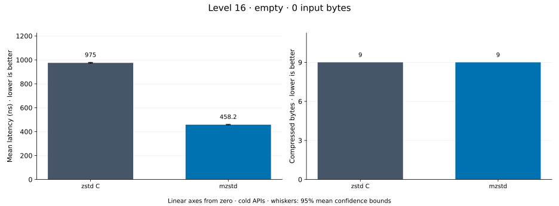
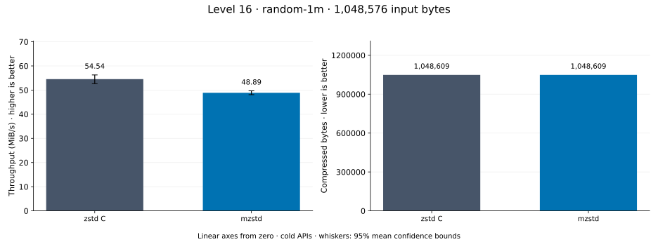
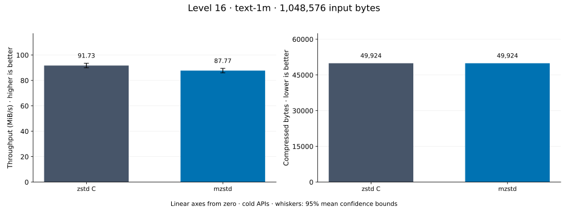
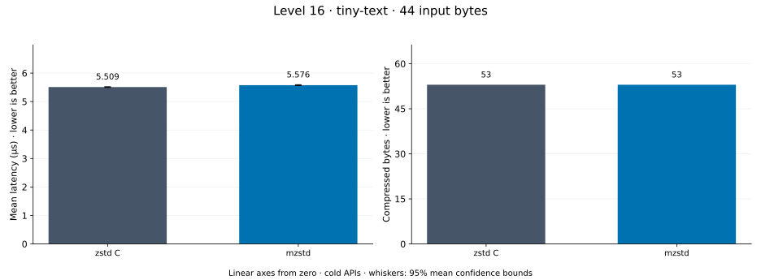
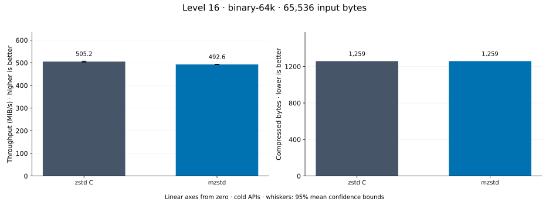
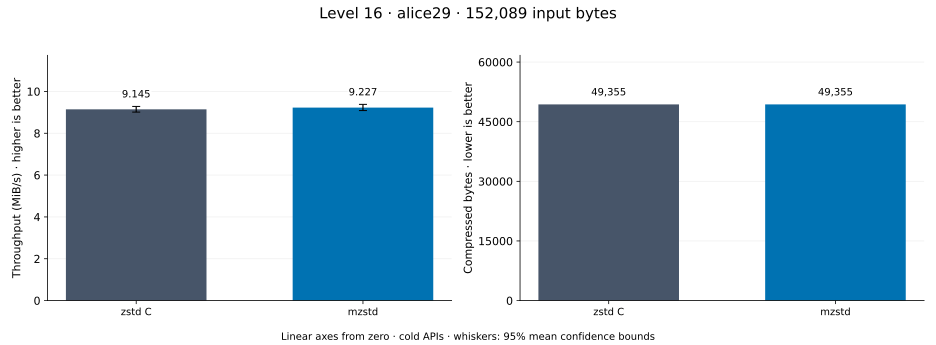
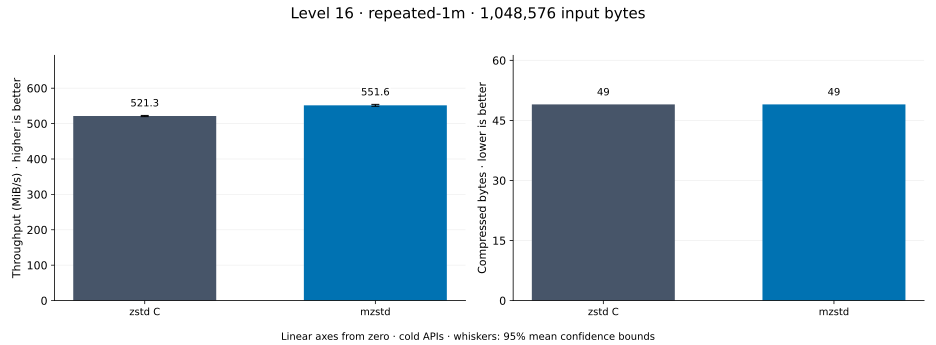
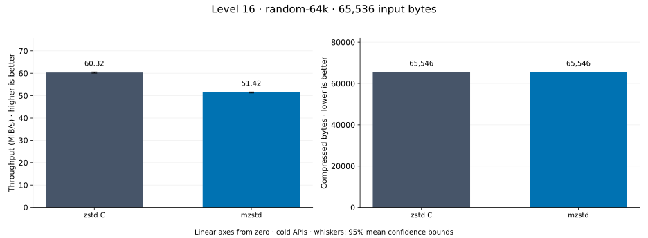

# Compression level 16

[Benchmark index](../README.md) · [Median overview](README.md) · [← Level 15](l15.md) · [Level 17 →](l17.md)

Recorded run: **enc-20261014-fix** (2026-10-14).
[Raw results](../encoder-comparison.csv) · [Environment](../encoder-comparison-environment.json) · [Run analysis](../encoder-comparison.md).

## Median across all datasets

Each of the 8 datasets has equal weight, including empty and tiny input.
Speed / C = C mean latency / implementation mean latency; output / C = implementation bytes / C bytes.
We take the median of these 8 per-dataset ratios separately for speed and size.
1× matches C; higher speed and lower output are better. These are medians across datasets,
not median sample latencies, and do not imply statistical significance.

| Implementation | Median speed / C ↑ | Median output / C ↓ | Datasets |
| --- | ---: | ---: | ---: |
| zstd C | 1.000× | 1.000× | 8 |
| mzstd | 1.124× | 1.000× | 8 |

Measurement setup and interpretation

zstd 1.5.7 (the C library built by `zstd-ffi`) and mzstd at the recorded
working tree compress identical bytes at this level. Every frame was checked byte-identical
to zstd's and decoded back to its input before any timing.

These are cold native API measurements: construction, allocation, compression, and disposal.
Complete known input; 20 samples, 0.2 s warmup, at least 0.5 s measurement.
Host: 13th Gen Intel(R) Core(TM) i7-13700KF, One single-threaded Criterion process pinned to logical CPU 2; no concurrent decoder sweep. unset; Cargo release defaults (bench profile), runtime SIMD dispatch (AVX2 level on this host).

Chart whiskers and table intervals describe 95% confidence bounds on mean timing.
They do not capture all host or allocator variation. Throughput bounds are transformed latency bounds.
Output / input is compressed bytes divided by input bytes; smaller is better, and values above 100% mean expansion.
For empty input, throughput and output / input are undefined (—).
See the [run analysis](../encoder-comparison.md#interpretation-limits) for measurement limitations.

## Dataset details

Ordered by mzstd speed / C, highest first; all 8 datasets are shown.
This order uses recorded mean latency, not statistical significance. Bars start at zero.

[empty](#empty) · [random-1m](#random-1m) · [text-1m](#text-1m) · [tiny-text](#tiny-text) · [binary-64k](#binary-64k) · [alice29](#alice29) · [repeated-1m](#repeated-1m) · [random-64k](#random-64k)

### empty

Empty input; measures API overhead. **Input: 0 bytes.**

mzstd speed / C: **2.106×**; output: 9 / 9 bytes.

Exact measurements and confidence bounds

| Implementation | Mean, ns | 95% mean interval, ns | MiB/s | Output bytes | Output / input | Speed / C |
| --- | ---: | ---: | ---: | ---: | ---: | ---: |
| zstd C | 976.3 | 963.7–989.1 | — | 9 | — | 1.000× |
| mzstd | 463.6 | 458.8–469.2 | — | 9 | — | 2.106× |

### random-1m

1 MiB of deterministic xorshift64 pseudorandom bytes. **Input: 1,048,576 bytes.**

mzstd speed / C: **1.343×**; output: 1,048,609 / 1,048,609 bytes.

Exact measurements and confidence bounds

| Implementation | Mean, µs | 95% mean interval, µs | MiB/s | Output bytes | Output / input | Speed / C |
| --- | ---: | ---: | ---: | ---: | ---: | ---: |
| zstd C | 1.868e+04 | 1.819e+04–1.92e+04 | 53.53 | 1,048,609 | 100.003% | 1.000× |
| mzstd | 1.391e+04 | 1.362e+04–1.424e+04 | 71.89 | 1,048,609 | 100.003% | 1.343× |

### text-1m

Alice text repeated cyclically to 1 MiB. **Input: 1,048,576 bytes.**

mzstd speed / C: **1.143×**; output: 49,924 / 49,924 bytes.

Exact measurements and confidence bounds

| Implementation | Mean, µs | 95% mean interval, µs | MiB/s | Output bytes | Output / input | Speed / C |
| --- | ---: | ---: | ---: | ---: | ---: | ---: |
| zstd C | 1.128e+04 | 1.105e+04–1.152e+04 | 88.66 | 49,924 | 4.761% | 1.000× |
| mzstd | 9,867 | 9,736–9,987 | 101.35 | 49,924 | 4.761% | 1.143× |

### tiny-text

44-byte quick-brown-fox sentence. **Input: 44 bytes.**

mzstd speed / C: **1.141×**; output: 53 / 53 bytes.

Exact measurements and confidence bounds

| Implementation | Mean, µs | 95% mean interval, µs | MiB/s | Output bytes | Output / input | Speed / C |
| --- | ---: | ---: | ---: | ---: | ---: | ---: |
| zstd C | 5.604 | 5.513–5.703 | 7.49 | 53 | 120.455% | 1.000× |
| mzstd | 4.911 | 4.884–4.952 | 8.54 | 53 | 120.455% | 1.141× |

### binary-64k

64 KiB of structured binary bytes: ((i / 16) XOR i) modulo 256. **Input: 65,536 bytes.**

mzstd speed / C: **1.107×**; output: 1,259 / 1,259 bytes.

Exact measurements and confidence bounds

| Implementation | Mean, µs | 95% mean interval, µs | MiB/s | Output bytes | Output / input | Speed / C |
| --- | ---: | ---: | ---: | ---: | ---: | ---: |
| zstd C | 126.6 | 124.5–128.9 | 493.80 | 1,259 | 1.921% | 1.000× |
| mzstd | 114.3 | 112.7–116.2 | 546.68 | 1,259 | 1.921% | 1.107× |

### alice29

Alice in Wonderland text from the Canterbury corpus (`testdata/alice29.txt`). **Input: 152,089 bytes.**

mzstd speed / C: **1.068×**; output: 49,355 / 49,355 bytes.

Exact measurements and confidence bounds

| Implementation | Mean, µs | 95% mean interval, µs | MiB/s | Output bytes | Output / input | Speed / C |
| --- | ---: | ---: | ---: | ---: | ---: | ---: |
| zstd C | 1.486e+04 | 1.477e+04–1.496e+04 | 9.76 | 49,355 | 32.451% | 1.000× |
| mzstd | 1.392e+04 | 1.373e+04–1.415e+04 | 10.42 | 49,355 | 32.451% | 1.068× |

### repeated-1m

1 MiB of repeated a bytes. **Input: 1,048,576 bytes.**

mzstd speed / C: **1.058×**; output: 49 / 49 bytes.

Exact measurements and confidence bounds

| Implementation | Mean, µs | 95% mean interval, µs | MiB/s | Output bytes | Output / input | Speed / C |
| --- | ---: | ---: | ---: | ---: | ---: | ---: |
| zstd C | 1,918 | 1,912–1,924 | 521.34 | 49 | 0.005% | 1.000× |
| mzstd | 1,813 | 1,804–1,822 | 551.56 | 49 | 0.005% | 1.058× |

### random-64k

64 KiB prefix of the deterministic pseudorandom corpus. **Input: 65,536 bytes.**

mzstd speed / C: **1.040×**; output: 65,546 / 65,546 bytes.

Exact measurements and confidence bounds

| Implementation | Mean, µs | 95% mean interval, µs | MiB/s | Output bytes | Output / input | Speed / C |
| --- | ---: | ---: | ---: | ---: | ---: | ---: |
| zstd C | 1,026 | 1,017–1,036 | 60.92 | 65,546 | 100.015% | 1.000× |
| mzstd | 986.3 | 975.2–998.5 | 63.37 | 65,546 | 100.015% | 1.040× |

