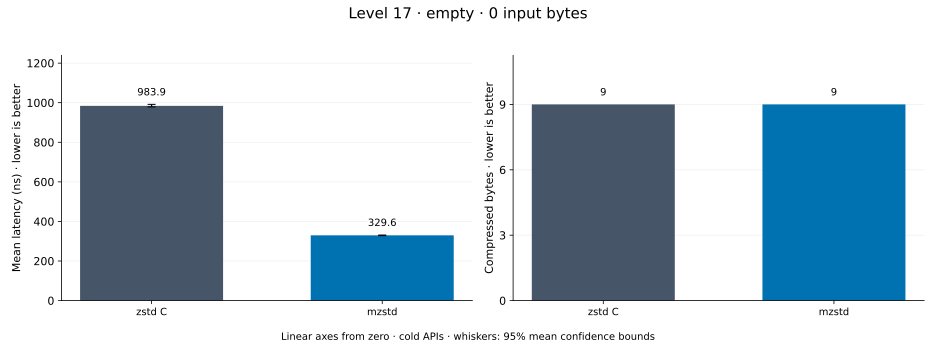
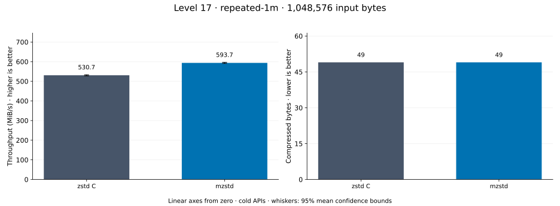
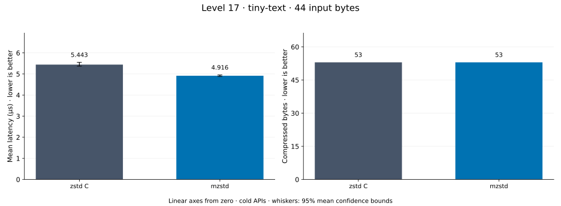
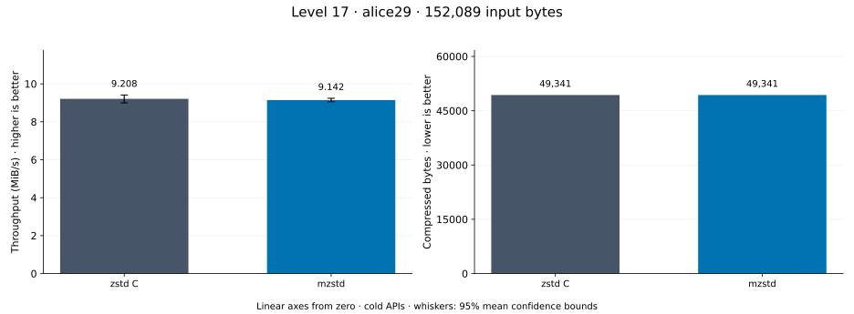
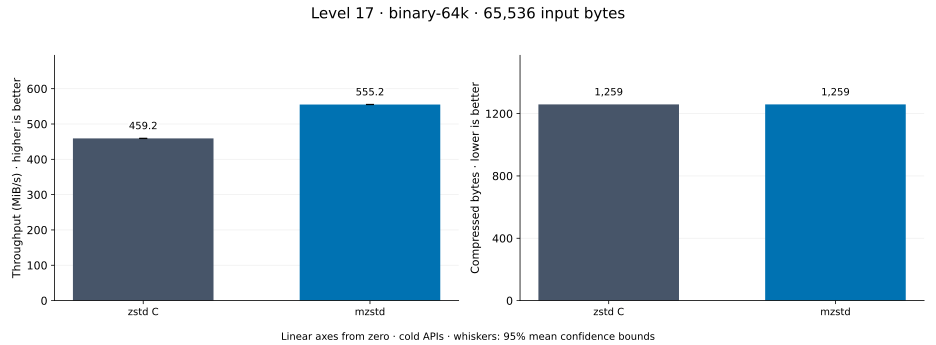
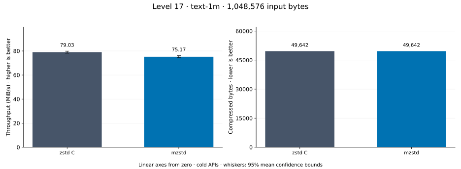
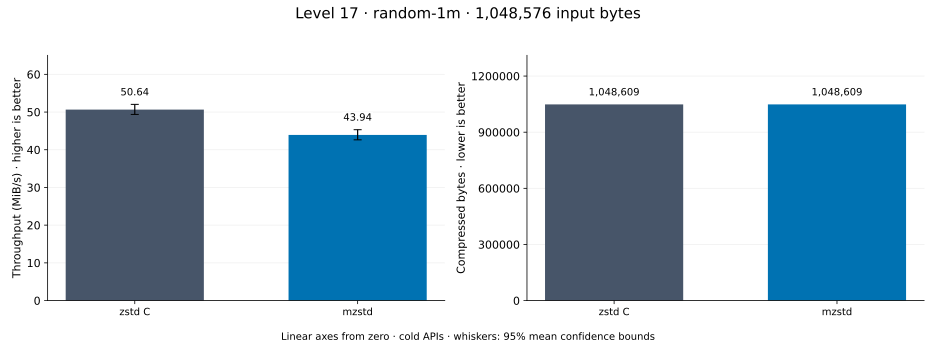
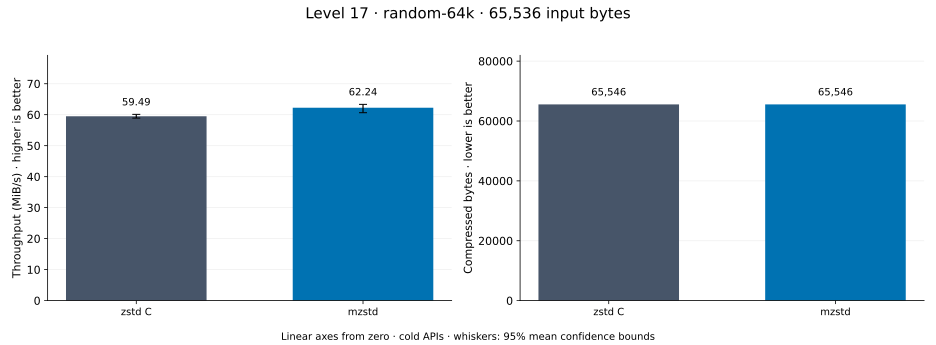

# Compression level 17

[Benchmark index](../README.md) · [Median overview](README.md) · [← Level 16](l16.md) · [Level 18 →](l18.md)

Recorded run: **parity-final-20261014** (2026-10-14).
[Raw results](../encoder-comparison.csv) · [Environment](../encoder-comparison-environment.json) · [Run analysis](../encoder-comparison.md).

## Median across all datasets

Each of the 8 datasets has equal weight, including empty and tiny input.
Speed / C = C mean latency / implementation mean latency; output / C = implementation bytes / C bytes.
We take the median of these 8 per-dataset ratios separately for speed and size.
1× matches C; higher speed and lower output are better. These are medians across datasets,
not median sample latencies, and do not imply statistical significance.

| Implementation | Median speed / C ↑ | Median output / C ↓ | Datasets |
| --- | ---: | ---: | ---: |
| zstd C | 1.000× | 1.000× | 8 |
| mzstd | 0.973× | 1.000× | 8 |

Measurement setup and interpretation

zstd 1.5.7 (the C library built by `zstd-ffi`) and mzstd at the recorded
working tree compress identical bytes at this level. Every frame was checked byte-identical
to zstd's and decoded back to its input before any timing.

These are cold native API measurements: construction, allocation, compression, and disposal.
Complete known input; 20 samples, 0.2 s warmup, at least 0.5 s measurement.
Host: 13th Gen Intel(R) Core(TM) i7-13700KF, One single-threaded Criterion process pinned to logical CPU 2; no concurrent decoder sweep. unset; Cargo release defaults (bench profile), runtime SIMD dispatch (AVX2 level on this host).

Chart whiskers and table intervals describe 95% confidence bounds on mean timing.
They do not capture all host or allocator variation. Throughput bounds are transformed latency bounds.
Output / input is compressed bytes divided by input bytes; smaller is better, and values above 100% mean expansion.
For empty input, throughput and output / input are undefined (—).
See the [run analysis](../encoder-comparison.md#interpretation-limits) for measurement limitations.

## Dataset details

Ordered by mzstd speed / C, highest first; all 8 datasets are shown.
This order uses recorded mean latency, not statistical significance. Bars start at zero.

[empty](#empty) · [repeated-1m](#repeated-1m) · [tiny-text](#tiny-text) · [alice29](#alice29) · [binary-64k](#binary-64k) · [text-1m](#text-1m) · [random-1m](#random-1m) · [random-64k](#random-64k)

### empty

Empty input; measures API overhead. **Input: 0 bytes.**

mzstd speed / C: **1.942×**; output: 9 / 9 bytes.

Exact measurements and confidence bounds

| Implementation | Mean, ns | 95% mean interval, ns | MiB/s | Output bytes | Output / input | Speed / C |
| --- | ---: | ---: | ---: | ---: | ---: | ---: |
| zstd C | 995.6 | 980.3–1,011 | — | 9 | — | 1.000× |
| mzstd | 512.8 | 505.4–521.2 | — | 9 | — | 1.942× |

### repeated-1m

1 MiB of repeated a bytes. **Input: 1,048,576 bytes.**

mzstd speed / C: **1.070×**; output: 49 / 49 bytes.

Exact measurements and confidence bounds

| Implementation | Mean, µs | 95% mean interval, µs | MiB/s | Output bytes | Output / input | Speed / C |
| --- | ---: | ---: | ---: | ---: | ---: | ---: |
| zstd C | 1,980 | 1,961–2,002 | 505.01 | 49 | 0.005% | 1.000× |
| mzstd | 1,850 | 1,832–1,871 | 540.54 | 49 | 0.005% | 1.070× |

### tiny-text

44-byte quick-brown-fox sentence. **Input: 44 bytes.**

mzstd speed / C: **1.040×**; output: 53 / 53 bytes.

Exact measurements and confidence bounds

| Implementation | Mean, µs | 95% mean interval, µs | MiB/s | Output bytes | Output / input | Speed / C |
| --- | ---: | ---: | ---: | ---: | ---: | ---: |
| zstd C | 5.62 | 5.524–5.715 | 7.47 | 53 | 120.455% | 1.000× |
| mzstd | 5.403 | 5.331–5.486 | 7.77 | 53 | 120.455% | 1.040× |

### alice29

Alice in Wonderland text from the Canterbury corpus (`testdata/alice29.txt`). **Input: 152,089 bytes.**

mzstd speed / C: **0.993×**; output: 49,341 / 49,341 bytes.

Exact measurements and confidence bounds

| Implementation | Mean, µs | 95% mean interval, µs | MiB/s | Output bytes | Output / input | Speed / C |
| --- | ---: | ---: | ---: | ---: | ---: | ---: |
| zstd C | 1.575e+04 | 1.541e+04–1.612e+04 | 9.21 | 49,341 | 32.442% | 1.000× |
| mzstd | 1.587e+04 | 1.57e+04–1.602e+04 | 9.14 | 49,341 | 32.442% | 0.993× |

### binary-64k

64 KiB of structured binary bytes: ((i / 16) XOR i) modulo 256. **Input: 65,536 bytes.**

mzstd speed / C: **0.953×**; output: 1,259 / 1,259 bytes.

Exact measurements and confidence bounds

| Implementation | Mean, µs | 95% mean interval, µs | MiB/s | Output bytes | Output / input | Speed / C |
| --- | ---: | ---: | ---: | ---: | ---: | ---: |
| zstd C | 127 | 125.2–128.9 | 492.18 | 1,259 | 1.921% | 1.000× |
| mzstd | 133.2 | 131.3–135.1 | 469.11 | 1,259 | 1.921% | 0.953× |

### text-1m

Alice text repeated cyclically to 1 MiB. **Input: 1,048,576 bytes.**

mzstd speed / C: **0.939×**; output: 49,642 / 49,642 bytes.

Exact measurements and confidence bounds

| Implementation | Mean, µs | 95% mean interval, µs | MiB/s | Output bytes | Output / input | Speed / C |
| --- | ---: | ---: | ---: | ---: | ---: | ---: |
| zstd C | 1.225e+04 | 1.21e+04–1.241e+04 | 81.63 | 49,642 | 4.734% | 1.000× |
| mzstd | 1.305e+04 | 1.281e+04–1.333e+04 | 76.63 | 49,642 | 4.734% | 0.939× |

### random-1m

1 MiB of deterministic xorshift64 pseudorandom bytes. **Input: 1,048,576 bytes.**

mzstd speed / C: **0.868×**; output: 1,048,609 / 1,048,609 bytes.

Exact measurements and confidence bounds

| Implementation | Mean, µs | 95% mean interval, µs | MiB/s | Output bytes | Output / input | Speed / C |
| --- | ---: | ---: | ---: | ---: | ---: | ---: |
| zstd C | 1.975e+04 | 1.922e+04–2.026e+04 | 50.64 | 1,048,609 | 100.003% | 1.000× |
| mzstd | 2.276e+04 | 2.206e+04–2.345e+04 | 43.94 | 1,048,609 | 100.003% | 0.868× |

### random-64k

64 KiB prefix of the deterministic pseudorandom corpus. **Input: 65,536 bytes.**

mzstd speed / C: **0.865×**; output: 65,546 / 65,546 bytes.

Exact measurements and confidence bounds

| Implementation | Mean, µs | 95% mean interval, µs | MiB/s | Output bytes | Output / input | Speed / C |
| --- | ---: | ---: | ---: | ---: | ---: | ---: |
| zstd C | 1,093 | 1,072–1,118 | 57.17 | 65,546 | 100.015% | 1.000× |
| mzstd | 1,263 | 1,245–1,282 | 49.47 | 65,546 | 100.015% | 0.865× |

