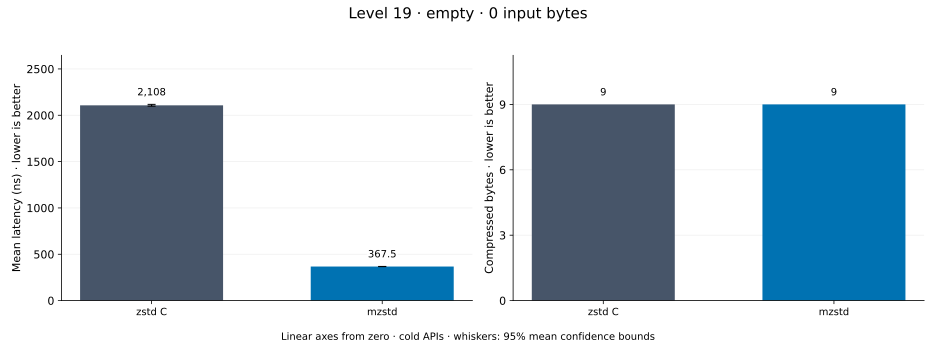
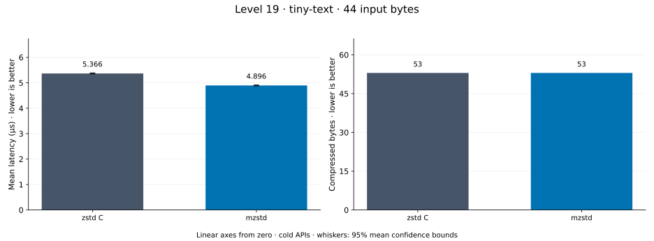
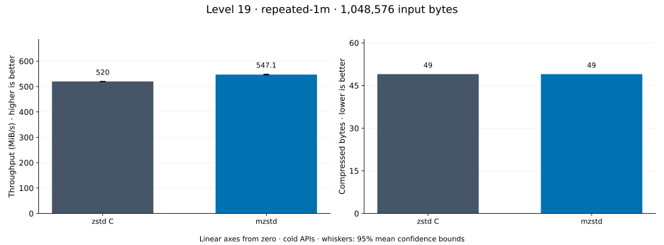
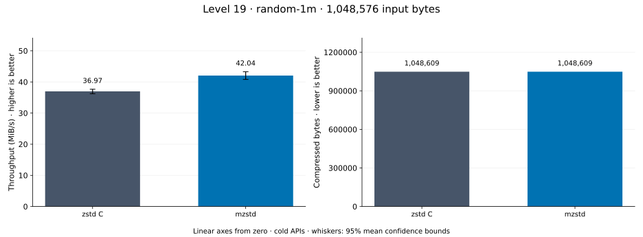
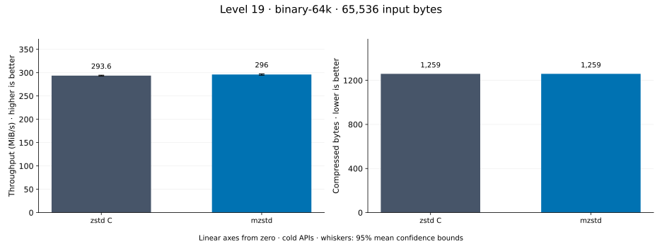
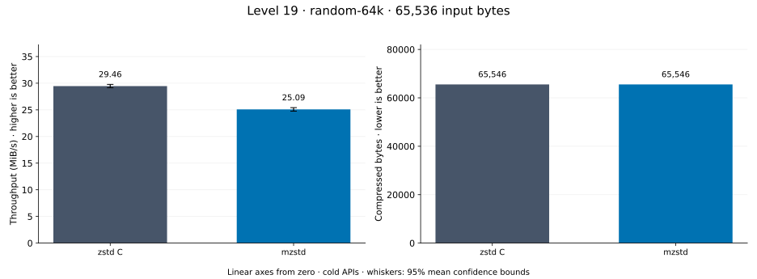
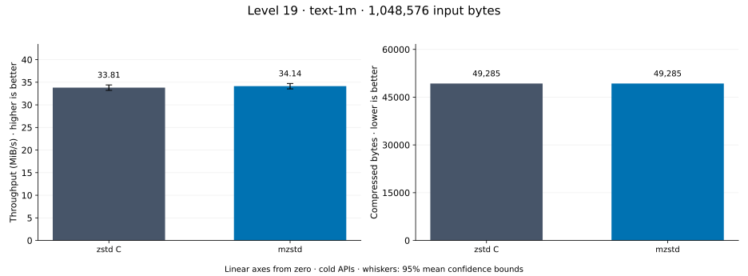
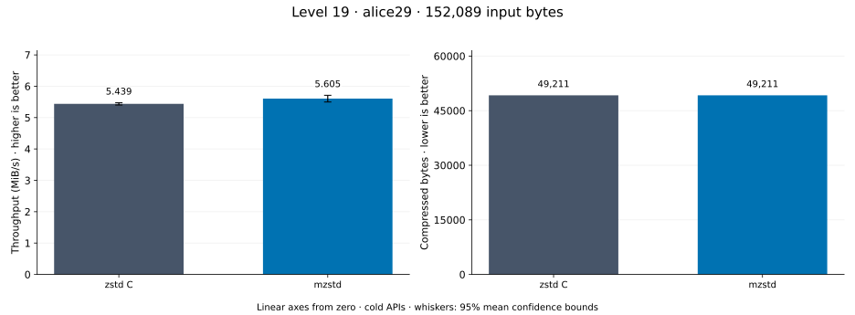

# Compression level 19

[Benchmark index](../README.md) · [Median overview](README.md) · [← Level 18](l18.md) · [Level 20 →](l20.md)

Recorded run: **full-20261030** (2026-10-30).
[Raw results](../encoder-comparison.csv) · [Environment](../encoder-comparison-environment.json) · [Run analysis](../encoder-comparison.md).

## Median across all datasets

Each of the 8 datasets has equal weight, including empty and tiny input.
Speed / C = C mean latency / implementation mean latency; output / C = implementation bytes / C bytes.
We take the median of these 8 per-dataset ratios separately for speed and size.
1× matches C; higher speed and lower output are better. These are medians across datasets,
not median sample latencies, and do not imply statistical significance.

| Implementation | Median speed / C ↑ | Median output / C ↓ | Datasets |
| --- | ---: | ---: | ---: |
| zstd C | 1.000× | 1.000× | 8 |
| mzstd main | 1.329× | 1.000× | 8 |
| mzstd | 1.266× | 1.000× | 8 |

mzstd main is the same matrix measured on `0a4fd87` in a process beside this run's; its ratios use that run's C timings.

Measurement setup and interpretation

zstd 1.5.7 (the C library built by `zstd-ffi`) and mzstd at the recorded
working tree compress identical bytes at this level. Every frame was checked byte-identical
to zstd's and decoded back to its input before any timing.

These are cold native API measurements: construction, allocation, compression, and disposal.
Complete known input; 20 samples, 0.5 s warmup, at least 1 s measurement.
Host: AMD Ryzen 9 7950X, Linux KVM guest with two dedicated vCPUs: the working tree's Criterion process pinned to vCPU 0 and the main branch's to vCPU 1, side by side; nothing else ran. unset; Cargo release defaults (bench profile), runtime SIMD dispatch (AVX-512 level on this host; the decoder runs its block loops at the AVX2 level).

Chart whiskers and table intervals describe 95% confidence bounds on mean timing.
They do not capture all host or allocator variation. Throughput bounds are transformed latency bounds.
Output / input is compressed bytes divided by input bytes; smaller is better, and values above 100% mean expansion.
For empty input, throughput and output / input are undefined (—).
See the [run analysis](../encoder-comparison.md#interpretation-limits) for measurement limitations.

## Dataset details

Ordered by mzstd speed / C, highest first; all 8 datasets are shown.
This order uses recorded mean latency, not statistical significance. Bars start at zero.

[empty](#empty) · [tiny-text](#tiny-text) · [repeated-1m](#repeated-1m) · [random-1m](#random-1m) · [binary-64k](#binary-64k) · [random-64k](#random-64k) · [text-1m](#text-1m) · [alice29](#alice29)

### empty

Empty input; measures API overhead. **Input: 0 bytes.**

mzstd speed / C: **5.735×**; output: 9 / 9 bytes.
mzstd main speed / C: 6.016× (separate run).

Exact measurements and confidence bounds

| Implementation | Mean, ns | 95% mean interval, ns | MiB/s | Output bytes | Output / input | Speed / C |
| --- | ---: | ---: | ---: | ---: | ---: | ---: |
| zstd C | 2,108 | 2,098–2,118 | — | 9 | — | 1.000× |
| mzstd | 367.5 | 366.1–368.7 | — | 9 | — | 5.735× |

### tiny-text

44-byte quick-brown-fox sentence. **Input: 44 bytes.**

mzstd speed / C: **1.537×**; output: 53 / 53 bytes.
mzstd main speed / C: 1.519× (separate run).

Exact measurements and confidence bounds

| Implementation | Mean, µs | 95% mean interval, µs | MiB/s | Output bytes | Output / input | Speed / C |
| --- | ---: | ---: | ---: | ---: | ---: | ---: |
| zstd C | 6.592 | 6.544–6.665 | 6.37 | 53 | 120.455% | 1.000× |
| mzstd | 4.289 | 4.277–4.308 | 9.78 | 53 | 120.455% | 1.537× |

### repeated-1m

1 MiB of repeated a bytes. **Input: 1,048,576 bytes.**

mzstd speed / C: **1.474×**; output: 49 / 49 bytes.
mzstd main speed / C: 1.492× (separate run).

Exact measurements and confidence bounds

| Implementation | Mean, µs | 95% mean interval, µs | MiB/s | Output bytes | Output / input | Speed / C |
| --- | ---: | ---: | ---: | ---: | ---: | ---: |
| zstd C | 1,027 | 1,021–1,034 | 973.37 | 49 | 0.005% | 1.000× |
| mzstd | 697.1 | 686.2–708.2 | 1,434.51 | 49 | 0.005% | 1.474× |

### random-1m

1 MiB of deterministic xorshift64 pseudorandom bytes. **Input: 1,048,576 bytes.**

mzstd speed / C: **1.331×**; output: 1,048,609 / 1,048,609 bytes.
mzstd main speed / C: 1.439× (separate run).

Exact measurements and confidence bounds

| Implementation | Mean, µs | 95% mean interval, µs | MiB/s | Output bytes | Output / input | Speed / C |
| --- | ---: | ---: | ---: | ---: | ---: | ---: |
| zstd C | 4.096e+04 | 3.957e+04–4.247e+04 | 24.41 | 1,048,609 | 100.003% | 1.000× |
| mzstd | 3.078e+04 | 2.996e+04–3.145e+04 | 32.49 | 1,048,609 | 100.003% | 1.331× |

### binary-64k

64 KiB of structured binary bytes: ((i / 16) XOR i) modulo 256. **Input: 65,536 bytes.**

mzstd speed / C: **1.202×**; output: 1,259 / 1,259 bytes.
mzstd main speed / C: 1.219× (separate run).

Exact measurements and confidence bounds

| Implementation | Mean, µs | 95% mean interval, µs | MiB/s | Output bytes | Output / input | Speed / C |
| --- | ---: | ---: | ---: | ---: | ---: | ---: |
| zstd C | 234.2 | 233.9–234.4 | 266.89 | 1,259 | 1.921% | 1.000× |
| mzstd | 194.8 | 194.5–195.2 | 320.77 | 1,259 | 1.921% | 1.202× |

### random-64k

64 KiB prefix of the deterministic pseudorandom corpus. **Input: 65,536 bytes.**

mzstd speed / C: **1.098×**; output: 65,546 / 65,546 bytes.
mzstd main speed / C: 1.114× (separate run).

Exact measurements and confidence bounds

| Implementation | Mean, µs | 95% mean interval, µs | MiB/s | Output bytes | Output / input | Speed / C |
| --- | ---: | ---: | ---: | ---: | ---: | ---: |
| zstd C | 2,102 | 2,100–2,105 | 29.73 | 65,546 | 100.015% | 1.000× |
| mzstd | 1,915 | 1,915–1,916 | 32.63 | 65,546 | 100.015% | 1.098× |

### text-1m

Alice text repeated cyclically to 1 MiB. **Input: 1,048,576 bytes.**

mzstd speed / C: **1.092×**; output: 49,285 / 49,285 bytes.
mzstd main speed / C: 1.111× (separate run).

Exact measurements and confidence bounds

| Implementation | Mean, µs | 95% mean interval, µs | MiB/s | Output bytes | Output / input | Speed / C |
| --- | ---: | ---: | ---: | ---: | ---: | ---: |
| zstd C | 2.642e+04 | 2.637e+04–2.647e+04 | 37.85 | 49,285 | 4.700% | 1.000× |
| mzstd | 2.419e+04 | 2.412e+04–2.427e+04 | 41.33 | 49,285 | 4.700% | 1.092× |

### alice29

Alice in Wonderland text from the Canterbury corpus (`testdata/alice29.txt`). **Input: 152,089 bytes.**

mzstd speed / C: **1.082×**; output: 49,211 / 49,211 bytes.
mzstd main speed / C: 1.140× (separate run).

Exact measurements and confidence bounds

| Implementation | Mean, µs | 95% mean interval, µs | MiB/s | Output bytes | Output / input | Speed / C |
| --- | ---: | ---: | ---: | ---: | ---: | ---: |
| zstd C | 2.506e+04 | 2.503e+04–2.508e+04 | 5.79 | 49,211 | 32.357% | 1.000× |
| mzstd | 2.316e+04 | 2.313e+04–2.321e+04 | 6.26 | 49,211 | 32.357% | 1.082× |

