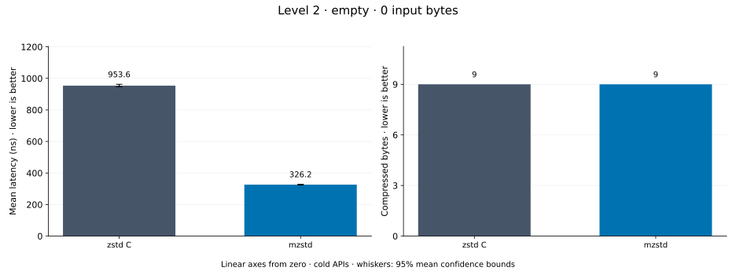
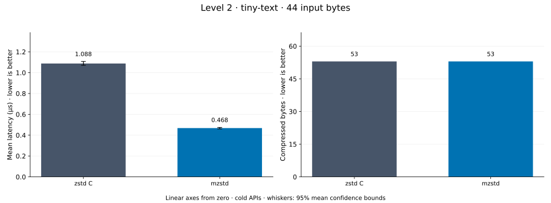
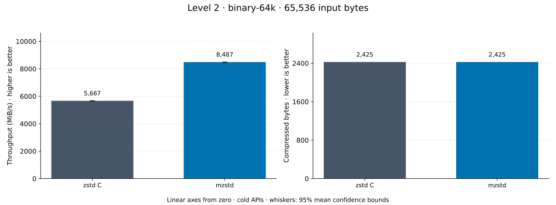
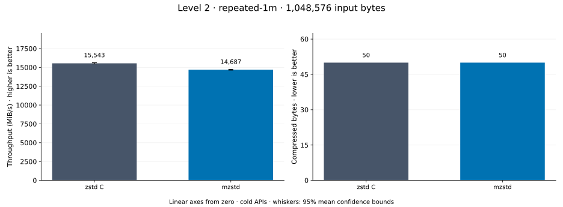
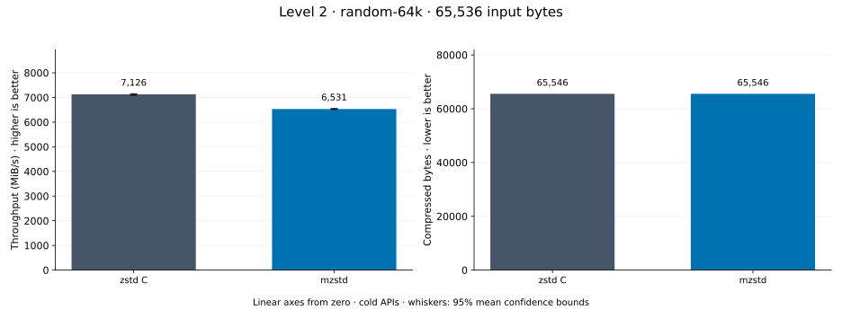
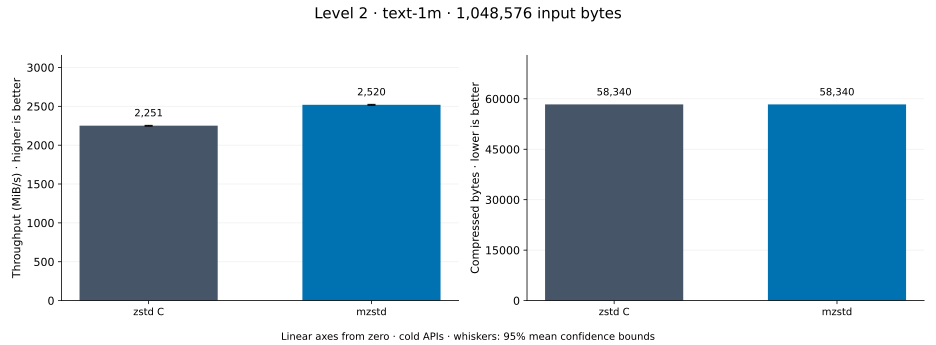
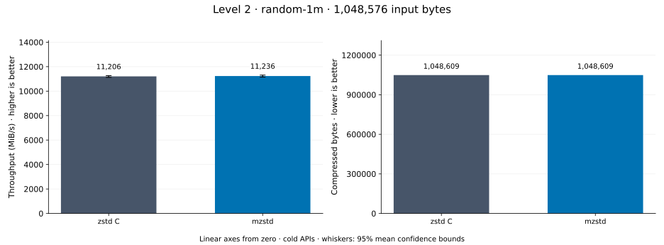
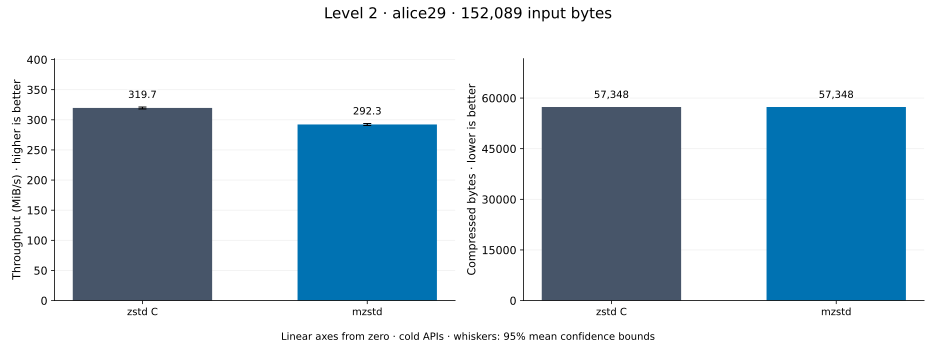

# Compression level 2

[Benchmark index](../README.md) · [Median overview](README.md) · [← Level 1](l1.md) · [Level 3 →](l3.md)

Recorded run: **enc-2026-10-13** (2026-10-13).
[Raw results](../encoder-comparison.csv) · [Environment](../encoder-comparison-environment.json) · [Run analysis](../encoder-comparison.md).

## Median across all datasets

Each of the 8 datasets has equal weight, including empty and tiny input.
Speed / C = C mean latency / implementation mean latency; output / C = implementation bytes / C bytes.
We take the median of these 8 per-dataset ratios separately for speed and size.
1× matches C; higher speed and lower output are better. These are medians across datasets,
not median sample latencies, and do not imply statistical significance.

| Implementation | Median speed / C ↑ | Median output / C ↓ | Datasets |
| --- | ---: | ---: | ---: |
| zstd C | 1.000× | 1.000× | 8 |
| mzstd | 0.931× | 1.000× | 8 |

Measurement setup and interpretation

zstd 1.5.7 (the C library built by `zstd-ffi`) and mzstd at the recorded
working tree compress identical bytes at this level. Every frame was checked byte-identical
to zstd's and decoded back to its input before any timing.

These are cold native API measurements: construction, allocation, compression, and disposal.
Complete known input; 20 samples, 1 s warmup, at least 3 s measurement.
Host: 13th Gen Intel(R) Core(TM) i7-13700KF, One single-threaded Criterion process pinned to logical CPU 2; the encoder and decoder sweeps ran concurrently on logical CPUs 2 and 6 (separate physical cores) and nothing else ran. unset; Cargo release defaults (bench profile), runtime SIMD dispatch (AVX2 level on this host).

Chart whiskers and table intervals describe 95% confidence bounds on mean timing.
They do not capture all host or allocator variation. Throughput bounds are transformed latency bounds.
Output / input is compressed bytes divided by input bytes; smaller is better, and values above 100% mean expansion.
For empty input, throughput and output / input are undefined (—).
See the [run analysis](../encoder-comparison.md#interpretation-limits) for measurement limitations.

## Dataset details

Ordered by mzstd speed / C, highest first; all 8 datasets are shown.
This order uses recorded mean latency, not statistical significance. Bars start at zero.

[empty](#empty) · [tiny-text](#tiny-text) · [binary-64k](#binary-64k) · [repeated-1m](#repeated-1m) · [random-64k](#random-64k) · [text-1m](#text-1m) · [random-1m](#random-1m) · [alice29](#alice29)

### empty

Empty input; measures API overhead. **Input: 0 bytes.**

mzstd speed / C: **2.642×**; output: 9 / 9 bytes.

Exact measurements and confidence bounds

| Implementation | Mean, ns | 95% mean interval, ns | MiB/s | Output bytes | Output / input | Speed / C |
| --- | ---: | ---: | ---: | ---: | ---: | ---: |
| zstd C | 971.6 | 969.4–973.6 | — | 9 | — | 1.000× |
| mzstd | 367.7 | 366.3–369.2 | — | 9 | — | 2.642× |

### tiny-text

44-byte quick-brown-fox sentence. **Input: 44 bytes.**

mzstd speed / C: **2.248×**; output: 53 / 53 bytes.

Exact measurements and confidence bounds

| Implementation | Mean, µs | 95% mean interval, µs | MiB/s | Output bytes | Output / input | Speed / C |
| --- | ---: | ---: | ---: | ---: | ---: | ---: |
| zstd C | 1.103 | 1.1–1.107 | 38.04 | 53 | 120.455% | 1.000× |
| mzstd | 0.4907 | 0.4882–0.4946 | 85.51 | 53 | 120.455% | 2.248× |

### binary-64k

64 KiB of structured binary bytes: ((i / 16) XOR i) modulo 256. **Input: 65,536 bytes.**

mzstd speed / C: **1.010×**; output: 2,425 / 2,425 bytes.

Exact measurements and confidence bounds

| Implementation | Mean, µs | 95% mean interval, µs | MiB/s | Output bytes | Output / input | Speed / C |
| --- | ---: | ---: | ---: | ---: | ---: | ---: |
| zstd C | 9.808 | 9.723–9.893 | 6,372.10 | 2,425 | 3.700% | 1.000× |
| mzstd | 9.711 | 9.598–9.832 | 6,435.72 | 2,425 | 3.700% | 1.010× |

### repeated-1m

1 MiB of repeated a bytes. **Input: 1,048,576 bytes.**

mzstd speed / C: **0.945×**; output: 50 / 50 bytes.

Exact measurements and confidence bounds

| Implementation | Mean, µs | 95% mean interval, µs | MiB/s | Output bytes | Output / input | Speed / C |
| --- | ---: | ---: | ---: | ---: | ---: | ---: |
| zstd C | 64.34 | 63.96–64.69 | 15,542.96 | 50 | 0.005% | 1.000× |
| mzstd | 68.09 | 67.83–68.33 | 14,687.47 | 50 | 0.005% | 0.945× |

### random-64k

64 KiB prefix of the deterministic pseudorandom corpus. **Input: 65,536 bytes.**

mzstd speed / C: **0.917×**; output: 65,546 / 65,546 bytes.

Exact measurements and confidence bounds

| Implementation | Mean, µs | 95% mean interval, µs | MiB/s | Output bytes | Output / input | Speed / C |
| --- | ---: | ---: | ---: | ---: | ---: | ---: |
| zstd C | 8.771 | 8.743–8.814 | 7,125.53 | 65,546 | 100.015% | 1.000× |
| mzstd | 9.569 | 9.54–9.598 | 6,531.37 | 65,546 | 100.015% | 0.917× |

### text-1m

Alice text repeated cyclically to 1 MiB. **Input: 1,048,576 bytes.**

mzstd speed / C: **0.913×**; output: 58,340 / 58,340 bytes.

Exact measurements and confidence bounds

| Implementation | Mean, µs | 95% mean interval, µs | MiB/s | Output bytes | Output / input | Speed / C |
| --- | ---: | ---: | ---: | ---: | ---: | ---: |
| zstd C | 467.8 | 464.8–471.3 | 2,137.78 | 58,340 | 5.564% | 1.000× |
| mzstd | 512.4 | 510.9–513.9 | 1,951.59 | 58,340 | 5.564% | 0.913× |

### random-1m

1 MiB of deterministic xorshift64 pseudorandom bytes. **Input: 1,048,576 bytes.**

mzstd speed / C: **0.882×**; output: 1,048,609 / 1,048,609 bytes.

Exact measurements and confidence bounds

| Implementation | Mean, µs | 95% mean interval, µs | MiB/s | Output bytes | Output / input | Speed / C |
| --- | ---: | ---: | ---: | ---: | ---: | ---: |
| zstd C | 93.46 | 93.16–93.76 | 10,699.52 | 1,048,609 | 100.003% | 1.000× |
| mzstd | 106 | 105.5–106.5 | 9,435.12 | 1,048,609 | 100.003% | 0.882× |

### alice29

Alice in Wonderland text from the Canterbury corpus (`testdata/alice29.txt`). **Input: 152,089 bytes.**

mzstd speed / C: **0.753×**; output: 57,348 / 57,348 bytes.

Exact measurements and confidence bounds

| Implementation | Mean, µs | 95% mean interval, µs | MiB/s | Output bytes | Output / input | Speed / C |
| --- | ---: | ---: | ---: | ---: | ---: | ---: |
| zstd C | 464.8 | 460.7–469 | 312.07 | 57,348 | 37.707% | 1.000× |
| mzstd | 617.2 | 611.6–623.2 | 234.99 | 57,348 | 37.707% | 0.753× |

