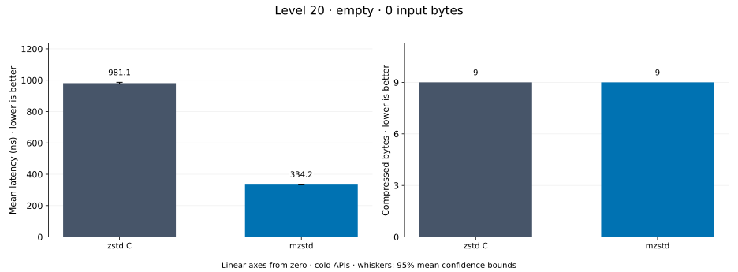
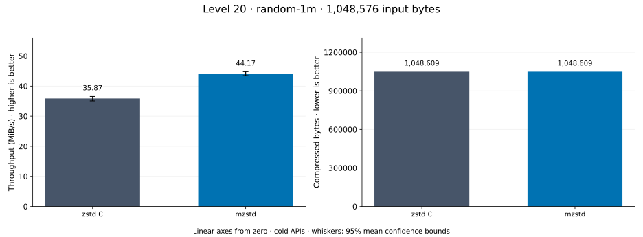
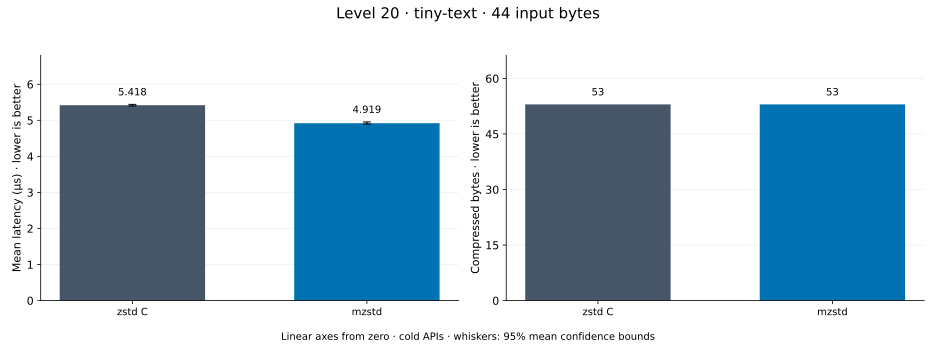
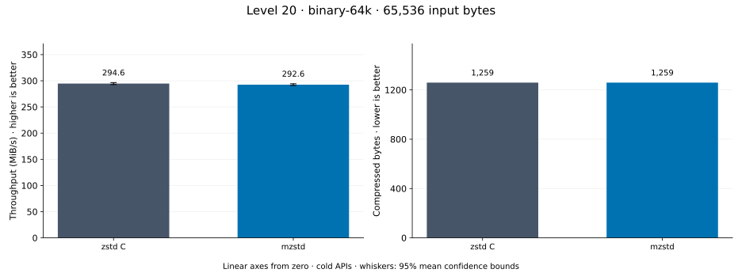
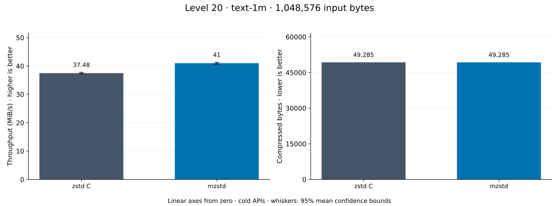
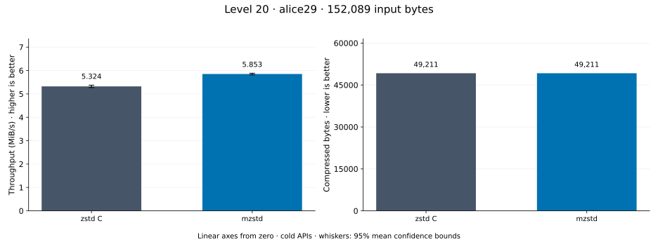
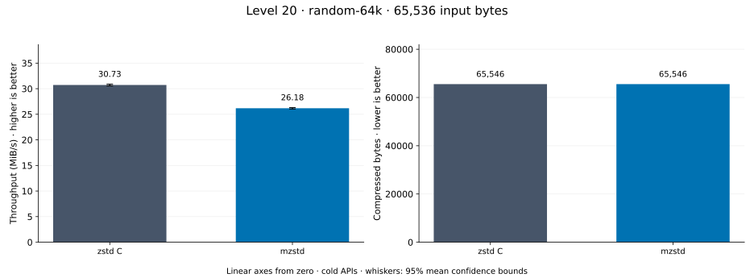
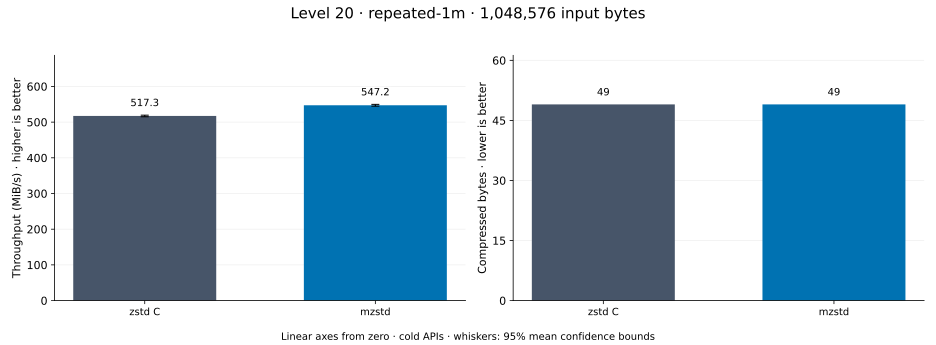

# Compression level 20

[Benchmark index](../README.md) · [Median overview](README.md) · [← Level 19](l19.md) · [Level 21 →](l21.md)

Recorded run: **enc-20261014-fix** (2026-10-14).
[Raw results](../encoder-comparison.csv) · [Environment](../encoder-comparison-environment.json) · [Run analysis](../encoder-comparison.md).

## Median across all datasets

Each of the 8 datasets has equal weight, including empty and tiny input.
Speed / C = C mean latency / implementation mean latency; output / C = implementation bytes / C bytes.
We take the median of these 8 per-dataset ratios separately for speed and size.
1× matches C; higher speed and lower output are better. These are medians across datasets,
not median sample latencies, and do not imply statistical significance.

| Implementation | Median speed / C ↑ | Median output / C ↓ | Datasets |
| --- | ---: | ---: | ---: |
| zstd C | 1.000× | 1.000× | 8 |
| mzstd | 1.096× | 1.000× | 8 |

Measurement setup and interpretation

zstd 1.5.7 (the C library built by `zstd-ffi`) and mzstd at the recorded
working tree compress identical bytes at this level. Every frame was checked byte-identical
to zstd's and decoded back to its input before any timing.

These are cold native API measurements: construction, allocation, compression, and disposal.
Complete known input; 20 samples, 0.2 s warmup, at least 0.5 s measurement.
Host: 13th Gen Intel(R) Core(TM) i7-13700KF, One single-threaded Criterion process pinned to logical CPU 2; no concurrent decoder sweep. unset; Cargo release defaults (bench profile), runtime SIMD dispatch (AVX2 level on this host).

Chart whiskers and table intervals describe 95% confidence bounds on mean timing.
They do not capture all host or allocator variation. Throughput bounds are transformed latency bounds.
Output / input is compressed bytes divided by input bytes; smaller is better, and values above 100% mean expansion.
For empty input, throughput and output / input are undefined (—).
See the [run analysis](../encoder-comparison.md#interpretation-limits) for measurement limitations.

## Dataset details

Ordered by mzstd speed / C, highest first; all 8 datasets are shown.
This order uses recorded mean latency, not statistical significance. Bars start at zero.

[empty](#empty) · [random-1m](#random-1m) · [tiny-text](#tiny-text) · [binary-64k](#binary-64k) · [text-1m](#text-1m) · [alice29](#alice29) · [random-64k](#random-64k) · [repeated-1m](#repeated-1m)

### empty

Empty input; measures API overhead. **Input: 0 bytes.**

mzstd speed / C: **2.119×**; output: 9 / 9 bytes.

Exact measurements and confidence bounds

| Implementation | Mean, ns | 95% mean interval, ns | MiB/s | Output bytes | Output / input | Speed / C |
| --- | ---: | ---: | ---: | ---: | ---: | ---: |
| zstd C | 991.8 | 971.5–1,015 | — | 9 | — | 1.000× |
| mzstd | 468 | 465.9–470.4 | — | 9 | — | 2.119× |

### random-1m

1 MiB of deterministic xorshift64 pseudorandom bytes. **Input: 1,048,576 bytes.**

mzstd speed / C: **1.239×**; output: 1,048,609 / 1,048,609 bytes.

Exact measurements and confidence bounds

| Implementation | Mean, µs | 95% mean interval, µs | MiB/s | Output bytes | Output / input | Speed / C |
| --- | ---: | ---: | ---: | ---: | ---: | ---: |
| zstd C | 2.75e+04 | 2.696e+04–2.814e+04 | 36.37 | 1,048,609 | 100.003% | 1.000× |
| mzstd | 2.22e+04 | 2.2e+04–2.241e+04 | 45.05 | 1,048,609 | 100.003% | 1.239× |

### tiny-text

44-byte quick-brown-fox sentence. **Input: 44 bytes.**

mzstd speed / C: **1.101×**; output: 53 / 53 bytes.

Exact measurements and confidence bounds

| Implementation | Mean, µs | 95% mean interval, µs | MiB/s | Output bytes | Output / input | Speed / C |
| --- | ---: | ---: | ---: | ---: | ---: | ---: |
| zstd C | 5.418 | 5.396–5.441 | 7.74 | 53 | 120.455% | 1.000× |
| mzstd | 4.919 | 4.892–4.955 | 8.53 | 53 | 120.455% | 1.101× |

### binary-64k

64 KiB of structured binary bytes: ((i / 16) XOR i) modulo 256. **Input: 65,536 bytes.**

mzstd speed / C: **1.099×**; output: 1,259 / 1,259 bytes.

Exact measurements and confidence bounds

| Implementation | Mean, µs | 95% mean interval, µs | MiB/s | Output bytes | Output / input | Speed / C |
| --- | ---: | ---: | ---: | ---: | ---: | ---: |
| zstd C | 214.2 | 211–217.9 | 291.78 | 1,259 | 1.921% | 1.000× |
| mzstd | 195 | 191.9–197.8 | 320.56 | 1,259 | 1.921% | 1.099× |

### text-1m

Alice text repeated cyclically to 1 MiB. **Input: 1,048,576 bytes.**

mzstd speed / C: **1.093×**; output: 49,285 / 49,285 bytes.

Exact measurements and confidence bounds

| Implementation | Mean, µs | 95% mean interval, µs | MiB/s | Output bytes | Output / input | Speed / C |
| --- | ---: | ---: | ---: | ---: | ---: | ---: |
| zstd C | 2.855e+04 | 2.82e+04–2.894e+04 | 35.03 | 49,285 | 4.700% | 1.000× |
| mzstd | 2.611e+04 | 2.568e+04–2.665e+04 | 38.30 | 49,285 | 4.700% | 1.093× |

### alice29

Alice in Wonderland text from the Canterbury corpus (`testdata/alice29.txt`). **Input: 152,089 bytes.**

mzstd speed / C: **1.063×**; output: 49,211 / 49,211 bytes.

Exact measurements and confidence bounds

| Implementation | Mean, µs | 95% mean interval, µs | MiB/s | Output bytes | Output / input | Speed / C |
| --- | ---: | ---: | ---: | ---: | ---: | ---: |
| zstd C | 2.719e+04 | 2.674e+04–2.77e+04 | 5.33 | 49,211 | 32.357% | 1.000× |
| mzstd | 2.558e+04 | 2.519e+04–2.596e+04 | 5.67 | 49,211 | 32.357% | 1.063× |

### random-64k

64 KiB prefix of the deterministic pseudorandom corpus. **Input: 65,536 bytes.**

mzstd speed / C: **1.053×**; output: 65,546 / 65,546 bytes.

Exact measurements and confidence bounds

| Implementation | Mean, µs | 95% mean interval, µs | MiB/s | Output bytes | Output / input | Speed / C |
| --- | ---: | ---: | ---: | ---: | ---: | ---: |
| zstd C | 2,015 | 1,992–2,040 | 31.02 | 65,546 | 100.015% | 1.000× |
| mzstd | 1,914 | 1,901–1,928 | 32.66 | 65,546 | 100.015% | 1.053× |

### repeated-1m

1 MiB of repeated a bytes. **Input: 1,048,576 bytes.**

mzstd speed / C: **1.007×**; output: 49 / 49 bytes.

Exact measurements and confidence bounds

| Implementation | Mean, µs | 95% mean interval, µs | MiB/s | Output bytes | Output / input | Speed / C |
| --- | ---: | ---: | ---: | ---: | ---: | ---: |
| zstd C | 1,948 | 1,932–1,967 | 513.22 | 49 | 0.005% | 1.000× |
| mzstd | 1,935 | 1,910–1,959 | 516.79 | 49 | 0.005% | 1.007× |

