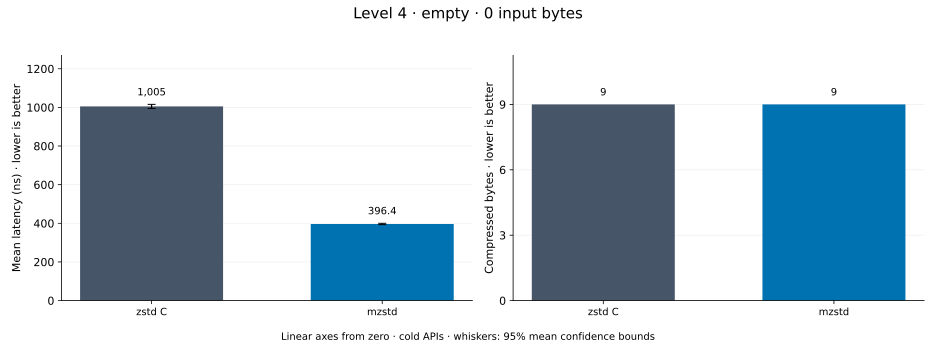
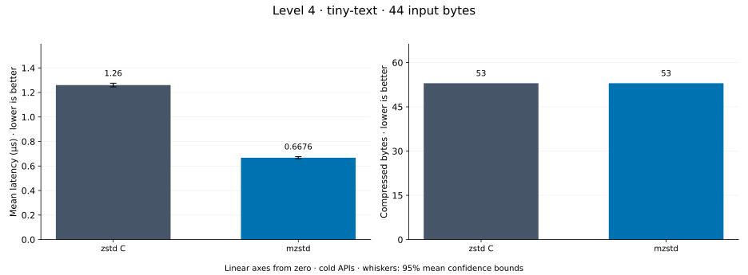
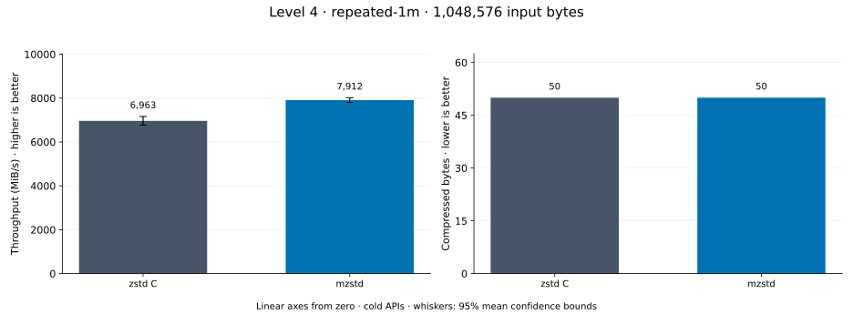
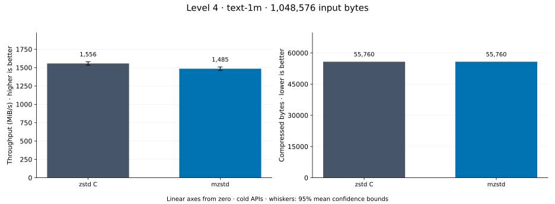
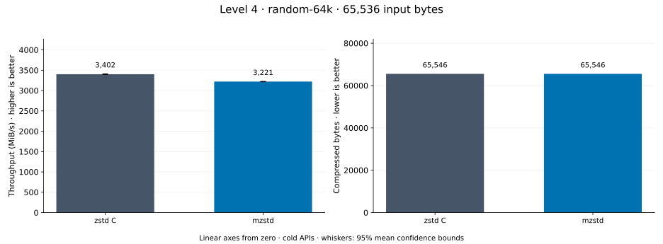
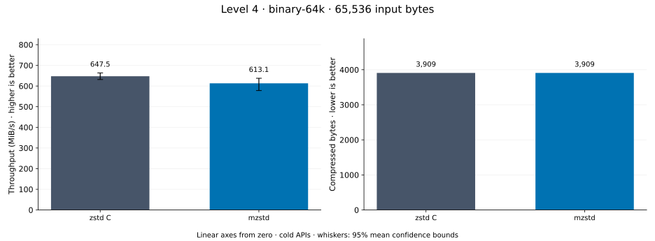
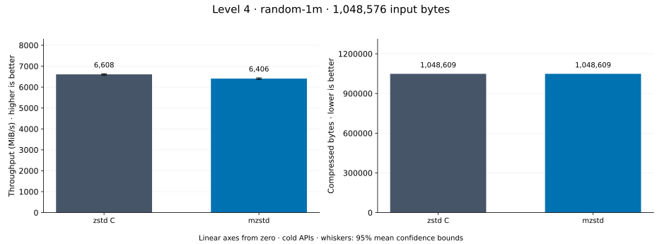
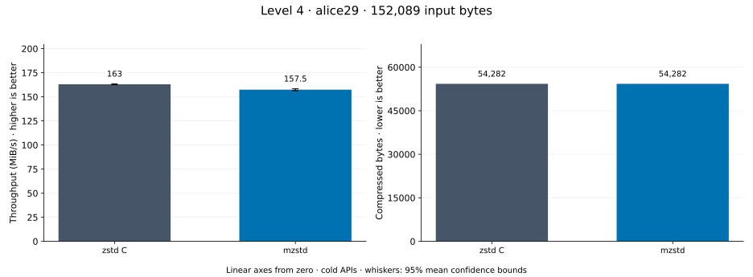

# Compression level 4

[Benchmark index](../README.md) · [Median overview](README.md) · [← Level 3](l3.md) · [Level 5 →](l5.md)

Recorded run: **full-20261030** (2026-10-30).
[Raw results](../encoder-comparison.csv) · [Environment](../encoder-comparison-environment.json) · [Run analysis](../encoder-comparison.md).

## Median across all datasets

Each of the 8 datasets has equal weight, including empty and tiny input.
Speed / C = C mean latency / implementation mean latency; output / C = implementation bytes / C bytes.
We take the median of these 8 per-dataset ratios separately for speed and size.
1× matches C; higher speed and lower output are better. These are medians across datasets,
not median sample latencies, and do not imply statistical significance.

| Implementation | Median speed / C ↑ | Median output / C ↓ | Datasets |
| --- | ---: | ---: | ---: |
| zstd C | 1.000× | 1.000× | 8 |
| mzstd main | 1.131× | 1.000× | 8 |
| mzstd | 1.127× | 1.000× | 8 |

mzstd main is the same matrix measured on `0a4fd87` in a process beside this run's; its ratios use that run's C timings.

Measurement setup and interpretation

zstd 1.5.7 (the C library built by `zstd-ffi`) and mzstd at the recorded
working tree compress identical bytes at this level. Every frame was checked byte-identical
to zstd's and decoded back to its input before any timing.

These are cold native API measurements: construction, allocation, compression, and disposal.
Complete known input; 20 samples, 0.5 s warmup, at least 1 s measurement.
Host: AMD Ryzen 9 7950X, Linux KVM guest with two dedicated vCPUs: the working tree's Criterion process pinned to vCPU 0 and the main branch's to vCPU 1, side by side; nothing else ran. unset; Cargo release defaults (bench profile), runtime SIMD dispatch (AVX-512 level on this host; the decoder runs its block loops at the AVX2 level).

Chart whiskers and table intervals describe 95% confidence bounds on mean timing.
They do not capture all host or allocator variation. Throughput bounds are transformed latency bounds.
Output / input is compressed bytes divided by input bytes; smaller is better, and values above 100% mean expansion.
For empty input, throughput and output / input are undefined (—).
See the [run analysis](../encoder-comparison.md#interpretation-limits) for measurement limitations.

## Dataset details

Ordered by mzstd speed / C, highest first; all 8 datasets are shown.
This order uses recorded mean latency, not statistical significance. Bars start at zero.

[empty](#empty) · [tiny-text](#tiny-text) · [repeated-1m](#repeated-1m) · [text-1m](#text-1m) · [random-64k](#random-64k) · [binary-64k](#binary-64k) · [random-1m](#random-1m) · [alice29](#alice29)

### empty

Empty input; measures API overhead. **Input: 0 bytes.**

mzstd speed / C: **10.096×**; output: 9 / 9 bytes.
mzstd main speed / C: 10.244× (separate run).

Exact measurements and confidence bounds

| Implementation | Mean, ns | 95% mean interval, ns | MiB/s | Output bytes | Output / input | Speed / C |
| --- | ---: | ---: | ---: | ---: | ---: | ---: |
| zstd C | 2,058 | 2,048–2,069 | — | 9 | — | 1.000× |
| mzstd | 203.8 | 200.7–208.1 | — | 9 | — | 10.096× |

### tiny-text

44-byte quick-brown-fox sentence. **Input: 44 bytes.**

mzstd speed / C: **5.773×**; output: 53 / 53 bytes.
mzstd main speed / C: 5.542× (separate run).

Exact measurements and confidence bounds

| Implementation | Mean, µs | 95% mean interval, µs | MiB/s | Output bytes | Output / input | Speed / C |
| --- | ---: | ---: | ---: | ---: | ---: | ---: |
| zstd C | 2.369 | 2.357–2.382 | 17.71 | 53 | 120.455% | 1.000× |
| mzstd | 0.4104 | 0.4087–0.4119 | 102.24 | 53 | 120.455% | 5.773× |

### repeated-1m

1 MiB of repeated a bytes. **Input: 1,048,576 bytes.**

mzstd speed / C: **2.964×**; output: 50 / 50 bytes.
mzstd main speed / C: 2.270× (separate run).

Exact measurements and confidence bounds

| Implementation | Mean, µs | 95% mean interval, µs | MiB/s | Output bytes | Output / input | Speed / C |
| --- | ---: | ---: | ---: | ---: | ---: | ---: |
| zstd C | 148.2 | 147.9–148.7 | 6,749.27 | 50 | 0.005% | 1.000× |
| mzstd | 49.98 | 49.89–50.08 | 20,008.02 | 50 | 0.005% | 2.964× |

### text-1m

Alice text repeated cyclically to 1 MiB. **Input: 1,048,576 bytes.**

mzstd speed / C: **1.132×**; output: 55,760 / 55,760 bytes.
mzstd main speed / C: 1.118× (separate run).

Exact measurements and confidence bounds

| Implementation | Mean, µs | 95% mean interval, µs | MiB/s | Output bytes | Output / input | Speed / C |
| --- | ---: | ---: | ---: | ---: | ---: | ---: |
| zstd C | 643.7 | 643.2–644.3 | 1,553.54 | 55,760 | 5.318% | 1.000× |
| mzstd | 568.6 | 567.6–569.6 | 1,758.81 | 55,760 | 5.318% | 1.132× |

### random-64k

64 KiB prefix of the deterministic pseudorandom corpus. **Input: 65,536 bytes.**

mzstd speed / C: **1.122×**; output: 65,546 / 65,546 bytes.
mzstd main speed / C: 1.144× (separate run).

Exact measurements and confidence bounds

| Implementation | Mean, µs | 95% mean interval, µs | MiB/s | Output bytes | Output / input | Speed / C |
| --- | ---: | ---: | ---: | ---: | ---: | ---: |
| zstd C | 16.39 | 16.37–16.42 | 3,812.98 | 65,546 | 100.015% | 1.000× |
| mzstd | 14.61 | 14.59–14.64 | 4,277.11 | 65,546 | 100.015% | 1.122× |

### binary-64k

64 KiB of structured binary bytes: ((i / 16) XOR i) modulo 256. **Input: 65,536 bytes.**

mzstd speed / C: **1.078×**; output: 3,909 / 3,909 bytes.
mzstd main speed / C: 1.090× (separate run).

Exact measurements and confidence bounds

| Implementation | Mean, µs | 95% mean interval, µs | MiB/s | Output bytes | Output / input | Speed / C |
| --- | ---: | ---: | ---: | ---: | ---: | ---: |
| zstd C | 95.72 | 95.59–95.92 | 652.96 | 3,909 | 5.965% | 1.000× |
| mzstd | 88.75 | 88.67–88.83 | 704.19 | 3,909 | 5.965% | 1.078× |

### random-1m

1 MiB of deterministic xorshift64 pseudorandom bytes. **Input: 1,048,576 bytes.**

mzstd speed / C: **0.972×**; output: 1,048,609 / 1,048,609 bytes.
mzstd main speed / C: 1.011× (separate run).

Exact measurements and confidence bounds

| Implementation | Mean, µs | 95% mean interval, µs | MiB/s | Output bytes | Output / input | Speed / C |
| --- | ---: | ---: | ---: | ---: | ---: | ---: |
| zstd C | 120.3 | 120.1–120.5 | 8,315.71 | 1,048,609 | 100.003% | 1.000× |
| mzstd | 123.7 | 123.7–123.8 | 8,081.63 | 1,048,609 | 100.003% | 0.972× |

### alice29

Alice in Wonderland text from the Canterbury corpus (`testdata/alice29.txt`). **Input: 152,089 bytes.**

mzstd speed / C: **0.961×**; output: 54,282 / 54,282 bytes.
mzstd main speed / C: 0.963× (separate run).

Exact measurements and confidence bounds

| Implementation | Mean, µs | 95% mean interval, µs | MiB/s | Output bytes | Output / input | Speed / C |
| --- | ---: | ---: | ---: | ---: | ---: | ---: |
| zstd C | 915.1 | 913.3–917.5 | 158.51 | 54,282 | 35.691% | 1.000× |
| mzstd | 952.3 | 951.9–952.8 | 152.30 | 54,282 | 35.691% | 0.961× |

