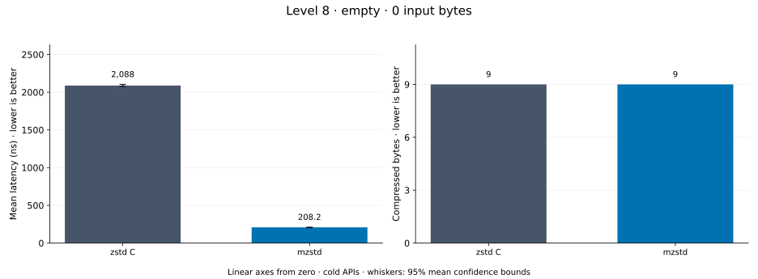
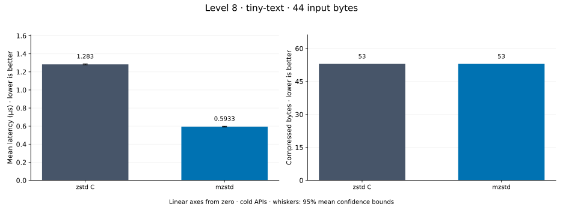
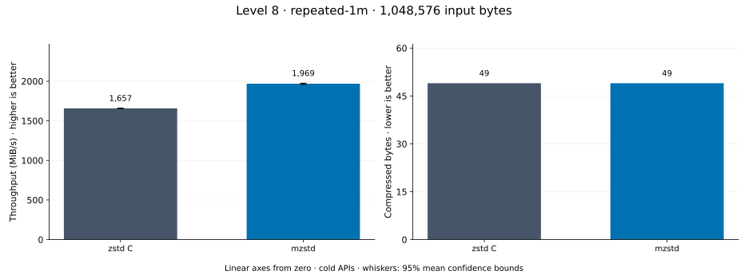
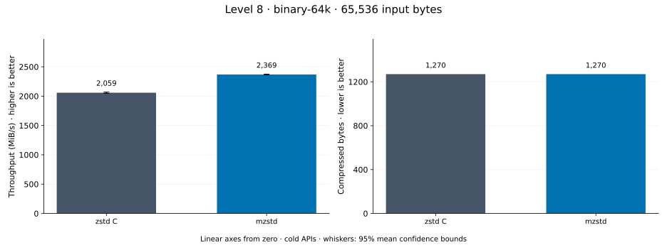
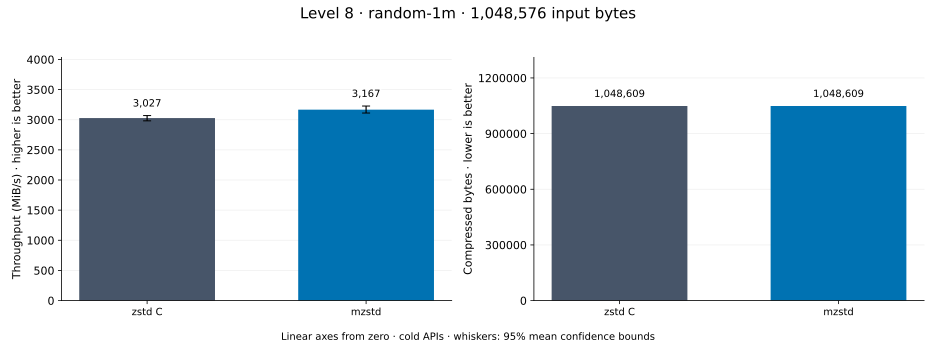
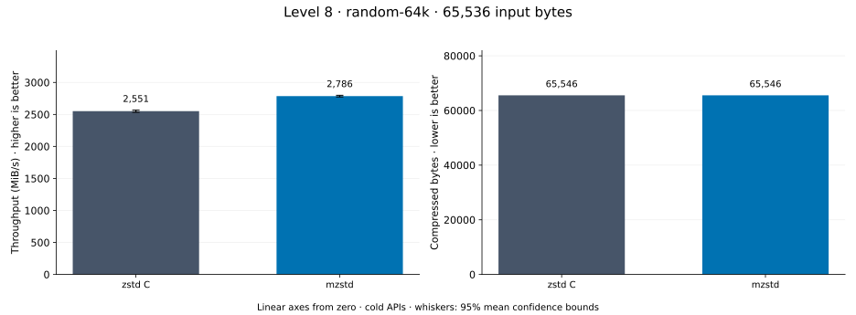
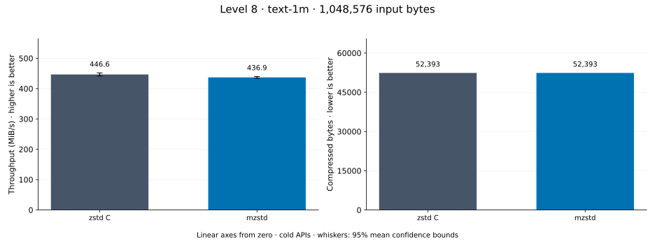
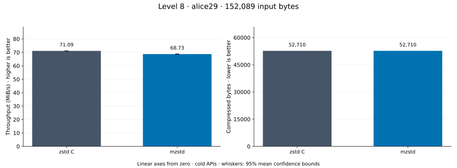

# Compression level 8

[Benchmark index](../README.md) · [Median overview](README.md) · [← Level 7](l7.md) · [Level 9 →](l9.md)

Recorded run: **full-20261030** (2026-10-30).
[Raw results](../encoder-comparison.csv) · [Environment](../encoder-comparison-environment.json) · [Run analysis](../encoder-comparison.md).

## Median across all datasets

Each of the 8 datasets has equal weight, including empty and tiny input.
Speed / C = C mean latency / implementation mean latency; output / C = implementation bytes / C bytes.
We take the median of these 8 per-dataset ratios separately for speed and size.
1× matches C; higher speed and lower output are better. These are medians across datasets,
not median sample latencies, and do not imply statistical significance.

| Implementation | Median speed / C ↑ | Median output / C ↓ | Datasets |
| --- | ---: | ---: | ---: |
| zstd C | 1.000× | 1.000× | 8 |
| mzstd main | 1.327× | 1.000× | 8 |
| mzstd | 1.324× | 1.000× | 8 |

mzstd main is the same matrix measured on `0a4fd87` in a process beside this run's; its ratios use that run's C timings.

Measurement setup and interpretation

zstd 1.5.7 (the C library built by `zstd-ffi`) and mzstd at the recorded
working tree compress identical bytes at this level. Every frame was checked byte-identical
to zstd's and decoded back to its input before any timing.

These are cold native API measurements: construction, allocation, compression, and disposal.
Complete known input; 20 samples, 0.5 s warmup, at least 1 s measurement.
Host: AMD Ryzen 9 7950X, Linux KVM guest with two dedicated vCPUs: the working tree's Criterion process pinned to vCPU 0 and the main branch's to vCPU 1, side by side; nothing else ran. unset; Cargo release defaults (bench profile), runtime SIMD dispatch (AVX-512 level on this host; the decoder runs its block loops at the AVX2 level).

Chart whiskers and table intervals describe 95% confidence bounds on mean timing.
They do not capture all host or allocator variation. Throughput bounds are transformed latency bounds.
Output / input is compressed bytes divided by input bytes; smaller is better, and values above 100% mean expansion.
For empty input, throughput and output / input are undefined (—).
See the [run analysis](../encoder-comparison.md#interpretation-limits) for measurement limitations.

## Dataset details

Ordered by mzstd speed / C, highest first; all 8 datasets are shown.
This order uses recorded mean latency, not statistical significance. Bars start at zero.

[empty](#empty) · [tiny-text](#tiny-text) · [repeated-1m](#repeated-1m) · [binary-64k](#binary-64k) · [random-1m](#random-1m) · [random-64k](#random-64k) · [text-1m](#text-1m) · [alice29](#alice29)

### empty

Empty input; measures API overhead. **Input: 0 bytes.**

mzstd speed / C: **10.028×**; output: 9 / 9 bytes.
mzstd main speed / C: 10.556× (separate run).

Exact measurements and confidence bounds

| Implementation | Mean, ns | 95% mean interval, ns | MiB/s | Output bytes | Output / input | Speed / C |
| --- | ---: | ---: | ---: | ---: | ---: | ---: |
| zstd C | 2,088 | 2,076–2,103 | — | 9 | — | 1.000× |
| mzstd | 208.2 | 205.5–210.4 | — | 9 | — | 10.028× |

### tiny-text

44-byte quick-brown-fox sentence. **Input: 44 bytes.**

mzstd speed / C: **5.750×**; output: 53 / 53 bytes.
mzstd main speed / C: 5.188× (separate run).

Exact measurements and confidence bounds

| Implementation | Mean, µs | 95% mean interval, µs | MiB/s | Output bytes | Output / input | Speed / C |
| --- | ---: | ---: | ---: | ---: | ---: | ---: |
| zstd C | 2.361 | 2.344–2.379 | 17.77 | 53 | 120.455% | 1.000× |
| mzstd | 0.4106 | 0.4082–0.4136 | 102.20 | 53 | 120.455% | 5.750× |

### repeated-1m

1 MiB of repeated a bytes. **Input: 1,048,576 bytes.**

mzstd speed / C: **2.530×**; output: 49 / 49 bytes.
mzstd main speed / C: 2.267× (separate run).

Exact measurements and confidence bounds

| Implementation | Mean, µs | 95% mean interval, µs | MiB/s | Output bytes | Output / input | Speed / C |
| --- | ---: | ---: | ---: | ---: | ---: | ---: |
| zstd C | 510.5 | 509.5–511.5 | 1,959.05 | 49 | 0.005% | 1.000× |
| mzstd | 201.8 | 201–202.6 | 4,956.01 | 49 | 0.005% | 2.530× |

### binary-64k

64 KiB of structured binary bytes: ((i / 16) XOR i) modulo 256. **Input: 65,536 bytes.**

mzstd speed / C: **1.369×**; output: 1,270 / 1,270 bytes.
mzstd main speed / C: 1.407× (separate run).

Exact measurements and confidence bounds

| Implementation | Mean, µs | 95% mean interval, µs | MiB/s | Output bytes | Output / input | Speed / C |
| --- | ---: | ---: | ---: | ---: | ---: | ---: |
| zstd C | 31.93 | 31.88–32.01 | 1,957.34 | 1,270 | 1.938% | 1.000× |
| mzstd | 23.33 | 23.3–23.37 | 2,678.78 | 1,270 | 1.938% | 1.369× |

### random-1m

1 MiB of deterministic xorshift64 pseudorandom bytes. **Input: 1,048,576 bytes.**

mzstd speed / C: **1.279×**; output: 1,048,609 / 1,048,609 bytes.
mzstd main speed / C: 1.173× (separate run).

Exact measurements and confidence bounds

| Implementation | Mean, µs | 95% mean interval, µs | MiB/s | Output bytes | Output / input | Speed / C |
| --- | ---: | ---: | ---: | ---: | ---: | ---: |
| zstd C | 283.4 | 280.2–286 | 3,528.39 | 1,048,609 | 100.003% | 1.000× |
| mzstd | 221.6 | 220.5–223 | 4,513.19 | 1,048,609 | 100.003% | 1.279× |

### random-64k

64 KiB prefix of the deterministic pseudorandom corpus. **Input: 65,536 bytes.**

mzstd speed / C: **1.093×**; output: 65,546 / 65,546 bytes.
mzstd main speed / C: 1.247× (separate run).

Exact measurements and confidence bounds

| Implementation | Mean, µs | 95% mean interval, µs | MiB/s | Output bytes | Output / input | Speed / C |
| --- | ---: | ---: | ---: | ---: | ---: | ---: |
| zstd C | 23.65 | 23.63–23.69 | 2,642.23 | 65,546 | 100.015% | 1.000× |
| mzstd | 21.64 | 21.56–21.75 | 2,888.07 | 65,546 | 100.015% | 1.093× |

### text-1m

Alice text repeated cyclically to 1 MiB. **Input: 1,048,576 bytes.**

mzstd speed / C: **1.060×**; output: 52,393 / 52,393 bytes.
mzstd main speed / C: 1.038× (separate run).

Exact measurements and confidence bounds

| Implementation | Mean, µs | 95% mean interval, µs | MiB/s | Output bytes | Output / input | Speed / C |
| --- | ---: | ---: | ---: | ---: | ---: | ---: |
| zstd C | 2,126 | 2,124–2,129 | 470.32 | 52,393 | 4.997% | 1.000× |
| mzstd | 2,006 | 2,005–2,007 | 498.50 | 52,393 | 4.997% | 1.060× |

### alice29

Alice in Wonderland text from the Canterbury corpus (`testdata/alice29.txt`). **Input: 152,089 bytes.**

mzstd speed / C: **0.967×**; output: 52,710 / 52,710 bytes.
mzstd main speed / C: 0.958× (separate run).

Exact measurements and confidence bounds

| Implementation | Mean, µs | 95% mean interval, µs | MiB/s | Output bytes | Output / input | Speed / C |
| --- | ---: | ---: | ---: | ---: | ---: | ---: |
| zstd C | 2,040 | 2,039–2,042 | 71.09 | 52,710 | 34.657% | 1.000× |
| mzstd | 2,110 | 2,108–2,114 | 68.73 | 52,710 | 34.657% | 0.967× |

